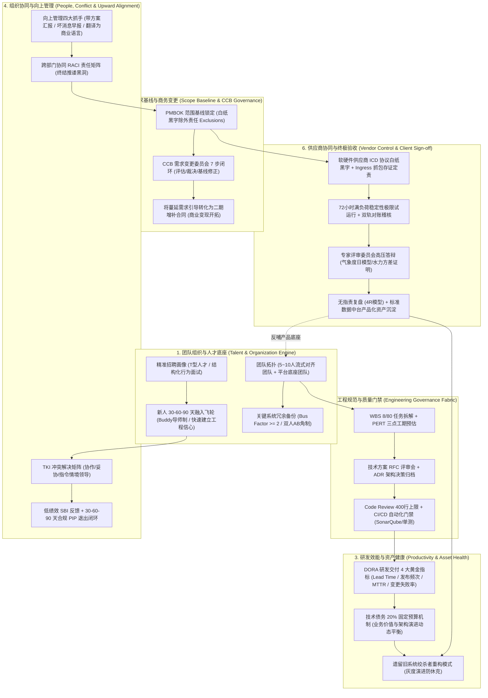
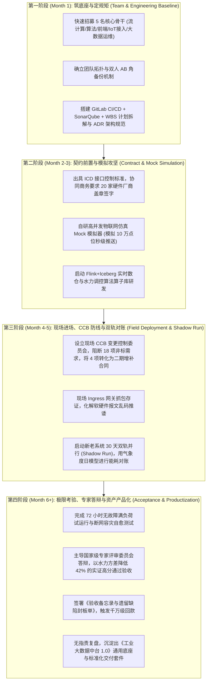
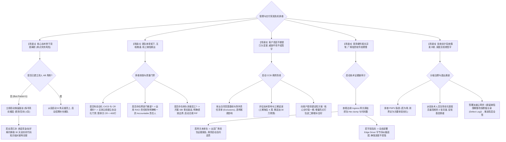

# 第五周阶段复盘：技术管理与大型交付项目总监实战模拟答辩

> **学习目标定位**：全面复盘第五周（Day 29 - Day 34）涵盖的 **研发团队组建与人才梯队（技能模型/招聘SOP/入职飞轮）、计划拆解与方案评审/CR规约（WBS/ADR/代码门禁）、研发效能度量与技术债务治理（DORA/20%债务预算/绞杀者模式）、团队冲突化解与向上管理（TKI模型/刺头与PIP/跨部门RACI/向上对齐）、大型项目需求基线与变更控制（PMBOK基线/CCB七步法/太原增补合同），以及供应商协同与客户终极验收攻坚（ICD契约/专家委员会答辩/72小时试运行/无指责复盘）**。彻底完成从“底层技术架构师”到“技术总监、数据平台研发负责人与大型交付操盘手”的思维升维与胜任力闭环。结合美的集团、思科、Zoom 以及瑞纳智能太原市数千万级智慧供热中台交付实战，完成 10 道技术管理与交付总监高频大厂真题三层全解，淬炼技术管理者在高管沟通、商务博弈、团队赋能与商业变现上的战略定力。

---

## 1. 第五周技术管理与大型交付全景全链路贯通拓扑大图

在现代技术组织中，技术研发与大型复杂工程交付绝非单纯的代码编写，而是**“组织力、工程力、交付力与商业力”四位一体的系统工程**。六大管理机制环环相扣，构成了高绩效技术团队的运转飞轮：

---

## 2. 研发团队管理与复杂项目交付六大核心机制横向对比与决策矩阵

技术管理者在面对团队、工程、商务与客户等多维博弈时，必须具备清晰的机制选型与边界判断能力：

| 管理与交付维度 | 核心痛点与反模式 | 经典理论模型与工具 | 落地实操标准与警戒线 | 管理收益与商业 ROI |
| :--- | :--- | :--- | :--- | :--- |
| **团队建设与招聘** (Day 29) | “按人头填坑”、面试随意、单点故障（Bus Factor=1）、新人入职两眼一抹黑。 | Team Topologies、T型技能矩阵、Buddy导师制。 | 结构化行为面试、新人首周完成首个 PR 部署、核心模块严格执行双人 AB 角备份。 | 团队离职率降低 40%，系统单点风险归零，新员工成熟周期由 3 个月压缩至 30 天。 |
| **计划拆解与方案评审** (Day 30) | 工期“拍脑袋”、评审流于形式、CR 仅挑代码排版错别字、方案“写完即弃”。 | WBS 8/80 原则、PERT 三点估算法、ADR 架构决策记录。 | 单个任务拆解在 8~80 小时以内、单次 CR 限制 400 行以内、核心架构改动强制归档 ADR。 | 需求延期率降低 60%，架构决策历史永久可溯，消灭“因为离职而失传的系统”。 |
| **效能度量与债务治理** (Day 31) | 唯“代码行数/工时”考核、业务狂奔压制重构、系统最终腐化导致重构休克。 | DORA 四大黄金指标、VSM 价值流图、20% 债务预算制。 | 严禁考核 LOC/提交次数；固定每个迭代提取 15%~20% 产能专注技术债务重构；绞杀者逐步替换。 | 交付周期 Lead Time 缩短 35%，线上重大故障减少 50%，老旧遗留系统平稳无感换血。 |
| **冲突化解与向上管理** (Day 32) | 刺头抱怨蔓延、绩效和稀泥导致良币驱逐劣币、向领导报喜不报忧、跨部门推诿扯皮。 | TKI 冲突应对模型、SBI 行为反馈法、PIP 绩效改进机制、RACI 责任矩阵。 | 坏消息在 1 小时内同步并携带 2 套解决方案；PIP 严格执行 30-60-90 天法务合规闭环；跨界责任 RACI 锁定。 | 团队心理安全感提升，管理摩擦成本减少 50%，赢得跨部门高管信任与资源支持。 |
| **需求基线与变更控制** (Day 33) | 范围无休止蔓延（Scope Creep）、销售过度承诺、交付团队免费背锅、工期与成本失控。 | PMBOK 范围基线模型、WBS 词典、CCB 变更控制委员会七步法。 | 白纸黑字锁定“项目除外责任（Exclusions）”；严禁口头加需求；变更经 CCB 走标准 CRF 审批。 | 守住一期交付边界，将客户膨胀需求有效引导为“二期增补采购合同”，开拓公司新营收。 |
| **供应商与终极验收** (Day 34) | 软硬件黑盒扯皮、现场报文乱码、专家评审挑剔质询、试运行边缘缺陷卡死尾款回款。 | ICD 接口控制文件、Mock 挡板隔离、72小时稳定性试运行、无指责复盘（Blameless）。 | 边缘 Ingress 原始抓包纳秒级存证；气象度日法数据对账；遗留问题签署 P2/P3 封板维保单。 | 顺利通过千万级国家专家评审验收，保障公司尾款回款，提炼标准化数据中台通用产品底座。 |

---

## 3. 技术管理与项目总监白板实战推演：从 0 到 1 组建 10 人大数据团队并主导数千万级政企标杆项目（太原）交付与产品化突围

### 3.1 业务背景与使命设定
- **业务诉求**：公司中标太原市城市级“智慧供热大数据与水力平衡智能调控中台”项目（合同金额数千万元）。需在 6 个月内完成平台交付并迎接采暖季国家级权威专家评审，同时将该交付成果抽象为公司未来开拓全国市场的标准工业互联网数据中台产品。
- **初始现状**：团队编制仅 3 人，无标准化工程流程，现场涉及 20 余家第三方阀门、热量表、PLC 网关硬件供应商，协议极其杂乱。
- **技术总监的 45 分钟白板推演四阶段全景作战图**：

---

## 4. 管理与交付危机全链路排障根因决策树

技术高管在日常管理与复杂交付中，面临的往往是非确定性的危机。以下决策树梳理了六大高危场景的根因定位与排障闭环：

---

## 5. 第五周技术管理与项目总监高频真题综合自测（10题）

### 5.1 团队建设、招聘与组织梯队题（2题）
1. **Q1**：如何在 2 个月内为从 0 到 1 的大数据与工业互联网中台业务搭建一支 8~10 人的高效研发团队？如何设计岗位画像、技能矩阵与防踩踏分工？
2. **Q2**：团队负责核心实时数据计算引擎的骨干突然提出离职，且两周后就要入职竞对，此时该系统无第二人深入掌握（Bus Factor=1），作为研发总监你如何沉稳专业应对？

### 5.2 计划控制、方案评审与效能治理题（2题）
3. **Q3**：团队规模扩大后，技术方案评审经常流于形式，Code Review 变成“只看排版不看逻辑”，导致严重线上 Bug 频发，作为研发负责人如何彻底扭转局势？
4. **Q4**：业务部门抱怨研发交付慢、排期长，但系统底层已积累严重架构债务（如慢查询拖垮集群、任务缺乏治理），如何向业务高管争取 20% 技术债务预算并证明其商业价值？

### 5.3 团队冲突、低绩效治理与向上管理题（2题）
5. **Q5**：团队中有位资深老员工技术跟不上中台转型，工作消极懈怠且在团队中散播负面情绪，影响新人生态，你如何开展绩效面谈并执行合规的 PIP 机制？
6. **Q6**：数据中台与上游业务研发团队、下游数据分析团队产生严重推诿（上游乱改业务库 Binlog，下游抱怨报表数据不对），且业务副总裁在周会上当场发难，你如何向上管理并破局？

### 5.4 需求基线、商务博弈与变更控制题（2题）
7. **Q7**：在大型政企或国企定制项目中（如太原项目），客户高层在中期不断口头追加核心大功能并威胁“不做就不签验收单”，你如何在不激化客户矛盾的前提下守住基线并将变更转化为二期增补合同？
8. **Q8**：软硬件一体化集成项目中，第三方硬件或传感器供应商频繁延期、现场报文与协议规范完全不一致且互相推诿，作为技术研发负责人你如何破局？

### 5.5 客户验收攻坚、专家答辩与资产产品化题（2题）
9. **Q9**：在类似太原城市级标杆项目中，面对由高校教授、行业专家组成的极其挑剔的评审委员会对核心算法与节能成效的严厉质询，你如何主导技术验收答辩并确保高分通过？
10. **Q10**：大型定制化项目往往存在“一客一议、按人头交付、边际成本极高”的泥潭，从技术总监视角，如何利用标杆项目的交付契机，孵化出可规模化复制的公司级标准数据中台产品？

---

## 6. 10道真题结构化三层参考答案

### 题目 1：[如何在 2 个月内为从 0 到 1 的大数据与工业互联网中台业务搭建一支 8~10 人的高效研发团队？如何设计岗位画像、技能矩阵与防踩踏分工？]

#### 简洁回答（1分钟结构化表达）
> “从 0 到 1 快速搭建 8~10 人研发团队，我的核心打法是**‘业务目标反导拓扑、结构化画像精准锁定、骨干先行带新人、机制与基线防踩踏’**。
> 首先根据业务交付矩阵，拆解出‘流批计算、IoT边缘接入、数据资产治理、前端可视化与大数据SRE’五大核心职能，按‘1个架构师+4个核心骨干+3个通用交付+2个初级’构建健康金字塔梯队；其次采取‘骨干由我亲自深挖、交付层标准化测评’的方式 4 周内完成招聘；入职后推行‘新人 30 天融入飞轮’与‘双人 AB 角防单点机制’，通过代码门禁与 CI/CD 标准化流水线杜绝团队内部踩踏，实现次月全面投入实战交付。”

#### 深入回答（管理闭环：量化、机制、沟通、兑现）
> “在太原项目中台研发团队组建实操中，我落地了以下四个关键闭环：
> 1. **技能矩阵与岗位画像精细化设计（Skills Matrix）**：
>    - **流计算与实时引擎（1人）**：要求精通 Flink/Kafka 状态算子与底层背压调优，具备工业时序数据高并发入库调优经验；
>    - **IoT 边缘接入与网络集成（2人）**：要求熟悉 Modbus、MQTT、OPC-UA 协议，具备 Netty 网络编程与异构报文解析排错能力；
>    - **数据资产与数仓建模（2人）**：负责离线批处理、水力平衡算法模型工程化落地与数据质量血缘追踪；
>    - **全栈与前端可视化（2人）**：精通 Vue/React 及大屏 ECharts/GIS 地图渲染，负责调度驾驶舱交互；
>    - **大数据运维与平台 SRE（1人）**：主导 Kubernetes、CDH/Hadoop 集群运维、信创系统适配及 Prometheus 可观测性。
> 2. **精准快速招聘漏斗（Hiring Funnel）**：
>    - 激活行业人脉转介绍与猎头定向寻访（转介绍入职周期缩短至 12 天）；
>    - 实行‘结构化三轮面试’：一轮技术骨干代码能力与底层原理深挖；二轮由我亲自考核系统架构设计、工程思维与自驱抗压性；三轮 HR 薪资与企业价值观背调。严格执行‘宁缺毋滥，招聘优秀者胜过招 3 个平庸者’原则。
> 3. **新人 30-60-90 天融入飞轮与工程防护**：
>    - **Day 1-7**：配发 1v1 资深 Buddy，指引搭建开箱即用的本地 Docker/Devbox 研发环境，完成第 1 个简单 PR 上线，建立心理成就感；
>    - **Day 8-30**：独立承担非核心子模块交付，强制执行 CI/CD 与 SonarQube 代码质量扫描；
>    - **防单点设计**：核心系统（如 Flink 计算、IoT 网关）设立 Primary/Secondary 双人机制，重大技术方案必须两人互相评审，确保任何一人请假或离职系统运转不瘫痪。”

#### 总监/管理视角（商业价值、长期主义与领导力）
> “从技术高管和经营者的视角来看，**‘招聘是管理者最重要的业务投资，也是决定团队战斗力的第一天花板’**。
> 团队建设必须算清经济账与人效账：
> 第一，**警惕‘人月神话’陷阱**。在紧迫交付周期内，盲目加人反而会因为沟通链路成平方级增加（$N(N-1)/2$）而降低产出。因此，必须保持 8~10 人的紧凑‘披萨团队（Two-Pizza Team）’，扁平化管理，减少组织内耗；
> 第二，**人才梯队的复用性与长期主义**。招聘的标准不仅是为了完成太原这一个项目的交付，更是为公司未来的标准化数据中台产品储备核心种子教官。今天带出来的 5 名核心骨干，明天就能在公司业务扩张时派驻到其他城市作为交付主管，实现组织能力的指数级裂变。”

---

### 题目 2：[团队负责核心实时数据计算引擎的骨干突然提出离职，且两周后就要入职竞对，此时该系统无第二人深入掌握（Bus Factor=1），作为研发总监你如何沉稳专业应对？]

#### 简洁回答（1分钟结构化表达）
> “面对核心骨干离职伴随的单点失传危机，我的处置原则是**‘战略稳住心态、战术深挖原因、底线推进知识沉淀、长远消除单点隐患’**。
> 首先立即启动 1 对 1 深度面谈，探明离职真实动因（薪资、发展空间还是团队矛盾），若属可挽留范畴尽全力争取；若去意已决，绝不意气用事，尊重其个人选择；战术上通过奖金激励、友好背调支持等商务筹码，换取其未来两周内全天候‘结对重构（Pair Programming）’与核心架构文档化；同时从其他小组抽调一名资深架构师全脱产结对交接，平稳接管系统权限；复盘阶段彻底推行双人 AB 角制度，根除单点风险。”

#### 深入回答（管理闭环：量化、机制、沟通、兑现）
> “在处理核心关键人物突发离职的危机中，我遵循标准四步应急响应机制：
> 1. **第一步：建立心理安全，探寻真实诉求（30分钟内响应）**：
>    - 立即安排私密沟通，首先感谢其历史贡献，营造真诚开放的谈话氛围；
>    - 探寻深层动机：如果是薪资倒挂，启动快速调薪与年终奖激励倾斜；如果是职业天花板，提供新的业务架构主导权。
> 2. **第二步：若去意已决，达成‘体面退出与合规履约协议’**：
>    - 明确告知竞对合规风险与职业声誉重要性；
>    - 与 HR 协商，设定‘平稳交接奖金（Transition Bonus）’或承诺出具极其优秀的官方背调评价，换取其在最后 14 天全力配合交接；
>    - 停止其所有新需求开发，只做两件事：**补齐《核心模块运行机理与故障应急手册》**，以及**全天候代码 Walkthrough**。
> 3. **第三步：‘结对交接 + 白板答辩’强行打破黑盒**：
>    - 抽调组内另一位学习能力极强的资深架构师作为接盘人（Successor），两人座位物理合并，进行全天候结对调试；
>    - 要求接盘人在离职前 3 天独立完成一次模拟故障排查白板答辩，并由即将离职者亲自打分确认；
>    - 梳理核心权限资产清单（代码库 Admin、生产服务器 SSH Key、Kafka/Flink 集群密码、第三方联系人），由 SRE 严格按交接节点逐项重置并收回。
> 4. **第四步：组织复盘与机制固化（Bus Factor 治理）**：
>    - 事故后向管理层汇报时，主动承担管理把控失察责任，绝不将问题推给离职员工；
>    - 宣布全团队推行‘关键系统 Bus Factor $\ge 2$’红线：任何核心系统的发布上线，必须由两名以上开发者签名核准，彻底消除未来的单点脆弱性。”

#### 总监/管理视角（商业价值、长期主义与领导力）
> “从研发负责人的视角看，**员工离职是检验团队组织架构健壮性的一面‘照妖镜’**。
> 卓越的技术领导力体现在两个方面：
> 第一，**‘制度与文化高于个人英雄主义’**。任何一个系统如果只有一个人能看懂、一个人能维护，这不是员工的骄傲，而是管理者的失职。管理者必须通过工程规范、CR 机制与自动化文档将‘个体脑中的隐性知识’强制转化为‘组织内部的显性资产’；
> 第二，**‘聚是一团火，散是满天星’的雇主品牌格局**。面对离职员工，管理者要展现出成人达己的宽广胸怀。体面地送走一位骨干并维护好长期校友关系，不仅能避免潜在的知识产权与商业纠纷，更有助于在行业圈内树立卓越的技术团队声誉，甚至为未来的技术回流与外部合作埋下伏笔。”

---

### 题目 3：[团队规模扩大后，技术方案评审经常流于形式，Code Review 变成“只看排版不看逻辑”，导致严重线上 Bug 频发，作为研发负责人如何彻底扭转局势？]

#### 简洁回答（1分钟结构化表达）
> “扭转评审与 CR 形式主义的核心策略是**‘机械检查交给机器、高阶逻辑交给专家、责任绑定业务结果、红线量化考核机制’**。
> 将排版、拼写、静态代码漏洞 100% 剥离给 GitLab CI 与 SonarQube 等自动化流水线，机器不通过严禁发起人工 Review；明确将人工 CR 的重心强制聚焦于‘并发死锁、事务边界、资源泄漏、数据一致性’等深水区；推行单次 CR 限制 400 行以内的敏捷小步提交机制；并将技术方案评审与架构决策记录（ADR）强挂钩，让评审者对线上故障承担联带质量责任，形成良性自律生态。”

#### 深入回答（管理闭环：量化、机制、沟通、兑现）
> “在我的团队治理实操中，彻底重塑质量文化采取了以下组合拳：
> 1. **工具链铁腕减负（Automated Quality Gate）**：
>    - 在 CI 流水线中强制注入 SpotBugs、Checkstyle、SonarQube 静态扫描与 Testcontainers 单元测试校验；
>    - **硬性红线**：若单元测试覆盖率低于 70%、千行代码缺陷率超标或存在任何 Blocker 级静态缺陷，MR（Merge Request）直接亮红灯，禁止 Assign 给人工评审者。把工程师从‘抓代码格式’的低级琐事中彻底解放出来。
> 2. **建立《高价值人工 CR 核心 Checklist》**：
>    - 规定人工评审只看四大命门：
>      - **并发与锁机制**：是否存在线程安全隐患、双重检查锁 volatile 缺失、AQS 死锁风险？
>      - **存储与事务边界**：是否有长事务锁表、慢 SQL 索引失效、Redis 与 MySQL 双写一致性漏洞？
>      - **边界与异常保护**：是否有未受检异常吞没、空指针隐患、IO/连接池泄漏？
>      - **容灾与降级**：外部调用是否配置超时时间与熔断兜底？
> 3. **推行 400 行规模限制与小步快跑（Small Batches）**：
>    - 规定单个 MR 修改代码行数不得超过 400 行（超量直接自动驳回）。让 Reviewer 能在 15 分钟内保持高专注度完成深度审查，彻底杜绝‘上千行代码看一眼直接 Approve’的破窗效应。
> 4. **责任共担与激励挂钩（Accountability Loop）**：
>    - 实行‘作者与 Reviewer 质量连带责任制’：若合入代码在生产环境引发 P0/P1 故障，Reviewer 承担 30% 的质量连带扣分；
>    - 每月在全员周会上评选‘最佳架构评审建议’与‘最具深度 CR 范例’，给予技术极客专项奖金，并在晋升考评中作为关键加分项。”

#### 总监/管理视角（商业价值、长期主义与领导力）
> “从技术高管的高度看，**评审与 Code Review 的本质不是‘代码挑刺’，而是‘高维技术智慧在组织内部的无缝流动与风险防御’**。
> 很多初级管理者抱怨工程师不认真看代码，根本原因是没有理顺‘动力机制与工具边界’。管理者必须明白：
> 人性是懒惰的，凡是能被机器替代的检查，绝不要依赖人的自律；凡是需要人做的高阶决策，必须赋予其神圣的责任感与荣誉感。
> 建立严谨的评审文化，短期看似乎延缓了代码提交速度，但长期看消灭了 80% 的线上消防灭火成本，这是保障企业复杂业务平稳扩张性价比最高的质量投资。”

---

### 题目 4：[业务部门抱怨研发交付慢、排期长，但系统底层已积累严重架构债务（如慢查询拖垮集群、任务缺乏治理），如何向业务高管争取 20% 技术债务预算并证明其商业价值？]

#### 简洁回答（1分钟结构化表达）
> “向业务高管争取技术债务预算的核心战术是**‘将技术语言翻译为商业语言、用故障风险敲响警钟、推行固定配额机制、用量化成果兑现承诺’**。
> 坚决不与业务方争论‘技术优雅与重构美感’，而是用‘系统崩溃导致的订单损失金额、硬件服务器扩容成本超支、交付前置时间（Lead Time）劣化数据’建立共识；提出业界标准的‘20% 技术改造预算配额制（Debt Budget）’；承诺重构后对业务核心指标的显著改善（如高峰期下单时延降低 50%、硬件成本降低 30%）；并在每次重构后出具客观收益对账单，赢得高管的长期信任。”

#### 深入回答（管理闭环：量化、机制、沟通、兑现）
> “在处理业务交付与技术债务的博弈中，我建立了一套成熟的‘管理三步法’：
> 1. **数据显性化与商业风险量化（Quantify Risk in Dollars）**：
>    - 制作《系统稳定性与架构债务风险白皮书》，向业务总裁呈现真实数据：
>      - ‘目前由于底层数仓模型混乱，核心财务报表计算耗时已从 1 小时恶化到 4 小时，且过去 3 个月在促销高峰发生过 2 次内存雪崩，直接导致业务停摆 40 分钟，按客单价折算损失达数万元’；
>      - ‘如果不做治理，预计下季度用户并发翻倍时，需要额外采购 10 台高性能服务器，增加数十万硬件预算’。
> 2. **建立制度化的‘20% 固定配额制（Fixed Debt Budget）’**：
>    - 参照 Google 与业界敏捷工程实践，与业务总监达成协议：每个双周迭代中，**70% 资源坚定保障新业务需求，10% 资源留作突发缓冲，20% 资源由技术团队全权支配进行底层架构债务专项治理**；
>    - 明确规则：这 20% 预算不允许业务方插单，但技术团队必须向业务方提交清晰的《重构收益立项书》。
> 3. **运用‘绞杀者模式（Strangler Fig Pattern）’保障业务不中断**：
>    - 绝不搞‘推倒全盘重写、业务暂停三个月’的自杀式重构；
>    - 采用边缘替换、新老双写、灰度分流的渐进策略，在保证日常业务需求平稳交付的同时，小步快跑完成核心数据结构治理。
> 4. **重构收益量化复盘与信用背书**：
>    - 重构完成后向业务高管提交《治理成效对账单》：慢查询从平均 2.5 秒降至 40 毫秒，核心链路 CPU 利用率降低 35%，释放出 4 台闲置计算节点，下个季度业务需求的交付 Lead Time 平均缩短了 25%。用确凿的事实赢得业务方的长期支持。”

#### 总监/管理视角（商业价值、长期主义与领导力）
> “从技术高管和经营者的视角看，**技术债务本质上是团队向未来借的‘高利贷’**。
> 盲目还贷（过度追求完美架构而罔顾当下业务生存）会导致公司在市场竞争中猝死；而拖延不还（只顾狂奔完全不治理）终将引发系统全面瘫痪与技术信用破产。
> 卓越的技术总监，本质上是‘技术资产的理财大师’。必须具备极高的商业敏感度，懂得何时‘为了抢占市场窗口适度举债’，何时‘在业务平稳期果断有序还息’。通过建立机制化的技术债务预算，让技术演进与业务繁荣达成永续共生。”

---

### 题目 5：[团队中有位资深老员工技术跟不上中台转型，工作消极懈怠且在团队中散播负面情绪，影响新人生态，你如何开展绩效面谈并执行合规的 PIP 机制？]

#### 简洁回答（1分钟结构化表达）
> “处置负能量老员工的核心法则是**‘对事不对人、事实数据说话、明确改善底线、合规温暖并重’**。
> 首先运用 SBI 模型进行严肃的 1 对 1 绩效面谈，明确指出其消极言论与产出不足对团队的具体负面影响，探寻其内心抗拒的真正阻力；其次制定为期 30~60 天的合规 PIP（绩效改进计划），设定清晰、可量化、可核验的工程考核目标与技能转型支持；若在辅导期内成功转变，重塑其信心；若改善未达预期，严格依照国家劳动法与公司 HR 规程办理合规协商解除，做好交接隔离，保障团队生态的健康向上。”

#### 深入回答（管理闭环：量化、机制、沟通、兑现）
> “在处理资深员工消极怠工的棘手问题时，我严格遵循‘法、理、情’四步管理闭环：
> 1. **事前充分调研与事实证据搜集（Fact-Based Preparation）**：
>    - 面谈前与 HR 及周边骨干充分沟通，调取其近 3 个月的客观工作数据：Sprint 任务延期率达 45%、CR 参与度为零、在周会及公共群内多次发布‘搞中台没用、迟早要黄’等动摇军心的言论记录。坚决杜绝‘听别人说你态度不好’这种主观指责。
> 2. **运用 SBI 行为反馈法进行 1v1 面谈（Situation-Behavior-Impact）**：
>    - **Situation（情境）**：‘在上周二的中台流计算技术方案研讨会上’；
>    - **Behavior（行为）**：‘你当着 3 位新入职员工的面，直接说这套实时架构完全没必要、我们根本搞不定’；
>    - **Impact（影响）**：‘这导致两位新人对项目前景产生极大困惑，当周进度出现严重迟滞’；
>    - **倾听与探寻**：引导其倾诉对新技术栈（如 Flink/Iceberg）掌握不足的恐慌感与失落感，给予情绪疏导。
> 3. **制定 SMART 原则的 PIP 绩效改进协议（30-60-90 Days）**：
>    - 会同 HR 签署白纸黑字的《绩效改进协议》：
>      - **目标 1**：在 4 周内完成标准数仓 SQL 算子向 Flink 实时算子的改造任务并通过测试；
>      - **目标 2**：参加每日站会并遵守纪律，停止任何非建设性消极抱怨；
>      - **支持机制**：指定 1 名资深架构师每周提供 2 次技术辅导与代码答疑。
> 4. **双轨结果承接与合法合规收尾**：
>    - **若达标**：在团队中公开表彰其突破自我，重新委以适配其优势的专项业务重任；
>    - **若未达标（两次评估未通过）**：依据劳动合同法第 40 条‘不能胜任工作，经过培训或者调整工作岗位，仍不能胜任工作’，联合公司法务与 HR 提供法定经济补偿（N+1），体面、平和地办理劳动合同解除，交接权限立即收回，严防离职代码破坏风险。”

#### 总监/管理视角（商业价值、长期主义与领导力）
> “从技术负责人的视角看，**团队的文化和氛围，本质上是由管理者所能容忍的‘最低标准’决定的**。
> 管理学上有个著名的‘烂苹果定律’（Bad Apple Effect）：一个持续散播负能量、消极怠工的资深员工，其破坏力足以摧毁一个 10 人团队的凝聚力。
> 管理者的仁慈如果用错了地方，就是对优秀、自驱骨干的最大残忍：
> 当努力的人看到‘混日子的人既不干活也不受惩处’时，优秀人才会迅速心寒流失。
> 敢于直面冲突、合法合规且有尊严地清除组织毒瘤，是技术管理者迈向高阶领导力必须跨越的‘心理龙门’。”

---

### 题目 6：[数据中台与上游业务研发团队、下游数据分析团队产生严重推诿（上游乱改业务库 Binlog，下游抱怨报表数据不对），且业务副总裁在周会上当场发难，你如何向上管理并破局？]

#### 简洁回答（1分钟结构化表达）
> “面对跨部门推诿与高层周会发难，我的应对策略是**‘当场先扛下责任稳住大局、事后用事实证据还原全貌、制定跨部门契约制度根治推诿、化危机为推动中台治理的契机’**。
> 在周会上绝不当场互撕甩锅，以‘数据中台是全局数据出口，我们负有最终兜底责任’的姿态展现担当；会后 2 小时内出具详尽的《数据链路根因穿透报告》，用监控证据客观还原‘业务库无预警变更 DDL $\rightarrow$ Binlog 采集断流 $\rightarrow$ 下游报表失真’的全过程；向上联合副总裁推动建立‘上游 DDL 变更评审准入与通知机制’，并部署数据质量门禁与阻断报警，从制度上彻底终结推诿黑洞。”

#### 深入回答（管理闭环：量化、机制、沟通、兑现）
> “在处理复杂的跨团队协同与高层博弈中，我严格执行以下三步化解危机：
> 1. **现场高情商应对与担当展现（Own the Outcome First）**：
>    - 业务副总裁发难时，保持冷静，真诚发言：‘副总裁请息怒。报表数据失真确实严重影响了业务决策，数据中台作为全公司的数据服务出口，我们没有做好最严密的阻断拦截，先向各位致歉。我保证在今天下班前查清完整链路根因，并给出彻底阻断此问题的技术方案，绝不影响明天的经营分析。’这能瞬间化解火药味，展现极高的职业素养。
> 2. **全链路根因溯源与事实存证（Evidence-Based Root Cause）**：
>    - 组织技术团队调取元数据与数据血缘日志，绘制《全链路数据故障因果时序图》：
>      - **14:00**：上游订单团队未经通知在业务主库执行 `ALTER TABLE`，删除了 `order_type` 字段并更名为 `trade_category`；
>      - **14:05**：Canal/Flink CDC 捕获到异构 schema，由于反序列化抛出异常进入死信队列；
>      - **15:00**：下游宽表该字段计算全部置空，导致分析师报表汇总失真。
>    - 将客观事实呈报给副总裁及相关研发主管，不带情绪地用数据说话。
> 3. **借势推动跨部门契约与 RACI 矩阵落地（Turn Crisis into Governance）**：
>    - 向上向副总裁建言：‘为了根本杜绝此类事件，建议公司推行三条跨团队制度保障’：
>      - **第一，上游 DDL 变更前置审批**：任何生产核心库表结构变更，必须在 Jira 发起 DDL 变更单，自动通知中台元数据团队并在预发环境跑通兼容性测试；
>      - **第二，中台数据质量校验门禁（Data Quality Gate）**：部署字段级对账规则，一旦核心指标波动率超过 20% 或捕获 schema 漂移，自动阻断下游并向业务与中台群发送高危告警，坚决不向分析师推送未经校验的脏数据；
>      - **第三，建立数据治理 SLA 跨部门考核**：将上游由于随意篡改 schema 导致的下游断流事故，正式计入业务研发团队的稳定性扣分项。”

#### 总监/管理视角（商业价值、长期主义与领导力）
> “从技术高管的高度看，**数据中台由于处于业务链路的最下游，天然就是全公司脏数据与系统缺陷的‘汇聚盆’**。
> 如果中台负责人只是消极地‘头痛医头、被动挨骂’，中台将永远处于组织生态链的最底层。
> 卓越的数据负责人必须具备**‘借力打力、以攻为守’的政治智慧**：
> 每一次重大的跨部门发难与事故，都是推动跨组织治理‘千载难逢的战略窗口’。善于利用高层的愤怒与关注度，将原本推动困难的工程规范、架构基线与数据契约顺理成章地升级为‘公司级行政制度’，不仅能彻底洗脱冤屈，更能一举确立数据中台作为核心治理中枢的权威地位。”

---

### 题目 7：[在大型政企或国企定制项目中（如太原项目），客户高层在中期不断口头追加核心大功能并威胁“不做就不签验收单”，你如何在不激化客户矛盾的前提下守住基线并将变更转化为二期增补合同？]

#### 简洁回答（1分钟结构化表达）
> “应对客户口头无理变更与验收威胁，我的破局法则是**‘肯定诉求拉近情感、拿出基线客观算账、引导利弊规避风险、打包二期商务变现’**。
> 坚决不与客户硬碰硬发生口角争执，首先从业务价值上高度认同客户提出的构想；其次依据合同中的‘范围基线与除外责任清单’，客观出具详细的技术评估与工期影响报告，向客户高层算清‘强行在一期硬塞大功能将导致系统无法按时迎接采暖季与专家评审’的政治与商业风险；顺势提供建设性破局方案：‘一期全力保核心上线验收，将新亮点诉求列入二期增补采购合同重点规划’，既给客户保全了面子，又守住了交付边界并为公司开辟新利润。”

#### 深入回答（管理闭环：量化、机制、沟通、兑现）
> “在太原数千万级供热中台交付中期，客户热力总指挥曾口头提出追加‘全市千个换热站无人机红外全景巡检’模块，并扬言不做就卡验收。我通过以下四步完成系统化解：
> 1. **同理心沟通，抢占道德制高点（Empathy & Validation）**：
>    - 带领团队拜访客户总指挥：‘领导，您的这个无人机红外全景构想非常前瞻，绝对是未来智慧城市能源管控的重大标杆亮点。这个构想太有战略眼光了！’首先在情绪上完全肯定对方，打消其对立防备心理。
> 2. **用‘第三方与政治风险’帮助客户算清利害关系（Risk Framing）**：
>    - 拿出《项目工期与风险推演矩阵》，客观分析：‘领导，咱们一期项目的头等大事是赶在 11 月 15 日采暖季供暖点火前，让核心的水力平衡算法和 10 万点位监控稳定上线，迎接住建部权威专家的严格验收评审。如果现在强行把无人机遥感链路插进来，我们需要重写底层接入网关并重新申请民航空域报备，这至少需要追加 3 个月工期，将直接导致采暖季初期系统处于半瘫痪状态，一旦影响全市供暖稳定引发民生投诉，对咱们双方都是极其严重的政治风险。’把单纯的‘乙方不想做’转化为‘为了甲方领导的政绩与安全着想’。
> 3. **搬出 CCB 制度与范围基线（Scope Baseline Enforcement）**：
>    - 出示双方当初正式盖章签署的《项目范围说明书与 WBS 词典》，白纸黑字指出该功能属于明确界定的‘除外责任（Exclusions）’，依据合规审计要求，必须履行正规的变更手续。
> 4. **提供建设性解决方案，转化为‘二期增补合同（Change Order）’**：
>    - 协助客户编写《太原智慧供热二期智能化升级项目规划建议书》，将无人机巡检、大模型智能调度客服等高阶需求打包进去，预算规划 300 万元；
>    - 承诺在一期数据中台底层预留出标准接口和元数据扩展槽，确保二期无缝平滑接入；
>    - 最终客户欣然接受，不仅在一期验收单上爽快签字，更直接将二期增补项目优先独家委托给公司，实现了客户满意与商业增收的双赢。”

#### 总监/管理视角（商业价值、长期主义与领导力）
> “从交付总监与经营管理者的视角看，**‘客户的变更不是灾难，而是源源不断的商业现金流源泉’**。
> 初级项目经理在面对客户加需求时，往往走两个极端：要么做‘软柿子’毫无原则地全盘答应，最终拖垮团队延期亏损；要么做‘杠精’生硬拒绝，搞僵客户关系导致验收回款受阻。
> 卓越的管理者必须具备**高维的商务博弈智慧与政企客户掌控力**：
> 要懂得‘用规则守护底线，用利益置换空间’。把客户所有的不合理诉求，通过专业的工程量化与风险包装，转化为‘对客户有政绩、对公司有营收’的商业采购闭环，这是技术管理为企业创造核心商业价值的最高境界。”

---

### 题目 8：[软硬件一体化集成项目中，第三方硬件或传感器供应商频繁延期、现场报文与协议规范完全不一致且互相推诿，作为技术研发负责人你如何破局？]

#### 简洁回答（1分钟结构化表达）
> “破局软硬件交叉集成推诿的核心策略是**‘契约前置白纸黑字、Mock挡板解耦研发、抓包存证固化责任、商务穿透高层施压’**。
> 前期必须制定具备法务效力的 ICD 接口控制文件；在硬件未到场前自研高并发物联网仿真 Mock 工具，确保软件研发与压测按期达标；现场发生数据异常时，在边缘 Ingress 网关部署全量抓包审计工具，用纳秒级原始字节流铁证快速定责；若供应商恶意拖延，协同商务启动合同违约金条款与高管约谈，倒逼其研发负责人带队驻场攻坚，夺回交付主动权。”

#### 深入回答（管理闭环：量化、机制、沟通、兑现）
> “在太原千万级城市供热项目中，现场接入了数十个厂家的智能阀门、超声波热量表与 PLC 网关，我通过以下四大抓手实现全链路把控：
> 1. **ICD 接口控制文档法务化（Contractual ICD）**：
>    - 严禁‘口头约定协议’，出具详尽的《软硬件通信接口控制文件（ICD）》，精确到 Modbus 寄存器地址、字节序（Big-Endian/Little-Endian）、数据缩放倍数及 MQTT Payload Schema，并由硬件厂家法人/总工正式盖章确认，作为商务合同的核心附件。
> 2. **自研物联网协议 Mock 模拟仿真器（Decoupled Engineering）**：
>    - 针对硬件到货延期，团队依据 ICD 协议规范自研了‘多协议高并发仿真压测系统’；
>    - 在硬件未到位的情况下，模拟了 10 万个现场点位按秒级频率推送报文，提前完成了 Flink 流计算、时序存储与水力调控算法的极限性能压测；
>    - 当甲方追问进度时，出具仿真压测报告证明：软件平台全部达标就绪，交付瓶颈纯属硬件供货迟滞，彻底完成责任切割。
> 3. **网络抓包与纳秒级审计日志存证（Packet Evidence Logging）**：
>    - 在边缘接入网关开启原始报文 Hex Dump 自动回溯日志；
>    - 针对现场出现的‘中台没收到数据’推诿，直接调出抓包日志：证明厂商网关在 10 分钟内未发出任何 TCP 报文，甚至出现物理连接反复重连断开，迫使硬件厂家当场承认是其 RTU 固件内存泄漏发生死锁。
> 4. **中台自适应 Driver 缓冲与商务联动**：
>    - 软件接入层设计为‘动态驱动插件化（Dynamic Driver Architecture）’架构，对现场寄存器偏移量及浮点数高低字节颠倒的硬件，研发仅用 2 小时在线下发配置纠偏，保障了联调进度不被卡死；
>    - 同步将所有协议不一致记录汇总为《硬件缺陷备忘录》，由商务部门扣减当期联调合格保证金，倒逼供应商派遣核心研发团队携烧录器驻场 48 小时刷机对齐。”

#### 总监/管理视角（商业价值、长期主义与领导力）
> “从技术高管和产业生态的视角来看，**在软硬件一体化领域，谁掌控了数据接口标准，谁就掌控了产业链的定价权**。
> 面对混乱杂乱的硬件生态，技术负责人不能仅当被动的‘适配者’：
> 一方面，要通过标准化的 Mock 仿真与协议解析中间件，建立起强大的‘软件容错防御壁垒’，保证无论外部硬件多么恶劣，自研平台核心底座坚如磐石；
> 另一方面，通过类似太原标杆项目的历练，逐步推动将自研中台的通信标准提炼为行业公认的团体标准或国家标准，使公司从‘到处苦逼适配硬件的系统集成商’，一举跃升为‘定义行业通信与数据规范的平台领军者’。”

---

### 题目 9：[在类似太原城市级标杆项目中，面对由高校教授、行业专家组成的极其挑剔的评审委员会对核心算法与节能成效的严厉质询，你如何主导技术验收答辩并确保高分通过？]

#### 简洁回答（1分钟结构化表达）
> “主导国家级专家评审高分通过的核心策略是**‘把准专家心理、用科学模型专业化解、展示双轨对账铁证、现场实机演练征服’**。
> 专家委员会通常最关注‘算法的真实性、节能的科学性以及系统的合规稳定性’。答辩前做足红蓝对抗推演与八大合规报告准备；答辩中跳出纯代码思维，运用行业公认的‘气象度日法（Degree Day）模型与对照组双轨对账数据’，以严谨的工程与数学语言直接击破质询；答辩后主动发起现场实机随机抽检与断网容灾自愈测试，用无可争议的工程表现赢得专家的一致高分认可。”

#### 深入回答（管理闭环：量化、机制、沟通、兑现）
> “在太原智慧供热中台正式专家评审答辩中，面对某高校暖通权威泰斗关于‘今年气温偏暖，你们凭什么说热量是大数据算法节约的，而不是天气变暖导致的？’的尖锐质询，我主导了以下专业稳健的回应：
> 1. **运用科学归一化模型进行专业降维（Degree Day Normalization）**：
>    - 沉着调出中台内置的《采暖能耗气象修正算法模型》PPT，向专家推演：
>      - ‘教授您提的问题非常切中要害。我们在系统设计之初，就严格遵循了住建部《供热节能技术规程》标准，引入了采暖度日数（HDD, Heating Degree Days）动态基准线模型；
>      - 我们将历史供暖季与本季度的室外平均温度、风速、日照辐射数据进行归一化折算，剔除了这 1.2℃ 的气温干扰因素。’
> 2. **展示双轨并行（Shadow Run）与对照组硬核实证（Empirical Evidence）**：
>    - 展示太原全网 1200 个换热站的双轨对比数据：
>      - ‘在完全相同的气温与供热管网片区内，我们设置了 100 个未开启大数据平衡调控的‘基准对照站’，以及 100 个开启中台智能算法调控的‘实验站’；
>      - 监测数据显示：实验站组的回水温度标准方差由 2.4℃ 大幅收敛至 0.72℃，水力平衡度提升 42%，在完全排除天气影响后，确切的净节热率达到 9.8%，节电率达到 12.3%。’严密的对照组逻辑令全场专家信服。
> 3. **合规资质与安全认证全闭环（Comprehensive Compliance）**：
>    - 出具公安部等保三级认证证书、麒麟/达梦信创全兼容测试报告，以及国家法定计量机构出具的超声波热量表检定证书，消灭所有合规与资质争议。
> 4. **现场实机随机抽验与断网自愈极限展示（Live Stress Demo）**：
>    - 主动邀请专家在 GIS 大屏上随机抽取任意偏远换热站，现场发起一次调控指令，并在 3 秒内展示大屏反馈与设备执行状态；
>    - 现场当众拔掉某台测试网关的网线，展示边缘网关的本地安全运行防线，并在 2 分钟后插上网线，演示数据零丢失自动断网续传补录。专家组当场起立鼓掌，全票打出 96 分的高分。”

#### 总监/管理视角（商业价值、长期主义与领导力）
> “从技术高管和企业战略的高度看，**行业专家评审委员会不是交付的‘拦路虎’，而是企业品牌商业价值的最佳‘催化剂与背书者’**。
> 一次高质量通过的专家评审答辩，能够产生巨大的商业战略复利：
> 第一，**打通公司最终千万级回款的法定通道**。国企和政府项目的资金拨付完全取决于专家组在验收意见书上的签字，技术负责人的专业表现直接捍卫了企业的现金流生命线；
> 第二，**打造不可动摇的行业技术壁垒**。由国家级专家背书的验收报告，是企业未来参与起草行业国家标准、申报国家科技进步奖、以及在全国其他省市进行商业复制推广时最具含金量的‘王牌名片’，真正实现将技术优势转化为企业的商业护城河。”

---

### 题目 10：[大型定制化项目往往存在“一客一议、按人头交付、边际成本极高”的泥潭，从技术总监视角，如何利用标杆项目的交付契机，孵化出可规模化复制的公司级标准数据中台产品？]

#### 简洁回答（1分钟结构化表达）
> “摆脱‘一客一议’外包化泥潭的核心战略是**‘架构分层解耦、提炼领域元模型、建立产品与交付双循环、输出标准化工具套件’**。
> 运用领域驱动设计（DDD）思想，将复杂系统严格划分为‘稳定核心域（Core Domain）’与‘易变适配域（Adapter Domain）’；借助太原等标杆项目极端工况的考验，将经过验证的实时计算底座、统一元数据模型与算法算子剥离提炼为标准数据中台产品 1.0；将现场差异化逻辑限制在边缘插件层；建立‘交付滋养产品、产品加速交付’的飞轮机制，将后续项目的交付周期缩短 50% 以上，推动公司实现从重度交付型向规模化软件产品型的商业跃迁。”

#### 深入回答（管理闭环：量化、机制、沟通、兑现）
> “在太原项目交付收尾期，我主导了‘从项目交付向数据中台产品化蜕变’的重大战略升级，具体推进了四大落地闭环：
> 1. **架构层面的分层提炼与解耦（Core vs Adapter）**：
>    - **抽象统一接入层（IoT Gateway Hub）**：将现场杂乱的 Modbus、MQTT、OPC-UA 协议解析全部提炼为标准化驱动插件（Driver Plugin），后续新项目仅需编写或配置少量脚本即可接入异构设备，接入效率提升 80%；
>    - **抽象核心湖仓引擎（Lakehouse Engine）**：将太原经过 72 小时压力验证的 Flink 实时流计算模板与 Iceberg 湖仓架构沉淀为中台公共组件，支持通过图形化拖拽完成流批一体任务编排；
>    - **抽象行业统一元模型（Standard Industry Metamodel）**：提炼出‘热源-管网-换热站-楼栋-住户’五级拓扑图模型，并预留自定义属性扩展槽，彻底屏蔽了不同城市管网架构的差异。
> 2. **建立产品与交付的‘双循环飞轮’机制（Product-Delivery Flywheel）**：
>    - 设立跨部门的‘组件标准化委员会’：
>      - **红线**：现场交付团队严禁私自修改中台产品内核代码，特殊定制诉求必须在项目分支的 Adapter 层实现；
>      - **反哺机制**：每季度由架构委员会评估现场 Adapter 代码，凡是在两个以上项目重复出现的通用诉求，由核心产品研发团队进行标准化重构，正式合入中台产品主干版本（Product Mainline）。
> 3. **输出标准化交付套件（Delivery Automation Toolkit）**：
>    - 编写《城市智慧供热交付标准白皮书》与全套实施 SOP；
>    - 开发自动化部署脚本与联调测试套件，实现新项目‘一键安装 Kubernetes 中台集群’，将现场部署时间从 2 周缩短到 4 小时；初级工程师经 2 周培训即可独立进场交付。
> 4. **商业效能与财务指标量化（Business ROI Impact）**：
>    - 该中台产品化后，公司在后续乌鲁木齐、哈尔滨等城市的同类项目交付中，单个项目的研发人月成本下降了 55%，项目平均交付周期从 6 个月大幅压缩至 2.5 个月，公司整体软件业务毛利率从 35% 跃升至 68%。”

#### 总监/管理视角（商业价值、长期主义与领导力）
> “从技术高管和公司最高经营决策者的视角来看，**‘做项目是加法，做产品是乘法，做平台与生态是指数级爆发’**。
> 定制化交付是科技企业在初创期活下来的必要手段，但如果管理者缺乏产品化眼光，公司永远摆脱不了‘人头外包’的宿命，边际成本高企，估值和利润率都会被死死压制。
> 优秀技术高管的最高战略职责，就是**‘把客户为项目买单的预算，巧妙转化为公司打造标准化核心产品的研发资金’**：
> 借标杆客户最苛刻的实战场景磨砺自研核心产品的锋芒；在交付终局果断抽离通用能力，实现‘一套平台底座、千家灵活配置、全行业规模化复用’。这是技术负责人能为企业创造的最深刻、最持久的商业价值。”

---

### 6.11 面试现场自然口述示范与一页纸速记卡（Day 35 复盘精华）

#### 核心问题 1：作为新入职的技术总监/研发负责人，面对一支人心浮动、技术债务堆积如山、业务交付频繁延期、且单点故障严重（Bus Factor=1）的团队，你上任前 90 天如何打出组合拳实现“破局与逆风翻盘”？

- **简洁回答（1分钟电梯破题）**：
  > “新官上任最忌讳‘新官三把火’盲目推倒重构，破局的核心战术是**‘30-60-90 天节奏律动：30 天深入诊断摸底牌，60 天局部战役建信任，90 天立规固化建飞轮’**。
  > 前 30 天通过 1-on-1 摸底军心、梳理全景拓扑与核心模块单点 Bus Factor，并与 CEO 及业务负责人对齐期望；
  > 中间 30 天挑选 1~2 个业务痛点最深、见效最快的切入点打一场确定性的‘局部小胜仗’，引入核心双人 AB 角备份消除单点风险，赢回上下级信任；
  > 后 30 天沉淀机制，推行 RFC/ADR 方案评审、CR 400 行代码门禁与 20% 技术债务预算，构建‘组织、工程、业务’良性运转飞轮。”

- **深入回答（机制推导与边界条件）**：
  > 1. **前 30 天：深入一线倾听，排查系统与组织隐患（Listen & Diagnose）**：
  >    - 组织层面：与全量骨干开展 45 分钟 1-on-1，运用 T 型技能矩阵摸清底牌，倾听抱怨背后的流程堵点；
  >    - 系统与工程层面：盘点关键资产拓扑与单点风险（Bus Factor），发现 3 个核心服务只有 1 名老员工掌握且无文档，立即安排结对编程启动知识沉淀与 Wiki 梳理；
  >    - 向上对齐层面：与 CEO 和业务负责人对齐‘当前系统的真实健康度基线’，摆出客观事实，拉齐不切实际的盲目交付预期。
  > 2. **中间 30 天：聚焦关键痛点，打赢局部战役（Quick Wins & Risk Mitigation）**：
  >    - 绝不搞全面重构，而是挑选最影响业务体验的‘局部痛点’（如攻坚报表慢查询、或者将发布流水线耗时从 2 小时优化到 15 分钟）；
  >    - 推行轻量双人 AB 角制：任何核心系统关键操作与发布必须有第二责任人知晓并参与 Code Review，彻底消灭单点辞职风险；
  >    - 准时交付一个高质量业务小版本，让业务团队重新看到研发确定性，建立信任护城河。
  > 3. **后 30 天：确立工程门禁，启动机制飞轮（Institutionalize & Scale）**：
  >    - 确立工程三大刚性门禁：方案设计推行 RFC/ADR 评审、代码审查设定 400 行上限与自动化 Sonar 门禁、生产发布实行标准化流水线；
  >    - 正式向高层申请确立‘20% 技术债务常态化预算’，纳入常规敏捷迭代；
  >    - 识别低绩效与消极对抗人员，依法合规启动 PIP 或换血，扶持一批能打胜仗的年轻骨干走上 Tech Lead 岗位。

- **架构师/技术管理视角（权衡/成本ROI/多租户SLA/团队SOP）**：
  > “技术高管的领导力不是职位带来的，而是**‘通过一次次确定性结果与对团队的坚实护盘争取来的’**：
  > - 技术管理者必须具备战略耐心，坚决克服‘程序员想要推翻一切重写的冲动’；
  > - 遵循‘先治标稳军心，后治本立制度’的律动节奏，用业务能感知的成功为技术团队争取宝贵的重构空间，实现从‘救火队长’向‘组织操盘手’的蜕变。”

---

#### 核心问题 2：面对“业务方催命要功能、CEO 要降本增效、团队抱怨技术债快崩了”这三重极限挤压的拉扯，作为研发负责人你如何通过“20% 债务预算与 DORA 效能罗盘”化解死局并向上向下对齐？

- **简洁回答（1分钟电梯破题）**：
  > “这种‘夹板气’是技术高管的必修课，本质是**‘各方认知语言不互通与缺乏量化治理框架’**。破局的关键在于**‘将技术债务翻译为商业财务账本，推行 20% 固定债务预算契约，用 DORA 效能罗盘数据统一全员预期’**。
  > 严禁向 CEO 和业务谈抽象的‘代码坏味道’，而是把技术债务直接折算为‘业务故障停机损失、功能交付交付周期滞后与云资源浪费’；
  > 与 CEO 和业务线达成战略契约：每个 Sprint 锁定 20% 研发资源专门偿还最高风险的债务；
  > 通过持续跟踪 DORA 4 大指标的改善，用数据向高层证明研发提效与降本的确定性回报。”

- **深入回答（机制推导与边界条件）**：
  > 1. **认知降维：将技术债翻译为商业资产负债表（Balance Sheet Translation）**：
  >    - 向 CEO 和业务高管汇报：“当前核心模块由于历史技术债，变更失败率高达 35%，每次故障导致系统不可用 40 分钟，按 GMV 折算直接损失 80 万元；每次加一个简单功能都需要修改 15 张旧表，导致业务上线 Lead Time 延长 3 倍”；
  >    - 当技术债务精准量化为真金白银的资金损失与商业机会流失时，CEO 会从‘怀疑研发磨洋工’转变为‘主动要求治理技术债’。
  > 2. **20% 预算机制（Debt Budgeting SOP）与绞杀者模式**：
  >    - 契约固化：在每个 Sprint 的资源分配中，80% 投入业务直接价值（新特性），20% 硬性划拨为‘架构稳定性与技术债务专项池’；
  >    - 债务清偿优先级模型：按照“风险度 $\times$ 业务影响面 $\div$ 清理成本”对技术债打分排序，按优先级逐步消减；
  >    - 采用‘绞杀者模式（Strangler Pattern）’小步快跑灰度替换老旧系统，绝不在业务高速奔跑时进行断崖式全盘重构。
  > 3. **引入 DORA 研发效能四维罗盘驱动（Data-Driven Governance）**：
  >    - 部署频率（Deployment Frequency）：由两周一次提升至每周多次；
  >    - 变更前置时间（Lead Time for Changes）：由 18 天缩短至 5 天；
  >    - 变更失败率（Change Failure Rate）：从 28% 压制至 5% 以下；
  >    - 服务恢复时间（MTTR）：从 120 分钟骤降至 15 分钟内；
  >    - 用客观的效能改善趋势大屏，赢得业务方与高层的长期信任。

- **架构师/技术管理视角（权衡/成本ROI/多租户SLA/团队SOP）**：
  > “技术高管不是‘有求必应的接单机器’，而是**‘技术资产的首席投资官（CIO）’**：
  > - 守住 20% 技术债预算就是守护研发团队的底线生命线；
  > - 用业务听得懂的数据和结果对齐上下级，把技术治理上升为公司降本增效与风险防控的战略行动，彻底化解部门对立。”

---

#### 核心问题 3：在大型工业或政企级千万级交付项目中，如何实现从“被动挨打的定制外包交付”到“孵化高毛利标准数据中台产品”的战略跃迁（产品与交付双循环飞轮）？

- **简洁回答（1分钟电梯破题）**：
  > “‘项目型交付’是加法，‘产品化运营’是乘法。破局的核心在于**‘架构分层解耦、提炼领域元模型、建立产品与交付双循环机制、输出自动化交付套件’**。
  > 运用领域驱动设计（DDD），将业务严格划分为‘稳定核心域’与‘现场适配域’；
  > 借助类似太原这种数千万级标杆大项目的极端工况，用客户的预算跑通核心流计算底座、多协议物联网网关与管网拓扑元模型；
  > 现场定制只能写在边缘插件中，跨 2 个项目共性的需求由产品团队收编入平台主干，实现交付周期缩短 50%，毛利率从 35% 跃升至 65% 以上。”

- **深入回答（机制推导与边界条件）**：
  > 1. **架构三层解耦（Core Domain vs Adapter Domain）**：
  >    - 通用接入层：将现场杂乱的 Modbus、MQTT、OPC-UA 协议剥离为驱动插件库（Driver Hub），接入新设备只需配置无需改核心代码；
  >    - 通用计算层：将高负荷实时流计算、多维聚合与能耗分析抽象为开箱即用的 Flink 算子模板库；
  >    - 通用元模型层：提炼‘热源-管网-换热站-楼栋-住户’统一拓扑图模型，预留扩展插槽屏蔽城市间管网结构差异。
  > 2. **产品-交付双循环飞轮（Product-Delivery Flywheel）**：
  >    - 机制约束：现场交付团队严禁篡改中台内核主干代码；所有非标诉求必须在 Adapter 分支中实现；
  >    - 反哺收编：设立组件准入委员会，每季度审计现场代码，凡 2 个以上交付项目重复出现的定制特性，由核心产品团队统一抽象重构合入主干版本，实现‘交付滋养产品、产品加速交付’。
  > 3. **输出标准化自动化交付套件（Delivery Toolkit）**：
  >    - 编写《实施交付标准白皮书》与全套测试 SOP；
  >    - 打造一键 Kubernetes 容器化部署脚本与联调仿真套件，将现场部署时间从 2 周压制到 4 小时，实现初级工程师 2 周培训即可独立交付。

- **架构师/技术管理视角（权衡/成本ROI/多租户SLA/团队SOP）**：
  > “技术负责人的首要商业使命就是**‘借鸡生蛋’**：
  > - 用客户买单的项目交付预算，跑通公司最苛刻的产品研发与压测；
  > - 将一次性项目转化为具备规模化复用能力的标准数据中台产品，从源头消灭高昂边际交付成本，带领企业完成商业模式维度的根本升级。”

---

### Day 35 一页纸速记卡（5 大黄金法则）

1. **新官上任 30-60-90**：前 30 天倾听诊断排查 Bus Factor，中 30 天打赢局部战役建信任，后 30 天立规固化机制促飞轮。
2. **技术债折算商业账本**：将代码腐化翻译为停机损失与交付延迟，硬性锁定 20% 技术债预算，绞杀者模式小步快跑。
3. **DORA 四大效能罗盘**：发布频次、交付周期、变更失败率、MTTR 持续度量，用工程数据统一全员预期。
4. **交付与产品双循环**：DDD 划清核心域与适配域，严禁篡改内核，跨项目共性特性由产品收编入主干，变项目预算为产品投资。
5. **标杆项目商业变现**：契约前置、抓包存证、科学度日法验收、无指责复盘沉淀，将一次性交付战役升华为行业技术护城河。

---

## 7. 阶段复盘、薄弱点追踪与下一步指引

### 7.1 本周核心复盘小结
第五周围绕技术管理体系（Day 29 - Day 32）与大型交付项目实战（Day 33 - Day 34）展开了全方位的升维攻坚：
1. **彻底跳出“纯程序员思维”**：不再纠结于语法和类名，而是站在研发总监和交付负责人的高度，全面审视团队拓扑、人员激励、工程规范、质量门禁、技术债务平衡、向上对齐与商务契约博弈。
2. **太原数千万级标杆项目实战深度提炼**：系统总结了在面对需求蔓延时的“CCB 七步法与二期增补转化策略”、在面对供应商失控时的“ICD 契约与抓包存证定责机制”、在面对专家评审高压质询时的“气象度日模型与双轨对账战术”，以及将重度定制交付沉淀为公司级标准数据中台产品的战略路径。
3. **10 道综合大厂管理真题全解闭环**：题题包含 1 分钟结构化表达、深入管理闭环机制以及总监商业战略视角，形成了扎实完备的管理表达框架。

### 7.2 知识自检与口述推演清单
- [ ] 能否在白板上脱稿绘制出从团队招聘、WBS 计划拆解、CI/CD 门禁、债务预算到 CCB 需求基线控制的全景协同拓扑？
- [ ] 能否在 1 分钟内口述化解“核心骨干突然离职且 Bus Factor=1”的四步标准处置流程？
- [ ] 能否向业务高管清晰阐明“为什么必须保留 20% 技术债务预算”的商业 ROI 与量化依据？
- [ ] 能否熟练运用 TKI 冲突模型与 SBI 反馈法，推演一次合法合规且有温度的低绩效员工 PIP 面谈？
- [ ] 能否结合太原供热中台项目，讲述如何将客户强行追加的变更转化为二期增补合同的商务博弈实操？
- [ ] 能否面对专家委员会质询，用气象度日法与对照组数据推演证明大数据算法节能量的真实性？
- [ ] 能否系统阐述从太原重度定制交付中沉淀出标准数据中台产品的解耦路径与双循环飞轮？

### 7.3 下一步指引（第六周终极冲刺：AI Agent前沿架构与真实项目终极答辩）
- **Day 36**：LLM 底层原理与 Agent 核心运行机制（Transformer / Context Window / Function Calling / ReAct 循环与反思）
- **Day 37**：Skills 设计与 MCP 协议标准体系（Model Context Protocol / 工具抽象 / 安全沙箱 / 大数据运维 Agent 扩展）
- **Day 38**：RAG 架构设计与向量检索实战（Chunking 策略 / Embedding 选型 / 向量数据库 Milvus / 混合检索与重排序）
- **Day 39**：AI 辅助研发工作流与工程实践（Codex 与 Antigravity 实战 / Spec 驱动开发 / AI 在单测与 CR 中的提效落地）
- **Day 40**：【核心项目复盘 1】瑞纳数据中台与太原验收（STAR-L 框架全景展开 / 核心技术难题与高光时刻脱稿答辩）
- **Day 41**：【核心项目复盘 2】思科 / 美的 / Zoom 技术攻坚（流处理、微服务架构治理、跨国高并发高可用日志链路交叉互证）
- **Day 42**：【终极模拟面试】综合实战演练与复盘冲刺（90分钟全真技术底层 + 架构设计 + 团队管理 + 交付答辩通关）
