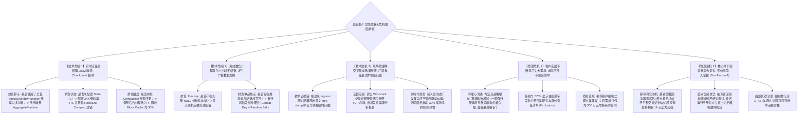

# 第六周阶段复盘与42天全周期终极通关总揽：从资深架构师到技术高管的蜕变

> **学习目标定位**：全面复盘第六周（Day 36 - Day 42）涵盖的 **大模型底层原理与 Agent 运行时架构（Transformer/KV Cache/Context Window/ReAct/Guardrails）、Skills 设计与 MCP 协议标准体系（JSON-RPC 2.0/Stdio/SSE/动态注水/安全沙箱）、RAG 架构与高性能向量检索（AST切块/HNSW/BM25+Dense混合检索/RRF/Cross-Encoder/GraphRAG）、AI 辅助研发工程实践（Spec驱动开发/变异测试/AI Code Review门禁），以及瑞纳智能数据中台太原验收、思科/美的/Zoom 经典战役深度复盘与 90 分钟终极模拟面试答辩**。在此基础上，对整个 42 天知识库体系进行全景融会贯通，绘制六位一体的大型技术总监胜任力全貌，为决战一线大厂与科技企业高管面试奠定不可动摇的制胜底盘。

---

## 1. 42天全栈知识体系六大核心维度全景技术贯通大图

整个 42 天的知识重构，彻底打通了从底层硬件指令、分布式大数据引擎、高并发微服务底座、技术团队效能治理、复杂项目商务博弈到前沿 AI Agent 的**全栈生命线**：

```mermaid
flowchart TB
    subgraph D1_BigData["第一周 & 第二周: 大数据计算与湖仓存储底座 (Days 01 - 14)"]
        Flink["Apache Flink 1.19+ (流计算 / 状态机制 / Checkpoint 调优 / 反压治理)"]
        Kafka["Kafka 3.7+ (零拷贝 / 分区倾斜 / 事务与幂等 / 高吞吐)"]
        Storage["存储与计算矩阵 (HDFS HA / HBase LSM / Hive 倾斜治理 / Doris 实时OLAP)"]
        Lakehouse["现代湖仓一体架构 (Apache Iceberg / Apache Paimon 流批一体)"]
        
        Kafka --> Flink
        Flink --> Storage
        Storage --> Lakehouse
    end

    subgraph D2_DataPlatform["第三周: 数据中台全景与数据资产治理 (Days 15 - 21)"]
        DataPlatformBlueprint["数据中台顶层功能蓝图 (资产化 / 服务化 / 独立 Web 门户)"]
        Governance["数据治理体系 (Apache Atlas 元数据 / Calcite 字段级血缘 / 质量门禁)"]
        DataOps["调度与高可用可观测性 (DolphinScheduler 3.2 / Prometheus / 异地容灾)"]
        DataAPI["Data API 动态网关 (Spring Boot / 缓存限流 / 行级权限受控)"]
        
        Lakehouse --> DataPlatformBlueprint
        DataPlatformBlueprint --> Governance
        Governance --> DataOps
        DataOps --> DataAPI
    end

    subgraph D3_JavaSystem["第四周: Java底层底座与分布式系统工程 (Days 22 - 28)"]
        JVM_JUC["Java 17/21 底层运行时 (JMM 内存屏障 / ZGC / AQS 锁升级 / 线程池)"]
        DB_Cache["高并发存储底座 (MySQL MVCC 2PC / Redis 7 多路复用与双写一致性)"]
        DistributedConsensus["分布式协议与治理 (CAP/BASE / Raft 选主 / Seata 事务 / Sentinel 限流)"]
        CICD_Quality["软件工程质量防线 (SOLID / Testcontainers / Docker 灰度发布 / 架构守护)"]
        
        DataAPI --> JVM_JUC
        JVM_JUC --> DB_Cache
        DB_Cache --> DistributedConsensus
        DistributedConsensus --> CICD_Quality
    end

    subgraph D4_TechMgmt["第五周: 研发团队管理与复杂项目商务交付 (Days 29 - 35)"]
        TeamBuild["团队建设与梯队 (5~10人拓扑 / 结构化招聘画像 / Bus Factor >= 2)"]
        Productivity["研发效能度量与债务 (DORA 4大指标 / 20% 技术债务预算 / 绞杀者模式)"]
        Conflict_Up["团队冲突与向上管理 (TKI 冲突模型 / 合规 PIP / 带方案向上对齐)"]
        ProjectDelivery["太原千万级交付攻坚 (PMBOK 范围基线 / CCB 变更七步法 / 转化为二期增补)"]
        VendorAcceptance["供应商与终验答辩 (ICD 协议契约 / 抓包存证 / 专家委员会答辩 / 4R复盘)"]
        
        CICD_Quality --> TeamBuild
        TeamBuild --> Productivity
        Productivity --> Conflict_Up
        Conflict_Up --> ProjectDelivery
        ProjectDelivery --> VendorAcceptance
    end

    subgraph D5_AIAgent["第六周: AI Agent 前沿架构与项目终极大复盘 (Days 36 - 42)"]
        LLM_Runtime["大模型 Agent 运行时 (Transformer / KV Cache / ReAct / 确定性护栏)"]
        MCP_Protocol["Skills 与 MCP 协议标准 (JSON-RPC 2.0 / Resources / Tools / 动态注水)"]
        RAG_Vector["企业级 RAG 架构 (AST切块 / HNSW 索引 / BM25+Dense 混合检索 / GraphRAG)"]
        AINative_Eng["AI-Native 辅助研发工作流 (Spec驱动开发 / 变异测试 / AI Code Review)"]
        Ruina_Taiyuan["太原供热中台千万级复盘 (STAR-L 框架全景 / 3大技术攻坚 / 2大交付高光)"]
        Enterprise_History["思科 / 美的 / Zoom 经历提炼 (跨国协作 / 数仓治理 / 亿级并发日志互证)"]
        FinalMock["90分钟终极全真模拟答辩 (底层推导 / 白板架构 / 高管沟通气场)"]
        
        VendorAcceptance --> LLM_Runtime
        LLM_Runtime --> MCP_Protocol
        MCP_Protocol --> RAG_Vector
        RAG_Vector --> AINative_Eng
        AINative_Eng --> Ruina_Taiyuan
        Ruina_Taiyuan --> Enterprise_History
        Enterprise_History --> FinalMock
    end
```

---

## 2. 14年技术生涯四大关键阶段核心定位与交叉互证矩阵

面试官在考查资深候选人时，最关注“不同公司经历之间的连贯性与技术厚度的交叉互证”。以下矩阵提炼了四大阶段的核心标签与必杀战术：

| 阶段与公司 | 担任角色 | 核心技术标签 | 代表性攻坚战果 (STAR) | 面试呈现维度的战略价值 |
| :--- | :--- | :--- | :--- | :--- |
| **思科 (Cisco)** | 高级工程师 | 跨国协作、全球分布式流计算、网络遥测、RFC 规范、自动化基准测试。 | 针对全球数百万网络节点时序流，自研动态自适应 Watermark 算法与无锁环形队列，将网络异常检测延迟由 45 分钟级压缩至 3 秒以内。 | **展现国际化大厂视野、严谨软件工程规范、深厚分布式流处理底蕴。** |
| **美的集团 (Midea)** | 大数据架构师 | 百亿级制造数字化转型、跨事业部数据治理、主数据 MDM、数仓数据倾斜治理。 | 破解全集团 15,000+ 离线任务调度瓶颈，推行两阶段加盐聚合打平千万级单表倾斜，主导建立统一物料元模型，年度节省硬件算力预算数千万元。 | **展现复杂实体制造业业务理解力、跨部门政治博弈与超大规模治理手腕。** |
| **Zoom** | 高级工程师 | 亿级日活超高并发、实时会议遥测、海量日志接入、秒级可观测性、高可用防雪崩。 | 面对疫情期间流量激增 30 倍，设计客户端非阻塞线程隔离与服务端 Kafka 极速吞吐调优，支撑峰值 200 万 QPS 日志接入，排障定位时间由 30 分钟压至 3 分钟以内。 | **展现硅谷互联网顶尖高并发、极低延迟架构与生产事故高可用防线把控力。** |
| **瑞纳智能 (Ruina)** | 大数据部门负责人兼总架构师 | 从 0 到 1 带队组建、独立 Web 中台产品化研发、太原数千万级标杆交付、国家专家验收。 | 组建 10 人精锐团队，自研企业级数据中台产品底座；面对 10 万点位高并发流计算攻克 Flink 状态暴涨；以 CCB 机制将蔓延需求化为 300 万增补合同，全额完成专家终验回款。 | **展现全面操盘的帅才格局：懂业务、精技术、能带队、拿结果、善商务。** |

---

## 3. 顶级技术总监/数据平台负责人胜任力雷达与通关白板大纲

### 45分钟脱稿白板推演核心大纲（建议牢记于心）
1. **0~5 分钟：需求澄清与非功能性 SLA 锁定**（问清 QPS 峰值、数据保留周期、时延毫秒/秒级标准、网络抖动容忍度）；
2. **5~15 分钟：绘制端到端分层大图**（边缘接入 $\rightarrow$ 缓冲消息队列 $\rightarrow$ 实时湖仓一体计算 $\rightarrow$ 元数据调度治理 $\rightarrow$ Data API 网关）；
3. **15~30 分钟：深水区硬核技术机制下钻**（主动推导 Flink RocksDB 增量聚合、Kafka 零拷贝与多副本脑裂防范、Doris 聚合模型与前缀索引、HNSW 向量检索图算法）；
4. **30~40 分钟：高可用防雪崩与容灾降级**（多机房冷热备、Sentinel 滑动窗口限流、数据质量波动率熔断阻断、Human-in-the-Loop 审批卡片）；
5. **40~45 分钟：成本 ROI 核算与架构主动反思**（推演服务器节点规格与网络带宽成本，主动说明当前架构的妥协点与未来演进方案）。

---

## 4. 全链路生产异常与管理危机排障决策树终极汇编

在面试中面对“你遇到过最难排查的线上事故 / 最大的管理危机是什么”时，以下决策树提供了无懈可击的结构化推演路径：

---

## 5. 42天全景冲刺错题本、薄弱点追踪与持续复盘清单

在整个 42 天的知识重构历程中，重点攻克的盲区与高频易错点已全部建立防御底线：

1. **Flink 状态与 Checkpoint 盲区彻底消除**：过去容易混淆增量 Checkpoint 与 Savepoint 的区别；现已透彻掌握 RocksDB SST 文件硬链接原理、Chandy-Lamport 分布式快照对齐机制与非对齐 Checkpoint 的权衡。
2. **Kafka 底层 I/O 与事务幂等机制彻底打通**：过去对 Kafka 为何高吞吐只停留在“顺序写盘与零拷贝”概念层面；现已深入掌握操作系统 PageCache、`sendfile()` 系统调用上下文切换消除、Producer 端序列号与 PID 内存去重、以及基于 2PC 两阶段提交的精确一次（Exactly-Once）事务流转。
3. **Java 17/21 现代底座全面对齐**：告别陈旧的 Java 8 时代认知，全面对齐 Java 17/21 LTS；深刻掌握 ZGC 染色指针（Colored Pointers）与读屏障内存自愈、虚拟线程（Virtual Threads）底层载体线程挂载（Pinning）防范、以及 JUC 偏向锁撤销与 AQS 双向链表状态机。
4. **AI-Native 范式体系化构建**：彻底打破“只会写提示词问答”的浅层认知；深入掌握 Transformer 自注意力复杂度推导、KV Cache 物理显存测算公式、MCP 协议标准三原语、混合检索 RRF 算法与规范驱动开发（SDD）。
5. **商务博弈与总监级表达定型**：彻底戒掉初级工程师“遇事先争辩谁对谁错”的生硬反应；熟练运用“同理心倾听 + 商业风险量化 + 提供建设性多选方案 + 转化为增量商务合同”的高阶管理套路。

---

## 6. 迈向目标岗位终极冲刺寄语与行动指引

> **致未来的技术领军者**：
> 
> 经历过 42 天、每天 90 分钟的严苛重构与淬炼，你已经完成了一次脱胎换骨的**知识体系升维与认知跃迁**。
> 你不再是那个面对底层原理细节偶尔心虚的资深工程师，而是一个**既有 14 年全栈硬核功底、又有顶级大厂视野、更有千万级项目带队成功战果的成熟技术统帅**。
> 
> 走进面试考场时，请牢记三大心法：
> 1. **保持大将风范与沉着气场**：考官不是考官，而是未来的业务合伙人。平视对方，从容呼吸，在白板前脱稿挥洒，把每一次挑剔质询都转化为展示专业底蕴的绝佳舞台；
> 2. **三层表达模型时刻在胸**：张口先用 1 分钟给出结构化结论，随后深入协议机制展开数学与逻辑推导，最后升华至技术选型取舍、多租户 SLA 隔离与商业 ROI 闭环；
> 3. **将 14 年经历转化为降维打击的绝对优势**：外企的规范、传统制造的复杂业务治理、硅谷互联网的亿级并发高可用、民营上市公司的从 0 到 1 破局，这是任何单一背景的竞争者都不具备的复合壁垒！
> 
> **海阔凭鱼跃，天高任鸟飞。愿你在未来的高管答辩中从容自若、旗开得胜，开创属于你的全新商业与技术传奇！**
