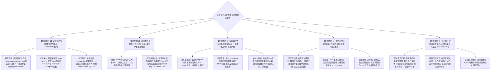

# 第六周阶段复盘与42天全周期终极通关总揽：从资深架构师到技术高管的蜕变

> **学习目标定位**：全面复盘第六周（Day 36 - Day 42）涵盖的 **大模型底层原理与 Agent 运行时架构（Transformer/KV Cache/Context Window/ReAct/Guardrails）、Skills 设计与 MCP 协议标准体系（JSON-RPC 2.0/Stdio/SSE/动态注水/安全沙箱）、RAG 架构与高性能向量检索（AST切块/HNSW/BM25+Dense混合检索/RRF/Cross-Encoder/GraphRAG）、AI 辅助研发工程实践（Spec驱动开发/变异测试/AI Code Review门禁），以及瑞纳智能数据中台太原验收、思科/美的/Zoom 经典战役深度复盘与 90 分钟终极模拟面试答辩**。在此基础上，对整个 42 天知识库体系进行全景融会贯通，绘制六位一体的大型技术总监胜任力全貌，为决战一线大厂与科技企业高管面试奠定不可动摇的制胜底盘。

---

## 1. 42天全栈知识体系六大核心维度全景技术贯通大图

整个 42 天的知识重构，彻底打通了从底层硬件指令、分布式大数据引擎、高并发微服务底座、技术团队效能治理、复杂项目商务博弈到前沿 AI Agent 的**全栈生命线**：

```mermaid
flowchart TB
    subgraph D1_BigData["第一周 & 第二周: 大数据计算与湖仓存储底座 (Days 01 - 14)"]
        Flink["Apache Flink 1.19+ (流计算 / 状态机制 / Checkpoint 调优 / 反压治理)"]
        Kafka["Kafka 3.7+ (零拷贝 / 分区倾斜 / 事务与幂等 / 高吞吐)"]
        Storage["存储与计算矩阵 (HDFS HA / HBase LSM / Hive 倾斜治理 / Doris 实时OLAP)"]
        Lakehouse["现代湖仓一体架构 (Apache Iceberg / Apache Paimon 流批一体)"]
        
        Kafka --> Flink
        Flink --> Storage
        Storage --> Lakehouse
    end

    subgraph D2_DataPlatform["第三周: 数据中台全景与数据资产治理 (Days 15 - 21)"]
        DataPlatformBlueprint["数据中台顶层功能蓝图 (资产化 / 服务化 / 独立 Web 门户)"]
        Governance["数据治理体系 (Apache Atlas 元数据 / Calcite 字段级血缘 / 质量门禁)"]
        DataOps["调度与高可用可观测性 (DolphinScheduler 3.2 / Prometheus / 异地容灾)"]
        DataAPI["Data API 动态网关 (Spring Boot / 缓存限流 / 行级权限受控)"]
        
        Lakehouse --> DataPlatformBlueprint
        DataPlatformBlueprint --> Governance
        Governance --> DataOps
        DataOps --> DataAPI
    end

    subgraph D3_JavaSystem["第四周: Java底层底座与分布式系统工程 (Days 22 - 28)"]
        JVM_JUC["Java 17/21 底层运行时 (JMM 内存屏障 / ZGC / AQS 锁升级 / 线程池)"]
        DB_Cache["高并发存储底座 (MySQL MVCC 2PC / Redis 7 多路复用与双写一致性)"]
        DistributedConsensus["分布式协议与治理 (CAP/BASE / Raft 选主 / Seata 事务 / Sentinel 限流)"]
        CICD_Quality["软件工程质量防线 (SOLID / Testcontainers / Docker 灰度发布 / 架构守护)"]
        
        DataAPI --> JVM_JUC
        JVM_JUC --> DB_Cache
        DB_Cache --> DistributedConsensus
        DistributedConsensus --> CICD_Quality
    end

    subgraph D4_TechMgmt["第五周: 研发团队管理与复杂项目商务交付 (Days 29 - 35)"]
        TeamBuild["团队建设与梯队 (5~10人拓扑 / 结构化招聘画像 / Bus Factor >= 2)"]
        Productivity["研发效能度量与债务 (DORA 4大指标 / 20% 技术债务预算 / 绞杀者模式)"]
        Conflict_Up["团队冲突与向上管理 (TKI 冲突模型 / 合规 PIP / 带方案向上对齐)"]
        ProjectDelivery["项目交付演练 (范围基线 / 变更评估 / 验收条件)"]
        VendorAcceptance["供应商与终验答辩 (ICD 协议契约 / 抓包存证 / 专家委员会答辩 / 4R复盘)"]
        
        CICD_Quality --> TeamBuild
        TeamBuild --> Productivity
        Productivity --> Conflict_Up
        Conflict_Up --> ProjectDelivery
        ProjectDelivery --> VendorAcceptance
    end

    subgraph D5_AIAgent["第六周: AI Agent 前沿架构与项目终极大复盘 (Days 36 - 42)"]
        LLM_Runtime["大模型 Agent 运行时 (Transformer / KV Cache / ReAct / 确定性护栏)"]
        MCP_Protocol["Skills 与 MCP 协议标准 (JSON-RPC 2.0 / Resources / Tools / 动态注水)"]
        RAG_Vector["企业级 RAG 架构 (AST切块 / HNSW 索引 / BM25+Dense 混合检索 / GraphRAG)"]
        AINative_Eng["AI-Native 辅助研发工作流 (Spec驱动开发 / 变异测试 / AI Code Review)"]
        Ruina_Taiyuan["太原数据中台项目复盘 (负责人职责 / 交付 / 正式验收)"]
        Enterprise_History["思科 / 美的 / Zoom 经历提炼 (跨国分布式研发 / 企业数据平台 / 日志平台研发)"]
        FinalMock["90分钟终极全真模拟答辩 (底层推导 / 白板架构 / 高管沟通气场)"]
        
        VendorAcceptance --> LLM_Runtime
        LLM_Runtime --> MCP_Protocol
        MCP_Protocol --> RAG_Vector
        RAG_Vector --> AINative_Eng
        AINative_Eng --> Ruina_Taiyuan
        Ruina_Taiyuan --> Enterprise_History
        Enterprise_History --> FinalMock
    end
```



---

## 2. 14年技术生涯四大关键阶段核心定位与交叉互证矩阵

先讲清自己负责的工作，再补充有记录可验证的决策与结果。团队规模、平台职责和项目验收依据[履历事实清单](../PROFILE_FACTS.md)。

| 公司 | 担任角色 | 可以直接讲的事实 | 复盘时准备的证据 |
| --- | --- | --- | --- |
| 美的集团 | 大数据架构师 | 参与企业级数据平台与架构设计 | 选一项本人参与的设计，说明问题、候选方案和职责边界。 |
| 思科中国（合肥） | 高级工程师 | 参与跨国分布式系统研发 | 选一项能说清个人贡献的研发工作。 |
| Zoom | 高级工程师 | 参与大规模日志与平台研发 | 梳理自己负责的模块、上下游及验证方式。 |
| 瑞纳智能 | 大数据部门负责人 | 管理 5~10 人团队，主导数据中台产品化，担任太原项目总体负责人并完成正式验收 | 用可披露的产品功能、职责划分与验收内容说明交付结果。 |

---

## 3. 岗位能力与白板演练

| 面试官考察什么 | 能从白板或回答中看到什么 |
| --- | --- |
| 架构设计 | 画出一次写入、一次读取和一处失败恢复的过程。 |
| 商业与成本 | 结合业务允许的延迟估算资源支出，说明什么条件会改变选型。 |
| 团队管理 | 说明哪个团队拥有数据质量、谁值班、什么告警需要升级。 |
| 项目交付 | 给出验收条件、进度风险和变更需要的决策。 |
| AI 工程 | 用一条真实请求说明离线评估、线上观测和权限校验。 |
| 沟通 | 用业务方能理解的语言解释风险，给出可执行的选择。 |

### 45分钟脱稿白板推演核心大纲（建议牢记于心）
1. **0~5 分钟：需求澄清与非功能性 SLA 锁定**（问清 QPS 峰值、数据保留周期、时延毫秒/秒级标准、网络抖动容忍度）；
2. **5~15 分钟：绘制端到端分层大图**（边缘接入 $\rightarrow$ 缓冲消息队列 $\rightarrow$ 实时湖仓一体计算 $\rightarrow$ 元数据调度治理 $\rightarrow$ Data API 网关）；
3. **15~30 分钟：深水区硬核技术机制下钻**（主动推导 Flink RocksDB 增量聚合、Kafka 零拷贝与多副本脑裂防范、Doris 聚合模型与前缀索引、HNSW 向量检索图算法）；
4. **30~40 分钟：高可用防雪崩与容灾降级**（多机房冷热备、Sentinel 滑动窗口限流、数据质量波动率熔断阻断、Human-in-the-Loop 审批卡片）；
5. **40~45 分钟：成本 ROI 核算与架构主动反思**（推演服务器节点规格与网络带宽成本，主动说明当前架构的妥协点与未来演进方案）。

---

## 4. 全链路生产异常与管理危机排障决策树终极汇编

> [!NOTE] 案例性质说明：下图用于假设场景推演，资源阈值、商务处置和事件细节仅供演练。讲个人经历时须按上一节的已确认事实作答。



---

## 5. 面试现场自然口述示范与一页纸速记卡（42 天终极通关精华）

### 核心问题 1：在面对 CEO/CTO 等高管终面时，如果被问到：“你作为一个经历过顶级外企、大型制造业和上市公司的技术统帅，入职前 90 天会如何破局并落地技术战略？”请给出结构化破局思路。

- **简洁回答（1分钟电梯破题）**：
  > “我将遵循**‘前 30 天摸清现状建立信任，中 30 天聚焦速赢确立基准，后 30 天形成战略推进落地’**的三阶段破局路径：
  > 前 30 天‘只听不说’，深访业务与技术骨干，完成系统拓扑与核心资产盘点，摸清最大的业务痛点与技术债务；
  > 30 到 60 天选择一个‘影响面大、周期短、见效快’的痛点打造‘Quick Win’（如关键报表时延从 2 小时压到 5 分钟或关键任务 OOM 根治），赢得团队与业务高层的初步信任；
  > 60 到 90 天形成 1~3 年技术演进路线图，建立团队梯队规范与多租户 SLA 机制，将短期战术胜利转化为长效商业与技术价值。”

- **深入回答（机制推导与边界条件）**：
  > 1. **前 30 天：全方位事实调研与暗流排查（Listen & Map）**：
  >    - **业务线访谈**：与核心业务业务方一对一深度沟通，厘清当前数据平台或技术系统的最直接痛点（是产出慢、数据不准、还是需求响应不及时？）；
  >    - **工程资产审计**：排查生产事故高频发区域、Bus Factor 为 1 的高危模块、当前服务器成本账单与核心数据 SLA 达标率；
  >    - **严守禁忌**：新官上任切忌‘全盘推翻前人方案’或‘生搬大厂老经验’，必须基于当前业务体量与现金流约束做客观归因。
  > 2. **30~60 天：精准战术切入与建立速赢（Focus & Win）**：
  >    - 选定 1~2 个关键痛点集中攻坚。例如针对数据倾斜或调度雪崩引入两阶段聚合或细粒度 TTL，直接降低集群资源负载并提升 SLA 达标率；
  >    - 通过‘打胜仗’确立在研发团队中的技术威信，并在高管双周会上用业务语言量化汇报成果（如提升 30% 交付吞吐，节约 15% 算力成本）。
  > 3. **60~90 天：组织梯队重塑与战略共识（Scale & Align）**：
  >    - 推动技术战略方案会签，明确企业未来 1~3 年演进大方向（如流批一体湖仓演进、AI-Native 辅助工程落地）；
  >    - 重构 8~10 人组织梯队拓扑，落实关键系统的双人 AB 角机制，推行规范化的 DORA 效能度量与 Code Review 门禁。

- **架构师/技术管理视角（权衡取舍、成本 ROI、SLA 与治理规范）**：
  > “技术高管的本质是**‘战略翻译官与资源调配者’**。前 90 天如果沉溺于‘重构代码’，往往会陷入业务断层和信任危机；如果只务虚不抓技术实质，又会失去技术判断力。真正的领导力在于：**用架构师的显微镜洞察系统命脉，用高管的望远镜校准业务航向，带领队伍在一个个具体的确定性胜仗中稳步完成战略转型。**”

---

### 核心问题 2：在大数据与 AI 深度融合的今天（从传统数据中台到现代流式湖仓、再到 AI-Native / Agent），你如何看待未来 3~5 年企业数字化底座的技术演进？架构师应如何做技术选型与团队能力储备？

- **简洁回答（1分钟电梯破题）**：
  > “未来 3~5 年企业数字化底座将呈现三大不可逆转的演进趋势：
  > 第一，**存储引擎流批一体化与开放湖仓化**：以 Iceberg/Paimon 为代表的流式数据湖将彻底取代冗余的 Lambda 传统离线架构，实现‘写入即湖、秒级分析、存算分离’；
  > 第二，**数据资产由结构化单轨向‘多模态非结构化 + 向量知识库’双轨演进**：企业核心资产从‘关系型报表’拓展为‘文档、代码、音视频语义向量’；
  > 第三，**消费形态从‘静态 BI 看板’转向‘AI Agent 自主决策与闭环执行’**：系统不仅回答‘发生了什么’，更通过 ReAct 循环与 Tool Calling 驱动业务闭环。
  > 架构师的核心抓手是：**守住高可用底盘，以开放协议（如 MCP/Iceberg）对冲模型与引擎迭代风险，以 AI-Native 工具改造团队工程习惯。**”

- **深入回答（机制推导与边界条件）**：
  > 1. **架构层演进推导**：
  >    - 传统数据平台架构存在‘离线数仓 + 实时流计算 + 维表缓存 + 向量检索’多套系统割裂，导致数据多副本存储膨胀、口径漂移与运维成本失控；
  >    - 现代化流式湖仓通过将存储统一在对象存储/HDFS 之上，配合自适应压缩与增量文件日志，消除了 ETL 链路冗余，使数据生产与消费延时大幅收窄；
  > 2. **AI 与数据平台的交汇点**：
  >    - 数据中台不再仅仅为人工看报表服务，而是充当 **LLM 与 Agent 的底层事实输入源（Grounding）**。高质量元数据、字段级数据血缘与严格质量门禁，直接决定了企业级 Agent 是否会产生严重幻觉；
  >    - 混合检索（BM25 + 向量 HNSW + Rerank）成为数据服务层标配，企业通过统一网关受控输出结构化与语义化双重能力。
  > 3. **团队能力储备与技术选型避坑**：
  >    - 避免‘盲目自研大模型’或‘过度追逐概念’，算力与参数属于基础基建，技术负责人的核心精力应放在**数据清洗切分管道、企业私有 MCP 工具链构建、以及业务场景的评测闭环（Evaluation-Driven）**上。

- **架构师/技术管理视角（权衡取舍、成本 ROI、SLA 与治理规范）**：
  > “在技术激进与稳定之间必须保持**架构免疫力**：核心交易与分析底盘必须遵循高内聚低耦合原则，通过标准接口层（如 Data API、MCP 规范、标准 SQL）隔离底层模型与计算引擎的频繁波动。技术选型看 ROI：不仅算服务器硬件账面成本，更要算团队学习曲线、社区活跃度与未来迁移成本。”

---

### 核心问题 3：如果重大技术决策上，业务高管强烈要求‘走捷径硬上线’换取市场机会，而架构团队警告存在严重系统架构缺陷与资损风险，作为技术总监你如何决策与多方平衡？

- **简洁回答（1分钟电梯破题）**：
  > “作为技术总监，**严禁做两件事：既不能机械生硬地‘技术一票否决阻断业务’，也不能毫无底线地‘妥协隐患听之任之’**。
  > 我的核心策略是：**‘商业共情定目标，技术分级防雪崩，签署备忘明责任，锁定预算偿债务’**：
  > 1. 与业务高管对齐业务目标，将‘全量硬上’拆解为‘核心流程最小可用版本（MVP）+ 严格限流降级’，保障核心链路不资损；
  > 2. 在架构层面设置技术兜底防线（如熔断降级、异步补偿与冷备写日志）；
  > 3. 正式签署风险与资源备忘，并在项目上线后首个迭代强制锁定 20%~30% 研发资源用于技术债务清偿。”

- **深入回答（机制推导与边界条件）**：
  > 1. **业务视角的共情与风险量化**：
  >    - 业务高管关注的是市场窗口期与客户合同违约金，单方面跟业务谈‘代码不优雅、缺乏扩展性’是无效沟通；
  >    - 必须把技术风险翻译为商业语言：‘如果该缺陷在早高峰爆发，将导致核心订单丢失、预计每小时资损 50 万元且引发监管处罚’；
  > 2. **架构维度的柔性妥协与防雪崩设计**：
  >    - 采用**防御性架构（Defensive Architecture）**：即使底层存在缺陷，也在入口层配置限流与排队机制，防止雪崩扩散到全局；
  >    - 对核心高危逻辑推行**双写比对（Shadow Run）**或仅对小比例白名单灰度开放，确保主干业务不受颠覆性冲击；
  > 3. **管理闭环与契约化推进**：
  >    - 在需求变更与发布评审会上，清晰出具《风险评估报告与应急预案》，明确各方知情同意；
  >    - 建立团队‘技术债务还款账本’，约定大促或上线节点过后，立即启动两周专项重构，闭环系统隐患。

- **架构师/技术管理视角（权衡取舍、成本 ROI、SLA 与治理规范）**：
  > “**没有脱离业务的技术架构，也没有脱离技术稳定性的业务繁荣。** 技术总监的价值就在于在‘速度与质量’的刀刃上跳舞，用可控的战术妥协换取业务的战略窗口，同时用严密的技术手段守住企业生存的底线，并在战役胜利后有条不紊地带领团队加固城池。”

---

### 42天终极收官通关一页纸速记卡（5大铁律与决战口诀）

```
========================================================================================
                  【42天终极通关总揽：技术总监与数据架构师 5 大必杀铁律】
========================================================================================

【铁律一：三层表达破万卷，张口先给准结论】
  - 1分钟电梯破题立论点，机制推导深挖底层数学与拓扑协议；
  - 架构师升华落脚点：权衡取舍（Trade-off）、多租户防踩踏、成本ROI与团队SOP。

【铁律二：底层穿透显真章，硬核机制不可晃】
  - Flink：两阶段提交+State TTL+RocksDB 增量快照；Kafka：零拷贝PageCache+事务PID去重；
  - Java：ZGC染色指针自愈+AQS双向队列+虚拟线程Pinning；向量：HNSW图跳表+RRF倒数融合。

【铁律三：真实经历不编造，交叉互证筑壁垒】
  - 思科参与跨国分布式系统研发，Zoom 参与大规模日志与平台研发。
  - 美的参与企业数据平台架构设计，瑞纳智能主导中台产品化并负责太原项目验收。

【铁律四：交付管理重契约，需求蔓延化商务】
  - 软硬件集成推诿看网关纳秒级Hex抓包；需求范围蔓延走CCB七步法；
  - 口头大需求绝不硬顶，同理心量化风险，打包转为二期采购增补合同。

【铁律五：技术服务商业局，大将气场定乾坤】
  - 平视考官，把挑剔质询视为合伙人业务探讨；脱稿白板，大图全局与微观机制收放自如；
  - 用架构师的显微镜洞察代码，用技术总监的望远镜校准商业航向！
========================================================================================
```

---

## 6. 42天全景冲刺错题本、薄弱点追踪与持续复盘清单

以下是终期自测项目。每项先闭卷作答，再记录答题日期、遗漏的条件和第二次复测结果。

1. 画出 Flink Checkpoint 时序，指出失败恢复后源、算子状态和外部写入各自如何处理。
2. 解释 Kafka 顺序写入、批处理和零拷贝各解决什么开销，并说明消费者怎样观察事务结果。
3. 给定容器内存告警与一段 GC 日志，判断还需要哪些证据区分堆内压力和堆外增长。
4. 用一个带权限的检索请求解释候选召回、排序与生成，说明会分别测哪项质量指标。
5. 面对一次范围变更，写出原验收条件、影响估算、备选方案以及需要谁决策。

## 7. 模拟面试后的行动

以一次真实模拟的答题记录更新[进度看板](../PROGRESS.md)。原理讲错、故障定位缺证据或项目职责说不清的题，写入[错题本](wrong-questions.md)，复测时改变一个条件重新作答。
