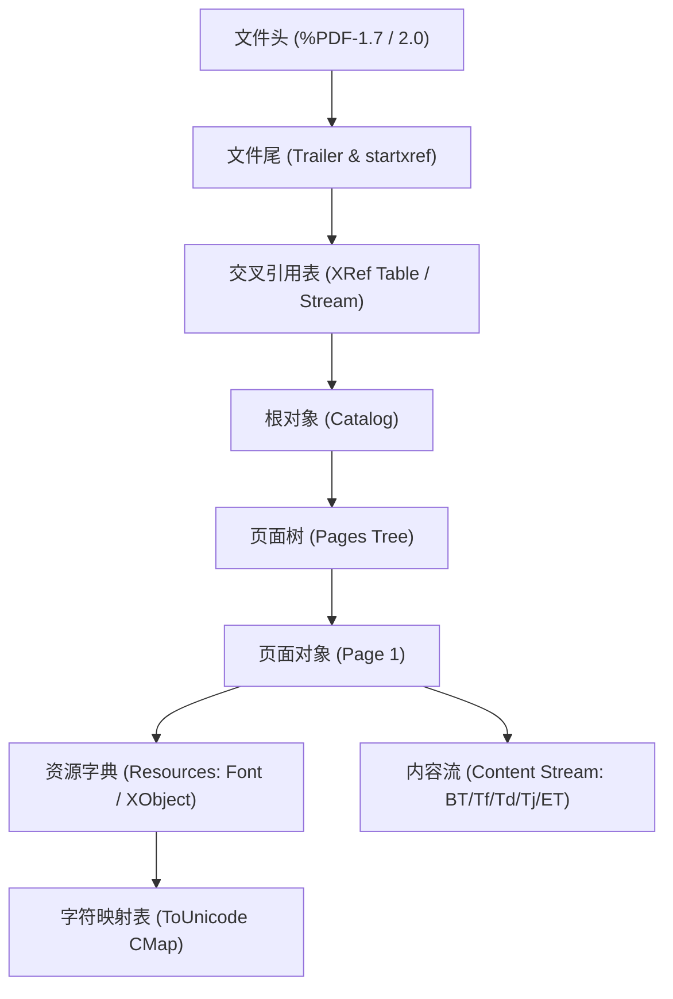
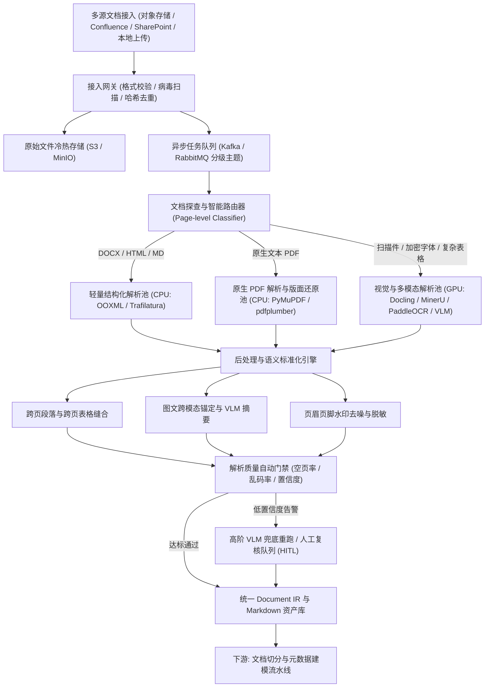
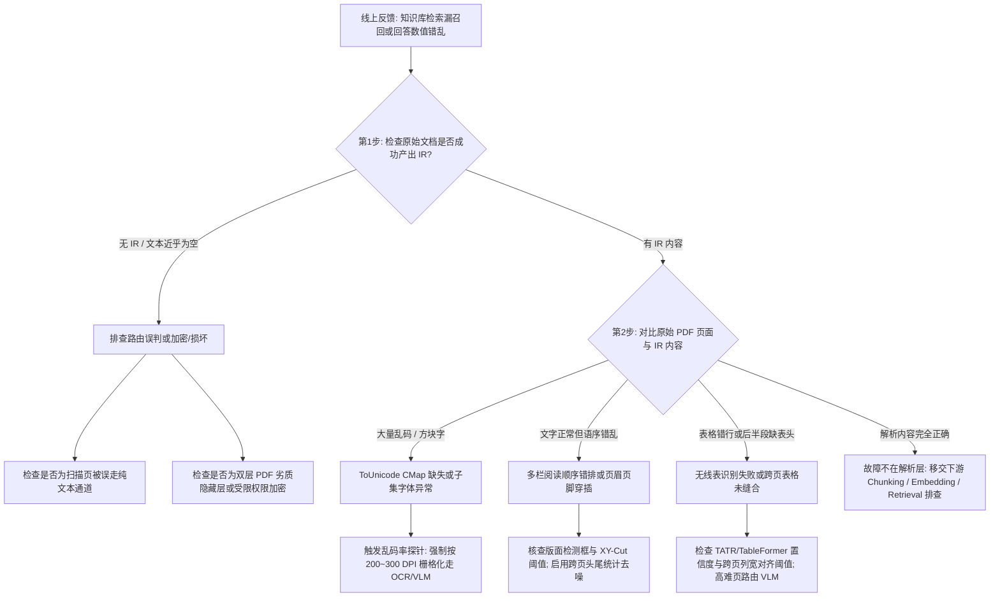

# 非结构化数据解析：PDF/Word/HTML底层结构、OCR与版面还原、表格重建与企业级解析流水线架构

> **学习路径导航（基础 → 深入 → 架构师）**：
> - **基础层（第 1~2 节）**：建立非结构化数据在 AI 时代作为“新 ODS 源头”的定位，明确 PDF/Word/HTML/扫描件的核心差异与解析边界。
> - **深入层（第 3~5 节）**：穿透 PDF 对象树与 `ToUnicode CMap`、OOXML 结构、DOM 去噪、OCR 三阶段管线 vs VLM 端到端解析、版面阅读顺序还原、有线/无线/跨页表格重建与质量度量指标（CER/WER/TEDS）。
> - **架构师层（第 6~11 节）**：掌握“开源 vs 商业、自研 vs 采购、集成 vs 重写”的选型权衡、企业级 10,000 份混合文档异步解析流水线落地、排障决策树、CPU/GPU/商业 API 成本测算与高频面试深度表达。
> - **与传统大数据体系关联**：非结构化文档解析本质上是 AI 时代的**数据采集与 ETL（Extract-Transform-Load）前置层**，可与数据中台架构全景 [01-platform-blueprint.md](../02-data-platform/01-platform-blueprint.md)、批流 ETL 引擎 [01-spark-core-shuffle.md](../01-bigdata/03-spark/01-spark-core-shuffle.md)、消息缓冲层 [01-kafka-architecture-throughput.md](../01-bigdata/02-kafka/01-kafka-architecture-throughput.md) 及下游切分建模 [02-chunking-metadata.md](./02-chunking-metadata.md) 对照学习。

---

## 1. 核心概念

### 1.1 非结构化数据解析的本质定义
在传统数仓与数据中台体系中，数据源主要是关系型数据库 Binlog、埋点 JSON 日志与标准 CSV/Parquet 文件，数据自带显式 Schema（列定义、类型与主键）。而在企业级 RAG、知识库与 Agent 应用中，核心知识资产大量沉淀于 **PDF 合同与技术手册、Word 制度规范、PPT 汇报材料、扫描票据、企业 Wiki 与 HTML 网页** 等非结构化或半结构化文档中。

**非结构化数据解析（Unstructured Document Parsing / Ingestion）** 是指将面向“人类视觉渲染”设计的二进制或标记文件，逆向还原为面向“机器语义检索与大模型推理”的**结构化中间表示（Intermediate Representation, IR）**的过程。解析产物不应仅仅是扁平的纯文本字符串，而应包含：
- **逻辑阅读顺序（Logical Reading Order）**：还原多栏、脚注、边栏的正确语义流；
- **文档层级树（Document Hierarchy）**：标题层级（H1/H2/H3）、段落、列表项与引用块；
- **结构化表格（Structured Tables）**：保留行列坐标、合并单元格（`rowspan` / `colspan`）及跨页衔接关系；
- **视觉与跨模态锚点（Visual Anchors）**：图片、图表、公式的边界框坐标（Bounding Box, `bbox`）、图注（Caption）与文本描述；
- **溯源物理坐标（Provenance Coordinates）**：精确到页码（`page_no`）与归一化坐标的定位信息，用于前端高亮引用。

### 1.2 核心术语全景表

| 术语 | 英文全称 | 核心定义与工程职责 | 所属处理阶段 |
| :--- | :--- | :--- | :--- |
| **文档中间表示** | Document IR / DOM | 统一抽象不同格式（PDF/DOCX/HTML）解析结果的标准化 JSON 树模型 | 解析输出契约 |
| **文本型 PDF** | Native / Digital-born PDF | 由 Word/LaTeX 等软件直接导出，内部保留字符编码、字体与矢量绘制指令的 PDF | 路由判别层 |
| **扫描型 PDF** | Scanned / Image-only PDF | 由纸质文档扫描或截图封装而成，页面本质是一张或多张栅格位图（Bitmap），无内嵌字符流 | 路由判别层 |
| **混合型 PDF** | Hybrid PDF | 同文档或同页面中既包含原生矢量文字，又内嵌扫描签章页、截图表格或公式图片的 PDF | 路由判别层 |
| **版面分析** | Document Layout Analysis (DLA) | 基于视觉检测模型识别页面中的标题、正文、页眉、页脚、表格、图片区域并输出 `bbox` 与类别 | 视觉理解层 |
| **光学字符识别** | Optical Character Recognition (OCR) | 将图像中的文字像素转化为可编辑文本序列，通常由检测、方向分类、识别组成 | 视觉理解层 |
| **表格结构识别** | Table Structure Recognition (TSR) | 识别表格行列划分、单元格合并关系及单元格文本归属，输出 HTML 或结构化矩阵 | 复杂元素还原 |
| **视觉语言模型** | Vision-Language Model (VLM) | 直接以整页或切片图像为输入、端到端输出 Markdown/HTML/JSON 的多模态大模型 | 前沿端到端解析 |
| **字符/词错误率** | CER / WER | 衡量 OCR 识别精度的基础编辑距离指标（Character / Word Error Rate） | 质量评估层 |
| **表格树编辑距离** | TEDS (Tree-Edit-Distance-based Similarity) | 衡量表格 HTML DOM 树结构与单元格内容双重还原精度的标准指标 | 质量评估层 |

---

## 2. 解决的问题

### 2.1 为什么不能直接用 `pdftotext` 或简单库抽取文本？
在 RAG 原型验证阶段，团队常直接调用轻量级文本抽取工具把 PDF 转为纯字符串，但在企业级生产环境中会立刻暴露五类致命缺陷，即典型的 **“垃圾进，垃圾出（GIGO）”**：

1. **视觉布局不等于语义结构（PDF 的基因缺陷）**：PDF 诞生于 1993 年，其设计目标是跨设备打印保真（类似数字纸张），文件内部记录的是“在坐标 `(x, y)` 用某字体画某个字形”，而**原生不强制保存段落、双栏边界、表格单元格归属或阅读顺序**。直接按流顺序抽取双栏 PDF 会导致左右两栏文字逐行穿插拼接，语义彻底破坏。
2. **表格结构塌陷导致数值归属错乱**：财务报表、产品参数表、合同报价单经纯文本抽取后，列对齐信息丢失，表头与对应数值脱钩。当用户询问“A 型号在华东区的 2025 年维保费率”时，大模型因无法区分行列对应关系而产生事实幻觉。
3. **扫描件、加密字体与复杂公式产生“静默空洞”**：扫描型 PDF 或嵌入特殊自定义字体（缺失 `ToUnicode` 映射表）的 PDF，用传统文本提取器只会返回空字符串或乱码字符（如 `\ufffd` / 私有区字符），且**程序不会报错**，造成知识库静默漏召回。
4. **高频噪声污染向量空间**：每页重复出现的页眉、页脚、公司保密水印、目录点线与页码如果未清洗直接进入切分与向量化，会显著稀释 Chunk 语义表征，并在跨页段落中间插入“第 14 页 / 共 80 页 内部机密”等断裂噪声。
5. **跨模态信息丢失**：架构图、流程图、带标注的设备拓扑图和截图表格往往承载文档中最核心的业务逻辑，纯文本解析会直接丢弃视觉层信息。

### 2.2 与传统大数据 ETL 的映射关系
对于拥有深厚大数据平台背景的架构师，可以将非结构化文档解析精准映射到传统数据中台的 **采集与 ODS/DWD 清洗层**（参考 [01-platform-blueprint.md](../02-data-platform/01-platform-blueprint.md)）：

| 传统结构化数仓 ETL | AI 非结构化文档解析流水线 | 本质共性与架构迁移点 |
| :--- | :--- | :--- |
| 数据源探查（Schema Discovery） | 文档格式嗅探与页面类型分类（Native / Scanned / Hybrid） | 先探查再路由，避免统一重算浪费算力 |
| ODS 原始贴源层存储 | 对象存储（S3/OSS/MinIO）保留原始二进制文件 + 哈希指纹 | 原始资产不可变（Immutable），支持随时重跑回溯 |
| 脏数据清洗与规范化（ETL Transform） | 版面去噪（页眉页脚/水印剔除）、OCR 纠偏、表格结构化、跨页拼接 | 从异构源转换为统一标准模型 |
| 统一模型层（DWD 标准化明细） | 标准化文档中间表示（Document IR JSON + Markdown） | 屏蔽上游格式差异，向下游切分与检索提供稳定契约 |
| 数据质量探针（DQ Check） | 空页率、乱码率、OCR 置信度分布、TEDS 抽检门禁 | 质量不达标阻断入库，防止污染下游索引 |

---

## 3. 底层原理

### 3.1 PDF 文档底层结构剖析（ISO 32000）
理解 PDF 底层物理组织，是排查乱码、字体丢失与解析异常的根本前提。一个标准 PDF 文件由四个物理部分组成：
1. **文件头（Header）**：声明 PDF 规范版本（如 `%PDF-1.7` 或 `%PDF-2.0`）。
2. **对象体（Body）**：由一系列带编号的间接对象（Indirect Objects，如 `12 0 obj ... endobj`）构成的逻辑树。
   - **Catalog（根对象）** → 指向 **Pages（页面树）** → 指向每个 **Page 对象**；
   - 每个 Page 对象挂载 **Resources**（字体字典 `Font`、外部图像 `XObject`、图形状态）和 **Contents（内容流 Content Stream）**。
3. **交叉引用表（Cross-Reference Table / XRef Stream）**：记录每个对象在文件中的精确字节偏移量，支持随机访问（O(1) 定位特定页，无需顺序通读全文件）。
4. **文件尾（Trailer）**：指向根对象 Catalog 与 XRef 起始偏移；PDF 支持**增量更新（Incremental Update）**，新修订内容追加在文件末尾并附带新的 Trailer，这也是部分签署过的 PDF 存在历史隐藏对象的原因。



**核心深水区：字符编码与 `ToUnicode CMap` 机制**
PDF 内容流中常见文本绘制操作符：`BT`（开始文本块）、`Tf`（选择字体与字号）、`Td/Tm`（设定文本位置矩阵）、`Tj/TJ`（按字形编码 Glyph ID 绘制字符与字间距微调）、`ET`（结束文本块）。
- 关键事实：内容流里的字节序列往往是**字形索引（Glyph Code / CID）**，而非直接的 UTF-8 字符！
- 解析器还原可读文字时，必须查询对应字体对象挂载的 **`ToUnicode CMap`**（字符编码到 Unicode 码点的映射表）。
- **乱码根因**：部分国产排版软件、早期 CAD 导出插件或防复制加密 PDF 会采用**子集嵌入字体（Subset Embedded Font）**并刻意剥离或混淆 `ToUnicode CMap`。此时阅读器仍能正确把字形轮廓画在屏幕上（人眼看完全正常），但任何基于文本流的解析器（如 PyMuPDF、PDFBox）抽出来的都是乱码或方块，必须强制降级为“渲染成图片 + OCR/VLM”路线。

### 3.2 文本型、扫描型与混合型 PDF 的本质区别与自动路由判别
盲目对所有 PDF 跑 GPU 版面+OCR 成本极高；盲目用纯文本抽取又会漏掉扫描页。生产系统必须在**页面级（Page-level）**而非文件级做自动路由判别（因为一份合同常见前 20 页是文本型，第 21 页是盖章扫描件）。

**页面级路由判别特征组合（多信号联合判定）**：
1. **文本覆盖与字符密度信号**：统计当前页文本流有效字符数 `char_count` 与字符边界框总面积占页面面积比例 `text_area_ratio`。若 `char_count < 20` 且存在覆盖面积 > 60% 的大图 `XObject`，直接判定为**扫描页**。
2. **乱码与未映射字符率（CID / PUA Ratio）**：检测抽取文本中替换字符 `\ufffd`、Unicode 私有区字符（PUA, `U+E000~U+F8FF`）、异常控制字符占比及语言模型困惑度（Perplexity）。若异常率 > 5%，判定为**字体编码损坏页（需降级渲染走 OCR）**。
3. **内嵌图像与矢量图形占比（Hybrid 判定）**：页面包含正常文本流，但同时包含面积大于阈值（如 > 10% 页面积）的非装饰性图片或大量矢量线段（可能是无文本层的流程图或复杂 CAD 表格），判定为**混合页**（文本流与视觉管道并行处理后按坐标融合）。
4. **双层 PDF 陷阱（Searchable PDF with Hidden OCR Layer）**：扫描仪生成的 PDF 常带有一层不可见的旧版低精度 OCR 隐藏文本层（渲染模式 `Tr = 3` 不可见文字）。若不检查 `render_mode == 3` 或字体特征，路由器会误判为原生文本页并直接读取劣质旧 OCR 结果，导致检索精度大幅下降。

### 3.3 OCR 工作原理：传统级联管线 vs VLM 端到端解析
#### 3.3.1 传统三阶段级联 OCR 管线（以 PaddleOCR 为代表）
1. **文本检测（Text Detection）**：定位图像中所有文本行的多边形坐标框。
   - **DBNet / DBNet++（Differentiable Binarization）**：基于分割（Segmentation）网络输出概率图与自适应阈值图，将不可微的二值化操作近似为可微函数纳入端到端训练，后处理仅需轻量阈值与多边形扩张，速度快、对弯曲文本与密集排版友好。
   - **CRAFT（Character Region Awareness）**：预测单字符区域分数（Region Score）与字符间亲和力（Affinity Score），擅长处理不规则间距与艺术字体，但后处理连通域分析开销较高。
2. **方向分类（Direction Classification）**：轻量级分类网络（如 MobileNetV3）判断裁剪后的文本行是否发生 90°/180°/270° 旋转并纠偏。
3. **文本识别（Text Recognition）**：将拉直的文本行图像映射为字符序列。
   - **CRNN + CTC**：CNN 提取视觉特征序列 → BiLSTM 建模上下文依赖 → CTC（Connectionist Temporal Classification）解决不定长对齐问题；成熟稳定但长文本与复杂字体语义建模能力受限。
   - **SVTR（Single Visual Model for Scene Text Recognition）**：基于 Vision Transformer 思想，以 Patch Mixing（局部与全局自注意力）替代 CNN+RNN，在复杂背景、模糊扫描件与中英混排上显著优于传统 CRNN。

#### 3.3.2 VLM 端到端文档解析（以 Qwen2.5-VL / GOT-OCR 2.0 / olmOCR 为代表）
近年多模态视觉语言模型（VLM）正在重塑高难度文档解析范式：
- **原理**：将整页文档以动态高分辨率（Dynamic Resolution / Native ViT Patching，如 Qwen2.5-VL 支持任意分辨率原图切片编码）送入视觉编码器，经视觉-语言对齐投影层输入 LLM 解码器，通过自回归方式直接生成带 Markdown 标题、LaTeX 公式、HTML 表格的结构化输出。
- **核心优势**：天然具备**跨元素上下文语义理解能力**——传统 OCR 把模糊的“0”和“O”、“1”和“l”孤立识别，而 VLM 可结合整行财务科目或代码语义直接纠错；同时统一解决版面、阅读顺序、复杂无线表格与手写批注问题，消除多模型级联误差放大。
- **核心局限**：
  1. **生成式幻觉风险**：自回归解码在面对低清模糊数字、极长密集表格时可能出现“补全不存在的文本”或“重复循环输出（Repetition Loop）”，需要输出长度监控与确定性解码约束；
  2. **缺乏精细字符级 `bbox`**：部分纯 Markdown 输出模式不易精准回溯每个词的坐标（需使用带 grounding 坐标输出能力的模型或与版面检测结合）；
  3. **显存与推理吞吐成本高**：虽然 2B~7B 专用小尺寸 VLM（如 GOT-OCR 2.0、Qwen2.5-VL-7B、DeepSeek-OCR/MonkeyOCR 类轻量化路线）显著降低了门槛，但单页延迟与 GPU 成本仍明显高于纯 CPU 解析与传统轻量 OCR。

### 3.4 Word（OOXML `.docx`）底层结构解析原理
与 PDF 不同，现代 Word 文档（`.docx`）遵循 **ECMA-376 / ISO 29500（Office Open XML, OOXML）** 标准，本质上是一个 ZIP 压缩包。解压后可见清晰的 XML 结构：
- `word/document.xml`：主文档体，由段落 `<w:p>`、文本运行段 `<w:r>`（带样式 `<w:rPr>`）、表格 `<w:tbl>` 顺序组织；
- `word/styles.xml`：样式定义表，通过 `<w:pStyle w:val="Heading1"/>` 或大纲级别 `<w:outlineLvl>` 精确还原逻辑章节树，**完全不存在 PDF 的多栏猜测难题**；
- `word/_rels/document.xml.rels`：关系映射表，将正文中的图片引用（`r:embed="rId7"`）、超链接与 `word/media/` 中的实际图像文件绑定；
- `word/header*.xml`、`word/footer*.xml`、`word/footnotes.xml`、`word/comments.xml`：天然与正文物理隔离，极易干净去除页眉页脚或按需提取批注与修订记录（Track Changes：`<w:ins>` 插入与 `<w:del>` 删除——**生产中必须正确处理修订标记，否则会把已删除的废止条款也当成有效正文抽取出来！**）。
- **历史格式 `.doc` 处理**：二进制 OLE2 复合文档结构封闭复杂，工程上统一通过无头 LibreOffice（`soffice --headless --convert-to docx`）在沙箱容器中转换为 `.docx` 后再解析。

### 3.5 HTML 与企业 Wiki 正文提取原理
企业知识库大量来源为 Confluence、语雀、内部门户网页和外部行业资讯 HTML。直接对 HTML 去除标签（`BeautifulSoup.get_text()`）会混入导航栏、侧边栏目录、面包屑、广告推荐与页脚版权信息。

**主流正文提取（Boilerplate Removal）机制**：
1. **DOM 启发式密度打分（Readability 算法思想）**：遍历 DOM 树，基于节点标签权重（`<article>`/`<main>`/`<p>` 加分，`<nav>`/`<aside>`/`<footer>` 减分）、文本长度、标点密度、链接文本占比（Link Density，导航栏链接密度极高）自底向上聚合父节点得分，锁定正文主子树。
2. **基于多特征融合与回退机制（Trafilatura）**：结合 DOM 规则裁剪、文本密度统计、结构化元信息（标题、作者、发布时间）抽取，并保留表格、列表、代码块与标题层级输出为 Markdown/XML；在学术与生产评测中综合 F1 表现长期处于开源方案前列。
3. **动态 SPA 页面处理**：对前端 JS 异步渲染的页面（React/Vue 应用），静态 HTTP 抓取仅得空壳 HTML，必须经过 Headless Browser（Playwright/Chromium）渲染等待 DOM 稳定后再提取，同时做好 SSRF 安全防护与资源配额隔离。

---

## 4. 系统架构

### 4.1 企业级统一非结构化文档解析平台架构
面向多格式、大规模、多租户企业知识库，解析系统绝不能写成单一同步脚本，而应采用**“接入路由解耦 + 插件化解析引擎 + 异步弹性计算 + 质量门禁回流”**的分层架构：



### 4.2 架构设计核心原则
1. **统一中间表示契约（Canonical Document IR）**：上游无论新增 CAD 图纸、PPTX、OFD 还是邮件 `.eml` 解析器，对外输出均强制对齐同一套 Document IR Schema（包含 `blocks[]`、`tables[]`、`images[]`、`hierarchy`、`provenance`），实现上游解析器替换对下游 Chunking/Indexing 零侵入。
2. **快慢通道物理隔离（Fast / Slow Lane Isolation）**：CPU 密集型轻量解析（毫秒~百毫秒级）与 GPU 密集型视觉解析（秒级）在消息队列和执行 Worker 池两个层面彻底隔离，防止一批 500 页扫描标书阻塞全公司正常 Word/Wiki 文档的秒级入库 SLA。
3. **页面级并行拆分与结果重组（Page-level Scatter-Gather）**：针对数百页超大 PDF，在路由层拆分为页面切片批次（如每 10 页一个 Sub-task）并行分发至多个 GPU Worker，全部完成后在 Reducer 阶段执行跨页段落合并与跨页表格缝合，将单份 500 页文档的端到端延迟从数十分钟压缩至分钟级。
4. **内容指纹幂等与版本快照**：基于文件内容 SHA-256 哈希与解析引擎版本号（`parser_version`）构成联合幂等键。文档未修改则跳过重复解析；解析器算法升级后，可基于原始文件库按版本灰度重跑并对比质量差异。

---

## 5. 关键算法或实现机制

### 5.1 PDF 版面分析与阅读顺序还原（Layout & Reading Order）
版面分析需要完成两件事：**区域检测（在哪里、是什么）** 与 **逻辑排序（先读哪块、后读哪块）**。

1. **版面区域检测**：采用基于 DocLayNet / CDLA 等数据集训练的目标检测模型（如 DocLayout-YOLO、RT-DETR、LayoutLMv3），将页面分割为 10+ 语义区域：`Title`、`Text`、`Table`、`Figure`、`Caption`、`Formula`、`Header`、`Footer`、`Page-number`、`Footnote`。
   - **去噪机制**：结合模型分类标签（`Header`/`Footer`）与**跨页统计特征**——若连续多页在相同顶部/底部 `y` 坐标区间出现高文本相似度字符串（如“XX 集团技术规范 V2.1”或正则匹配页码 `第 \d+ 页`），则高置信度剔除。
2. **多栏阅读顺序还原算法**：
   - **经典几何算法：递归 XY-Cut（Recursive XY-Cut）**：将所有文本块投影至 X 轴和 Y 轴，寻找水平或垂直方向上的最大空白间隙（Valley/Gap）作为分割线，递归将页面切分为树形区域（例如先按水平空白分出通栏标题与下方正文，再按垂直空白分出左栏与右栏），最后按自上而下、从左到右深度优先遍历。
   - **XY-Cut 局限与增强**：遇到图文混排绕排、L 型不规则分栏或倾斜扫描件时，纯几何投影容易切错。进阶方案结合 **LayoutReader**（基于序列到序列神经网络，输入各块 `bbox` 坐标与文本嵌入，直接预测逻辑阅读序号）或 **XY-Cut++**（先分离跨栏标题/图表锚点，再对正文栏聚类排序）。

### 5.2 复杂表格提取与跨页表格缝合（Table Reconstruction）
表格是企业文档解析中最具挑战、业务价值最高的模块，必须按“有线表、无线表、单元格合并、跨页拼接、表达格式”五个维度拆解：

1. **有线表 vs 无线表识别机制**：
   - **有线表（Bordered Table）**：原生 PDF 可直接提取矢量线条（`lines`/`rects`）求交点构建网格，速度快且精度高（如 `pdfplumber` 规则法）；扫描件则利用图像形态学或线段检测结合深度学习还原框线。
   - **无线表 / 三线表（Borderless / Three-line Table）**：金融年报与学术论文常见无线表，仅靠文本列对齐与行间距隐式表达表格结构。必须依赖视觉结构识别模型，如 **Table Transformer (TATR)**（检测行、列、表头与跨行列区域 `spanning cell`）、**SLANet / Lore**（直接预测 HTML 结构 Token 序列与单元格坐标框）或 **TableFormer**（Docling 内置）。
2. **跨页表格检测与缝合算法（Cross-page Table Stitching）**：
   跨页表格被硬性截断后，下一页的表格行会失去表头上下文。工程上采用**多信号规则 + 语义校验状态机**自动缝合：
   - **空间连续性信号**：第 $P$ 页最后一个主体块是表格（忽略页脚/页码），且第 $P+1$ 页第一个主体块也是表格（忽略页眉）。
   - **几何结构一致性信号**：两表有效列数相同，且各列水平边界坐标（`x_min`, `x_max`）对齐误差在容忍阈值内（如 < 3% 页宽）。
   - **续表标识信号**：第 $P+1$ 页表上方存在“续表”、“表 X（续）”、“Continued”字样；或者两表首行完全一致（重复打印表头，缝合时需**去重删除第二页重复表头**）；或者第 $P+1$ 页首行无表头样式（字体未加粗、数据类型与上一页末行一致，直接追加数据行）。
   - **单元格跨页断行处理**：若第 $P$ 页末行单元格文本未以句末标点结束，且第 $P+1$ 页首行对应列主键为空、仅描述列有文本，需触发**同行单元格文本拼接**而非新增逻辑行。
3. **表格表达格式权衡：Markdown vs HTML vs 结构化 JSON**：
   - **Markdown Table**：Token 占用少、大模型原生理解极佳，但**完全不支持 `rowspan` / `colspan` 合并单元格与嵌套列表**。适用于简单规整二维表。
   - **HTML `<table>`**：原生完整支持 `rowspan`、`colspan`、`<thead>`、`<tbody>`，且主流 LLM 在预训练语料中见过海量 HTML 表格，对结构推理能力强。**架构推荐：简单无合并表格转 Markdown，含合并单元格的复杂表格保留精简 HTML（剥离 `style`/`class` 等冗余属性）**。
   - **结构化 JSON / 键值展开**：对超高维宽表（如 20+ 列参数表），除保留 HTML 原表外，可额外生成面向检索的“行级自然语言摘要”或 `Header: Value` 键值对文本，显著提升向量召回命中率。

### 5.3 图片与文本跨模态关联机制
文档中的架构图、折线图、流程示意图不能简单丢弃或孤立存放：
1. **空间就近与正则锚定（Caption & Reference Grounding）**：
   - 利用版面模型识别 `Figure` 与 `Caption` 框，基于欧氏距离与上下位置约束（通常图注位于图下方或上方紧邻处）完成配对；
   - 在正文中通过正则匹配“如图 3-2 所示”、“见下表”、“Figure 4”建立反向交叉引用指针。
2. **视觉内容语义化转换（Visual-to-Text Enrichment）**：
   - 将裁剪后的有效图片（过滤尺寸过小的装饰 Logo、分隔线图标，并基于感知哈希 pHash 去重避免每页重复调用）送入 VLM；
   - 传入**上下文提示词**（附带该图所属章节标题 + 图注 Caption + 正文引用该图的上下文段落），要求 VLM 输出结构化语义描述（如流程图转为 Mermaid/步骤清单，统计图表提取关键趋势与极值数据）；
   - 生成的描述作为 `image_summary` 嵌入文档原位参与检索，同时在元数据中保留原图对象存储 URI 以便回答时图文并茂展示。

### 5.4 解析质量量化评估指标体系
脱离量化指标调优解析流水线等同于盲人摸象，企业级评估需覆盖四个维度：
1. **文本识别精度（CER / WER）**：
   - $\text{CER} = \frac{S + D + I}{N}$，其中 $S, D, I$ 分别为字符级替换、删除、插入次数，$N$ 为真实参考文本总字符数；中文场景优先使用 **CER**，英文场景辅以 **WER**（词级错误率）。
2. **表格结构与内容精度（TEDS, Tree-Edit-Distance-based Similarity）**：
   - 将预测表格与真值表格均解析为 HTML DOM 树 $T_a, T_b$，计算树编辑距离：
     $$\text{TEDS}(T_a, T_b) = 1 - \frac{\text{EditDist}(T_a, T_b)}{\max(|T_a|, |T_b|)}$$
   - 可拆分为 **TEDS-Struct**（仅评估行列合并结构，忽略单元格文字）与 **TEDS-All**（结构与文字联合评估），精准区分故障出在表格结构识别模型还是 OCR 识别层。
3. **阅读顺序保真度（Reading Order Edit Distance / BLEU-Order）**：
   - 将文档文本块序列与人工标注逻辑顺序计算归一化 Levenshtein 编辑距离（NID, Normalized Indel Distance）或 Kendall's Tau 排序相关性，专项监控双栏串行与页眉页脚残留问题。
4. **生产运行时无监督监控指标**：线上全量文档无法逐份人工标注，需通过**空页异常率、乱码/PUA 字符率、OCR 平均置信度分位数（P10/P50）、Token 产出与文件体积比值异常**实现自动化质量探针拦截。

---

## 6. 技术选型与替代方案

### 6.1 主流文档解析工具全景对比矩阵

| 工具 / 产品 | 类型与协议 | 核心架构路线 | 优势能力 | 局限与短板 | 典型适用场景 |
| :--- | :--- | :--- | :--- | :--- | :--- |
| **PyMuPDF (fitz)** | 开源 (AGPL / 商业授权) | C/C++ MuPDF 绑定，原生 PDF 对象流解析 | 速度极快（毫秒级/页）、内存占用低、支持文本坐标与页面高质量渲染 | 无内置深度学习版面/无线表识别；AGPL 协议商业闭源分发需买 License | 原生纯文本 PDF 高速抽取、页面路由特征探查、PDF 渲染前置组件 |
| **pdfplumber** | 开源 (MIT) | 基于 pdfminer.six 的字符级坐标与矢量线条几何分析 | 精确获取每个字符 `bbox` 与矢量框线，原生有线表提取可控性极强 | 纯 Python 速度较慢；不支持扫描件与复杂无线表 | 规则固定的原生财务报表、发票、有线表格精确定位 |
| **Unstructured** | 开源 (Apache 2.0) / 商业 API | 编排框架（集成 pdfminer / Detectron2 / YOLOX / PaddleOCR 等） | 支持格式最全（PDF/DOCX/PPTX/EML/HTML 等），输出标准 Element 列表，生态完善 | `hi_res` 模式重、依赖复杂；中文复杂版面与跨页表格默认精度一般 | 多格式异构企业知识库快速集成底座 |
| **Marker** | 开源 (GPLv3 / 商业授权) | Surya 版面/OCR 模型 + Texify 公式 + 表格模型流水线 | 转 Markdown 质量高，数学公式与英文学术论文还原出色，支持可选 LLM 辅助增强 | GPLv3 协议商用受限；中文密集复杂表格稳定性需调优；重度依赖 GPU | 科研论文、技术书籍、公式密集型 PDF 转换 |
| **MinerU (Magic-PDF)** | 开源 (AGPL-3.0) | DocLayout-YOLO + PaddleOCR + UniMERNet 公式 + RapidTable | 中文文档、科研论文、复杂版面与公式还原能力强，社区活跃，内置完整端到端管线 | AGPL 协议商用需关注合规；多模型串联显存与部署复杂度较高 | 中文技术文档、研报、扫描与混排 PDF 高精度解析 |
| **IBM Docling** | 开源 (MIT) | RT-DETR 版面模型 + TableFormer 表格结构模型 + 可插拔 OCR | **MIT 宽松协议商业友好**；统一 DoclingDocument IR 设计优雅；支持 PDF/DOCX/PPTX/HTML 且工程化程度高 | 中文手写体与极端模糊扫描件需替换外部中文 OCR 后端（如 RapidOCR/PaddleOCR） | **企业级私有化知识库首选开源底座** |
| **Azure Document Intelligence** | 商业云 API | 微软托管视觉版面 + OCR + 表格 + 键值对模型 | 开箱即用，英文/多语种表格、勾选框、手写体精度极高，免 GPU 运维 | 数据出境与私有化合规限制；大批量处理按页计费线性增长，存在厂商锁定 | 海外业务、合规允许上云、追求极速上线验证的团队 |
| **合合信息 TextIn** | 商业 API / 私有化部署 | 自研中文场景版面分析 + 无线/跨页表格 + 印章公式识别 | 中文复杂商业文档（财报、招投标书、盖章扫描件、无线表）精度行业领先，支持私有化 | 商业采购授权与按页调用成本；私有化部署需商务采购与版本绑定 | 金融、政企、法律等对中文复杂扫描件与表格零容忍核心场景 |

### 6.2 架构师三维战略选型权衡

#### 维度一：开源 vs 商业产品
| 评估维度 | 开源自建（如 Docling / MinerU + PaddleOCR） | 商业产品（云 API 或商业私有化，如 TextIn / Azure） |
| :--- | :--- | :--- |
| **扩展性** | 高：可针对企业垂直文档微调版面或表格模型，自由插拔自定义后处理规则 | 中：依赖厂商版本迭代，对企业特有古怪版式（如特定工业报表）难以深度定制 |
| **维护成本** | 高：需维护 GPU 集群、CUDA/ONNX/TensorRT 推理环境、模型版本升级与显存 OOM 治理 | 低：API 零运维；私有化版本由厂商提供标准镜像与 SLA 支持 |
| **技术风险** | 中高：需警惕开源协议合规风险（**AGPL/GPL 传染性 vs MIT/Apache 2.0**）及小众开源项目停更风险 | 中：外部服务限流/可用性风险，以及数据隐私合规审查风险 |
| **厂商锁定** | 低：完全掌控中间表示 IR 与解析流水线 | 高：若业务代码直接耦合厂商专有 JSON 格式，后期迁移成本极高 |
| **长期演进成本** | 前期研发与 GPU 硬件投入高，规模超百万页后边际单页成本极低 | 前期零启动成本，但随着文档量与重跑频次上升，按页计费呈线性增长 |

#### 维度二：自研 vs 采购
- **严禁从零自研底层 CV/OCR 视觉模型**：通用文档版面检测、OCR 识别与表格结构模型属于典型的计算机视觉基础设施，需千万级标注数据与专业算法团队持续迭代。除非企业核心商业模式就是卖文档解析产品，否则**绝不应自研底层识别模型**。
- **应该自研的核心资产（Control Plane & Post-processing）**：
  1. 统一文档中间表示（Canonical Document IR）与适配层（Adapter）；
  2. 页面级智能分类路由器（决定走低成本 CPU 还是高精度 GPU/商业 API）；
  3. 企业领域后处理规则（如行业专有术语 OCR 后纠错词典、特定合同跨页表格缝合逻辑、内部密级脱敏）；
  4. 自动化质量门禁与评测基准集（Golden Dataset）。

#### 维度三：集成 vs 重写
- **推荐策略：标准化外壳集成 + 分层路由混合架构（Hybrid Tiered Architecture）**。
- 具体做法：不要重写开源解析引擎内核，也不要把系统绑死在某一家商业 API。通过抽象统一 `DocumentParserInterface` 封装多个后端：
  - **Tier 1（约占 60%~70% 流量）**：Word/HTML/规整原生 PDF → 走纯 CPU 开源通道（python-docx / Trafilatura / PyMuPDF + Docling 轻量模式），单页成本趋近于零；
  - **Tier 2（约占 20%~30% 流量）**：常规扫描件与多栏表格 PDF → 走自部署 GPU 开源引擎（Docling + RapidOCR/PaddleOCR 或 MinerU）；
  - **Tier 3（约占 5%~10% 高难/低置信度流量）**：模糊手写体、复杂无线跨页表、质量门禁告警页 → 动态路由至商业高精度 API（如 TextIn）或私有部署 VLM（如 Qwen2.5-VL-7B）兜底。
- **团队能力匹配**：若团队为 5~10 人偏工程与大数据背景（缺乏专职 CV 算法工程师），优先采用 **“Docling (MIT) 开源底座集成 + 高难页面路由 VLM/商业 API 兜底”** 方案，以最小运维负担换取最高整体准确率与演进弹性。

---

## 7. 工程实践

> [!NOTE] 案例性质说明：本案例为教学假设场景，用于系统训练 AI 数据架构设计能力，不属于个人过往真实任职项目。关于个人过往真实履历事实边界，请严格对照 [PROFILE_FACTS.md](../PROFILE_FACTS.md)。

### 7.1 教学假设场景：10,000 份企业混合文档解析流水线设计
**假设业务背景**：某中大型制造与能源类企业拟构建企业级知识问答平台，首批需导入 **10,000 份历史沉淀文档**（总计约 **250,000 页**，平均每份 25 页），构成如下：
- **Word（`.docx` / `.doc`）**：3,500 份（约 52,500 页），包含管理制度、SOP、带修订痕迹的审批稿；
- **原生文本 PDF**：3,500 份（约 105,000 页），包含设备选型手册、双栏技术白皮书、复杂参数表格；
- **扫描型 / 混合型 PDF**：3,000 份（约 92,500 页），包含盖章扫描合同、手写批注验收单、多页连续报价表与现场拓扑截图。
- **核心非功能需求**：首批全量冷启动需在 **24 小时内完成**；后续日增量约 200 份文档需在 **5 分钟内可检索**；要求支持精确页码溯源、跨页表格不丢表头、解析错误可观测可回放。

### 7.2 端到端工程流水线落地拓扑
1. **接入与预检层（Ingestion & Deduplication）**：
   - 文件落盘至对象存储 MinIO/S3（模拟传统数仓 ODS 原始层），计算 `sha256` 内容指纹并登记至文档注册表（PostgreSQL），避免重复文件浪费算力。
   - `.doc` 老格式先经无头 LibreOffice 隔离容器统一转 `.docx`；加密受限 PDF 标记异常状态并转入人工解密队列。
2. **页面级探查与分层分发（Page-level Routing via Kafka）**：
   - 利用轻量 CPU Worker（PyMuPDF）以 ~500 页/秒的速度快速扫描所有 PDF，按页输出特征报告，将任务投递至 Kafka（参考 [01-kafka-architecture-throughput.md](../01-bigdata/02-kafka/01-kafka-architecture-throughput.md)）的三个分级 Topic：
     - `doc.parse.cpu_fast`（Word + 纯文本原生 PDF）；
     - `doc.parse.gpu_standard`（双栏复杂版面 + 常规扫描件，按 10 页为一个 Chunk Batch 切片并行）；
     - `doc.parse.vlm_fallback`（低置信度告警页、复杂无线表与关键架构图解读）。
3. **统一 Document IR 输出契约（核心 JSON Schema 示例）**：

```json
{
  "doc_id": "doc_9f8e7d6c5b",
  "source_uri": "s3://ai-ods-raw/2026/contract_2025_081.pdf",
  "content_sha256": "a1b2c3d4e5f6...",
  "parser_pipeline": {
    "engine": "docling-2.x+rapidocr",
    "fallback_pages": [12, 13],
    "fallback_engine": "qwen2.5-vl-7b",
    "parsed_at": "2026-11-18T10:15:30Z"
  },
  "quality_metrics": {
    "total_pages": 28,
    "empty_page_ratio": 0.0,
    "garbled_char_ratio": 0.002,
    "avg_ocr_confidence": 0.94,
    "gate_status": "PASSED"
  },
  "elements": [
    {
      "element_id": "el_0042",
      "type": "table",
      "section_path": ["第3章 商务报价", "3.2 设备清单与单价"],
      "page_range": [12, 13],
      "is_stitched_cross_page": true,
      "bbox_list": [
        {"page": 12, "coords": [0.08, 0.45, 0.92, 0.90]},
        {"page": 13, "coords": [0.08, 0.10, 0.92, 0.52]}
      ],
      "content_html": "<table><thead><tr><th rowspan=\"2\">设备型号</th><th colspan=\"2\">报价(万元)</th></tr><tr><th>2025</th><th>2026</th></tr></thead><tbody><tr><td>HX-200</td><td>12.5</td><td>11.8</td></tr></tbody></table>",
      "content_markdown_fallback": "| 设备型号 | 2025报价(万元) | 2026报价(万元) |\n|---|---|---|\n| HX-200 | 12.5 | 11.8 |",
      "ocr_confidence": 0.96
    },
    {
      "element_id": "el_0043",
      "type": "image",
      "section_path": ["第4章 系统拓扑"],
      "page_range": [15, 15],
      "image_uri": "s3://ai-dwd-assets/doc_9f8e7d6c5b/p15_fig1.png",
      "caption": "图 4-1 站控层数据采集与上报链路",
      "vlm_summary": "该架构图展示边缘网关通过 MQTT 协议将传感器数据推送至 Kafka，再由 Flink 清洗后分别写入 Doris 与对象存储。"
    }
  ]
}
```

### 7.3 与原大数据中台调度、质量与血缘体系的打通
- **复用成熟调度与批处理编排**：首批 10,000 份历史文档全量解析与后续定期“解析器升级重跑”本质上是离线批处理 DAG 任务，可直接复用企业既有 DolphinScheduler 调度平台（参考 [04-orchestration-scheduler.md](../02-data-platform/04-orchestration-scheduler.md)）管理重试、告警与限流；日增量解析则通过 Kafka + 无状态 Worker 消费实现准实时入库。
- **元数据与血缘登记**：每次解析完成后，将 `doc_id`、`source_uri`、`parser_pipeline` 与产出 IR 对象路径作为血缘边写入统一元数据中心（参考 [02-metadata-governance.md](../02-data-platform/02-metadata-governance.md) 与 [03-quality-lineage.md](../02-data-platform/03-quality-lineage.md)），确保任意一条线上问答的错误回答，都能溯源到是哪一版解析器、从哪份原始 PDF 的哪一页产出的。

---

## 8. 常见故障与解决思路

### 8.1 非结构化解析线上故障排查决策树



### 8.2 五类高频生产故障与根治策略

| 故障现象 | 深层根因 | 快速止血与工程根治 |
| :--- | :--- | :--- |
| **1. 解析 Worker 频繁 OOM (Exit Code 137)** | 单份 PDF 包含超高分辨率未压缩大图（如 600 DPI 工程图纸），渲染成 RGB 位图后单页占用数 GB 内存；或 C/C++ 底层 PDF 库未及时释放句柄产生堆外内存泄漏 | ① 渲染阶段强制限制最大边长像素（如 `max_dim <= 2048px` 或 200 DPI）；② 对单页超时（如 60s）与内存上限配置独立子进程隔离（`multiprocessing` 池每处理 N 个文档主动回收重启 Worker）；③ 超大 PDF 按页切片分批流式处理。 |
| **2. 扫描双层 PDF 抽取结果大量错别字** | 历史扫描仪已写入一层极低精度的隐藏 OCR 文本（`Tr = 3`），路由器检测到存在字符流，误判为高质量原生 PDF 而跳过现代 OCR | 路由探查层显式过滤 `render_mode == 3` 不可见文字，或将此类页面强制视为图像扫描页重新走高精度 OCR/VLM。 |
| **3. 盖章红印/水印遮挡导致关键金额识别错误** | 红色公章与斜向浅灰水印覆盖在财务数字或合同签字栏上，导致检测框断裂或数字误识别 | OCR 前置增加图像预处理算子：**RGB/HSV 色彩通道过滤去红章**（利用红色通道像素高值特性还原底层黑色文字）与自适应二值化去浅色水印；关键财务页交由 VLM 结合语义校验。 |
| **4. VLM 端到端解析触发死循环重复生成** | 遇到密集空白点线（如长目录页 `.....`）或极复杂长表时，VLM 自回归解码陷入局部高概率重复 Token 循环，耗尽 `max_tokens` 与 GPU 显存 | ① 推理参数启用适度 `repetition_penalty`（如 1.05~1.1）；② 流式监测输出 N-gram 重复率，一旦连续重复即刻中断（Early Stop）并降级切换至“版面检测 + 传统 OCR”路径。 |
| **5. `.docx` 抽取出已废弃的合同条款** | 业务人员开启了 Word 修订模式（Track Changes），直接遍历所有 `<w:t>` 文本节点会把 `<w:del>` 删除标签中的旧条款一并拼入正文 | XML 解析器显式遵循 OOXML 修订规范：丢弃 `<w:del>` 与 `<w:delText>` 节点，仅保留生效正文与 `<w:ins>` 接受后的内容，并记录修订历史元数据。 |

---

## 9. 性能及成本分析

基于第 7 节教学假设场景（**10,000 份文档 / 250,000 页**：Word 52,500 页 + 原生 PDF 105,000 页 + 扫描/混合 PDF 92,500 页），对三种主流落地路线进行吞吐、硬件算力与直接经济成本量化测算（以下价格与吞吐为业界常见公开基准量级估算，实际随分辨率、平均文本密度与云厂商区域折扣波动）：

### 9.1 单页处理吞吐基准对比

| 处理路径 | 典型硬件配置 | 单实例吞吐（页/秒） | 单页平均延迟 | 250,000 页全量耗时（单实例） |
| :--- | :--- | :---: | :---: | :---: |
| **纯 CPU 轻量解析（OOXML / PyMuPDF）** | 8 vCPU / 16 GB RAM | 100 ~ 300 页/秒 | 3 ~ 10 ms | 约 15 ~ 40 分钟 |
| **开源视觉管线（Docling / MinerU + OCR）** | 1 × NVIDIA L4 (24GB) 或 T4 (16GB) | 1.5 ~ 4 页/秒 | 250 ~ 650 ms | 约 17 ~ 46 小时 |
| **开源 7B VLM 端到端（Qwen2.5-VL-7B, vLLM FP8/AWQ）** | 1 × NVIDIA L40S / A100 (48~80GB) | 0.8 ~ 2.5 页/秒 | 0.4 ~ 1.2 s | 约 28 ~ 86 小时 |
| **商业高精度文档解析 API（受并发 QPS 限制）** | 无本地算力（按并发 20 QPS 估算） | 10 ~ 20 页/秒 | 1 ~ 3 s (端到端) | 约 3.5 ~ 7 小时 |

### 9.2 首批 250,000 页全量冷启动 + 首年运营成本测算

| 架构方案 | 首批 25 万页直接成本估算 | 首年增量与运维成本（假设年增 15 万页 + 1 次全量重跑 = 40 万页） | 综合评价 |
| :--- | :--- | :--- | :--- |
| **方案 A：全量商业 API**（按 0.015 ~ 0.05 元/页或 1.5~10 美元/千页区间估算） | 约 **3,750 ~ 12,500 元**（国产商业 API）；若用海外云如 Azure Read/Layout（约 1.5~10 美元/千页）则约 **2,700 ~ 18,000 元** | 约 **6,000 ~ 20,000 元**（纯按量弹性，零 GPU 闲置成本） | 适合冷启动 PoC 与数据量 < 50 万页/年的团队，无运维负担，但需过数据安全合规关 |
| **方案 B：全量自建 GPU 跑 VLM**（租用 4 卡 L40S 按需冷启动 + 1 卡常驻） | 冷启动按需租用约 20 小时 × 4 卡 × 15 元/卡时 ≈ **1,200 元** | 1 卡常驻包年约 **6 ~ 10 万元/年** + 研发运维人力 | 纯 VLM 全量处理原生 Word/PDF 存在严重算力浪费，且单卡常驻闲置率高 |
| **方案 C：分层路由混合架构（推荐生产基线）** | ① CPU 通道处理 15.75 万页（约 50 元）；<br>② 自建按需弹性 4 × L4 处理 8 万页扫描/复杂版面（约 400 元）；<br>③ 高难/告警 1.25 万页（5%）路由商业 API 或 VLM 兜底（约 300~600 元）。<br>**合计冷启动约 800 ~ 1,100 元** | 日常增量采用 **Serverless GPU / 错峰批处理调度**，结合 5% 高难页兜底，首年算力+API 直接成本可压降至 **1.5 ~ 3 万元** | **综合 ROI 最优**：兼顾私有化安全、高准确率、24 小时内冷启动达标与长期低边际成本 |

> **FinOps 核心洞察**：在企业级文档解析中，**“页面级路由分流”是最大的降本杠杆**。将占比超 60% 的规整 Word、HTML 与原生文本 PDF 拦截在低成本 CPU 通道，仅将真正需要视觉理解的页面送入 GPU/VLM，可直接削减 60%~75% 的算力与 API 开支，且规避了 OCR 给原本干净的原生文本引入额外识别错误的风险。

---

## 10. 面试题

1. **Q1（架构设计）**：如果让你设计一个面向企业级知识库的统一非结构化文档解析架构，需同时支持 PDF、Word、HTML、PPT、扫描件及未来新增格式（如 CAD/OFD），你如何保证系统的高扩展性、高吞吐与可维护性？
2. **Q2（核心难点）**：企业财务报表与招投标 PDF 中存在大量跨页表格与合并单元格，工程上如何准确检测、提取并缝合跨页表格？表格还原后应该存成 Markdown 还是 HTML，如何平衡检索召回与大模型推理效果？
3. **Q3（全链路影响）**：OCR 识别错误（如数字错位、专有名词误识、多栏串行）会如何沿 RAG 链路逐级放大并最终影响检索召回与大模型回答？如何建立系统化的防御与质量评估闭环？
4. **Q4（底层原理与路由）**：如何精准区分文本型 PDF、扫描型 PDF、混合型 PDF 以及“带隐藏旧 OCR 层的双层 PDF”？为什么有时 PDF 肉眼打开清晰可读，程序抽取出来却是乱码？
5. **Q5（技术选型与成本权衡）**：开源解析方案（如 Docling / MinerU）、端到端 VLM（如 Qwen2.5-VL）和商业文档解析 API 各有什么优劣？如果团队只有 5~10 名工程人员且文档涉及企业敏感数据，你会如何做选型决策？
6. **Q6（多模态信息治理）**：企业技术手册中有大量架构图、流程图和数据曲线图，纯文本解析会导致核心信息丢失，工程上如何实现图片与文本的跨模态关联，并控制 VLM 处理成本？

---

## 11. 参考答案

### 题目 1：统一非结构化文档解析架构的扩展性、吞吐与可维护性设计

#### 1 分钟简洁回答
企业级统一文档解析架构的核心在于**“契约统一、路由分流、快慢隔离、状态可溯”**：首先定义一套与格式无关的标准化文档中间表示（Canonical Document IR），作为上游所有解析器与下游切分索引之间的稳定契约；其次通过接入层与页面级智能路由器，将 Word/原生 PDF 等轻量任务与扫描件/复杂表格等重型 GPU 任务物理隔离到不同的队列和 Worker 池中，防止重任务拖垮全局吞吐；最后通过插件化 Adapter 注册机制支持新格式无侵入接入，并配套自动化质量门禁与原始文件指纹去重，实现可观测、可重跑、易演进的平台化能力。

#### 深入原理解释
1. **插件化扩展设计（Hexagonal / Adapter 架构）**：抽象 `BaseParser` 契约，按 MIME 类型与内容嗅探结果动态路由至具体插件（OOXMLParser、TrafilaturaHTMLParser、NativePDFParser、VisualLayoutParser）。未来接入 OFD 或邮件 `.eml` 时，只需实现对应 Adapter 并映射到统一的 `DocumentIR`（含 `blocks`、`tables`、`images`、`section_path`、`bbox`），下游的 Chunking、Embedding 与检索链路完全无需修改。
2. **高吞吐并发机制（Scatter-Gather 模式）**：针对几百页的大 PDF，采用“文件级拆分 → 页面批次（如 10 页/片）并行解析 → Reducer 聚合缝合”的两阶段架构，利用 Kafka 分区实现水平扩缩容；同时对快慢通道设立独立 Topic 与消费组，保证日常小文档秒级入库。
3. **可维护性与可重放性**：对象存储永久保留原始文件与 `sha256` 指纹，解析结果记录 `parser_engine_version`。当底层解析模型从 v1 升级到 v2 时，可基于离线批调度（如 DolphinScheduler）按文档类型定向灰度重跑，并对比前后版本质量指标。

#### 架构师视角分析
- **复用成熟大数据工程基因**：本质上这就是非结构化数据领域的 ETL 平台（ODS 原文存储 → 异步消息削峰 → 计算引擎转换 → DWD 标准 IR → DQ 质量门禁），完全可以复用企业现有对象存储、Kafka、调度系统和统一元数据血缘体系，避免重复造轮子。
- **稳定性与多租户隔离**：解析库（尤其是底层 C/C++ PDF 引擎与 GPU 推理框架）极易受恶意构造文件或超大图片引发内存泄漏和崩溃。必须在 Worker 层引入**子进程沙箱隔离 + 单页超时熔断 + 内存上限回收 + 死信队列（DLQ）**，保障单个畸形文件不击穿整个解析集群。

#### 典型追问
- **追问 1**：如果按 10 页一个批次并行解析 PDF，跨页段落和跨页表格在不同 Worker 之间断开了怎么办？
  - *要点*：并行只发生在无状态的页面视觉识别与版面提取阶段（Map 阶段）；所有页面切片完成后，由轻量级的文档级 Reducer 按页码顺序重组，统一执行跨页段落拼接、跨页表格缝合与全局目录树构建。
- **追问 2**：解析版本升级后，如何避免全量重跑导致线上知识库服务中断？
  - *要点*：采用双版本索引或文档级版本戳（`doc_version` + `parser_version`）灰度写入，经离线黄金测试集评测确认召回提升后，再分批原子切换线上可见版本。

#### 常见错误回答
- 只罗列几个开源工具名字（如“我用 LangChain 的 DirectoryLoader 调 Unstructured 就能解析所有格式”），忽略同步阻塞瓶颈、大文件 OOM 风险与中间表示契约设计；
- 试图用同一条重型 GPU/VLM 流水线暴力处理所有文件，缺乏快慢通道隔离和成本意识；
- 解析完直接丢弃原始文件坐标和结构信息，只存一份扁平纯文本，导致后续无法做引用溯源和质量排查。

---

### 题目 2：PDF 跨页表格检测拼接与 HTML vs Markdown 表达权衡

#### 1 分钟简洁回答
跨页表格处理分为**“单页结构精准还原”**与**“跨页状态机缝合”**两步：单页内根据有线/无线特征分别采用矢量框线或深度学习表格结构模型（如 TableFormer/SLANet）还原行列与合并单元格；跨页时综合空间连续性（上一页尾块与下一页首块均为表格）、列几何对齐度（列数及列 `x` 坐标误差在阈值内）及续表语义特征（是否含“续表”或重复表头）完成自动拼接与重复表头剔除。在表达格式上，**简单二维表用 Markdown 省 Token，含 `rowspan`/`colspan` 合并单元格的复杂表保留精简 HTML**，并辅以面向检索的行级摘要，兼顾召回率与大模型推理精度。

#### 深入原理解释
1. **跨页缝合的四个判定条件**：
   - **块位置相邻**：剥离页眉、页脚、页码后，第 $P$ 页最后一个元素与第 $P+1$ 页第一个元素均为 `Table`；
   - **列宽拓扑对齐**：计算两表各列边界 `[x_min, x_max]` 的 IoU 或偏移量，若列数一致且列边界对齐偏差 < 3% 页宽，则进入候选缝合；
   - **重复表头去重**：比较第 $P+1$ 页首行与第 $P$ 页表头行的文本相似度（如 > 0.9）或单元格样式，若为打印自动重复的表头则予以剔除；
   - **跨页断行单元格合并**：若第 $P+1$ 页首行首列（通常为序号或主维度列）为空，且第 $P$ 页末行长文本未出现句末标点，则将该行文本追加至上一页末行对应单元格，而非新建行。
2. **Markdown vs HTML 深度对比**：
   - Markdown 语法原生不支持跨行跨列合并；若强行将合并单元格拆分重复填充或留空，容易破坏多级复合表头语义（如“2025 年”下辖“Q1/Q2”两列）；
   - 精简 HTML（仅保留 `<table>/<thead>/<tbody>/<tr>/<th>/<td>` 及 `rowspan`/`colspan`，剔除 CSS 样式）能 100% 无损表达复杂树状表头，且主流 LLM 经过大量网页 HTML 预训练，对 HTML 表格的行列推理准确率显著高于拍平后的伪 Markdown。

#### 架构师视角分析
- **检索态与生成态分离（Dual Representation）**：HTML 标签本身对向量 Embedding 和 BM25 检索是一种噪声，且超大表格（例如跨越 5 页、200 行的设备清单）不能整张塞进一个 Chunk。最佳实践是在存储层同时维护：
  1. **检索视图**：按行组切分，每组自动注入完整表头上下文（Header Injection），或生成结构化摘要，保证用户查某一行型号时精准召回；
  2. **生成视图**：通过父子索引在命中子行后，向 LLM 提供带有完整表头的精简 HTML 片段或完整局部子表，降低数值归属幻觉。
- **兜底机制**：对财务审计、合同核心报价表等极高风险表格，若结构识别置信度低于阈值（如 < 0.85），自动路由至高阶 VLM 结合前后页拼接图二次复核。

#### 典型追问
- **追问 1**：如果两页中间隔了一张图片或者一段跨页脚注，跨页表格还能识别出来吗？
  - *要点*：版面分析阶段需先识别并剥离 `Footnote`、`Header`、`Footer` 以及悬浮 `Figure` 区域，再在纯主体流序列中做跨页相邻判断，否则会被底部脚注打断缝合条件。
- **追问 2**：如果一张表横跨 10 页，有 300 行，缝合完后超过 Embedding 和 LLM 上下文窗口怎么办？
  - *要点*：缝合的目的是还原“逻辑完整性与表头继承关系”，而不是要求把 300 行硬塞进同一个 Chunk。缝合后应在 Chunking 阶段按固定行数（如每 15~20 行）做**表头复制切分（Header-Preserving Table Chunking）**，确保每个子块都自带表头。

#### 常见错误回答
- 回答“直接把所有 PDF 表格都转成 Markdown 就行了”，忽略企业表格大量存在多级合并表头的现实；
- 只说“检测有没有‘续表’两个字”，忽略大量跨页表格并没有标注“续表”字样；
- 把整张 10 页长表拼成一个超大字符串直接做 Embedding，导致向量语义严重稀释且超出模型截断长度。

---

### 题目 3：OCR 错误对检索与大模型回答的级联影响及治理闭环

#### 1 分钟简洁回答
OCR 错误绝不只是“错几个字”，它会在 RAG 全链路产生**指数级误差放大**：在检索层，专有名词、型号编码或关键数字错一个字符就会导致 BM25 精确匹配彻底失效、Dense Embedding 语义偏移，引发漏召回；在生成层，大模型具备很强的“脑补与合理化”倾向，会将错误的金额、日期或否定词（如把“不得”识别为“可得”）当成确凿事实推理，输出逻辑流畅但事实致命错误的答案。治理需建立**“事前降噪路由 + 事中置信度门禁与领域纠错 + 事后评估与错因回流”**的完整闭环。

#### 深入原理解释
1. **对检索层的破坏机制**：
   - **稀疏检索（BM25）崩溃**：企业查询高度依赖精准实体（型号 `HX-200B`、错误码 `E1042`、制度编号 `FIN-2025-08`）。OCR 把 `0` 识成 `O`、把 `1` 识成 `I` 或 `l`，分词器切出的 Token 完全改变，倒排索引召回直接归零；
   - **稠密检索（Embedding）语义漂移**：中文单字误识（如“水力平衡”识成“水力平街”、“减免”识成“加免”）或多个乱码字符穿插，会改变句向量方向，使正确段落跌出 Top-K；
   - **版面串行导致上下文污染**：双栏串行会把相邻两句无关的话拼在一起，向量表征变成“语义杂烩”，既无法被精准检索，又占据上下文窗口。
2. **对生成层的破坏机制**：
   - **忠实度悖论（Faithfulness to Wrong Context）**：RAG Prompt 通常强约束模型“严格依据参考资料作答”。当参考资料因 OCR 错误把税率 `13%` 识成 `1.3%` 或漏掉小数点变成 `130%` 时，忠实度越高的模型反而越笃定地输出错误结论；
   - **数字与否定词高敏性**：文本中 1% 的 CER 看似很低，但如果这 1% 恰好落在金额、日期、版本号或“不/非/禁止”等极性词上，业务可用性直接降为 0%。

#### 架构师视角分析
- **防御体系四道防线**：
  1. **源头止损**：能走原生文本流绝不走 OCR，杜绝画蛇添足引入识别误差；
  2. **图像预处理与分层兜底**：针对红章、阴影、倾斜做预处理；建立页面/块级 OCR 置信度阈值（如平均置信度 < 0.85 或数字密集块 < 0.92），自动升级至 VLM 结合语义二次识别；
  3. **领域词典与轻量纠错**：维护企业专有名词库（产品型号、部门名、专业术语），在后处理阶段对低置信度 Token 做编辑距离约束校验（注意严禁对自由文本做无约束大模型改写，防止引入新幻觉）；
  4. **可量化评估与错误归因闭环**：建立覆盖核心业务文档的黄金评测集，定期追踪 CER、TEDS 与下游 RAG Recall@K 的相关性；线上引入用户点踩反馈，将 Bad Case 精准归因至“解析层 vs 切分层 vs 检索层 vs 生成层”，针对性修复并反哺规则库。

#### 典型追问
- **追问 1**：能不能把所有 OCR 出来的文本统一用大模型（LLM）润色纠错一遍？
  - *要点*：不建议全量盲目用纯文本 LLM 纠错。原因有三：① 成本与延迟极高；② 纯文本 LLM 看不到原图，面对错误型号或数字只能“瞎猜”，容易把原本对的冷门型号改错（过度纠正）；③ 正确做法是仅对**低置信度片段**把**原图切片 + 文本**交由 VLM 看着图核对。
- **追问 2**：CER 降到 1% 以下是不是就代表解析完全达标了？
  - *要点*：不是。CER 对所有字符等权计分，无法反映关键实体（金额、型号、否定词）错误和表格结构错位。必须联合 **关键字段准确率（Key Field Accuracy）+ TEDS + 阅读顺序指标** 综合评估。

#### 常见错误回答
- 认为“现在大模型容错能力很强，OCR 错几个字模型自己能看懂”，低估了错别字对倒排检索召回的毁灭性打击和数值错误风险；
- 仅提出“换一个更好的 OCR 模型”，没有建立路由分流、置信度门禁、领域词典与评测归因闭环。

---

### 题目 4：PDF 类型自动路由判别与“肉眼正常但抽取乱码”根因

#### 1 分钟简洁回答
PDF 路由必须在**页面级**执行，通过组合特征判定文本型、扫描型、混合型与带隐藏层的双层 PDF：统计有效可见字符数、大图占比、不可见渲染模式（`Tr = 3`）及异常字符率。而 PDF 肉眼清晰但程序抽取乱码，根因在于 PDF 内容流存储的是字形索引（Glyph ID）而非直接 Unicode 字符，当导出工具嵌入子集字体却缺失或混淆了 **`ToUnicode CMap`** 映射表时，阅读器仍可绘制字形轮廓供人阅读，但文本解析器无法反查真实字符码点，必须通过乱码探针自动降级为“光栅化渲染 + OCR/VLM”。

#### 深入原理解释
1. **乱码的底层物理链路**：PDF 显示字符只需“字形编号 + 字体矢量轮廓曲线”，因此即便完全没有 `ToUnicode CMap`，屏幕渲染和打印也完全正常。但文本提取器依赖 `CMap` 把字形编号翻译回 UTF-8 码点；一旦 `CMap` 缺失、映射指向 Unicode 私有区（PUA, `U+E000~U+F8FF`）或被刻意做位移加密（防复制保护），抽取结果就会变成方块字或无意义乱码。
2. **四类 PDF 页面的精确判定规则**：
   - **原生文本页**：可见字符数充足、乱码/PUA 率 < 5%、无占满页面的底层扫描大图；
   - **纯扫描页**：可见字符数极少（如 < 20），且存在覆盖页面积 > 60% 的位图 `XObject`；
   - **双层隐藏 OCR 页**：存在全页扫描底图，同时文本流字体的渲染模式为 `Tr = 3`（不可见文字）；此类页面必须忽略陈旧隐藏层，强制走现代视觉管道；
   - **混合页**：包含高质量原生文本，同时含占比较大的非装饰性图表、截图表格或公式图片，需将原生文本流坐标与图片区域视觉识别结果按 `bbox` 坐标合并。

#### 架构师视角分析
- **工程防坑点**：切忌在**文件级**采样前 3 页就决定整份 PDF 的路线！企业合同与招投标书普遍是“正文原生文本 + 末尾附件与盖章页扫描件”。采用页面级轻量探查（PyMuPDF 每页仅耗时约 2~5 ms）成本几乎可以忽略，却能彻底消除“后半段附件静默丢失”的线上隐患。
- **质量探针前置**：把乱码率检测（PUA 占比 + `\ufffd` 占比 + 轻量语言分布统计）内置在路由器出口，一旦发现原生抽取乱码立即无缝切换至视觉渲染通道，实现自愈。

#### 典型追问
- **追问 1**：遇到加密或禁止复制（Permissions Flag 限制）的 PDF 怎么处理？
  - *要点*：区分两种加密：① 仅设置 Owner Password（限制打印/复制但无需输入密码即可打开），企业合规前提下解析器可正常读取或渲染；② 设置了 User Password（打开即需密码），系统绝不应暴力破解，应识别加密状态码，标记为 `ENCRYPTED_BLOCKED` 并通知文档提交人解密后重新上传。

#### 常见错误回答
- 仅判断 `len(text) == 0` 来区分扫描件与文本型 PDF，漏掉双层隐藏 OCR 页、页眉有字但正文是图片的扫描页以及乱码字体页；
- 将乱码归咎于“Python 文件编码没设成 UTF-8”，不了解 PDF 内部字体子集与 `ToUnicode CMap` 原理。

---

### 题目 5：开源解析方案、端到端 VLM 与商业 API 的选型权衡

#### 1 分钟简洁回答
三种路线各有明确边界：**开源引擎（如 Docling/MinerU）**可控、私有化友好、大规模边际成本低，但需承担 GPU 运维与复杂版面调优；**端到端 VLM**语义理解与复杂无线表、公式还原能力强，但推理成本高且存在生成幻觉风险；**商业 API**开箱即用精度高，但存在数据合规限制、按页线性付费和厂商锁定风险。针对 5~10 人工程团队且涉敏感数据的场景，最优解是**“标准化 IR 抽象 + MIT 宽松开源底座（Docling + 中文 OCR）处理主体 + 私有部署轻量 VLM 兜底 5%~10% 高难页面”**的分层混合架构。

#### 深入原理解释
1. **核心维度权衡**：
   - **开源协议合规（极易忽视的法务红线）**：PyMuPDF、MinerU 默认为 AGPL-3.0，Marker 为 GPLv3；若企业对外提供 SaaS 或打包私有化商业产品交付，直接嵌入可能触发强传染性条款，必须采购商业授权或优先选用 **MIT / Apache 2.0 协议** 组件（如 IBM Docling、Apache Tika/PDFBox、RapidOCR/PaddleOCR Apache 2.0 部分）；
   - **准确率 vs 幻觉边界**：传统 OCR/版面模型的错误是“局部字形误识或框选偏移”，可预测且带明确置信度；VLM 虽整体可读性极高，但在极端长表或模糊文本上可能出现“凭空编造字段”的生成式幻觉，用于财务或法务文档时必须引入长度校验与置信度比对。
2. **团队人力匹配**：5~10 人工程团队缺乏专职 CV 算法研究员，不具备持续训练微调检测模型的条件，因此应选择工程化成熟、封装清晰、社区活跃的开源底座做集成，把研发精力聚焦在路由、后处理、权限元数据与评估体系上。

#### 架构师视角分析
- **防止厂商锁定的架构解耦**：无论当下选用哪家开源引擎还是商业私有化方案，必须通过统一中间表示（Canonical Document IR）隔离上下游。今天用 Docling，明年某个开源轻量 VLM 性价比提升 5 倍，只需新增一个实现相同 IR 契约的 Parser Worker 并调整路由权重，即可平滑演进，避免推倒重写。
- **分阶段演进路线**：
  - *Phase 1（冷启动验证，0~1 个月）*：CPU 轻量解析 + Docling 快速跑通，高难敏感度较低的非密测试集可用商业 API 建立精基准（Benchmark）；
  - *Phase 2（生产上线，1~3 个月）*：全私有化分层路由（CPU + GPU 开源引擎 + 私有 7B VLM 兜底），上线自动化质量门禁；
  - *Phase 3（规模提效，3 个月+）*：基于线上 Bad Case 沉淀黄金测试集，针对特定高价值报表引入定制后处理规则或领域微调。

#### 典型追问
- **追问 1**：如果老板要求两周内上线 Demo 给大客户看，且对中文复杂扫描财报精度要求极高，选型会变吗？
  - *要点*：会动态调整节奏但守住架构底线。两周 Demo 阶段在合规脱敏前提下，可在统一 IR 适配层后直接接入高精度商业 API（如 TextIn）快速呈现最高效果；但架构上坚持输出标准 IR，确保合同签约正式私有化交付时，能无缝切换为商业私有化部署包或自建混合底座。

#### 常见错误回答
- 极端站队：“开源完全免费肯定全自研”或“VLM 已经淘汰了传统 OCR，直接全量调多模态大模型”，忽视协议合规、长期运维人力、算力成本与生成幻觉问题；
- 选型分析只谈准确率，不谈团队技能结构、数据安全合规与厂商锁定成本。

---

### 题目 6：技术文档中图片与文本的跨模态关联及成本控制

#### 1 分钟简洁回答
图片与文本的跨模态关联需要解决**“定位绑定、语境注入、成本过滤、双向溯源”**四个问题：先由版面分析识别图片与图注（Caption）并结合正文引用词建立锚点；再通过分辨率过滤与感知哈希（pHash）去重剔除装饰图标与重复 Logo，削减无效调用；随后将高价值业务图连同所属章节标题和上下文一起送入 VLM 生成结构化语义描述，嵌入原位参与检索；最后在元数据中保留原图 URI 与坐标，实现前端图文并茂的溯源展示。

#### 深入原理解释
1. **图文锚定机制**：
   - **空间配对**：基于版面检测输出的 `Figure` 与 `Caption` 框，按纵向紧邻距离与水平重叠率匹配图注；
   - **文本交叉引用**：利用正则抽取正文中对图号的引用句（如“如图 3-2 所示，系统在高峰期触发降级”），将其与图片 ID 双向绑定。
2. **上下文增强的 VLM 描述生成（Context-Aware Captioning）**：
   - 孤立地把一张架构图丢给 VLM，模型往往只输出泛泛的“这是一张包含若干方框和箭头的示意图”；
   - 将**文档标题 + 当前章节路径 + 图注 + 正文引用段落**一并作为 Prompt 上下文传入 VLM，引导模型针对不同图型输出高信息密度文本（流程图输出节点流转步骤，折线图提取坐标轴含义与峰值拐点，架构图提取组件依赖关系）。

#### 架构师视角分析
- **多级降本漏斗（实测可过滤 60%~80% 无效图片）**：
  1. *尺寸与长宽比过滤*：过滤宽/高小于阈值（如 `< 100px`）或极端狭长的装饰分割线、小图标；
  2. *感知哈希（pHash / dHash）全局去重*：企业 PPT/Word/PDF 每页右上角常带相同公司 Logo 或重复通用示意图，去重后只调一次 VLM 并复用摘要缓存；
  3. *轻量分类预筛*：必要时用轻量视觉分类器区分“信息型图表（架构图/统计图/截图表格）”与“纯装饰风景照/人物照”，仅对信息型图表调用 VLM。
- **进阶路线（视觉原生检索权衡）**：对于纯图册、海报或强排版依赖的设计文档，也可关注 ColPali / ColQwen 等直接对整页图像做多向量（Late Interaction）检索的范式，但目前存储开销较大且不易与传统权限/高亮体系融合，在企业通用知识库中仍以“关键图 VLM 语义化 + 原图回显”性价比更高。

#### 典型追问
- **追问 1**：如果一张图片本身就是截图贴进去的复杂表格，应该走 VLM 图片摘要还是表格结构提取？
  - *要点*：先分类识别该图属于“截图表格（Table-as-Image）”而非示意图；截图表格应输出精确的 HTML 表格结构（逐格保真数据），而不是只给一段模糊的自然语言摘要，否则用户追问具体单元格数值时仍会答错。

#### 常见错误回答
- 把 PDF 里抽取出来的所有图片无差别全量调用昂贵的闭源多模态大模型 API，导致 70% 费用花在公司 Logo 和装饰线条上；
- 生成图片描述时不附带周围正文上下文，导致描述空洞、丢失业务专有名词，检索依然命中不了。

---

### 11.7 面试现场自然口述示范与一页纸速记卡（Day 43 复盘精华）

> **使用方式**：以下 3 段口述示范针对零基础快速建立架构表达习惯设计，贴合 14 年传统数据平台架构师视角（将非结构化解析自然映射到传统 ETL 的 ODS/DWD 分层，不虚构任何未做过的 AI 生产项目）。

#### 口述示范 A：如何设计 2~3 年可扩展的统一文档解析架构？
> “设计统一文档解析架构，我不会一上来就纠结具体用哪款开源库，而是把传统数据中台 **ODS $\to$ DWD 标准化分层与解耦** 的思想迁移过来，分五层落地：
> 1. **统一接入与不可变原始层（ODS）**：多源文档通过统一 `Connector` 接入，做格式校验与 `SHA256` 去重，原始文件原封不动落对象存储（S3/MinIO），任务推异步消息队列（Kafka / Redis Streams）削峰；
> 2. **页面级（Page-level）智能路由**：Word（`.docx`）直接解 OOXML 并正确过滤 `<w:del>` 删除修订，HTML 用 Trafilatura 去噪；PDF 按页做四类探针——字符密度低且覆盖大图判扫描页、缺失 `ToUnicode CMap` 致乱码超 5% 强制渲染走视觉、识破双层 PDF（`Tr=3` 隐藏劣质旧 OCR 层）、纯原生页走毫秒级 CPU 引擎（PyMuPDF），仅扫描/复杂页进 GPU，直接省掉 60%~70% 算力成本；
> 3. **插件化解析 Adapter 池**：CPU 轻解析池与 GPU 重解析池物理隔离、按队列积压弹性扩缩容；
> 4. **统一中间表示（Canonical Document IR，DWD）**：保证 2~3 年不推倒重来的核心契约。无论上游换 Docling、MinerU、商业 API 还是未来更强 VLM，输出统一转为标准 JSON 树（保留阅读顺序、章节树、表格 HTML/Markdown、跨页缝合、图文锚点、页码与 `bbox` 坐标及 `parser_version`），下游切分检索只认 IR；
> 5. **自动化质量门禁（DQ Check）**：自动监控空页率、乱码率与 OCR 置信度，低于阈值（如 0.85）进隔离队列走 VLM 兜底或人工复核。未来模型升级只需新写 Adapter，针对历史低分 ODS 原文件按 `parser_version` 局部回刷，上层零侵入。”

#### 口述示范 B：PDF 跨页表格如何处理？OCR 错字如何影响下游？
> - **跨页表格四步法**：先按坐标剔除页眉/页脚/水印 $\to$ 判定第 $N$ 页尾块与第 $N+1$ 页首块均为表格，且列数一致、列 X 坐标对齐（IoU > 0.8）、无新标题或带‘续表’字样 $\to$ 对比去重分页重复表头并拼接数据行 $\to$ 若合并后超长，按行切分并强制给每个子块头部重贴原始表头与章节路径。**格式选择**：规整二维表用 Markdown（省 Token）；含合并单元格（`rowspan/colspan`）必须留 HTML 防止列错位。
> - **OCR 错误级联影响与防御**：OCR 错一两个字会引发 **Data Cascade**——型号/金额识错（如 `S7-1500` $\to$ `S7-I500`）先打穿 BM25 精确匹配导致漏召回，再破坏章节标题切分，最后在生成侧因强约束忠实上下文制造出“高置信度错误答案”。防御绝不靠下游 LLM 无脑改写数字/型号，而是：**源头拿原生电子版 + 图像去倾斜去红章 + 置信度门禁（低分进 VLM/人工隔离队列）+ 前端带页码和 `bbox` 原图高亮溯源**。

#### 口述示范 C：10,000 份混合文档（约 30 万页）解析工具怎么选型与算成本账？
> “按页面难度分层组合，不单押一个工具：约 70% 简单电子页走 CPU（PyMuPDF/python-docx/Trafilatura），近乎零算力成本且无幻觉；约 25% 复杂版面与普通扫描页走内网开源 GPU 引擎（IBM Docling / MinerU），2 张中端 GPU 卡 2~3 天可完成冷启动，一次性算力费约 1~2 千元且数据不出内网；仅约 5% 质量门禁拦截的极难页兜底路由至 7B 级开源 VLM 或合规商业 API。若团队仅 1~2 人且需 2 周快速验证业务价值、数据脱敏允许出网，第一阶段可通过统一 Adapter 先接商业 API（30 万页约 3~5 万元），后期随时无痛切换至开源私有化部署，规避厂商锁定。”

#### Day 43 一页纸速记卡
1. **核心定性**：非结构化解析 = AI 时代的 **ODS $\to$ DWD 清洗层**；长期演进靠 **Canonical Document IR 契约 + 保留原文件 + `parser_version`**。
2. **三大底层暗坑**：PDF 缺失 `ToUnicode CMap`（人眼正常、程序乱码）；双层 PDF `Tr=3` 隐藏劣质旧 OCR 层；Word `.docx` 未过滤 `<w:del>` 已删除修订条款。
3. **两大工程核心**：**页面级路由**（70% CPU + 25% 开源 GPU + 5% VLM/商业兜底）；**跨页表格四步法**（去噪 $\to$ 列/X坐标对齐缝合 $\to$ 去重表头 $\to$ 合并单元格留 HTML、大表拆行补表头）。
4. **三把评估尺子**：OCR 看 **CER / WER**；表格结构+内容看 **TEDS**；多栏顺序看 **阅读顺序编辑距离**。

---

## 12. 官方资料与源码参考

1. **PDF 国际规范索引（ISO 32000-2:2020 / PDF 2.0）**：[PDF Association Specification Index](https://pdfa.org/resource/pdf-specification-index/)
2. **Office Open XML（`.docx`）国际标准**：[ECMA-376 Office Open XML File Formats](https://ecma-international.org/publications-and-standards/standards/ecma-376/)
3. **IBM Docling（MIT 开源企业级文档解析引擎）**：[DS4SD/docling GitHub](https://github.com/DS4SD/docling)
4. **OpenDataLab MinerU（高精度多模态 PDF 转 Markdown 管线）**：[opendatalab/MinerU GitHub](https://github.com/opendatalab/MinerU)
5. **PyMuPDF（高速原生 PDF 解析与渲染库）**：[PyMuPDF Official Documentation](https://pymupdf.readthedocs.io/) | [pymupdf/PyMuPDF GitHub](https://github.com/pymupdf/PyMuPDF)
6. **pdfplumber（字符级坐标与矢量表格解析）**：[jsvine/pdfplumber GitHub](https://github.com/jsvine/pdfplumber)
7. **PaddleOCR（工业级检测/方向/识别与版面表格套件）**：[PaddlePaddle/PaddleOCR GitHub](https://github.com/PaddlePaddle/PaddleOCR)
8. **Marker（PDF 转 Markdown 工具）**：[VikParuchuri/marker GitHub](https://github.com/VikParuchuri/marker)
9. **Unstructured（多格式文档摄取框架）**：[Unstructured-IO/unstructured GitHub](https://github.com/Unstructured-IO/unstructured)
10. **Trafilatura（工业级 HTML 网页正文提取库）**：[adbar/trafilatura GitHub](https://github.com/adbar/trafilatura)
11. **Azure AI Document Intelligence 官方文档**：[Microsoft Learn - Document Intelligence](https://learn.microsoft.com/en-us/azure/ai-services/document-intelligence/)
12. **核心学术论文**：
    - **DBNet**：Liao et al., *Real-Time Scene Text Detection with Differentiable Binarization* (AAAI 2020), [arXiv:1911.08947](https://arxiv.org/abs/1911.08947)
    - **PubTabNet & TEDS 评测指标**：Zhong et al., *Image-based table recognition: data, model, and evaluation* (ECCV 2020), [arXiv:1911.10683](https://arxiv.org/abs/1911.10683)
    - **DocLayNet 版面分析数据集**：Pfitzmann et al., *DocLayNet: A Large Human-Annotated Dataset for Document-Layout Segmentation* (KDD 2022), [arXiv:2206.01062](https://arxiv.org/abs/2206.01062)
    - **GOT-OCR 2.0**：Wei et al., *General OCR Theory: Towards OCR-2.0 via a Unified End-to-end Model* (2024), [arXiv:2409.01704](https://arxiv.org/abs/2409.01704)
    - **Qwen2.5-VL 技术报告**：Qwen Team, *Qwen2.5-VL Technical Report* (2025), [arXiv:2502.13923](https://arxiv.org/abs/2502.13923)
