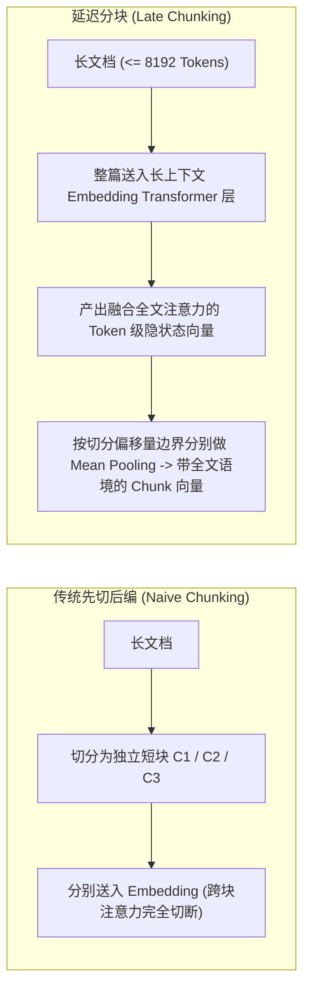
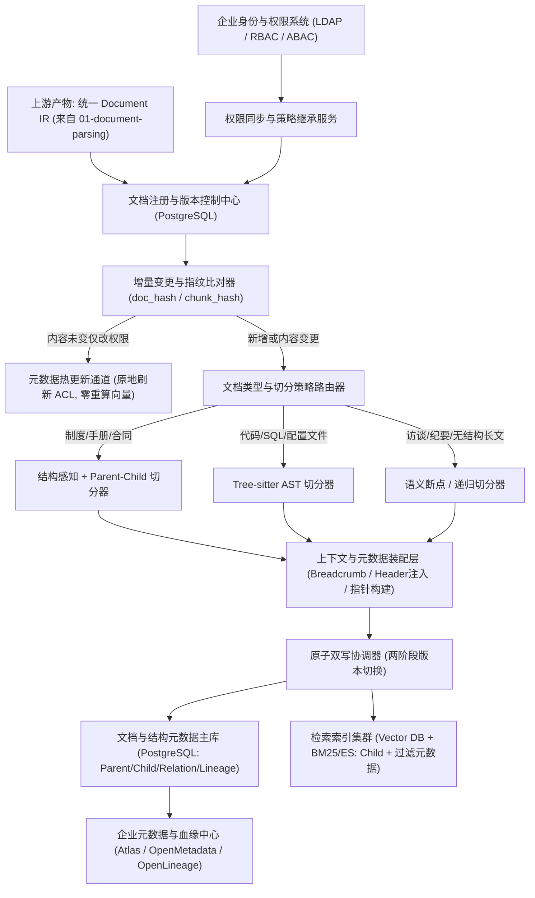
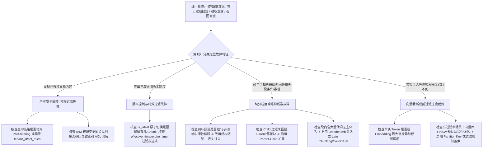

# 文档切分与元数据建模：多范式分块算法、Late Chunking、企业级权限元模型与知识血缘治理

> **学习路径导航（基础 → 深入 → 架构师）**：
> - **基础层（第 1~2 节）**：建立“切分是检索粒度的物理建模，元数据是治理与权限的神经中枢”的核心认知，理解为什么即使大模型拥有 128K~1M 上下文仍离不开精细化切分与元数据建模。
> - **深入层（第 3~5 节）**：穿透 Embedding 语义稀释机制、6 大切分范式（固定/递归/语义/结构感知/Parent-Child/Late Chunking）、Chunk Size 与 Overlap 权衡方程、结构关系保留（树形父子、相邻链表、图表交叉引用）及双层切分质量评估体系。
> - **架构师层（第 6~11 节）**：掌握“开源 vs 商业、自研 vs 采购、集成 vs 重写”的选型权衡、10,000 份多租户多版本文档的统一元数据 Schema 与权限继承落地、常见故障排障树、索引与 Token 成本测算及高频面试深度应答。
> - **与传统大数据体系关联**：本模块直接承接上游文档解析 [01-document-parsing.md](./01-document-parsing.md)，并与企业数据中台的**统一元数据治理** [02-metadata-governance.md](../02-data-platform/02-metadata-governance.md)、**数据质量与全链路血缘** [03-quality-lineage.md](../02-data-platform/03-quality-lineage.md)、**多租户安全与权限管控** [05-data-api-security.md](../02-data-platform/05-data-api-security.md) 以及下游 RAG 混合检索 [03-rag-vector-search.md](../06-ai-agent/03-rag-vector-search.md) 紧密联动。

---

## 1. 核心概念

### 1.1 文档切分与元数据建模的本质定义
如果说非结构化文档解析是将二进制文件清洗为标准 DWD 层中间表示（Document IR），那么**文档切分（Document Chunking）与元数据建模（Metadata Modeling）**就是面向 AI 检索与推理引擎的**数仓建模与资产治理层（DWS / Asset Modeling）**。

1. **文档切分（Chunking）**：将长文档按照语义边界、版面结构或索引粒度，拆分为大小受控、语义完整、可独立向量化与倒排索引的逻辑知识单元（Chunk / Node）。它决定了知识库被检索时的**最小可寻址粒度（Retrieval Unit）**与喂给大模型的**上下文装配粒度（Generation Unit）**。
2. **企业级元数据建模（Document & Chunk Metadata Modeling）**：为每一份文档与每一个切分块赋予标准化的**技术元数据、业务元数据、结构拓扑元数据与安全权限元数据**。它是实现**多租户数据硬隔离、版本生效控制、结构化预过滤（Pre-filtering）、前端原文高亮溯源与端到端数据血缘**的物理底座。

### 1.2 核心术语全景表

| 核心概念 | 英文术语 | 核心定义与工程职责 | 所属层级 |
| :--- | :--- | :--- | :--- |
| **检索块 / 生成块** | Retrieval Chunk / Generation Context | 用于向量与关键词匹配的小粒度单元 vs 实际拼接送入 LLM 推理的大粒度上下文 | 切分建模层 |
| **块大小与重叠度** | Chunk Size & Overlap | 单个 Chunk 的最大 Token/字符上限，以及相邻两块之间共享的边界缓冲文本长度 | 切分超参层 |
| **父子分块** | Parent-Child Chunking (Small-to-Big) | 索引细粒度子块（Child）保障匹配精度，命中后按指针回捞完整父块（Parent）保障推理语境 | 高阶切分策略 |
| **延迟分块** | Late Chunking | 先将整篇长文档输入长上下文 Embedding 模型做全局自注意力编码，再按切分边界对 Token 向量做池化 | 前沿表征机制 |
| **上下文增强检索** | Contextual Retrieval | 在切分后、向量化前，用轻量模型为每个孤立 Chunk 注入“所属文档与章节全局背景说明” | 前沿增强策略 |
| **结构拓扑指针** | Structural Pointers (`parent/prev/next/ref`) | 记录 Chunk 在文档目录树中的父子关系、前后顺序链表以及与表格/图片的交叉引用 ID | 知识图谱/结构层 |
| **内容指纹** | Content Hash (`sha256`) | 对原始文档或单个 Chunk 正文计算的加密哈希，用于增量变更检测、幂等去重与跳过冗余向量化 | 数据工程层 |
| **权限前过滤** | ACL Pre-filtering | 在向量 ANN 搜索或倒排召回阶段，基于 `tenant_id` 与 `acl_roles` 强制裁剪候选集，杜绝越权泄露 | 安全合规层 |

---

## 2. 解决的问题

### 2.1 为什么大模型上下文越来越长（128K ~ 1M），仍然必须做好切分与元数据建模？
工程实践中常出现一种误区：“既然现代 LLM 支持百万 Token，直接把整份 PDF 塞进 Prompt 不就不需要切分了吗？”但在企业级生产场景（如 10,000 份文档、总计上亿 Token）中，精细切分与元数据建模解决的是五个不可回避的物理瓶颈：

1. **Embedding 模型的语义稀释（Semantic Dilution）与长度硬约束**：
   - 无论 LLM 上下文有多长，检索阶段使用的稠密向量模型（Embedding Model）必须把一段文本压缩进固定维度（如 768 或 1024 维）的单一浮点向量中。
   - 如果一个 Chunk 塞进 3,000 个 Token，包含 5 个不同主题（如既讲采购流程、又讲财务报销、又讲违约条款），压缩后的单向量只是 5 个主题的“平均质心”，导致查询其中任意单一主题时余弦相似度都被严重拉低，出现召回塌陷。
2. **“中间遗忘”效应（Lost in the Middle）与推理成本爆炸**：
   - 研究与生产实测均表明，当 Prompt 充斥数万 Token 无关噪音时，LLM 对上下文中段关键事实的注意力显著衰减，幻觉率上升；同时每次查询全量送入长文本会令首字延迟（TTFT）飙升至数十秒，Token 账单呈百倍暴涨。
3. **跨块截断与指代消解丢失（Broken Context & Coreference Loss）**：
   - 粗糙切分会在表格中间、代码块中间或因果句中间一刀切断；更隐蔽的是**代词丢失**——原文档第 4 段写着“该方案在 2026 年起暂停对华东区适用”，一旦切块与前文脱离，“该方案”指代什么彻底消失，检索器根本无法将其与“冷链补贴政策”关联。
4. **企业级多租户、密级隔离与版本冲突（ACL & Version Pollution）**：
   - 企业知识库中常并存《2024 版薪酬管理办法》与《2026 版薪酬管理办法》，且高管薪酬细则仅限 HR 与总监级可见。如果没有严谨的 `version`、`effective_time`、`is_latest`、`tenant_id` 和 `acl_roles` 元数据建模，检索器极易把**已废止的旧制度**或**无权查看的机密段落**召回并泄露给普通员工。
5. **无法支撑引用溯源与数据血缘审计**：
   - 若 Chunk 丢失了 `doc_id`、`section_path`、`page_no` 和 `bbox`，AI 给出的结论就成了不可验证的黑盒，一旦出现错误回答，研发无法回溯到源文档和具体加工版本。

### 2.2 与传统大数据中台“数据治理与数据血缘”的深层共鸣
参考知识库中 [02-metadata-governance.md](../02-data-platform/02-metadata-governance.md) 与 [03-quality-lineage.md](../02-data-platform/03-quality-lineage.md) 的治理框架，AI 知识库的元数据建模本质上是传统三类元数据与字段级血缘在非结构化领域的自然延伸：

| 传统数仓治理体系 | AI 知识库 Chunk 与元数据建模 | 共通架构原则 |
| :--- | :--- | :--- |
| 技术元数据（库/表/列/分区/存储路径） | 文档格式、页数、`page_no`、`bbox`、`token_count`、`content_hash`、`embedding_model` | 支撑物理定位、增量同步与索引演进 |
| 业务元数据（业务域/指标口径/Owner/密级） | `domain`、`doc_type`、`owner_dept`、`security_level`、`effective_time`、`expire_time` | 支撑业务过滤、时效控制与资产盘点 |
| 操作元数据（作业状态/耗时/访问热度） | `parser_version`、`chunker_version`、`indexed_at`、Chunk 检索命中率与点踩反馈计数 | 支撑效果监控、冷热分层与坏例治理 |
| 权限体系（Apache Ranger 行列级策略） | `tenant_id` + `acl_roles` + `acl_users` + 向量库/ES 检索前过滤（Pre-filtering） | 最小权限原则与租户数据物理/逻辑硬隔离 |
| 字段级血缘（源表 → ETL → ADS 指标） | 资产级血缘（原始 PDF → Document IR → Parent/Child Chunk → Vector ID → 线上 Citation） | 任何一条问答结果可反向溯源、上游更新可正向影响分析 |

---

## 3. 底层原理

### 3.1 Embedding 表征边界与 Chunk Size / Overlap 权衡数学直觉
要科学设定切分参数，必须理解两个相互制约的底层机理：

1. **信息熵与向量表征容量权衡（Chunk Size Trade-off）**：
   - **过小（如 64 ~ 128 Tokens）**：单块语义极纯，与短问题匹配度高，但丢失前因后果、限定条件（如“前提条件：仅限 VIP 客户”）与跨句推理链，容易出现“断章取义式幻觉”；同时总 Chunk 数暴增，推高向量索引内存占用与 ANN 图遍历开销。
   - **过大（如 1,500 ~ 2,000+ Tokens）**：包含多个子话题，经过 Mean Pooling 或 `[CLS]` 池化后的单向量成为多语义折中点，与具体细粒度问题的余弦相似度被显著稀释（Signal-to-Noise Ratio 下降）；且即便命中，大量无关段落也会占据 Top-K 窗口并干扰重排模型（Reranker，许多 Cross-Encoder 上限仅为 512~1024 Tokens）。
   - **黄金平衡区间与解耦思路**：在单层切分中，中文企业知识库常见经验甜点区在 **300 ~ 600 Tokens**（英文约 256 ~ 512 Tokens），Overlap 设为 **10% ~ 15%**；但在高阶架构中，更优解是**通过 Parent-Child 架构将“检索粒度（200~400 Tokens）”与“生成粒度（800~1,500 Tokens）”彻底解耦**。

2. **Overlap（滑动重叠窗口）的作用与代价**：
   - **正向作用**：缓解硬切分导致的关键事实恰好落在切口两侧的问题，保证边界句子在至少一个 Chunk 中拥有邻近上下文。
   - **负面代价**：当 Overlap 超过 25%~30% 时，① 存储与 Embedding 计算成本按 $\frac{1}{1 - \text{overlap\_ratio}}$ 膨胀；② Top-K 召回结果极易被同一段落高度重叠的 2~3 个相邻 Chunk 霸占，挤压其他真正互补证据的召回席位（需在检索后做 Adjacent Chunk Deduplication/Merge）。

### 3.2 六大切分范式核心原理拆解

#### 1. 固定长度切分（Fixed-size Chunking）
按固定字符数或 Token 数机械截断并附加固定步长重叠。计算复杂度 $O(N)$、无外部依赖，但会频繁截断完整句子、表格与代码块，**严禁直接用于生产级企业技术/制度知识库**，仅可作为兜底切分器。

#### 2. 递归字符切分（Recursive Character Text Splitting）
按照优先级递减的分隔符列表（如 `["\n\n", "\n", "。", "！", "？", "；", " ", ""]`）自顶向下递归拆分：优先按空行（自然段）切，若某段仍超长再按换行切，仍超长则按中文句号切，最后合并相邻短段直至逼近 `chunk_size`。它在零模型开销前提下最大程度保护了自然段落与句子完整性，是**通用纯文本场景的可靠基线**。

#### 3. 语义切分（Semantic Chunking）
- **机制**：先将文档按句切分，使用滑窗（如每 1~3 句为一个小窗以平滑单句噪声）计算每个句窗的 Embedding 向量 $\vec{e}_i$，计算相邻窗口的余弦距离 $d_i = 1 - \cos(\vec{e}_i, \vec{e}_{i+1})$；当 $d_i$ 超过动态分位数阈值（如第 90~95 百分位）时，判定此处发生话题转换并插入断点。
- **工程权衡**：对缺乏标题层级的长篇访谈录、客服工单记录、会议纪要非常有效；但在结构清晰的技术规范或合同中，其收益往往不如“结构感知切分”，且入库阶段需要对每个句子调用 Embedding，摄取耗时与计算成本显著上升（约增 3~5 倍），还可能产出长度极不均匀的极端超长/超短块（需叠加最小/最大长度硬护栏）。

#### 4. 结构感知切分（Structure / Layout / AST-Aware Chunking）
- **文档结构感知**：直接消费上游 Document IR 中的标题层级树（H1 → H2 → H3）、列表项、表格对象、代码块和图片锚点。
  - 核心铁律：**标题永不与正文孤立拆分**；**小表格（< 阈值 Token）严禁腰斩**；**超大表格按行组切分并强制为每个子块复制注入表头（Header Injection）**；**每个文本块头部前置注入结构面包屑（Breadcrumb Injection）**，如 `[文档: 设备运维规范V3 | 章节: 第4章 故障处理 > 4.2 紧急停机]`。
- **代码 AST 感知**：针对源码或 SQL 知识库，使用 `Tree-sitter` 解析抽象语法树，严格沿着类（Class）、方法（Method）、函数（Function）与 SQL CTE/DDL 语句边界切分，保留完整签名与注释上下文。

#### 5. 父子分块（Parent-Child / Small-to-Big Chunking）
将**检索精度**与**生成完整性**拆分为两层结构：
- **Parent Chunk（父块，如完整二级章节或 1,000~1,500 Tokens）**：存入文档存储（PostgreSQL / MongoDB / Redis / 对象存储），不直接或仅作辅助向量化；
- **Child Chunk（子块，如 200~350 Tokens 的精细语义片段）**：携带 `parent_id` 写入向量库与 BM25 索引；
- **运行时流程**：用户提问命中若干 Child Chunk → 按 `parent_id` 聚合去重 → 捞出完整 Parent Chunk 送入 Reranker 或直接送入 LLM 生成回答。这样既规避了大块语义稀释，又消除了小块上下文缺失。

#### 6. 延迟分块（Late Chunking）与上下文增强（Contextual Retrieval）原理对比
传统切分（Naive Chunking）的最大痛点是**先切块再编码**，导致子块脱离全文后无法完成代词消解（如“该公司”、“上述条款”）。业界演进出两种前沿解法：



- **Late Chunking（由 Jina AI 系统化提出）**：利用支持 8K+ 长窗口的现代 Embedding 模型（如 `jina-embeddings-v3`、`bge-m3`），**先让整篇文档（或整章）一次性通过 Transformer 编码器**，使所有 Token 在 Self-Attention 层完成跨段指代消解与上下文交互，得到 Token 级特征矩阵后，**再根据切分器预先算好的字符/Token 边界位置对每段 Token 向量分别做 Mean Pooling**。
  - *优势*：几乎零额外 LLM 调用成本，天然保留全文指代语义；
  - *局限*：受限于 Embedding 模型最大上下文窗（超过 8K 仍需分章窗口处理）；无法直接改善 BM25 关键词检索中的代词缺失问题；且依赖对底层 Embedding 模型前向传播 Token Hidden States 的访问权限（闭源黑盒 API 无法直接使用）。
- **Contextual Retrieval（Anthropic 工程实践）**：对每个切好的 Chunk，调用轻量 LLM（结合 Prompt Caching 缓存整篇文档前缀）生成一段 50~100 字的**情境定位说明**拼接在 Chunk 开头，再同时做 Dense Embedding 与 BM25 索引。
  - *优势*：**同时提升向量检索与 BM25 稀疏检索效果**（因为补充了缺失的实体名称），且对底层模型无白盒改造依赖；
  - *局限*：入库阶段存在明确的 LLM 预处理成本与延迟（即使开启 Prompt Caching，批量处理 10,000 份文档仍需精细核算成本）。

---

## 4. 系统架构

### 4.1 切分建模与元数据治理平台全景架构
企业级切分与元数据系统不应只是向量入库脚本里的一段 `splitter.split_text()`，而应采用**“元数据与主数据注册中心 + 策略化切分路由引擎 + 双存储一致性写入 + 血缘权限联动”**架构：



### 4.2 关键架构解耦点
1. **权限变更与内容变更分离（Metadata Hot-Patch）**：企业组织架构调整或员工调岗时，文档的访问权限（`acl_roles`）频繁变动，而文档正文一字未改。将 ACL 作为可独立更新的标量元数据字段，支持对向量库/ES 执行**原地标量字段热更新（Upsert Payload / Partial Update）**，彻底避免“改一次权限就要重新解析和重新 Embedding 几万个块”的灾难性开销。
2. **主存储（Source of Truth）与检索索引分离**：以事务型数据库（PostgreSQL）作为 Document、Version、Parent Chunk、Child Chunk 与关系指针的权威主存储；向量库（如 Milvus/Qdrant/pgvector）与倒排引擎（Elasticsearch/OpenSearch）作为可重建的派生读索引（Derived Read Index）。任何时候切换 Embedding 模型或调整索引参数，均可直接从主库回放重刷索引，无需重新解析原始 PDF。
3. **两阶段版本切换（Blue-Green Document Version Flip）**：更新一份 100 页重要制度文档时，先以 `version = v2, status = INDEXING` 写入全部新 Chunk 并完成向量构建，确认 100% 成功后在元数据主库与检索索引中原子将 `v2` 置为 `is_latest = true`、`v1` 置为 `is_latest = false`（再异步清理过期索引），杜绝“删旧写新中途崩溃导致线上查无此文档”的空窗期。

---

## 5. 关键算法或实现机制

### 5.1 结构感知 + Parent-Child 混合切分算法流程
针对企业最核心的 PDF/Word 制度手册与技术文档，生产推荐的标准切分状态机如下：
1. **目录树构建**：遍历 Document IR 中的 `Heading` 元素，维护当前标题栈 `section_stack = [H1, H2, H3]`，生成标准路径 `section_path`。
2. **按元素类型差异化处理**：
   - **普通文本段落**：在同一最低级标题内聚合形成 Parent Block（上限约 1,200 Tokens，超长则按自然段边界拆分为多个同级 Parent）；再对每个 Parent 内部用递归句界切分器生成 Child Chunks（目标 300~450 Tokens，重叠 1 句 / ~50 Tokens）。
   - **表格元素（Table）**：
     - 若表格总 Token ≤ 800：整表作为一个独立原子块保留（不拆散），同时生成一条 `table_summary` 摘要子块指向该表 Parent；
     - 若表格总 Token > 800（如长报价单/参数表）：提取 `<thead>` 表头，按每组 10~15 行切分为多个 Child 表块，**每个子块自动前置复制完整表头**，并共享同一个 Parent Table ID。
   - **图片与公式元素（Image / Formula）**：将图注（Caption）+ VLM 语义描述 + 正文引用句组装为独立语义子块，关联 `image_uri` 与所属章节 Parent。
3. **上下文面包屑注入（Breadcrumb Prefixing）**：为每个 Child Chunk 的检索文本前缀注入统一结构标头（仅计入有限开销，通常 < 30 Tokens）：
   `【文档】企业数据安全管理办法(v2.3) | 【章节】第3章 分级分类 > 3.2 核心数据访问审批 | 【类型】正文`
4. **双向结构关系链构建**：按逻辑阅读序为同一文档所有 Child 写入 `prev_chunk_id` / `next_chunk_id`，为每个 Child 写入 `parent_chunk_id`，为引用图表的文本块写入 `linked_element_ids`。运行时检索命中某块后，若需扩展语境，可 $O(1)$ 查出父块、前后邻接块或关联图表。

### 5.2 企业级权限继承与检索前过滤机制（ACL Inheritance & Pre-filtering）
文档权限安全是企业 AI 落地的第一红线，必须严防**“检索后过滤（Post-filtering）陷阱”**：
- **为什么禁止纯 Post-filtering？** 若先在全库做 Top-20 向量召回，再在应用层剔除当前用户无权访问的文档，当全库 95% 匹配文档属于高密级时，过滤后可能只剩 0 条或 1 条结果，导致有权限的文档反而漏召回（Zero-Recall Failure）。
- **标准方案：分级继承 + 检索前过滤（Pre-filtering）**：
  1. **权限继承链**：`租户 (tenant_id) → 空间/知识库 (kb_id) → 文件夹 (folder_id) → 文档 (doc_id) → Chunk`。默认向下继承，支持文档级显式覆写（Override）；当文件夹权限变更时，通过异步消息批量刷新受影响文档的 `acl_roles` / `acl_deny_users` 字段。
  2. **查询态布尔表达式下推**：用户发起检索时，鉴权网关从 IAM/JWT 解析该用户的 `tenant_id`、`user_id`、`dept_ids` 与 `role_ids`，强制拼装不可绕过的过滤条件并下推至向量库（Milvus Scalar Filter / Qdrant Payload Index / pgvector Bitmap Index）与 ES Filter Context：
     - `tenant_id == current_tenant`
     - `AND status == 'ACTIVE' AND is_latest == true`
     - `AND effective_time <= now() AND (expire_time IS NULL OR expire_time > now())`
     - `AND (is_public == true OR acl_roles OVERLAPS user_roles OR acl_users CONTAINS user_id)`
     - `AND NOT (acl_deny_users CONTAINS user_id)`
  3. **大规模租户隔离优化**：当单集群租户数较多且各租户数据分布不均时，结合向量库的 **Partition Key（按 `tenant_id` 逻辑分区）** 限制 ANN 图搜索范围，既保证绝对隔离，又防止过滤率过高导致的 HNSW 图断连与召回衰减。

### 5.3 切分质量双层评估方法
切分参数不能靠拍脑袋设定，需建立**内在指标（Intrinsic）+ 外在指标（Extrinsic）**双层评测体系：

1. **内在结构质量指标（无需标注查询，自动化流水线实时计算）**：
   - **Token 长度分布统计（P10 / P50 / P90 / Max）**：监控是否出现大量碎块（< 50 Tokens，噪声高）或超长截断块（> Embedding 模型上限，静默丢失尾部内容）；
   - **完整句界率（Sentence Boundary Integrity）**：检查 Chunk 首尾是否落在合法句末标点或结构边界，而非单词/句子/Markdown 表格行腰斩；
   - **相邻块语义边界对比度**：验证同块内句子平均相似度是否显著高于跨块边界句子相似度，检验语义内聚性。
2. **外在端到端检索指标（基于业务黄金测试集，参考 Chroma Chunking Evaluation 方法论）**：
   - **跨切分方案可比指标（Token-level IoU / Span Recall & Precision）**：由于不同 Chunk Size 产出的 Chunk 总数和范围不同，直接比“Chunk 级 Recall@5”对大块不公平（大块天然覆盖范围广）。科学做法是在原始文档上标注**最小答案证据区间（Golden Evidence Spans，字符起止偏移量）**，评测 Top-K 召回文本与真值证据区间的 **Token-level Recall（是否完整覆盖答案证据）** 与 **Token-level Precision（召回文本中有效证据占比，惩罚过度注水的大块）**，以及综合 **Token-F1**；
   - **下游 RAG 联合验证**：联合监控重排后 Context Recall、Faithfulness（忠实度）与端到端回答准确率，作为切分策略上线的最终卡点。

---

## 6. 技术选型与替代方案

### 6.1 主流切分工具与元数据存储底座对比矩阵

| 维度 / 类别 | 开源轻量库（LangChain / LlamaIndex Splitters + Tree-sitter） | 全链路开源框架（RAGFlow / Dify / FastGPT 内置切分） | 云厂商托管知识库（AWS Bedrock KB / Azure AI Search / 阿里云百炼） | 自建企业级数据管道（Document IR + 定制 Chunker + PG/Milvus/ES） |
| :--- | :--- | :--- | :--- | :--- |
| **切分灵活度** | 高：代码级可控，易组合自定义策略 | 中：内置多种可视化模板（Q&A/纸质/法律/表格），深度改造成本中 | 低中：仅暴露固定几种内置策略（固定/层级/语义） | **极高**：完全贴合企业复杂表格、跨文档引用与垂直行业结构 |
| **权限与版本元数据** | 仅提供弱类型 `dict` metadata，无原生版本与权限继承体系 | 提供基础知识库级权限，细粒度文档/部门级动态 ACL 扩展受限 | 与对应公有云 IAM 绑定紧密，跨云与私有化本地 AD/LDAP 适配复杂 | **极强**：完整对齐企业现有 RBAC/ABAC、多租户与数据治理血缘中心 |
| **维护成本** | 中：工具本身轻量，需自行维护外部状态存储与编排 | 中低：开箱即用，但业务深度定制时易与上游开源主干分叉难升级 | 低：全托管免运维 | 较高：需维护主存储、同步任务与双写一致性机制 |
| **生态兼容与厂商锁定** | 开源 Python 生态标准，无锁定 | 与对应应用平台强耦合，底层 Schema 较难独立复用于多 Agent 底座 | **强厂商锁定**：元数据模型、索引结构与计费均受云厂商约束 | **零锁定**：标准 PostgreSQL Schema + 开放检索接口，可服务多套上层 AI 应用 |

### 6.2 架构师三维选型决策权衡

#### 维度一：开源 vs 商业产品
- **中小型业务验证 / 非核心内部问答**：优先复用成熟开源全链路框架（如 RAGFlow 的版面与切分模板）或云托管知识库快速跑通闭环，缩短 MVP 周期。
- **中大型企业级统一知识中台（多业务线复用、强权限合规、复杂异构文档）**：严禁把核心企业知识资产和权限模型锁死在黑盒商业 SaaS 或单一低代码 RAG 玩具平台中。应采用**开源底层组件（LangChain/LlamaIndex 底层算子 + Tree-sitter + PG/Milvus/ES）+ 自建统一元数据与治理层**，保障扩展性与长期演进自主权。

#### 维度二：自研 vs 采购
- **不要重复造轮子（直接集成开源/采购）**：基础分词器（`tiktoken`/模型原生 Tokenizer）、递归句界分割器、Tree-sitter 语法解析器、向量数据库（Milvus/Qdrant/pgvector）与倒排引擎（ES/OpenSearch）。
- **必须牢牢掌握在自己手里的核心自研层**：
  1. **企业统一文档与 Chunk 元数据 Schema**（直接映射组织架构、密级、版本与业务域）；
  2. **面向企业特有文档的结构化切分规则引擎**（如合同条款层级、跨页表头注入、涉密字段掩码）；
  3. **权限同步与双写一致性控制面**（确保 IAM 权限变更分钟级生效且不触发全量重算）；
  4. **切分与检索离线评测基准框架**。

#### 维度三：集成 vs 重写
- **架构原则**：面向 5~10 人的平台研发团队，**以“集成现有数据中台底座”为最高优先级，坚决避免另起炉灶重写基础设施**。
  - 若企业已有 PostgreSQL 集群与 Elasticsearch 集群，在百万级 Chunk 规模内（例如 10,000 份文档产出约 30~80 万 Chunk），完全可以先用 **PostgreSQL（含 `pgvector`）+ Elasticsearch** 落地元数据主库、权限过滤、稠密与稀疏混合检索，显著降低新增专用向量数据库的运维门槛与技术风险；待规模突破千万级 Chunk 或高并发低延迟成为瓶颈时，再通过抽象的检索适配层平滑扩展至 Milvus/Qdrant 专用向量集群。

---

## 7. 工程实践

> [!NOTE] 案例性质说明：本案例为教学假设场景，用于系统训练 AI 数据架构设计能力，不属于个人过往真实任职项目。关于个人过往真实履历事实边界，请严格对照 [PROFILE_FACTS.md](../PROFILE_FACTS.md)。

### 7.1 教学假设场景：10,000 份多版本多权限企业文档的切分与元数据建模落地
承接 [01-document-parsing.md](./01-document-parsing.md) 中的教学假设背景（10,000 份 PDF/Word，约 250,000 页），在切分与元数据层新增以下典型企业约束：
- **多租户与多部门权限**：覆盖 3 个子公司租户（`tenant_id`）、12 个业务部门，文档分为公开（L1）、部门内部（L2）、项目受限（L3）、高管机密（L4）四个密级；
- **版本演进与时效性**：制度与报价单频繁修订（如 V1.0 → V2.0），要求问答默认仅检索当前生效最新版本，但支持审计角色按时间点追溯历史生效版本；
- **精准溯源与血缘要求**：每条回答引用必须可点击跳转至原文 PDF 指定页码并高亮 `bbox`，同时接入企业数据治理目录统计各部门知识资产覆盖率与引用热度。

### 7.2 企业级统一文档与 Chunk 元数据模型（DDL & JSON Schema）

#### 1. 主元数据表设计（PostgreSQL，权威 Source of Truth）

```sql
-- 1. 文档主表与版本元数据 (对齐企业数据治理资产目录)
CREATE TABLE ai_document_versions (
    doc_version_id    UUID PRIMARY KEY,
    doc_id            VARCHAR(64) NOT NULL,          -- 逻辑文档唯一ID (跨版本不变)
    version           VARCHAR(32) NOT NULL,          -- 语义版本号, 如 v2.1
    is_latest         BOOLEAN NOT NULL DEFAULT FALSE,-- 原子切换标记
    lifecycle_status  VARCHAR(24) NOT NULL,          -- INDEXING / ACTIVE / DEPRECATED / DELETED
    tenant_id         VARCHAR(64) NOT NULL,          -- 多租户硬隔离键
    kb_id             VARCHAR(64) NOT NULL,          -- 所属知识库ID
    title             TEXT NOT NULL,
    doc_type          VARCHAR(32) NOT NULL,          -- POLICY / MANUAL / CONTRACT / REPORT
    source_uri        TEXT NOT NULL,                 -- 原始文件对象存储 URI (ODS溯源)
    ir_uri            TEXT NOT NULL,                 -- 解析后 Document IR URI (DWD溯源)
    content_hash      CHAR(64) NOT NULL,             -- 原文 SHA-256 指纹
    security_level    SMALLINT NOT NULL,             -- 1:公开 2:内部 3:受限 4:机密
    acl_roles         TEXT[] NOT NULL DEFAULT '{}',  -- 允许访问角色列表 (继承自目录/文档覆写)
    acl_users         TEXT[] NOT NULL DEFAULT '{}',  -- 显式授权用户列表
    acl_deny_users    TEXT[] NOT NULL DEFAULT '{}',  -- 显式拒绝名单 (优先级最高)
    effective_time    TIMESTAMPTZ NOT NULL,          -- 制度/合同生效时间
    expire_time       TIMESTAMPTZ,                   -- 失效时间 (NULL表示长期有效)
    owner_dept        VARCHAR(64) NOT NULL,          -- 业务归属部门 (数据治理Owner)
    parser_version    VARCHAR(64) NOT NULL,          -- 解析流水线版本 (血缘记录)
    chunker_version   VARCHAR(64) NOT NULL,          -- 切分策略版本 (血缘记录)
    created_at        TIMESTAMPTZ NOT NULL DEFAULT NOW(),
    updated_at        TIMESTAMPTZ NOT NULL DEFAULT NOW(),
    UNIQUE (tenant_id, doc_id, version)
);

-- 2. Chunk 与结构拓扑主表 (同时支撑 Parent 与 Child 层级)
CREATE TABLE ai_document_chunks (
    chunk_id          UUID PRIMARY KEY,
    doc_version_id    UUID NOT NULL REFERENCES ai_document_versions(doc_version_id),
    doc_id            VARCHAR(64) NOT NULL,
    tenant_id         VARCHAR(64) NOT NULL,
    chunk_level       VARCHAR(16) NOT NULL,          -- 'PARENT' | 'CHILD'
    parent_chunk_id   UUID REFERENCES ai_document_chunks(chunk_id),
    prev_chunk_id     UUID,                          -- 同级前驱指针 (支持前后文滑动扩展)
    next_chunk_id     UUID,                          -- 同级后继指针
    chunk_order       INT NOT NULL,                  -- 文档内全局逻辑阅读序号
    chunk_type        VARCHAR(24) NOT NULL,          -- TEXT / TABLE / TABLE_SUMMARY / IMAGE_CAPTION / CODE
    section_path      TEXT[] NOT NULL,               -- 标题树路径, 如 '{"第3章 商务报价","3.2 设备清单"}'
    page_no_start     INT NOT NULL,                  -- 起始页码 (1-based)
    page_no_end       INT NOT NULL,                  -- 结束页码 (跨页表格/段落支持范围)
    bbox_json         JSONB,                         -- 归一化坐标数组, 用于前端PDF高亮定位
    linked_element_ids TEXT[] DEFAULT '{}',          -- 关联的图片/表格/脚注 ID (交叉引用)
    content_raw       TEXT NOT NULL,                 -- 原始完整内容 (HTML表格或纯文本, 供生成用)
    content_for_index TEXT NOT NULL,                 -- 注入面包屑/表头后的检索文本 (供Embedding/BM25用)
    token_count       INT NOT NULL,
    content_hash      CHAR(64) NOT NULL,             -- Chunk 级内容哈希 (局部增量重算向量依据)
    created_at        TIMESTAMPTZ NOT NULL DEFAULT NOW()
);

CREATE INDEX idx_chunks_tenant_doc ON ai_document_chunks (tenant_id, doc_id, chunk_level);
CREATE INDEX idx_chunks_parent ON ai_document_chunks (parent_chunk_id);
```

#### 2. 检索索引侧冗余 Payload（Vector DB / Elasticsearch 同步契约）
为支持检索阶段的零回表前过滤（Pre-filtering），写入向量库与 ES 的每条 Child 记录均携带扁平化标量快照：

```json
{
  "chunk_id": "7c9e6679-7425-40de-944b-e07fc1f90ae7",
  "parent_chunk_id": "550e8400-e29b-41d4-a716-446655440000",
  "doc_id": "doc_9f8e7d6c5b",
  "version": "v2.1",
  "is_latest": true,
  "lifecycle_status": "ACTIVE",
  "tenant_id": "tenant_energy_01",
  "acl_roles": ["dept_ops", "role_engineer", "role_director"],
  "acl_deny_users": [],
  "security_level": 2,
  "effective_ts": 1767225600,
  "expire_ts": 253402300799,
  "doc_type": "MANUAL",
  "chunk_type": "TABLE",
  "section_path": ["第3章 商务报价", "3.2 设备清单与单价"],
  "page_no": 12,
  "bbox": [0.08, 0.45, 0.92, 0.90],
  "content_hash": "e3b0c44298fc...",
  "prev_chunk_id": "6b8d5568-...",
  "next_chunk_id": "8d0f7780-..."
}
```

### 7.3 与原数据中台元数据治理及血缘系统的集成落地
1. **统一元数据目录纳管**（参考 [02-metadata-governance.md](../02-data-platform/02-metadata-governance.md)）：在企业既有元数据中心（如 OpenMetadata / Apache Atlas）中扩展非结构化实体类型 `KnowledgeDocument` 与 `KnowledgeIndex`，将 `doc_id`、`owner_dept`、`security_level`、资产覆盖率与问答引用热度纳入统一数据资产大盘，让业务负责人对“僵尸过期文档”和“高频热点文档”一目了然。
2. **全链路血缘追踪**（参考 [03-quality-lineage.md](../02-data-platform/03-quality-lineage.md)）：每次入库作业向血缘系统发射标准血缘事件（可对齐 OpenLineage 规范）：
   `ODS 原文件 (source_uri + sha256) → [Parser v2.1] → Document IR → [Chunker v1.4] → Parent/Child Chunks → [BGE-M3 v1] → Vector/ES Index`。
   当某份源制度修订或某批历史解析模型曝出缺陷时，通过**下游影响分析（Impact Analysis）**秒级圈定受影响索引分区并触发定点重算。

---

## 8. 常见故障与解决思路

### 8.1 切分与元数据线上故障排查决策树



### 8.2 五类高频生产问题与工程根治方案

| 故障场景 | 典型表现与深层根因 | 工程根治手段 |
| :--- | :--- | :--- |
| **1. 向量模型静默截断（Silent Truncation）** | 部分 Chunk 超过 512 Tokens（如用 `bge-large-zh-v1.5` 最大长度 512），超长表格或段落的后半部分在 Embedding 时被框架静默截断，导致文档后半段永远搜不到 | 切分阶段**严禁按字符数粗略估算**，必须直接使用目标 Embedding 模型对应的真实 Tokenizer 精准计 Token，设置硬上限为 `model_max_tokens - prefix_reserve`（如 `512 - 40 = 472`）并加入入库质量门禁拦截超标块。 |
| **2. 同段重叠块霸占 Top-K（Overlap Flooding）** | Overlap 设为 30% 时，Top-5 召回中有 3~4 条是同一章节相邻的重复文本，挤占了其他真正互补证据的槽位 | ① 降低 Overlap 至 10%~15%（在 Parent-Child 架构下子块甚至可用极小重叠 5%~10%）；② 检索后处理引入**基于 `parent_chunk_id` 与连续 `chunk_order` 的聚合合并去重（Sibling Merge）**。 |
| **3. 文档修订后出现“新旧版本混答”** | 仅覆盖写入新 Chunk 而未清理或标记旧版本 Chunk，导致大模型同时看到 2024 版和 2026 版两条相反规定并自行混淆 | 实施严格的双状态版本控制（`version` + `is_latest` + `lifecycle_status`），写入采用两阶段原子切换；检索默认强过滤 `is_latest == true`，历史版本仅在明确开启“审计回溯模式”时按指定时间窗口查询。 |
| **4. 权限变更延迟引发短暂越权或误拒** | 员工离职或调岗后，同步索引 ACL 的异步批任务每晚跑一次，导致白天出现长达数小时的权限窗口期 | ① 将 IAM/权限系统的角色文档授权变更接入事件总线（Kafka），实现秒级增量 Metadata Patch；② 在最终答案返回前的网关层叠加一层**轻量级实时二次校验（Defense-in-Depth）**，核验命中 `doc_id` 在 Redis/PG 中的实时最新权限状态。 |
| **5. 细碎短块污染召回（Fragment Noise）** | 目录项、孤立章节标题（如仅含“第三章 安全管理”6 个字）、图注碎片被单独切成 Chunk，极易与短查询发生极高字面或向量匹配，却毫无信息量 | 切分后处理强制实施**最小信息量合并规则（Min-Chunk Merge）**：孤立标题强制向后绑定至其下第一段正文；独立碎片块（`< 60 Tokens` 且非结构化表格/图注）自动并入同级前驱或后继块。 |

---

## 9. 性能及成本分析

延续 10,000 份企业文档（约 250,000 页，假设平均每页有效文本约 600 中文字符 ≈ 450 Tokens，总有效语料约 **1.125 亿 Tokens**）的教学假设场景，对不同切分策略的存储、计算与入库成本进行量化对比：

### 9.1 不同切分策略的资源膨胀与成本测算（基于 1.125 亿 Tokens 语料）

| 切分策略 | 平均 Child 大小 / Overlap | 预计产出索引块总数 | 1024维 FP32 向量裸内存（含 HNSW 约 1.5× 索引开销） | 入库 Embedding 耗时（单张 L40S 跑 BGE-M3，约 3万 Tokens/s） | 额外 LLM 预处理开销 | 综合架构评价 |
| :--- | :---: | :---: | :---: | :---: | :---: | :--- |
| **策略 A：固定/递归切分** | 500 Tokens / 15% | 约 26.5 万块 | 约 1.6 GB | 约 65 分钟 | 无 | 成本最低，但表格截断与上下文丢失严重 |
| **策略 B：结构感知 + Parent-Child（推荐生产基线）** | Child 350 Tokens / 10%（Parent ~1,200 Tokens 存 PG） | 约 35.7 万 Child + 9.5 万 Parent | 约 2.2 GB（仅 Child 进向量索引） | 约 70 分钟 | 无（仅图片 VLM 已在解析层完成） | **综合性价比最高**：内存与算力增量可控，召回精度与上下文完整性兼顾 |
| **策略 C：语义切分（Semantic Chunking）** | 动态均值 ~400 Tokens | 约 28 万块 | 约 1.7 GB | 约 4 ~ 5 小时（需先逐句 Embedding + 再逐块 Embedding） | 无 | 入库耗时翻倍，对自带标题结构的企业文档边际收益低于策略 B |
| **策略 D：结构感知 + Late Chunking** | 350 Tokens（按 8K 章窗口编码后池化） | 约 32 万块 | 约 1.9 GB | 约 85 分钟（长序列注意力略降吞吐） | 无 | 无额外 LLM 费用，显著改善代词指代；需自托管长上下文 Embedding 模型 |
| **策略 E：全量 Contextual Retrieval** | 350 Tokens + 80 Tokens 上下文前缀 | 约 35.7 万块 | 约 2.2 GB | 约 85 分钟 | 调用轻量 LLM（开启 Prompt Caching，按 ~1.5 亿输入 + 3,000 万输出 Tokens 估算，商业 API 约 300~1,200 元；或本地 7B/14B GPU 跑约 10~15 小时） | 精度上限高（尤其对 BM25+Dense 双路提升明显），适合高价值核心文档子集分级启用 |

### 9.2 增量更新与 FinOps 降本实操建议
1. **Chunk 级哈希差分更新（Chunk-level Diffing）**：一份 100 页的制度文档仅修改了第 58 页的一段条款时，切分后对所有新旧 Chunk 比对 `content_hash`，仅对发生变化的 2~3 个 Chunk 调用 Embedding 与索引更新，跳过其余 98% 未变更块，削减 **90%+** 增量更新计算成本。
2. **元数据标量与向量分层存储**：向量索引只保留 `chunk_id`、向量及高频前过滤标量（`tenant_id`, `acl_roles`, `is_latest`, `effective_ts`, `doc_type`）；长文本 `content_raw`、详细 `bbox_json` 与完整 `Parent Chunk` 存储在低成本 PostgreSQL 中，召回 Top-K 后按主键批量回表，将昂贵的向量集群内存占用压缩 50% 以上。
3. **分级增强策略**：不要对全库 10,000 份文档一刀切开启昂贵的 Contextual Retrieval，而是按资产分级——**仅对 L1 核心制度、高频 FAQ 与产品报价核心库（通常占总量 15%~20%）启用 Contextual 增强或 Late Chunking**，其余常规文档使用“结构感知 + Breadcrumb 注入 + Parent-Child”，在预算内实现最高 ROI。

---

## 10. 面试题

1. **Q1（核心权衡）**：在企业级 RAG 系统中，如何科学确定 `Chunk Size` 与 `Overlap`？是否 Chunk 越大越好或者越小越好？有没有办法同时兼顾细粒度精准检索与大粒度完整上下文？
2. **Q2（企业架构与安全）**：如何设计面向多租户、多版本、多部门权限的企业级文档结构与元数据模型？如何在向量检索中严格防止越权数据泄露与已废止旧版本污染？
3. **Q3（前沿原理对比）**：请深入解释 `Parent-Child Chunking`、`Late Chunking` 和 `Contextual Retrieval` 三种上下文增强切分方案的底层原理、适用边界与工程成本权衡。
4. **Q4（复杂结构治理）**：面对包含长表格、嵌套代码块与多级标题的技术规范和合同文档，固定切分和普通递归切分有哪些致命缺陷？如何设计结构感知切分器避免语义断裂？
5. **Q5（一致性与运维）**：当企业内部一份 100 页核心规范发生局部修订，或某位员工部门角色权限变更时，如何设计索引增量更新与元数据同步机制，保证不出现“查询空窗期”、“新旧混答”和全量重算开销？
6. **Q6（评估与数据治理）**：如何科学量化评估两套不同切分策略的优劣（如何消除 Chunk 大小不同导致的 Recall 偏差）？切分与元数据层又该如何融入企业既有的数据治理与血缘体系？

---

## 11. 参考答案

### 题目 1：Chunk Size 与 Overlap 的科学选择与“检索/生成粒度解耦”

#### 1 分钟简洁回答
`Chunk Size` 的核心矛盾在于**检索精准度（需要小块避免语义稀释）**与**推理上下文完整性（需要大块保留前因后果）**之间的天然冲突。Chunk 既不是越大越好（会导致 Embedding 单向量语义稀释、超出 Reranker 窗口并引入生成噪声），也不是越小越好（会断章取义、丢失限定条件并推高索引开销）。生产中单层切分通常按目标 Embedding 模型 Tokenizer 实测控制在 300~600 Tokens、Overlap 10%~15%；而更根本的架构解法是采用 **Parent-Child（小块检索、大块召回）** 将检索粒度与生成粒度彻底解耦，并基于业务黄金测试集的 Token-level IoU/F1 做数据驱动调优。

#### 深入原理解释
1. **底层制约因素**：
   - **Embedding 语义压缩瓶颈**：固定维度向量（如 1024 维）表征多主题长文本时会发生语义平均化，查询单个具体事实时余弦相似度显著下降；且多数模型有严格长度上限（如 512 或 8192 Tokens），超长会被静默截断；
   - **Reranker 窗口限制**：很多高精度 Cross-Encoder 重排模型最佳窗口在 512~1024 Tokens，过大的 Chunk 在重排阶段尾部关键信息被截掉，导致排序失真；
   - **Overlap 边际递减效应**：10%~15% 重叠可保护跨边界关键句；但超过 25% 会导致存储计算成本激增，并引发 Top-K 召回结果被同一段重复切片霸占（Overlap Flooding）。
2. **动态差异化设定**：不同文档类型与查询模式应配置不同粒度——事实点查型（如错误码、规章条目、参数定义）适合偏小粒度（200~350 Tokens）；流程总结/因果分析型（如架构设计方案、故障复盘）适合结合 Parent 块（800~1,500 Tokens）完整回捞。

#### 架构师视角分析
- **架构解耦思维**：纠结单一完美 `Chunk Size` 是局部最优陷阱。工业级标准实践是 **Child Chunk（250~400 Tokens，用于高精匹配）+ Breadcrumb 路径注入 + Parent Chunk（完整小节，用于喂给 LLM）+ 相邻块指针（`prev`/`next`，必要时滑动扩展）**。
- **工程铁律**：严禁用字符数拍脑袋配置 `chunk_size=500`（中文 1 字和英文 1 词的 Token 转换比例差异极大），必须绑定线上实际使用的 Embedding 模型原生 Tokenizer 精确计量，并建立离线自动化评测脚本，把 Chunk Size 选择从“玄学调参”转化为“指标驱动实验”。

#### 典型追问
- **追问 1**：如果开启了 Parent-Child，Child 命中了 3 条来自同一个 Parent 的子块，怎么处理？
  - *要点*：按 `parent_chunk_id` 做聚合去重，避免把同一份父块重复拼接三次塞进 LLM 上下文浪费 Token；同时可将命中子块数量或最高子块分数作为该 Parent 的排序权重，释放剩余 Top-K 名额给其他互补证据。

#### 常见错误回答
- 直接死记一个万能数字（如“一律切 512 字符、重叠 50 字符”），未区分中英文 Token 换算、未考虑模型截断上限与文档类型差异；
- 认为“大模型现在支持 128K 上下文了，所以 Chunk 越大越好，直接切 4,000 Tokens 省事”，完全忽略 Embedding 语义稀释和重排截断问题。

---

### 题目 2：企业级文档结构与权限元数据建模及防越权、防过期机制

#### 1 分钟简洁回答
企业级元数据建模必须围绕**“主从分层、权限继承、版本状态机、检索前过滤”**四大支柱展开：以事务数据库（如 PostgreSQL）作为文档版本、父子结构拓扑（`section_path`/`parent_id`/`prev`/`next`/`bbox`）与安全策略的权威主存储；将多租户隔离键（`tenant_id`）、继承后的权限标签（`acl_roles`/`acl_users`/`acl_deny_users`）与版本生效字段（`is_latest`/`effective_time`/`expire_time`）冗余同步至检索索引侧；查询时在向量与倒排召回阶段强制执行 **ACL 前过滤（Pre-filtering）** 并在返回网关叠加实时二次鉴权，从根本上杜绝越权泄露与旧版制度污染。

#### 深入原理解释
1. **四维元数据抽象**：
   - *标识与版本域*：`doc_id`（跨版本不变）、`version`、`is_latest`、`lifecycle_status`、`effective_time`、`expire_time`、`content_hash`；
   - *安全与租户域*：`tenant_id`、`security_level`、`acl_roles`、`acl_users`、`acl_deny_users`（显式拒绝优先级高于允许）；
   - *结构与溯源域*：`chunk_level`（Parent/Child）、`parent_chunk_id`、`prev/next_chunk_id`、`section_path`、`page_no_start/end`、`bbox_json`、`linked_element_ids`；
   - *血缘与治理域*：`source_uri`、`owner_dept`、`parser_version`、`chunker_version`。
2. **为什么必须用 Pre-filtering 而非 Post-filtering？**
   - Post-filtering 先召回全局 Top-K 再过滤无权限项，当最匹配的文档全属于高密级时，过滤后结果集可能为空，既造成合法文档漏召回，又可能通过返回条数变化暴露敏感信息存在性（侧信道推断）；
   - Pre-filtering 将 `tenant_id`、`is_latest == true`、时间窗口与 ACL 集合交集条件直接下推至检索索引内核，保证返回候选集 100% 合法且填满 Top-K。

#### 架构师视角分析
- **高过滤率下的性能退化治理**：当单索引内租户极多且权限碎片化严重时，纯标量前过滤可能导致 HNSW 导航图大量节点被跳过而出现断连与延迟抖动。架构上应结合向量库的 **Partition Key（按 `tenant_id` 分区隔离）** 与**过滤感知搜索算法（Filter-aware ANN / 低剩余率自动回退暴力扫描）** 保障延迟与召回双稳。
- **纵深防御（Defense-in-Depth）**：索引层异步同步权限难免存在秒级~分钟级延迟；高敏企业场景必须在 LLM 生成前于网关层对最终选中的几条 `doc_id` 查一次高可用实时权限缓存（Redis/IAM），做到“索引层保召回、网关层保零越权”。

#### 典型追问
- **追问 1**：如果公司有 500 个角色和复杂的项目组动态权限，把几百个用户 ID 全塞进每个 Chunk 的 `acl_users` 数组里，索引膨胀且权限一变要改几万条记录怎么办？
  - *要点*：权限建模遵循 **RBAC/群组抽象优先**——文档优先绑定角色组/部门组/项目组 ID，而非展开平铺个人 User ID；只有极少数特例点对点授权才进 `acl_users`。员工离职或转岗时只需在 IAM 更新“人→组”映射，查询网关实时拉取该用户最新 `group_ids`，**知识库索引一条记录都不用改！**

#### 常见错误回答
- 仅在向量库里存 `doc_name` 和 `page_no` 两个字段，把权限控制寄希望于“前端按知识库分入口”或“拿到 Top-10 后在代码里 `if has_perm` 过滤”；
- 权限变更时把文档删了重新解析切分并重算 Embedding，导致系统资源被权限同步拖垮。

---

### 题目 3：Parent-Child、Late Chunking 与 Contextual Retrieval 的原理与选型对比

#### 1 分钟简洁回答
三者解决的都是“切分导致上下文丢失”的问题，但发力阶段和成本模型完全不同：**Parent-Child** 解决的是*召回后的生成上下文完整度*（索引小块、回捞大块），零额外模型成本，是通用必选基线；**Late Chunking** 解决的是*向量编码阶段的跨段指代消解*（整篇先过长上下文 Embedding 模型再按边界池化），几乎零额外成本但仅作用于 Dense 检索且需白盒访问模型；**Contextual Retrieval** 在切分后用轻量 LLM 为每块写入全局语境摘要，同时大幅提升 Dense 与 BM25 检索精度，但存在明显的入库 LLM 预处理成本，适合分级用于核心高价值文档。

#### 深入原理解释
1. **Parent-Child（Small-to-Big）**：
   - *核心动作*：不改变单个 Child 的文本语义，仅在命中后通过结构指针向上还原完整父节；
   - *盲区*：如果某个 Child 内部全用代词（“它将于下季度停产”），即便有 Parent，Child 自己被召回的概率依然偏低。
2. **Late Chunking**：
   - *核心动作*：先整篇送入支持 8K+ 窗口的 Embedding Transformer，利用 Self-Attention 让“它”在隐空间吸收前文主语语义，再根据切分偏移量对 Token Hidden States 分别做 Mean Pooling；
   - *盲区*：① 不改变原始文本字符，因此对 BM25 稀疏检索无任何增益；② 无法使用仅返回单一向量的闭源 Embedding API；③ 超出 8K 窗口的百页长文仍需分章窗口处理。
3. **Contextual Retrieval**：
   - *核心动作*：利用支持 Prompt Caching 的轻量 LLM，结合整篇文档背景为每个 Chunk 生成 50~100 字显式上下文头（显式补全实体名、时间、章节归属），拼接后再分别送入 Embedding 和 BM25；
   - *盲区*：入库吞吐受限于 LLM 推理速度，且存在额外的 Token 费用与生成内容准确性校验需求。

#### 架构师视角分析
- **组合拳大于单打独斗**：三者并非互斥关系。在企业级生产落地中，推荐**渐进式组合架构**：
  1. *全量标配（零额外 LLM 成本）*：**结构感知 Parent-Child + 规则化 Breadcrumb 面包屑注入**（利用 Document IR 已有文档名和 `section_path` 免费解决 70% 的主体定位问题）；
  2. *自托管模型进阶*：若已自部署 `bge-m3` / `jina-embeddings-v3` 等长窗模型，可低成本引入 **Late Chunking** 进一步消除跨段代词漂移；
  3. *核心资产精选*：仅对高价值、多代词、多条款引用的核心合同/制度/研报子集（如占全库 15%）开启 **Contextual Retrieval**，实现质量与成本的精准 ROI 平衡。

#### 典型追问
- **追问 1**：既然 Breadcrumb 面包屑注入是免费的，它和 Contextual Retrieval 差在哪里？
  - *要点*：Breadcrumb 只能注入显式的静态结构路径（如“第 3 章 > 3.2 退费规则”）；但若正文里写着“上述标准对 B 类代理商减半执行”，仅靠标题路径无法补全“上述标准指代前文哪一项费用与具体比例”，此时 Contextual Retrieval 或 Late Chunking 才能真正补齐跨段隐式依赖。

#### 常见错误回答
- 把 Late Chunking 误解为“先检索完再切分文档”；
- 不加区分地建议对全公司几十万份文档全部调用昂贵大模型做 Contextual Retrieval，完全不核算入库延迟和预算。

---

### 题目 4：复杂结构文档（长表格、代码、多级标题）的结构感知切分设计

#### 1 分钟简洁回答
固定长度和普通递归切分把文档视为扁平字符串，会导致**表格失头错列、代码块函数腰斩、孤立标题污染召回**三大顽疾。解决之道是让切分器直接消费上游解析产出的结构化 Document IR，按元素类型实施差异化原子保护：**标题与首段绑定并向下传播面包屑、小表整表保留、跨页超长表按行组切分并强制复制表头、代码与 SQL 使用 Tree-sitter 按 AST 语法边界切分**，确保每一个切分块都是自洽的最小逻辑单元。

#### 深入原理解释
1. **表格专项切分机制**：
   - 严禁把 Markdown/HTML 表格按字符数从单元格中间切开；
   - 设定原子阈值（如 800 Tokens）：小于阈值整表保留为原子块，同时挂载一条表格摘要用于语义路由；大于阈值时解析 `<thead>`（含多级合并表头），将 `<tbody>` 按行分组（每组控制总 Token ≤ 阈值），**每一组均自动前置注入完整 `<thead>` 表头**，且所有子块通过 `parent_chunk_id` 指向整张逻辑表。
2. **代码与 SQL AST 切分机制**：
   - 利用 `Tree-sitter` 构建语法树，按 `class_definition`、`function_definition`、`method_declaration` 或完整 SQL `CREATE / SELECT` 语句切分；
   - 当单个巨型类超过上限时，向下拆分为独立方法块，并为每个方法块前置注入所属文件路径、类名、关键类注释及 `import` 依赖头，保留完整符号上下文。
3. **标题与列表保护机制**：
   - 绝不产生仅含标题文字的孤立块；
   - 有序步骤列表（如应急排障 1~6 步）在未超父块上限时尽量保持在同一 Parent 内，避免召回时丢失“第 5 步回滚校验”。

#### 架构师视角分析
- **上下游契约协同**：切分层的上限高度取决于上游解析层（[01-document-parsing.md](./01-document-parsing.md)）产出的 IR 质量。如果上游把表格、标题、代码块全拍平成了一坨纯文本，下游切分器再聪明也只能靠脆弱的正则去猜。因此架构师必须把**“保留结构类型与层级树”**作为解析层到切分层的强制接口契约。

#### 典型追问
- **追问 1**：如果有一张 25 列的超宽设备参数表，即便是单行带表头也看不清哪列对应哪列怎么办？
  - *要点*：对宽表在生成索引文本（`content_for_index`）时，可将每一行转换为显式 `列名: 列值` 的键值文本（Row Serialization），极大提升 BM25 和 Embedding 对“某型号+某参数”的匹配度；同时在 `content_raw` 保留精简 HTML 供 LLM 核对。

#### 常见错误回答
- 回答“我在 Markdown 里用 `\n\n` 切分就不会切坏表格”，忽略超长表格内部不含空行导致超过 Embedding 最大长度被静默截断，以及多级表头丢失的问题。

---

### 题目 5：文档局部修订与权限变更时的增量更新及一致性保障

#### 1 分钟简洁回答
解决增量更新一致性与成本的核心在于**“变更分类解耦 + 内容哈希差分 + 两阶段原子版本切换”**：首先严格区分“仅元数据/权限变更”与“文档正文内容变更”，前者直接走标量字段热更新通道，零向量重算；后者通过 Chunk 级 `content_hash` 比对，只对真正改动的局部块重算 Embedding；写入过程采用蓝绿双版本状态机（先以 `INDEXING` 写入新版本全量视图，全部就绪后再原子切换 `is_latest` 标记，异步回收旧版本索引），彻底消灭查询空窗期与新旧混答。

#### 深入原理解释
1. **三类变更的差异化路径**：
   - **纯权限/元数据变更**（如部门更名、新增授权角色、延长有效期）：仅更新 PostgreSQL 主表，并向向量库与 ES 下发 `Partial Update / Upsert Payload` 刷新标量元数据，毫秒级生效，节省 100% GPU Embedding 算力；
   - **文档正文局部修订**（如 100 页手册仅修改 2 页）：解析产出新 IR 并切分后，对比新旧版本所有 Chunk 的 `content_hash` 集合——未变块的向量直接复用拷贝至新版本号，仅对新增/修改的 2% Chunk 调用 Embedding 模型；
   - **文档下线/删除**：先在主库与索引将 `lifecycle_status` 置为 `DELETED` / `is_latest = false` 实现秒级逻辑不可见，再由异步 GC 任务在低峰期物理清理向量与对象存储，避免线上同步大删引发索引段合并抖动。
2. **两阶段原子切换时序（防空窗期与半成品泄露）**：
   - *Phase 1*：写入新版本 `v2` 文档与 Chunk，标记 `is_latest = false, lifecycle_status = 'INDEXING'`（线上查询只查 `is_latest = true`，完全隔离未就绪数据）；
   - *Phase 2*：核验主库、向量库、ES 三端写入条数一致且无报错后，先置 `v2.is_latest = true`，再置 `v1.is_latest = false`（或在支持事务/别名切换的引擎中原子提交），随后触发旧版延迟物理回收。

#### 架构师视角分析
- **跨存储最终一致性兜底（对账补偿机制）**：PostgreSQL、向量数据库与 Elasticsearch 属于异构分布式存储，不存在跨库强分布式事务。架构师必须借鉴大数据对账思路（参考 [03-quality-lineage.md](../02-data-platform/03-quality-lineage.md)）：
  - 写入链路采用 **Transactional Outbox（事务发件箱）+ Kafka 幂等消费** 保证消息不丢；
  - 配套定时**轻量化一致性巡检对账任务**，核对 PG 活跃 `doc_version_id` 与向量库/ES 中的 Chunk 计数及 `is_latest` 状态，自动修复因网络超时产生的孤儿向量（Orphan Chunks）。

#### 典型追问
- **追问 1**：先置 `v2.is_latest = true` 再置 `v1.is_latest = false` 的瞬间，会不会出现毫秒级的新旧版本同时被查到？
  - *要点*：极短窗口内可能存在双版本可见，但相比“先删旧再写新”导致的分钟级完全不可用要安全得多；若业务对强原子切换有极致要求，可在查询网关侧针对同一 `doc_id` 命中多版本时按 `version` 取最大版本号去重，即可在极短切换窗口内做到对用户完全无感。

#### 常见错误回答
- 直接按 `doc_id` 先执行 `DELETE FROM vector_db WHERE doc_id = ?`，再慢慢重新解析、切分、调 Embedding 写入——一旦中途失败或限流，核心知识库直接出现长时间数据黑洞；
- 文档改了一个错别字就对整份百页 PDF 全量重跑 Embedding。

---

### 题目 6：切分质量的科学量化评估与融入企业数据治理血缘体系

#### 1 分钟简洁回答
评估切分策略绝不能只看“Chunk 级 Recall@K”，因为粗暴增大 Chunk Size 会人为抬高 Chunk 命中率却严重稀释精度、毒化生成。科学评估需采用**“内在结构指标 + 基于字符偏移真值区间的 Token-level IoU（Span Recall / Precision / F1）+ 下游 RAG 忠实度”**三层联合评测。在治理层面，则将文档、切分版本与检索索引作为标准非结构化资产纳入企业统一元数据目录与全链路血缘（源文档 → 解析器版本 → 切分器版本 → 索引），实现资产盘点、效果可追溯与变更影响分析。

#### 深入原理解释
1. **消除尺寸偏差的科学评测法（Span-based Evaluation）**：
   - 在黄金测试集构建阶段，**答案证据标注绑定到原始文档的精确字符起止区间 `[start_char, end_char]`（独立于任何切分方案）**，而不是绑定到某一版的 `chunk_id`；
   - 对比策略 A（300 Tokens）与策略 B（800 Tokens）时，计算两者在相同召回总预算下（例如均限制召回总长度或相同 Top-K），召回文本与黄金证据区间的交集占比：
     - $\text{Token Recall} = \frac{|\text{Retrieved} \cap \text{GoldenSpan}|}{|\text{GoldenSpan}|}$（衡量证据是否被完整切出并召回，不遗漏关键条件）；
     - $\text{Token Precision} = \frac{|\text{Retrieved} \cap \text{GoldenSpan}|}{|\text{Retrieved}|}$（衡量有效信噪比，惩罚把大量无关废话打包进大块的方案）；
     - 结合 **Token-F1** 与下游 LLM 生成的 Faithfulness / Answer Correctness 综合决策。
2. **在线与离线质量监控闭环**：
   - 入库阶段自动采集 Intrinsic 指标（碎片率 `< 60 Tokens`、超长截断数 `== 0`、完整句界率 `> 95%`）作为 CI/CD 质量门禁；
   - 线上持续采集每个 Chunk 的检索命中次数、重排留存率与最终回答引用率，识别“长期零命中死块”与“高引用高点踩有毒块”。

#### 架构师视角分析
- **打通数据治理与 AI 工程的最后一公里**：传统大数据团队的深厚积累恰恰是当前许多纯算法团队做 AI 知识库的短板。将 `doc_id`、`owner_dept`、`security_level`、资产新鲜度（过期文档占比）接入企业元数据治理平台（[02-metadata-governance.md](../02-data-platform/02-metadata-governance.md)），并用 OpenLineage 类规范记录从原始文件到 Chunk 再到线上问答的完整血缘（[03-quality-lineage.md](../02-data-platform/03-quality-lineage.md)），能够把“黑盒不可控的 RAG 玩具”真正升级为“可审计、可治理、可度量 ROI 的企业级知识资产平台”。

#### 典型追问
- **追问 1**：线上用户反馈某条 AI 回答错了，怎么快速界定是解析出错、切分出错、检索出错还是大模型生成出错？
  - *要点*：依赖血缘与全链路 Trace 日志做四步漏斗归因：① 查原始 PDF 对应页与 Document IR——若 IR 已错或缺失，归因**解析层**；② 查切分后的 Chunk 列表——若关键证据被腰斩或丢失表头，归因**切分层**；③ 查召回与重排后的 Top-K 上下文——若 Chunk 完好却未进 Top-K，归因**检索/重排/ACL过滤层**；④ 若正确证据已在 Top-K 中而模型仍答错，归因**Prompt 与生成层**。

#### 常见错误回答
- 仅靠“人工问 5 个问题感觉效果还不错”决定切分方案；
- 用 Chunk 命中率（Hit Rate@5）直接对比 200 Tokens 和 1,500 Tokens 两种方案，得出“越大越好”的错误统计结论；
- 把 AI 知识库与企业既有数据安全、元数据目录和血缘体系割裂成两张皮。

---

### 11.7 面试现场自然口述示范与一页纸速记卡（Day 44 复盘精华）

> **使用方式**：延续“传统大数据建模与数据治理迁移到 AI 数据架构”的表达习惯，把切分与元数据定位为 **AI 知识库的 DWS 粒度建模与治理底座**。

#### 口述示范 A：Chunk Size 和 Overlap 怎么选？大模型支持 1M 上下文了还需要切分吗？
> “先说第二个问题：**哪怕大模型窗口到了 128K 甚至 1M，企业知识库依然必须做精细切分**。三个硬约束绕不开：一是 1 万份文档动辄几亿 Token，物理上塞不进单次请求；二是全量硬塞延迟和账单都会爆炸；三是超长上下文存在明显的 **Lost in the Middle** 注意力衰减，把关键条款埋在几十万字中间模型照样漏看。
>
> 至于 **Chunk Size 怎么选**，本质上是**‘检索精度’和‘生成完整性’的矛盾**：切太小（比如 100 Token），丢主语、丢前提条件（像‘上述条款不适用于外包人员’直接断联）；切太大（比如 2000 Token），多个主题混在一个 1024 维固定向量里发生**语义稀释**，检索精准度暴跌。  
> 所以我的工程原则不是去死磕一个万能数字，而是**‘把检索粒度和生成粒度解耦’**：
> 1. **先按文档结构感知切分**：绝不用固定字符一刀切——制度/手册按章节标题树切，表格独立成块且拆行补表头，代码按函数/类 AST 切，FAQ 按问答对独立成块；
> 2. **落地 Parent-Child Chunking（父子块架构）**：用 **256~512 Tokens 的小块（Child）** 做向量和 BM25 精准检索；一旦命中，回溯取出它所属的 **1000~1500 Tokens 的大块（Parent）** 或前后相邻窗口交给大模型生成答案，兼顾高精度检索与完整上下文；
> 3. **Overlap（重叠）** 仅作为兜底设为块长的 **10%~15%**（采用结构切分和父子块后甚至可以降到 0%~5%，省存储和去重开销）；最终参数必须基于黄金测试集做对照实验定稿，不靠拍脑袋。”

#### 口述示范 B：如何设计企业级文档与 Chunk 元数据模型，支撑多版本、权限与溯源？
> “这一块和传统数据中台的元数据建模（Metadata Governance）高度相通。我会把元数据分成**主表真相源（PostgreSQL）**和**检索期下推 Payload（向量库/ES）**两层，字段围绕四个维度建模：
> 1. **身份与版本血缘**：`doc_id`、`version_id`、`is_latest`、`content_sha256`、`chunk_sha256`、`effective_from / effective_to`（生效与过期时间）、`parser_version / chunker_version`——支持版本切换、失效过滤、块级 Diff 增量更新和全链路血缘追溯；
> 2. **安全与多租户权限（最核心）**：`tenant_id`、`security_level`、`acl_roles[]`（部门/角色/安全组列表）——**所有权限必须在检索期做 Pre-filtering 强制下推**，绝不把无权限文档召回后再让 Prompt 过滤；而且易变的权限建议绑定角色组，避免单人授权列表爆炸或组织调整引发海量向量重写；
> 3. **结构拓扑关系**：`parent_chunk_id`、`prev_chunk_id / next_chunk_id`、`section_path`（面包屑路径，如 `财务制度 > 差旅报销 > 住宿标准`）以及关联图表的 `linked_media_ids`——在切分时顺手把 `section_path` 拼进检索文本头部，能极大消除孤立段落的上下文缺失；
> 4. **原文物理溯源**：`page_no`、`bbox[x1,y1,x2,y2]`、`char_start / char_end`——前端直接支持点击引用跳转到原 PDF 对应页高亮核验。”

#### 口述示范 C：Parent-Child、Late Chunking 和 Contextual Retrieval 怎么选？切分好坏怎么科学评估？
> - **三种上下文保持方案的工程取舍**：
>   - **Parent-Child（首选主干）**：实现最简单、零额外大模型预处理费用、完全不绑定特定 Embedding 模型，80% 的企业知识库优先上这套；
>   - **Contextual Retrieval（Anthropic 方案，切块前用廉价小模型给每块生成 50~100 字背景导语拼在头部）**：对金融/法务/制度类“强指代、弱结构”文档提分极明显，但离线构建需要把整份文档喂给 LLM 产生额外 Token 成本（需配合 Prompt Caching 压成本），适合对核心高价值文档定向开启；
>   - **Late Chunking（先将整篇长文送入长窗口 Embedding 模型做全篇 Token 级自注意力编码，再按切块边界做 Mean Pooling）**：理论上最优雅地保留跨段指代且免 LLM 费用，但强依赖支持 8K+ 长窗口的开源 Embedding 模型且改造推理管线门槛较高，适合有专职算法/推理工程能力的团队二期探索。
> - **切分质量的科学评估（避开“块越大 Recall 越高”陷阱）**：不能直接拿 Chunk 级 Hit Rate 对比 300 Token 和 1500 Token 方案（大块把半页纸全包进去，命中率虚高但噪音爆表）。科学做法是把黄金测试集的答案真值标在**原文档精确字符区间 `[char_start, char_end]`**（与切分方案解耦），在相同召回总 Token 预算下计算 **Token-level Recall / Precision / F1（Span IoU）**，同时配合入库门禁（碎片率 `< 60 Token`、超长截断为 0）和下游生成 Faithfulness 综合评判。”

#### Day 44 一页纸速记卡
1. **核心定性**：切分与元数据 = AI 知识库的 **DWS 粒度建模与数据治理层**；检索粒度与生成粒度必须解耦。
2. **主流工程组合**：**结构感知切分 + Parent-Child（256~512 子块检索 / 1000~1500 父块生成）+ 面包屑路径 `section_path` 注入**；Overlap 控制在 10%~15%（结构切分后可更低）。
3. **元数据四大核心维度**：版本血缘（`version/is_latest/sha256/effective_time`）+ 安全权限（`tenant_id/acl_roles` 强制 Pre-filter）+ 结构指针（`parent/prev/next/section_path`）+ 物理溯源（`page_no/bbox/char_span`）。
4. **三大上下文保持取舍**：**Parent-Child**（性价比最高首选）vs **Contextual Retrieval**（高价值强指代文档，靠 Prompt Cache 降本）vs **Late Chunking**（需长窗开源 Embedding 定制池化）。
5. **评估避坑铁律**：严禁用 Chunk 级 Hit Rate 直接比不同块长；真值必须锚定原文档字符区间，在等预算下测 **Token-level IoU (Recall/Precision/F1)**。

---

## 12. 官方资料与源码参考

1. **LangChain Text Splitters 官方概念与实现文档**：[LangChain Text Splitters](https://python.langchain.com/docs/concepts/text_splitters/)
2. **LlamaIndex Node Parsers & HierarchicalNodeParser 文档**：[LlamaIndex Node Parsers](https://docs.llamaindex.ai/en/stable/module_guides/loading/node_parsers/)
3. **Late Chunking 原始论文（Jina AI）**：Günther et al., *Late Chunking: Contextual Chunk Embeddings Using Long-Context Embedding Models* (2024), [arXiv:2409.04701](https://arxiv.org/abs/2409.04701)
4. **Contextual Retrieval 工程技术文章（Anthropic）**：[Introducing Contextual Retrieval](https://www.anthropic.com/news/contextual-retrieval)
5. **Chroma 切分策略科学评测框架（Token-level IoU / Precision / Recall）**：[brandonstarxel/chunking_evaluation GitHub](https://github.com/brandonstarxel/chunking_evaluation)
6. **BGE-M3 长上下文多粒度向量表征论文**：Chen et al., *BGE M3-Embedding: Multi-Lingual, Multi-Functionality, Multi-Granularity Text Embeddings Through Self-Knowledge Distillation* (2024), [arXiv:2402.03216](https://arxiv.org/abs/2402.03216)
7. **Tree-sitter 抽象语法树解析器官方文档（代码 AST 切分底座）**：[Tree-sitter Official Docs](https://tree-sitter.github.io/tree-sitter/)
8. **OpenLineage 开放数据血缘规范文档**：[OpenLineage Documentation](https://openlineage.io/docs/)
