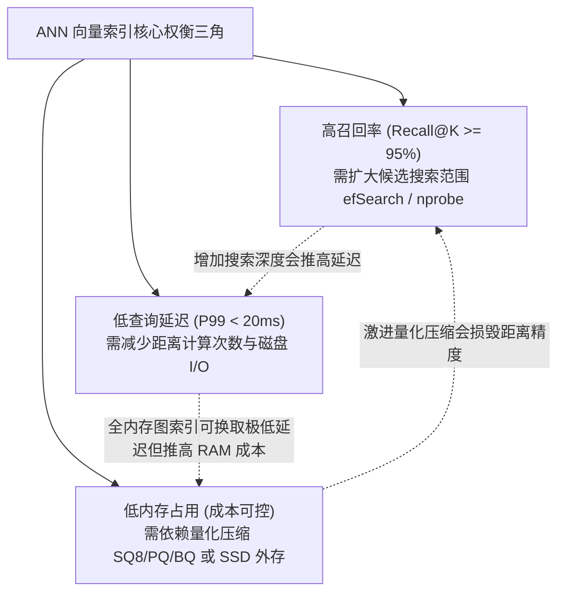
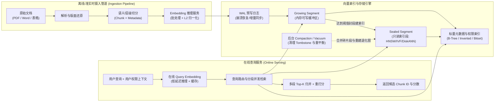
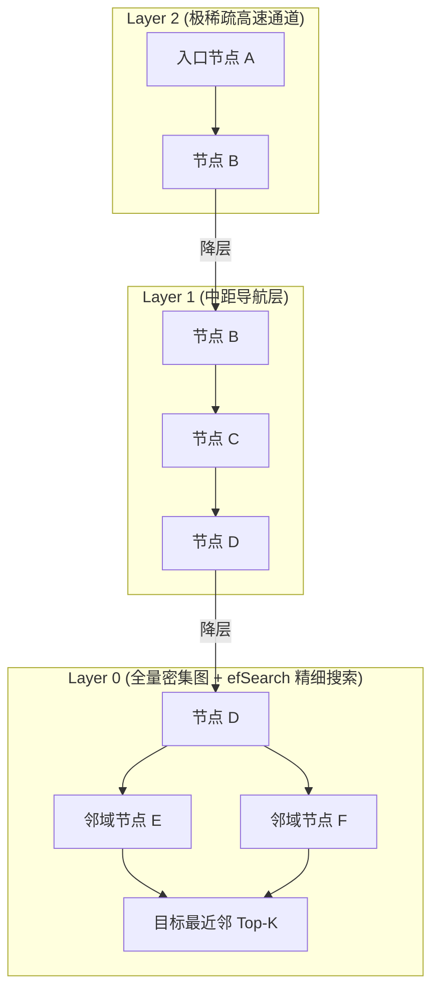
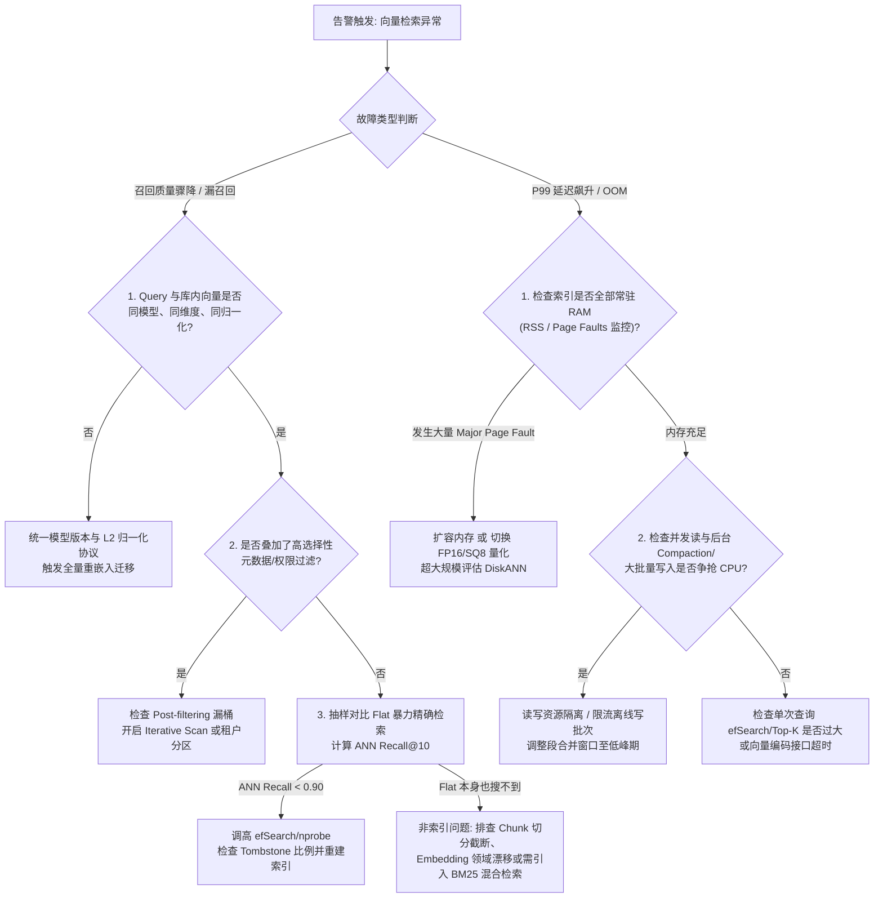

# Embedding 与向量索引：语义表示、ANN 索引机制与向量存储选型

> **学习路径定位**：本文面向技术研发负责人、大数据研发经理与 AI 数据架构师，按照“**是什么 → 为什么需要 → 如何实现 → 设计取舍 → 工程应用 → 常见问题 → 面试表达**”的逻辑展开，并贯穿“**基础认知 / 深入机制 / 架构师决策**”三层递进视角。重点将传统关系型数据库索引（B+Tree / LSM-Tree）的工程直觉迁移至高维语义向量检索领域，建立可量化的容量估算、索引选型与成本评估框架。

---

## 1. 核心概念

### 1.1 基础认知：什么是 Embedding 与向量索引

- **Embedding（向量嵌入）**：通过预训练神经网络模型，将非结构化数据（文本块、表格摘要、图片、代码片段）映射为固定维度连续实数向量 $\mathbf{v} \in \mathbb{R}^d$（常见维度 $d \in \{384, 768, 1024, 1536, 3072\}$）的过程。其核心目标是让**语义相近的对象在向量空间中的距离更近，语义无关的对象距离更远**。
- **向量索引（Vector Index）**：为了在百万乃至十亿级高维向量集合中，以毫秒级延迟找到与查询向量 $\mathbf{q}$ 最相似的 Top-K 个向量，而构建的近似最近邻（ANN, Approximate Nearest Neighbor）数据结构。

### 1.2 核心术语与概念边界

| 概念 | 英文术语 | 核心定义 | 与传统数据系统的类比 |
| :--- | :--- | :--- | :--- |
| **稠密向量** | Dense Embedding | 维度固定（如 1024 维）、绝大多数元素非零的连续实数向量，捕获上下文语义与同义表达。 | 隐式语义特征签名 |
| **稀疏向量** | Sparse / Lexical Vector | 维度等于词表大小（数万至数十万维）、绝大多数元素为零的权重向量（如 BM25、SPLADE、BGE-M3 Lexical）。 | 倒排索引中的加权 Term 向量 |
| **多向量表示** | Multi-Vector (ColBERT) | 不把整段文本压缩为单一向量，而是保留每个 Token 级向量序列，检索时计算细粒度最大相似度之和（MaxSim）。 | 细粒度行存扩展索引 |
| **精确最近邻** | Exact kNN (Flat Search) | 暴力计算查询向量与库内全部向量的距离，召回率 100%，时间复杂度 $O(N \cdot d)$。 | 全表扫描（Full Table Scan） |
| **近似最近邻** | ANN (Approximate NN) | 牺牲极少量召回率（如 95%~99%），换取亚线性查询复杂度 $O(\log N)$ 或 $O(\sqrt{N})$ 的索引算法。 | 带精度权衡的高维空间索引 |
| **向量量化** | Vector Quantization | 将原始 FP32（4 字节/维）压缩为 FP16、Int8、Binary 或子空间码本（PQ），以降低内存占用与带宽压力。 | 列存压缩与字典编码 |
| **召回率** | Recall@K | ANN 返回的 Top-K 结果中，命中真实精确 kNN Top-K 的比例。 | 检索完整性 SLA 指标 |

### 1.3 三层学习递进视角

- **基础层**：理解 Embedding 如何表示语义、余弦相似度/点积/欧氏距离的区别，以及为何高维向量不能直接用 MySQL B+Tree 索引。
- **深入层**：掌握双塔对比学习（InfoNCE）、Matryoshka 可变维度表示、HNSW 图导航、IVF 聚类与 PQ 乘积量化、DiskANN SSD 混合索引的底层机制，以及增量更新带来的图退化问题。
- **架构师层**：能够基于文档规模、QPS、P99 延迟、权限过滤选择率与团队运维能力，完成精确的内存与成本测算，并在 `pgvector`、Milvus、Qdrant、Elasticsearch 与商业托管服务（Pinecone）之间做出合理的长期演进决策。

---

## 2. 解决的问题

### 2.1 传统数据库索引为何在高维向量上失效

在传统关系型数据库与大数据引擎中（详见 [数据库底层与 PostgreSQL/MySQL 事务](../03-java-engineering/03-database-storage-engine.md)），B+Tree 依赖**一维全序关系（Total Ordering）**进行二分剪枝；空间索引（R-Tree / KD-Tree）在 2~10 维地理坐标下表现良好。但在 768~3072 维语义向量空间中，传统树形索引会遭遇**维度灾难（Curse of Dimensionality）**：

1. **缺乏可排序标量边界**：两个向量在某一维坐标相近，不代表整体语义相近；无法按单一键值构建有序范围扫描。
2. **空间划分退化为全表扫描**：在维度 $d > 20$ 时，KD-Tree 或 R-Tree 的超矩形边界几乎全部重叠，查询球体与绝大部分子树相交，剪枝效率趋近于零，退化为比暴力扫描更慢的随机 I/O。
3. **关键词匹配的语义鸿沟**：传统 `LIKE` 或倒排索引依赖字面重合，用户搜索“设备停机应急流程”时，无法命中仅包含“故障宕机处置预案”的文档。

### 2.2 Embedding 与向量索引解决的核心业务痛点

1. **跨越字面表达差异的语义泛化**：支持同义词、上下位概念、跨语言表达以及口语化提问的语义召回。
2. **控制大规模语料下的查询延迟**：暴力 Flat 扫描在 10 万条 1024 维 FP32 向量上，单次查询需读取约 400 MB 内存数据，并发 QPS 极易被内存带宽打满；引入 ANN 索引后，单次查询仅访问数百至数千个候选节点，P99 延迟可控制在 5~30 ms。
3. **平衡内存硬件成本与检索精度**：通过量化压缩与冷热分层（内存图索引 + SSD 磁盘全精度重排），避免向量检索基础设施的硬件成本失控。

### 2.3 语义向量的能力边界（反模式）

Embedding 并非通用精确检索的替代品，它在以下场景存在固有短板：

- **精确编号与专有名词匹配**：对物料编号（如 `VALVE-DN200-PN16`）、错误码（`ERR-4092`）、合同编号、人名与函数名缺乏字面刚性约束，容易召回“长相类似但编号不同”的干扰片段。
- **精确数值比较与逻辑推理**：向量空间无法稳定表达“价格低于 5000 元”、“版本 >= v2.3”或“否定条件（不含某条款）”，必须交由结构化元数据过滤处理。
- **长文本信息稀释**：将数千字文档直接压缩进单个 1024 维向量会导致细粒度事实被平均化，必须配合前置 Chunking 切分策略（关联 [混合检索与重排序](./04-hybrid-search-rerank.md)）。
- **领域语义漂移（Domain Shift）**：通用语料训练的 Embedding 模型对企业私有缩写、行业黑话（如工业设备术语、内部系统代号）区分度较弱。

---

## 3. 底层原理

### 3.1 Embedding 模型训练核心：双塔对比学习与 InfoNCE

现代检索类 Embedding 模型（如 BGE、E5、GTE、text-embedding-3）大多基于 **Bi-Encoder（双塔编码器）** 架构，通过**对比学习（Contrastive Learning）**训练语义空间分布：

- **双塔独立编码**：查询（Query）与文档块（Passage）分别通过共享权重或独立权重的 Transformer 编码器输出定长向量（通常取 `[CLS]` 池化或 Mean Pooling），推理阶段文档向量可完全离线预计算并入库。
- **InfoNCE 损失函数**：给定一个查询 $q$、一个正样本 $d^+$ 以及批内负样本与难负样本（Hard Negatives）集合 $\{d_1^-, \dots, d_K^-\}$，模型通过最小化 InfoNCE 损失拉近正样本对、推远负样本对：

$$\mathcal{L}_{\text{InfoNCE}} = -\log \frac{\exp(\text{sim}(q, d^+) / \tau)}{\exp(\text{sim}(q, d^+) / \tau) + \sum_{j=1}^{K} \exp(\text{sim}(q, d_j^-) / \tau)}$$

其中 $\tau$ 为温度系数（Temperature，通常取 0.01~0.05），用于控制相似度分布的锐度。

- **难负样本（Hard Negatives）的决定性作用**：仅依赖随机批内负样本（In-batch Negatives），模型只能区分完全无关的主题；引入 BM25 召回但实际不相关的“高字面重合难负样本”后，模型才能学会细粒度的语义判别。
- **各向异性（Anisotropy）问题**：未经对比学习优化的原始预训练语言模型向量往往挤在一个狭窄的锥形区域内，导致任意两段无关文本的余弦相似度都很高（如 0.7 以上）。对比学习通过均匀性（Uniformity）约束将向量分散到超球面上，显著提升 ANN 索引的区分度。

### 3.2 Matryoshka 表示学习（MRL）与多表示范式

#### Matryoshka Representation Learning (MRL)
OpenAI `text-embedding-3`、Nomic、BGE-M3 等新一代模型引入了**俄罗斯套娃表示学习（MRL）**：在训练阶段同时对向量的前 $m \in \{256, 512, 768, 1024, \dots, d\}$ 维前缀计算对比损失，迫使模型将最核心的语义信息优先编码在前部维度中。

- **工程价值**：业务方可以在不重新训练模型的前提下，直接截取前 512 或 256 维并重新进行 L2 归一化，在召回率仅下降 1%~2% 的代价下，将内存占用和计算量直接压缩 50%~75%。

#### Dense vs Sparse vs Multi-Vector (ColBERT)

| 表示范式 | 输出形态 | 相似度计算方式 | 优势 | 劣势与存储开销 |
| :--- | :--- | :--- | :--- | :--- |
| **Dense（稠密单向量）** | 单个 $\mathbb{R}^d$ 向量 | Cosine / Inner Product | 生态成熟、索引紧凑、语义泛化强 | 细粒度词项信息被池化压缩 |
| **Learned Sparse（稀疏学习向量）** | `(token_id, weight)` 键值对（如 SPLADE、BGE-M3 Sparse） | 词项权重内积（倒排加速） | 兼具词法精确匹配与同义词扩展，可解释性强 | 高频扩展词会导致倒排链变长、延迟波动 |
| **Multi-Vector（ColBERT）** | 每个 Token 一个低维向量（如 128 维） | **MaxSim** 延迟交互：$\sum_{i \in Q} \max_{j \in D} \langle \mathbf{q}_i, \mathbf{d}_j \rangle$ | 保留词级交互精度，长文档细粒度匹配显著优于单向量 | 存储体积膨胀 10x~50x，需配合 PLAID/PQ 压缩与两阶段检索 |

### 3.3 距离度量与单位向量的数学等价性

向量检索常用的三种度量方式如下：

1. **余弦相似度（Cosine Similarity）**：衡量向量夹角方向，忽略模长差异。
   $$\text{Cosine}(\mathbf{x}, \mathbf{y}) = \frac{\mathbf{x} \cdot \mathbf{y}}{\|\mathbf{x}\|_2 \|\mathbf{y}\|_2}$$
2. **内积 / 点积（Inner Product / Dot Product）**：同时受方向与模长影响。
   $$\text{IP}(\mathbf{x}, \mathbf{y}) = \sum_{i=1}^{d} x_i y_i = \mathbf{x} \cdot \mathbf{y}$$
3. **欧氏距离（Euclidean Distance / L2）**：衡量空间直线距离。
   $$d_{L2}(\mathbf{x}, \mathbf{y}) = \sqrt{\sum_{i=1}^{d} (x_i - y_i)^2}$$

**关键数学等价性（L2 归一化条件）**：
当所有文档向量与查询向量预先完成单位归一化（即 $\|\mathbf{x}\|_2 = \|\mathbf{y}\|_2 = 1$）时：

$$\|\mathbf{x} - \mathbf{y}\|_2^2 = \|\mathbf{x}\|_2^2 + \|\mathbf{y}\|_2^2 - 2(\mathbf{x} \cdot \mathbf{y}) = 2 - 2\text{Cosine}(\mathbf{x}, \mathbf{y})$$

**工程意义**：
- 在归一化前提下，最大化余弦相似度、最大化内积（MIPS）与最小化欧氏距离（L2）得到的 **Top-K 排序结果完全等价**。
- 生产引擎（如 FAISS、Milvus、Qdrant）在入库与查询前统一对向量执行一次 L2 归一化，检索内核即可直接使用**内积（Inner Product）**配合 CPU SIMD 指令集（AVX-2 / AVX-512 / ARM NEON 的 FMA 乘加指令）完成计算，省去逐次求模长与开方的开销，吞吐提升显著。
- **例外边界**：若模型专门为非归一化最大内积训练（如部分推荐系统双塔模型，向量模长编码了物品热度或先验置信度），则不可强行归一化，必须严格对齐模型训练时的度量协议。

### 3.4 ANN 近似最近邻的三角权衡

高维向量索引设计本质上是在 **召回率（Recall@K）**、**查询延迟（Latency）** 与 **内存占用（Memory）** 之间进行帕累托权衡，并受**索引构建时间与增量更新成本**约束：



---

## 4. 系统架构

### 4.1 向量检索子系统全链路架构

在企业级 AI 数据平台中，向量索引不是孤立组件，而是嵌入在“离线/准实时文档摄入管道”与“在线检索服务”之间的核心存储计算层：



### 4.2 与传统数据库存储引擎（B+Tree / LSM-Tree）的架构类比

熟悉传统大数据与数据库存储引擎（参见 [数据库底层与 PostgreSQL/MySQL 事务](../03-java-engineering/03-database-storage-engine.md)）的工程师，可以通过以下映射快速建立对现代向量数据库内核的直觉：

| 存储内核维度 | 传统 OLTP / LSM 引擎（InnoDB / RocksDB / Doris） | 现代向量存储引擎（Milvus / Qdrant / pgvector） |
| :--- | :--- | :--- |
| **持久化保障** | WAL / Redo Log 顺序写盘，崩溃重放 | 独立 WAL（如 Milvus 依托 Pulsar/Kafka/Woodpecker，Qdrant 本地 WAL，pgvector 复用 PG WAL） |
| **写缓冲架构** | LSM MemTable 接收高频写，Immutable Flush 为只读 SSTable | Growing Segment 接收实时增量（常先暴力扫描或轻量图），满阈值后转为 Sealed Segment 异步构建 HNSW/IVF/DiskANN |
| **删除机制** | 写入 Tombstone 墓碑标记，查询时过滤 | 维护 Bitset 删除位图（Soft Delete），查询遍历图时跳过已删除节点，避免破坏图连通性 |
| **空间回收** | Background Compaction 合并多层 SSTable | Segment Compaction / Vacuum 清理墓碑并触发局部或全量索引重建 |
| **索引导航本质** | B+Tree 按键有序二分，磁盘页（16KB）高度受控（3~4 层） | HNSW 按高维距离构建多级小世界图，高度依赖随机内存跳转（Pointer Chasing） |
| **并发与事务** | MVCC 快照读与行锁/间隙锁 | `pgvector` 原生继承 PG ACID/MVCC；独立向量库（Milvus/Qdrant）通常提供可调一致性级别（Strong / Session / Bounded / Eventually） |

---

## 5. 关键算法或实现机制

### 5.1 HNSW（Hierarchical Navigable Small World）

HNSW 是目前全内存场景下综合性能（召回率与 P99 延迟）最均衡的主流向量索引算法。

#### 核心设计哲学：高维空间的“多层跳表 + 小世界图”
- **多层拓扑结构**：HNSW 将节点分配至 $0, 1, \dots, L$ 层。第 0 层包含全部向量，向上每一层的节点数量按指数概率 $P(l) = \lfloor -\ln(\text{uniform}(0,1)) \cdot m_L \rfloor$ 递减（类似 SkipList 跳表）。
- **两阶段导航检索**：
  1. **高层粗略定位（Zoom-in）**：从最高层的入口点（Entry Point）开始，每层执行贪心搜索（`ef=1`），快速跨越长距离边逼近目标区域，找不到更近邻居时降落到下一层。
  2. **第 0 层精细束搜索（Beam Search）**：在第 0 层维护大小为 `efSearch` 的动态优先队列，持续扩展候选节点邻居直到队列顶部不再更新，最终截取 Top-K 返回。
- **启发式选边（Heuristic Neighbor Selection）**：插入新节点时，不单纯连接距离最近的 `M` 个节点，而是优先选择**方向分散、连接不同局部聚类**的邻居，防止图退化为孤立的局部孤岛，保障长程可达性。



#### 核心参数定量影响

| 参数 | 作用阶段 | 含义 | 调大后的影响 | 工程基线参考 |
| :--- | :--- | :--- | :--- | :--- |
| **`M`** | 构建期 | 每个节点在每层的最大出边连接数（第 0 层通常为 $2M$） | 图连通性更强、高维召回更高；**内存开销线性上升**、构建变慢 | `16`（常规）~ `32`（高维/高召回） |
| **`efConstruction`** | 构建期 | 插入节点时搜索候选邻居的动态队列长度 | 图质量与召回上限更高；**建索引耗时显著增加**，不增加内存 | `100` ~ `200`（一般不低于 `2 * M`） |
| **`efSearch`** | 查询期 | 第 0 层束搜索维护的候选队列长度 | 召回率提升；**查询延迟近似线性上升**，可按请求动态调节 | `40` ~ `128`（必须 $\ge K$） |

### 5.2 IVF（Inverted File Index）与乘积量化（PQ）家族

当数据规模达到千万至亿级、全内存 HNSW 成本过高时，基于空间聚类的 IVF 家族成为核心替代方案。

#### 工作机制
1. **离线聚类划片**：通过 K-Means 将全量向量空间划分为 `nlist` 个 Voronoi 聚类单元，记录每个单元的质心（Centroid），并将每个向量挂载到最近质心的倒排列表中。
2. **在线路由扫描**：查询时先计算查询向量与 `nlist` 个质心的距离，选出最近的 `nprobe` 个聚类桶，仅扫描这些桶内的向量。
3. **关键参数权衡**：
   - `nlist`：通常设为 $\sqrt{N}$ 至 $4\sqrt{N}$（例如 100 万向量设 `nlist = 1024 ~ 4096`）。
   - `nprobe`：扫描的桶数量，占 `nlist` 的 1%~10%。`nprobe` 越大召回越高，但扫描计算量呈线性增长。

#### 量化压缩演进（IVF_FLAT → IVF_SQ8 → IVF_PQ → BQ + Rerank）

| 索引变体 | 压缩机制 | 典型压缩比 | 精度损失特征 | 适用定位 |
| :--- | :--- | :--- | :--- | :--- |
| **`IVF_FLAT`** | 桶内保留全精度 FP32 原始向量 | 1x（无压缩） | 仅受 `nprobe` 漏桶影响 | 内存充裕、对精确距离敏感的中等数据集 |
| **`IVF_SQ8`** | 标量量化（Scalar Quantization）：将每个浮点维度按 min/max 线性映射到 1 字节 `uint8` | **4x** | 召回损失极小（通常 < 1%），性价比极高 | 生产环境中最常用的默认内存压缩方案 |
| **`IVF_PQ`** | 乘积量化（Product Quantization）：将 $d$ 维切分为 $m$ 个子空间，每个子空间用 K-Means 训练 256 个码字（1 字节编码），查询时查预计算距离表（ADC） | **16x ~ 64x** | 高压缩下距离失真明显，需配合 Oversampling + 原始向量重打分 | 亿级超大规模向量、内存极度受限场景 |
| **`BQ` (Binary Quantization)** | 将每维按 0 阈值二值化为 1 bit，使用 CPU `POPCNT` 汉明距离指令极速粗筛 | **32x** | 仅适合高维（$d \ge 1024$）且分布均匀的模型，必须二阶段全精度重排 | 高维低延迟超低内存粗筛（如 Qdrant / pgvector halfvec+bit） |

### 5.3 DiskANN（Vamana 图与 SSD 混合索引）

HNSW 的最大瓶颈在于图结构和原始向量必须常驻内存。微软提出的 **DiskANN** 突破了“内存容量上限即向量规模上限”的制约：

- **Vamana 单层高质量图**：不同于 HNSW 的多层跳表，DiskANN 仅维护一层连通度极高、直径极短的图结构。通过引入参数 $\alpha > 1$（典型值 1.2）的 **RobustPrune（鲁棒剪枝）**，在单层内同时保留短程近邻边与长程跨区边，将 SSD 磁盘跳数压低至极少次数。
- **内存 + NVMe SSD 协同布局**：
  - **内存中**：仅驻留极小的 **PQ 压缩向量**（压缩比可达 16x~32x），用于在图遍历时快速估算邻居距离、决定搜索方向。
  - **NVMe SSD 中**：将每个节点的**全精度原始向量与其邻接表打包存储在同一个 4KB 磁盘页**中。每次访问磁盘节点只需 1 次随机读即可同时获取精确向量和下一跳邻接列表。
- **Beam Search 异步并发 I/O**：每次向 SSD 发起宽度为 $W$ 的并发异步读取请求（利用 `io_uring` 压榨 NVMe 高 IOPS），隐藏磁盘随机读延迟，最终在内存中基于读取到的全精度向量完成精确排序。
- **开源落地代表**：`Milvus DiskANN`、`pgvectorscale`（PostgreSQL 的 StreamingDiskANN 扩展）。在亿级规模下，DiskANN 可将硬件成本降至全内存 HNSW 的 1/5 ~ 1/10，同时保持 P99 延迟在 10~30 ms 级别。

### 5.4 向量索引的增量更新、删除与图退化治理

与静态离线构建不同，企业知识库文档存在持续新增、修订与下线，索引动态维护面临三大工程难题：

1. **软删除（Tombstone / Bitset）与逻辑空洞**：
   - 直接从 HNSW 图中物理抹除节点极其危险，极易切断通往其他有效节点的路径（Bridge Node 断裂）。因此主流引擎均采用**删除位图（Bitset）**标记删除：图遍历阶段仍可经过已删除节点作为“过路跳板”，只是不将其计入 Top-K 结果集。
2. **图退化（Graph Degradation）与质心漂移（Centroid Drift）**：
   - 当删除/更新比例超过 **20%~30%** 时，HNSW 中大量邻边指向失效节点，有效搜索步数激增，召回率与延迟同时恶化。
   - 对于 IVF 索引，若新增业务数据主题发生明显漂移，原有 K-Means 质心不再均匀覆盖新数据分布，导致热点桶膨胀（数据倾斜）。
3. **生产级治理策略**：
   - **增量分片隔离**：写入先落入小型 Growing Segment（或增量队列），读时合并 Growing + Sealed 结果，避免高频单条写锁阻塞在线读。
   - **自动 Compaction 阈值**：监控段内无效数据比例（Dead Ratio），超过 20%~25% 时触发后台异步段合并与局部图重建。
   - **零停机双索引切换（Alias Blue-Green Swap）**：当更换 Embedding 模型、调整维度或全量重建 IVF 质心时，构建新版本 Collection/Index，完成追平与离线 Recall 验收后，通过原子 Alias 切换流量。

---

## 6. 技术选型与替代方案

### 6.1 主流向量存储方案全景对比

| 评估维度 | PostgreSQL (`pgvector` + `pgvectorscale`) | Qdrant | Milvus (2.4+/2.5+) | Elasticsearch 8.x / OpenSearch | Pinecone (商业全托管) |
| :--- | :--- | :--- | :--- | :--- | :--- |
| **架构定位** | 关系型数据库扩展，业务数据与向量同库存储 | Rust 编写的轻量高性能专用向量库 | 云原生分布式存算分离向量数据库 | 全文检索引擎扩展 HNSW/BBQ 向量能力 | Serverless 商业全托管 SaaS 向量服务 |
| **核心索引支持** | HNSW、IVFFlat、DiskANN (`pgvectorscale`)、halfvec/bit 量化 | HNSW + Filterable Payload 图、SQ/PQ/BQ、mmap 磁盘模式 | HNSW、IVF 家族、DiskANN、Sparse + Dense 原生混合 | HNSW（基于 Lucene）、Int8/BBQ 量化、原生倒排 BM25 | 专有 Serverless 分层索引（细节闭源） |
| **事务与标量过滤** | **极强**：原生 ACID、复杂 SQL Join、行级安全策略 RLS | **强**：Payload 索引深度融合 HNSW 单阶段过滤 | **较强**：支持标量表达式过滤、Iterative Filtering、分区键 | **极强**：倒排+聚合+过滤能力极其成熟 | 支持基础元数据过滤与 Namespace 隔离 |
| **推荐数据规模** | 1 万 ~ 5,000 万向量（结合 pgvectorscale 可扩展更高） | 10 万 ~ 1 亿向量 | 1,000 万 ~ 数十亿向量（分布式横向扩展） | 10 万 ~ 1 亿（适合已有 ES 集群复用） | 弹性按需扩展，无自建上限 |
| **运维门槛** | **极低**（复用现有 DBA 与 PG 高可用/备份体系） | **低**（单二进制/容器集群，Raft 一致性，无重型外部依赖） | **高**（分布式模式依赖 etcd、MinIO/S3、Pulsar/Kafka；单机 Standalone 较轻） | **中高**（JVM GC 调优、分片规划与内存占用偏高） | **零运维**（全托管） |
| **厂商锁定与合规** | 无锁定，支持私有化与信创合规 | 无锁定（Apache 2.0），易私有化 | 无锁定（Apache 2.0），易私有化 | 开源协议存在 ES/OpenSearch 分叉，支持私有化 | **强锁定**，数据出境与政企私有化受限 |

### 6.2 架构师四大战略选型维度

#### 1. 开源自建 vs 商业托管
- **选择商业托管（Pinecone / 云厂商托管向量库）**：适用于初创团队验证 PMF、无专职运维人员、数据允许上公有云、且流量呈波峰波谷剧烈波动的场景。但需警惕长期高 QPS 与大数据量下的账单非线性增长及数据迁移锁定。
- **选择开源自建（pgvector / Qdrant / Milvus）**：适用于政企/制造/金融等**私有化部署与数据合规红线**场景，或已有成熟大数据/K8s 运维团队、追求长期 TCO 可控的企业。

#### 2. 集成复用现有底座 vs 引入独立向量库
- **优先集成复用（PG + `pgvector` 或 已有 ES 集群）**：在向量规模 **< 1,000 万**、且强依赖与业务表（用户权限、组织架构、文档版本号）做强一致事务更新的场景下，**严禁为了追热点而盲目引入一套全新的分布式集群**。多一套存储就多一条跨库双写同步链路（CDC/补偿）、多一份一致性故障面与团队 on-call 负担。
- **何时拆分引入专用向量库（Qdrant / Milvus）**：
  - 向量规模突破数千万甚至上亿，单机内存与磁盘 I/O 成为瓶颈，需要存算分离与独立横向扩缩容；
  - 在线检索 QPS 高，向量扫描的 CPU/内存抖动已影响核心 OLTP 业务数据库的稳定性；
  - 需要高频多租户物理隔离、GPU 加速建索引或原生 Multi-Vector / DiskANN 等前沿特性。

#### 3. 自研索引内核 vs 采购/集成成熟引擎
- 除头部搜索引擎与基础云厂商外，99% 的业务企业**不应自研 ANN 图索引底层内核**（涉及底层 SIMD 汇编优化、并发图锁控制、崩溃恢复与量化精度调优，投入产出比极低）。
- 企业应将研发精力聚焦于**领域文档解析、切分策略、权限隔离网关、评测闭环与业务路由编排**等差异化护城河层。

#### 4. Embedding 模型：商业 API vs 开源私有化部署
- **商业 API（OpenAI `text-embedding-3` / Cohere / 豆包/通义 Embedding API）**：零 GPU 运维、冷启动快、适合低频或早期验证；痛点在于敏感文档外发合规风险、公网抖动以及调用单价随文档重刷线性累积。
- **开源自部署（`BGE-M3` / `BCEmbedding` / `Qwen3-Embedding` + TEI / vLLM / Infinity）**：数据不出内网、固定算力下吞吐边际成本极低、且支持基于企业难负样本做领域微调（Fine-tuning）。

---

## 7. 工程实践

> [!NOTE] 案例性质说明：本案例为教学假设场景，用于系统训练 AI 数据架构设计能力，不属于个人过往真实任职项目。

### 7.1 教学假设场景：10,000 份企业文档知识库索引架构设计

**假设业务背景**（对齐 [PROFILE_FACTS.md](../PROFILE_FACTS.md) 登记的教学推演项目）：
- **文档规模**：10,000 份企业内部 PDF / Word 文档（含扫描件、复杂表格、操作规程、多版本迭代文件与多部门访问权限控制）。
- **切片量级估算**：假设平均每份文档 15~25 页，解析切分（Chunk 约 400~600 tokens，15% overlap）后平均产出 **20~30 个 Chunks/文档**，总有效 Chunk 数约为 **20 万 ~ 30 万条**；考虑历史版本保留与未来 3 年增长（3x 冗余），按 **100 万向量**进行架构容量设计。
- **查询特征**：企业内部员工问答与辅助检索，峰值 QPS 约 20~50，要求检索层 P99 延迟 < 80 ms，**严格按部门/角色权限（RBAC）与文档生效状态（`status = 'ACTIVE'`）过滤**，零越权泄露。

### 7.2 架构决策：为何在此规模下优先选择 `PostgreSQL + pgvector`

基于“避免过度设计、最小化分布式一致性成本”的架构原则，在 20 万~100 万向量规模且具备强权限过滤、多版本事务更新特征的场景中，**首选 PostgreSQL 16/17 + `pgvector 0.8+`（必要时叠加 `pgvectorscale`）**，而非直接铺设重型分布式 Milvus 集群：

1. **强一致元数据与向量事务**：文档从 `v1` 升版至 `v2` 时，可在同一个 ACID 事务内将旧版本 Chunks 置为 `ARCHIVED` 并写入新版本 Chunks 与向量，彻底消除“元数据已下线、向量库还能搜出脏数据”的双写延迟问题。
2. **复用传统 RDBMS 运维与权限体系**：支持行级安全策略（RLS）、B-Tree 组合索引与标准备份恢复。
3. **平滑演进路径**：业务抽象层封装统一的 `VectorRepository` 接口；当未来数据规模突破千万级或需要独立弹性扩缩容时，可通过 CDC 增量双写平滑迁移至 Qdrant 或 Milvus。

### 7.3 索引表 Schema 与参数基线设计（教学推演配置）

```sql
-- 启用 pgvector 扩展
CREATE EXTENSION IF NOT EXISTS vector;

-- 文档块与向量统一表（使用 halfvec 半精度 FP16 直接节省 50% 存储与内存）
CREATE TABLE kb_document_chunks (
    chunk_id       BIGSERIAL PRIMARY KEY,
    doc_id         BIGINT NOT NULL,
    version_no     INT NOT NULL,
    dept_id        VARCHAR(32) NOT NULL,        -- 部门权限隔离字段
    security_level SMALLINT NOT NULL DEFAULT 1, -- 密级 (1:公开 2:内部 3:机密)
    is_active      BOOLEAN NOT NULL DEFAULT TRUE,
    content        TEXT NOT NULL,
    metadata       JSONB NOT NULL DEFAULT '{}'::jsonb,
    embedding      halfvec(1024) NOT NULL,      -- 例如 BGE-M3 输出 1024 维，L2 归一化后存 FP16
    updated_at     TIMESTAMPTZ NOT NULL DEFAULT NOW()
);

-- 1. 标量过滤组合索引（加速权限与生效版本筛选）
CREATE INDEX idx_kb_chunks_acl_active
    ON kb_document_chunks (dept_id, is_active, security_level);

-- 2. 部分 HNSW 向量索引（仅对当前生效版本建索引，大幅缩小图体积并杜绝历史版本干扰）
-- 因向量已完成 L2 归一化，直接使用内积操作符 halfvec_ip_ops 替代余弦距离
CREATE INDEX idx_kb_chunks_hnsw_active
    ON kb_document_chunks
    USING hnsw (embedding halfvec_ip_ops)
    WITH (m = 16, ef_construction = 128)
    WHERE is_active = TRUE;
```

**关键工程基线配置**：
- **构建期优化**：建索引前在会话级调高 `SET maintenance_work_mem = '4GB';` 与 `SET max_parallel_maintenance_workers = 4;`，避免图构建期间溢出磁盘导致耗时飙升 10 倍。
- **查询期迭代扫描（`pgvector 0.8+`）**：开启 `SET hnsw.iterative_scan = relaxed_order;` 与 `SET hnsw.ef_search = 80;`，防止叠加 `WHERE dept_id = 'RD' AND security_level <= 2` 高选择性过滤时返回结果不足 Top-K。
- **与原知识库衔接**：部分索引（Partial Index）+ `maintenance_work_mem` 调优与 [数据库底层与 PostgreSQL/MySQL 事务](../03-java-engineering/03-database-storage-engine.md) 中的 `autovacuum` 死元组回收强相关——批量下线历史文档版本后，必须及时触发 `VACUUM` 清理索引死引用，防止 HNSW 图膨胀。

### 7.4 数据同步与索引演进 SOP

1. **文档哈希去重（Idempotency）**：对每个文档及 Chunk 计算 SHA-256 指纹，文档微调时仅对变更的 Chunk 重新调用 Embedding，节省 80%+ 重刷算力。
2. **模型版本隔离字段**：表元数据记录 `embedding_model_version`（如 `bge-m3-v1`）。严禁将不同 Embedding 模型产出的向量混存于同一个向量空间（不同模型的语义坐标系完全正交，直接算距离毫无意义）。
3. **离线召回基准验证**：每次调整 `m`、`ef_search` 或切换量化精度（FP32 → FP16 / SQ8），必须在抽样评估集上对比 Exact Flat Search 的 **Recall@10**，要求 Recall@10 $\ge 0.95$ 方可上线。

---

## 8. 常见故障与解决思路

### 8.1 高频生产故障模式

| 故障现象 | 根因剖析 | 快速止损措施 | 根治方案 |
| :--- | :--- | :--- | :--- |
| **过滤查询返回条数不足 Top-K（甚至为空）** | HNSW 默认仅扫描 `efSearch` 个候选后做 Post-filtering；若权限过滤命中率仅 2%，候选被全部滤空 | 临时调大 `efSearch`（如 64 → 256） | 升级 `pgvector 0.8+` 开启 Iterative Scan，或在 Qdrant/Milvus 启用单阶段 Filterable 索引/按租户 Partition 分区 |
| **向量库 OOM 崩溃（Exit Code 137）** | 仅按原始向量大小估算内存，忽略 HNSW 邻接表、构建期临时缓冲、段合并双份副本及操作系统 Page Cache | 临时扩容内存或降低并发索引构建任务数 | 启用 `halfvec`(FP16) 或 SQ8 量化；超大规模迁移至 DiskANN / mmap 模式；预留 1.8x~2.0x 内存水位 |
| **上线数月后召回率持续下降、延迟毛刺增多** | 频繁文档更新/删除产生大量 Tombstone，HNSW 图连通性退化或 IVF 质心漂移 | 调高查询期 `efSearch` / `nprobe` 临时保召回 | 建立监控告警（Dead Ratio > 20%），定期低峰期触发 Compaction 或 `REINDEX CONCURRENTLY` |
| **换用新 Embedding 模型后检索结果完全错乱** | 查询侧已切新模型，但库内部分旧文档仍为旧模型向量，或未统一 L2 归一化导致内积排序失效 | 立即回滚查询侧模型版本至与库内一致 | 强校验 `embedding_model_version`；采用新列/新 Collection 双写全量重刷后原子切流 |
| **构建 HNSW 索引耗时数小时且拖垮在线查询** | 建索引工作内存不足（频繁磁盘交换）或未做资源隔离，抢占在线 CPU 与 I/O | 限流或中止离线建索引任务 | 调大 `maintenance_work_mem`；分离读写节点（主库构建/异步流复制，或独立离线索引构建节点） |

### 8.2 向量检索异常排障决策树



---

## 9. 性能及成本分析

### 9.1 向量存储与内存精确计算公式

架构师在做硬件容量评审前，必须能够手算向量内存需求，避免拍脑袋低估导致上线 OOM。

#### 1. 原始向量与量化存储大小公式

$$\text{Memory}_{\text{vec}} = N \times d \times B_{\text{elem}}$$

- $N$：向量总条数；$d$：向量维度；$B_{\text{elem}}$：单维字节数（FP32 = 4B，FP16/BF16 = 2B，Int8 SQ8 = 1B，Binary BQ = 1/8 B）。
- 若采用乘积量化 PQ（$m$ 个子空间，每子空间 8 bit）：$\text{Memory}_{\text{PQ}} \approx N \times m\text{ bytes}$。

#### 2. HNSW 图结构额外内存开销公式

每个节点在第 0 层最多保存 $2M$ 条边，高层平均约 $\frac{M}{\ln M}$ 条边（粗略按总计约 $2.2M \sim 2.5M$ 个 4 字节整数 ID 估算）：

$$\text{Memory}_{\text{graph}} \approx N \times M \times 2.2 \times 4\text{ bytes} \approx 8.8 \cdot N \cdot M\text{ bytes}$$

#### 3. 工程总内存水位公式（含安全系数）

$$\text{Memory}_{\text{total}} \approx (\text{Memory}_{\text{vec}} + \text{Memory}_{\text{graph}} + \text{Memory}_{\text{meta}}) \times \gamma$$

其中工程冗余系数 $\gamma$ 取 **1.5 ~ 2.0**（用于覆盖图构建临时缓冲、Segment Compaction 双副本以及 OS 缓存与查询并发内存）。

#### 4. 不同规模与量化策略内存测算表（以 $d = 1024$ 维、HNSW $M = 16$ 为基准）

| 向量规模 $N$ | FP32 裸向量 | HNSW 图开销 | FP32 + HNSW 总推荐 RAM ($\gamma=1.6$) | FP16 + HNSW 总推荐 RAM ($\gamma=1.6$) | SQ8 + HNSW 总推荐 RAM ($\gamma=1.6$) | Binary 粗筛 RAM (不含全精度重排) |
| :--- | :--- | :--- | :--- | :--- | :--- | :--- |
| **30 万**（1 万文档教学假设） | 1.14 GB | 0.04 GB | **~1.9 GB** | **~1.0 GB** | **~0.55 GB** | ~0.12 GB |
| **100 万** | 3.81 GB | 0.13 GB | **~6.3 GB** | **~3.3 GB** | **~1.75 GB** | ~0.41 GB |
| **1,000 万** | 38.15 GB | 1.31 GB | **~63 GB** | **~33 GB** | **~17.5 GB** | ~4.1 GB |
| **1 亿** | 381.47 GB | 13.11 GB | **~631 GB**（成本过高） | **~326 GB** | **~174 GB** | ~41 GB（推荐转 DiskANN） |

> **关键洞察**：当维度 $d=1024$ 时，**原始向量本身占据总内存的 90% 以上**，因此**FP16 / SQ8 量化与 MRL 降维（如 1024 → 512）带来的内存降本收益远大于调小 `M`**。

### 9.2 QPS 与 P99 延迟经验基线（参考量级，视硬件与过滤条件浮动）

- **100 万级向量（FP16 + HNSW，16 核 32G 单机，无重度过滤）**：Recall@10 $\approx 96\% \sim 98\%$ 时，单次查询 P99 延迟约 **5~15 ms**，单节点支撑 **200~600 QPS**。
- **1,000 万级向量（SQ8 + HNSW 或分片集群）**：单分片 P99 延迟约 **15~35 ms**；多并发下吞吐瓶颈主要在**内存带宽（Memory Bandwidth）**与多核缓存行竞争。
- **1 亿级向量（DiskANN + NVMe SSD）**：P99 延迟约 **15~40 ms**，吞吐受限于 NVMe 随机读 IOPS（单盘 NVMe 可支撑数百至上千 QPS，需合理控制 Beam Width）。

### 9.3 Embedding 算力成本测算：商业 API vs 自部署 GPU

结合 **10,000 份企业文档**教学假设场景（按 30 万 Chunks、平均每 Chunk 500 tokens，合计约 **1.5 亿 Tokens**；线上日均 5 万次查询，每次 Query 50 tokens，月均查询 7,500 万 Tokens）：

| 成本项 | 商业 API 方案（以约 \$0.06 ~ \$0.13 / 1M tokens 估算） | 开源自部署方案（以单张 L4 / T4 / A10 级别 GPU 实例估算） |
| :--- | :--- | :--- |
| **首次全量建库（1.5 亿 Tokens）** | 约 \$9 ~ \$20（几十至一百余元人民币），一次性极低 | 依赖已租用 GPU，BGE-M3 单卡吞吐约 3,000~8,000 tokens/s，5~14 小时完成 |
| **月度增量 + 在线查询（假设月均 1 亿 Tokens）** | 约 \$6 ~ \$13 / 月 | 云上按月租用 1 张 T4/A10 GPU（含高可用双实例需 2 张）约 2,000~6,000 元人民币/月 |
| **成本拐点分析** | **月调用量低于数亿 Tokens 且允许数据出域时，商业 API 成本远低于自租常驻 GPU** | **以下三种情况必选私有化部署**：① 数据严禁出内网（合规红线）；② 月 Token 吞吐达数十亿级以上（全量文档高频重刷或大流量在线检索）；③ 需要复用现有 GPU 推理集群（按卡切分 MIG/共享 Rerank 服务） |

---

## 10. 面试题

1. **Q1**：在企业级 RAG 知识库项目中，如何系统评估 Embedding 与向量数据库的存储、内存及算力成本？请给出具体的估算框架。
2. **Q2**：HNSW、IVF（含 IVF_PQ / IVF_SQ8）和 DiskANN 的底层原理差异是什么？在不同数据规模下如何选型，且索引面临高频增量更新和删除时如何治理？
3. **Q3**：余弦相似度、点积（内积）和欧氏距离在向量检索中有什么区别？为什么生产系统普遍要求入库前先做 L2 归一化？
4. **Q4**：向量的维度越高越好吗？在面对千万级向量内存吃紧时，你会按什么优先级组合使用 MRL 降维、标量量化（SQ8）、乘积量化（PQ）与二值量化（BQ）？
5. **Q5**：在百万级以下且强依赖部门权限与文档版本控制的场景中，为什么很多架构师会选择 PostgreSQL + `pgvector` 而不是一上来就部署 Milvus 分布式集群？两者的演进拐点在哪里？
6. **Q6**：线上向量库已经运行了半年，现在业务方要求升级效果更好的新一代 Embedding 模型，你会如何设计零停机、低风险的索引平滑迁移方案？

---

## 11. 参考答案

### Q1：如何系统评估 Embedding 与向量数据库的存储、内存及算力成本？

#### 1. 1分钟简洁回答
评估成本需拆解为**离线/在线 Embedding 算力成本**与**向量数据库存储/内存/运维 TCO**两大块。内存是向量库的核心成本项，估算公式为 `(向量条数 × 维度 × 单维字节 + HNSW 图边开销) × 1.6~2.0 工程冗余系数`。例如 100 万条 1024 维向量，FP32 加 HNSW 约需 6.3 GB 内存，使用 FP16 或 SQ8 可压降至 3.3 GB 或 1.8 GB。算力侧则需对比商业 API 按 Token 计费与自建 GPU 固定租费的拐点，并结合数据合规要求决策。

#### 2. 深入原理解释
- **Chunk 数量反推**：不能只看原始文档份数，需按文档平均页数、切分窗口大小（如 500 tokens）、重叠率（10%~20%）以及历史版本保留系数折算出最终向量条数 $N$。
- **内存构成分解**：
  1. 向量主体：$N \times d \times B_{\text{elem}}$（FP32=4B, FP16=2B, SQ8=1B）。
  2. HNSW 邻接表：$N \times M \times 2.2 \times 4\text{ bytes}$。当 $d=1024, M=16$ 时，图边开销仅占 FP32 裸向量的 3.4%，但当做二值量化后，图边开销会变成不可忽视的主要占比。
  3. 标量索引与运维缓冲：元数据过滤索引、建索引临时内存（如 PG `maintenance_work_mem`）以及段合并期的双份峰值内存，必须乘以 1.5~2.0 的安全系数。
- **Embedding 吞吐与成本核算**：区分“一次性历史全量建库”与“日常增量 + 在线 Query 推理”。全量建库可通过批处理压满吞吐（短时租用按需 GPU 或调用低价 Batch API），在线查询则受限于 P99 延迟（需常驻低延迟推理实例或复用 CPU ONNX 量化小模型）。

#### 3. 架构师视角分析
- **显性成本之外的隐性 TCO**：硬件费用往往不是大头，**运维人力成本、跨库数据同步复杂度与合规审计风险**才是关键。小规模场景（如 1 万份文档约 30 万向量）硬上分布式集群，运维和排障成本远超机器本身。
- **动态成本治理**：通过内容哈希去重避免文档小改触发全篇重算 Embedding；对历史归档文档采用冷热分层（仅对 `is_active = TRUE` 建内存 HNSW，归档版转低成本磁盘或离线检索）。

#### 4. 典型追问
- **追问**：如果业务要求将文档规模从 1 万份扩展到 100 万份（约 3,000 万向量），你的内存和存储预算会如何调整？
  - **应对要点**：FP32 全内存需近 200 GB 内存且单机难扛，应切换为 **FP16/SQ8 + 分片集群**（约 50~100 GB 分布式内存）或采用 **DiskANN（NVMe SSD + 内存 PQ 导航）** 将 RAM 压至 20~30 GB 级，同时验证 P99 延迟是否仍满足 SLA。

#### 5. 常见错误回答
- 只算 `N × d × 4 bytes` 裸向量大小，漏算图结构、段合并双副本和标量元数据，导致上线建索引时直接 OOM。
- 不区分数据合规约束和调用量级，盲目声称“自建 GPU 一定比调 API 便宜”（忽略了低并发下 GPU 空转与高可用双机部署的固定成本）。

---

### Q2：HNSW、IVF 与 DiskANN 的底层原理差异、选型与增量更新治理

#### 1. 1分钟简洁回答
**HNSW** 是全内存多层导航小世界图，召回率高、延迟极低，但内存贵且频繁删除易导致图退化；**IVF** 是基于 K-Means 聚类的倒排桶，内存开销小、配合 SQ8/PQ 压缩比高，但需要离线训练质心且存在数据漂移问题；**DiskANN** 采用单层 Vamana 图配合“内存 PQ 导航 + NVMe SSD 读全精度向量”，专攻亿级数据的高性价比低内存检索。增量删改治理上，通用做法是“软删除 Bitset + 增量缓冲段 + 达到无效阈值后异步 Compaction 重建”。

#### 2. 深入原理解释
- **HNSW**：构建期通过概率层级和启发式选边形成稀疏长程高速公路与密集底层局域网，查询期高层贪心降落、底层按 `efSearch` 做 Beam Search。时间复杂度近似 $O(\log N)$。
- **IVF 家族**：将空间划分为 `nlist` 个 Voronoi 桶，查询扫描最近的 `nprobe` 个桶。`IVF_PQ` 将高维向量切分到 $m$ 个子空间做码本量化，利用非对称距离计算（ADC）查表加速，大幅省内存但距离误差放大。
- **DiskANN**：用单层 Vamana 图减少跳数（避免多层在磁盘上产生过多随机寻道），将原始向量与邻接表紧邻存放在同一 4KB SSD 页内，靠内存 PQ 选路、靠 `io_uring` 并发 Beam Search 隐藏磁盘延迟。
- **更新退化机理**：HNSW 物理删节点会破坏连通性，所以只打 Tombstone Bitset；但死节点比例超过 20%~30% 后，搜索步数大量消耗在无效过路节点上，引发召回下跌和延迟毛刺。IVF 新增异构主题数据则会导致既有聚类桶负载严重倾斜。

#### 3. 架构师视角分析
- **规模选型阶梯**：
  - `< 100 万`：HNSW（FP16 或 FP32），极致简单、低延迟。
  - `100 万 ~ 2,000 万`：HNSW + SQ8/FP16 量化，或 IVF_SQ8（内存受限时）。
  - `> 5,000 万 ~ 亿级`：DiskANN（NVMe SSD）或分布式 IVF_PQ + 全精度重打分（Oversampling）。
- **运维治理闭环**：将 `deleted_ratio`（死节点占比）与线上抽样 Recall@10 纳入监控指标；业务更新应区分高频微调与批量发版，低峰期自动触发段合并或无锁重建，避免在白天高峰期引发 CPU 抖动。

#### 4. 典型追问
- **追问**：如果使用 `IVF_PQ` 压缩了 32 倍，怎么把损失的召回率补回来？
  - **应对要点**：采用**两阶段超采样重打分（Oversampling + Refine）**——第一阶段用 PQ 粗筛出 `Top-(K × 5)` 甚至 `Top-(K × 10)` 个候选，第二阶段从内存或 SSD 取出这些候选的全精度 FP16/FP32 向量重新计算精确距离并截断返回 Top-K。

#### 5. 常见错误回答
- 认为 HNSW 可以像 B+Tree 一样直接高效物理删除节点而不影响查询质量。
- 只提“数据大就用 IVF，数据小就用 HNSW”，忽略了量化压缩方式（SQ8/PQ）和 DiskANN 存算分层对成本拐点的改变。

---

### Q3：余弦相似度、点积与欧氏距离的区别及 L2 归一化的意义

#### 1. 1分钟简洁回答
余弦相似度只看向量夹角方向，忽略长度；点积（内积）同时受方向和模长影响；欧氏距离（L2）衡量空间直线距离。在向量全部完成 **L2 单位归一化**（模长为 1）后，三者在 Top-K 排序上完全数学等价（$\|x-y\|_2^2 = 2 - 2\langle x, y \rangle$）。生产中预先归一化并统一采用内积计算，能够省去查询时重复求模与开方，充分利用 CPU SIMD 乘加指令提升吞吐。

#### 2. 深入原理解释
- **数学推导**：设 $\|\mathbf{x}\|_2 = \|\mathbf{y}\|_2 = 1$，则：
  - $\text{Cosine}(\mathbf{x}, \mathbf{y}) = \frac{\mathbf{x} \cdot \mathbf{y}}{1 \times 1} = \mathbf{x} \cdot \mathbf{y}$
  - $\|\mathbf{x} - \mathbf{y}\|_2^2 = \|\mathbf{x}\|_2^2 + \|\mathbf{y}\|_2^2 - 2(\mathbf{x} \cdot \mathbf{y}) = 2 - 2(\mathbf{x} \cdot \mathbf{y})$
  - 因为 $2 - 2s$ 是关于相似度 $s$ 的严格单调递减函数，最小化欧氏距离与最大化内积/余弦相似度得到的排序完全一致。
- **硬件指令优势**：在 1024 维向量的高频检索中，内积只需顺序执行 FMA（Fused Multiply-Add）指令；而未归一化的余弦相似度需要对每个候选向量计算 $\sqrt{\sum y_i^2}$ 并执行浮点除法，除法与开方的 CPU 时钟周期消耗远高于乘加。

#### 3. 架构师视角分析
- **契约一致性校验**：向量检索极易出现“建库时用了 Cosine，代码里误配了 L2 或未归一化直接用 IP”的隐蔽 Bug（查询不会报错，但相关性显著恶化）。架构规范上必须在 Embedding 网关层强制输出归一化向量，并在索引定义与检索客户端做度量契约强校验。
- **适用例外边界**：并非所有场景都该盲目归一化——如果上游使用最大内积搜索（MIPS）训练的推荐双塔模型，模长本身承载了曝光权重或置信度，强行归一化会抹杀该信号。

#### 4. 典型追问
- **追问**：使用 Matryoshka（MRL）截断向量维度（如 1536 截断到 512 维）后，还能直接用内积吗？
  - **应对要点**：**不能直接用！** 原 1536 维向量模长为 1，截断前 512 维后的子向量模长一定小于等于 1 且各不相同，**必须在截断之后重新执行一次 L2 归一化**，才能恢复余弦与内积的等价性。

#### 5. 常见错误回答
- 笼统回答“文本都用余弦、图像都用欧氏距离”，未讲清楚 L2 归一化后的数学等价性与硬件 SIMD 加速原理。
- 忽略 MRL 截断后必须重新 L2 归一化这一极易踩坑的细节。

---

### Q4：向量维度越高越好吗？千万级向量内存吃紧时的压缩优化优先级

#### 1. 1分钟简洁回答
维度并非越高越好。更高维度能承载更细的语义区分度，但也带来存储、内存带宽、距离计算开销的线性增长，且在噪声数据上容易过拟合。当千万级向量内存吃紧时，建议按“**损失最小、落地最稳**”的优先级推进：① 优先启用 **FP16/BF16 半精度**（省 50%，几乎无损）；② 其次使用 **SQ8 标量量化**（省 75%，损失 <1%）或 **MRL 截断降维**（需模型支持）；③ 再高压缩则采用 **BQ 二值量化或 PQ + 全精度 Oversampling 重排**；④ 规模更大时引入 **DiskANN** 将原始向量下沉至 NVMe SSD。

#### 2. 深入原理解释
- **维度的边际效益递减**：在企业通用文档检索中，从 256 维升到 768/1024 维召回提升明显，但从 1024 维升到 3072 维往往仅带来 1%~2% 的边际增益，却付出 3 倍内存与带宽成本。
- **各压缩手段的精度特性**：
  - **FP16**：动态范围和尾数精度对归一化后的 $[-1, 1]$ 语义向量完全足够，Recall@10 差异通常小于 0.1%。
  - **SQ8**：对每个维度线性量化到 256 个离散档位，仍保留较好的相对距离序。
  - **BQ（1-bit）**：仅保留正负号，极度依赖高维（一般 $d \ge 1024$）与均值居中的分布特性，在低维（如 384 维）下精度崩塌严重，必须叠加全精度二阶段重打分。
  - **PQ**：子空间聚类量化适合超大规模，但码本训练依赖数据分布，分布剧烈变化时需要重新训练码本。

#### 3. 架构师视角分析
- **用数据驱动而非拍脑袋**：任何降维或量化上线前，必须建立企业私有评测集（哪怕先抽样 200~500 条真实高频查询），绘制 `Recall@10` vs `P99 Latency` vs `月硬件成本` 的帕累托曲线，向管理层清晰量化“省 60% 内存仅牺牲 0.8% 召回，且可由后置 Rerank 补回”。
- **结合下游 Rerank 协同设计**：如果检索链路后端已有 Cross-Encoder Rerank，粗排向量检索的核心目标是“Top-50 不漏掉正确答案”，此时可以更大胆地采用 SQ8 甚至 BQ 压缩来压降成本。

#### 4. 典型追问
- **追问**：BQ 二值量化后，为什么重排所需的原始向量不放在内存里，难道读磁盘不会变慢吗？
  - **应对要点**：BQ 粗筛已经将候选从千万级缩小到了 50~100 条。从 NVMe SSD 上并发随机读取 50~100 条 2KB（FP16 1024 维）向量，仅需约 100~200 KB I/O，在现代 NVMe 上耗时仅 1~3 ms，性价比极高。

#### 5. 常见错误回答
- 认为只要维度越高、FP32 精度越高就越专业，完全不考虑内存带宽与硬件 ROI。
- 盲目启用 PQ 或 BQ 却不做 Oversampling 全精度重打分，导致线上相关性大幅滑坡。

---

### Q5：百万级以下强权限场景为何优选 `pgvector` 而非直接上 Milvus 集群？演进拐点在哪里？

#### 1. 1分钟简洁回答
在百万级以下且强依赖部门权限、多版本状态一致性的企业知识库场景，`PostgreSQL + pgvector` 能将**业务元数据、权限表与向量索引放在同一个 ACID 事务内**，零跨库双写一致性隐患、零新增分布式集群运维负担，且完全满足毫秒级查询需求。演进拐点通常出现在**向量规模突破千万级、高并发检索 CPU 抢占核心 OLTP 业务、或需要多租户物理隔离与存算分离弹性扩缩容**时，届时再通过抽象仓储层平滑迁移至 Qdrant 或 Milvus。

#### 2. 深入原理解释
- **分布式双写陷阱**：如果业务元数据在 MySQL/PG，向量在 Milvus，文档改权限或下线旧版本时，必须维护 CDC 同步或分布式事务补偿。一旦同步延迟或消费堆积，就会出现“员工搜到已撤回或无权限文档”的严重合规事故。
- **能力演进现状**：现代 `pgvector 0.8+` 已支持 `halfvec`（FP16）、`bit` 二值量化、HNSW 并行建索引以及 **Iterative Index Scans**（解决高选择性过滤漏召回问题）；叠加 `pgvectorscale` 还能引入 StreamingDiskANN，将单机承载上限扩展到数千万级。
- **专用向量库的不可替代区**：Milvus 分布式版通过存算分离（QueryNode / DataNode / IndexNode + 对象存储）支持数十亿向量横向扩展、GPU 建索引、Segment 级精细调度与原生多路稀疏+稠密混合检索，这是单机关系库难以覆盖的领域。

#### 3. 架构师视角分析
- **控制架构熵增**：技术负责人做选型的核心职责之一是**抵制不必要的架构复杂度**。对于 5~10 人规模的研发团队，每引入一套重型分布式中间件（etcd + MinIO + 消息队列 + 多角色计算节点），都会显著稀释业务交付人力。
- **预留演进接口（防锁定设计）**：在应用层通过 `VectorStoreAdapter` 隔离索引写入与查询协议，业务代码不写死 PG 方言，确保未来触及演进拐点时迁移成本可控。

#### 4. 典型追问
- **追问**：如果用 `pgvector`，高并发查询时向量计算把 CPU 打满了，影响主库业务怎么办？
  - **应对要点**：第一，不要把向量表直接混部在核心交易主库，应采用**独立只读从库或独立 PG 实例**承接知识库检索；第二，通过只读副本水平扩展查询 QPS；第三，配置独立连接池与查询超时熔断（`statement_timeout`）。

#### 5. 常见错误回答
- 陷入“唯分布式论”，不管数据量是 10 万还是 10 亿，开口就是部署全套分布式 Milvus + Pulsar + MinIO。
- 忽视 `pgvector` 在低版本中的后过滤召回空洞问题，未提及 `0.8+ Iterative Scan` 或部分索引等工程对策。

---

### Q6：线上向量库如何设计零停机、低风险的 Embedding 模型升级与索引迁移方案？

#### 1. 1分钟简洁回答
不同 Embedding 模型生成的向量空间完全不可通约，严禁原位混合覆盖。标准迁移方案采用**双写影子索引 + 离线全量重刷 + 灰度评估对比 + 原子别名切流**：先建新版本索引（或新列/新 Collection），开启增量双写确保新文档同步入新旧两套索引；同时后台低速批处理重刷历史全量文档；待数据追平且通过离线评测集与线上灰度校验后，通过路由开关原子切流，观察稳定后再下线旧索引回收资源。

#### 2. 深入原理解释
1. **阶段一：评测准入（Offline Gate）**：在黄金测试集上对比新旧模型的 Recall@K、MRR 与下游回答质量，确认新模型在领域专有名词、长文本与难负样本上无显著回退（防止“综合分提升但核心业务场景退化”）。
2. **阶段二：增量双写与模型版本隔离**：新建 `collection_v2`（或在 PG 中新增 `embedding_v2` 列及独立部分索引），文档摄入流水线同时写入 `v1` 和 `v2`，记录写入水位时间戳或增量事务 ID。
3. **阶段三：历史回填与限流保护**：扫描水位之前的历史 Chunks，利用低峰期批处理调用新 Embedding 模型回填 `v2`；写入时控制 Batch 速率与并发度，避免打满 GPU 推理服务或向量库写入 I/O。
4. **阶段四：一致性校验与影子流量（Shadow Traffic）**：校验 `v1` 与 `v2` 的有效 `chunk_id` 集合完全一致；复制 5%~10% 线上真实查询异步发往 `v2`，比对延迟与返回差异，不影响主链路响应。
5. **阶段五：原子切换与可回滚窗口**：通过 Collection Alias 或配置中心开关将读流量切至 `v2`，保留 `v1` 只读热备 3~7 天作为秒级回滚保底，确认无异常后清理 `v1` 释放内存与磁盘。

#### 3. 架构师视角分析
- **成本与窗口控制**：双索引并行期间，内存会短暂出现 **2x 峰值占用**。架构师需提前评估：能否临时弹性扩容内存节点，或在新索引构建期先用 FP16/SQ8 控制峰值水位；切忌在内存已达 80% 时直接原地建第二套全量 HNSW 索引引发雪崩 OOM。
- **与大数据数仓变更的共性**：这与数据平台中“宽表 Schema 变更 / 指标口径重构的双跑校验 + 视图原子切换”完全同构，核心都是**幂等重刷、双跑对账、灰度可控与秒级回滚**。

#### 4. 典型追问
- **追问**：如果旧索引已经占满内存，没有预算临时扩容到 2 倍内存怎么办？
  - **应对要点**：方案 A：在独立临时节点/云上按需实例完成新索引构建，通过快照备份还原切换；方案 B：若底层支持 DiskANN 或 mmap，构建期先以磁盘模式运行新索引，切流并释放旧索引内存后再将新索引预热至内存。

#### 5. 常见错误回答
- 提出“逐批把库里的旧向量更新成新向量，边更边查”——在长达数小时的重刷窗口内，库内混杂两套坐标系，在线检索结果会大面积错乱。
- 漏掉增量双写环节，导致历史回填期间新入库的文档在新索引中丢失。

---

### 11.7 面试现场自然口述示范与一页纸速记卡（Day 45 复盘精华）

> **使用方式**：把向量索引类比成你熟悉的 **PostgreSQL B+Tree / HBase LSM-Tree**——传统索引在“一维有序空间”做精确范围查找，ANN 向量索引在“千维连续空间”做 **召回率 / 延迟 / 内存** 三角权衡。

#### 口述示范 A：HNSW、IVF 和 DiskANN 怎么选？为什么向量索引的“删除”很麻烦？
> “三大主流 ANN 索引本质上是**内存预算与延迟/召回率的权衡**：
> - **HNSW（分层导航小世界图，类比高维跳表）**：上层稀疏长跳快速定位大区，底层稠密精搜。优势是**查询延迟极低（个位数毫秒）、召回率最高（95%~99%）、天然支持流式增量插入**；代价是**极其吃内存**（图邻接表 + 向量常驻内存，约为原向量体积的 1.5~2.5 倍）。只要内存放得下（百万到数千万级），生产首选 HNSW，核心调三个参数：`M`（每点最大边数，决定内存与连通度）、`efConstruction`（建图精度）、`efSearch`（查询动态调召回率与延迟）。
> - **IVF（倒排文件聚类，如 IVF_FLAT / IVF_SQ8 / IVF_PQ）**：先 K-Means 聚成 `nlist` 个桶，查询时只扫最近的 `nprobe` 个桶。内存省、离线构建快，但需要预先训练聚类中心，数据分布漂移后桶会倾斜，查询召回率上限通常略低于 HNSW；适合内存紧张、偏静态或批量重刷的大规模场景。
> - **DiskANN（Vamana 图 + NVMe SSD）**：把压缩后的向量放内存、完整图与原向量放 NVMe 磁盘，单机即可承载上亿向量，内存占用压降 5~8 倍，代价是延迟从几毫秒升至 10~30ms，是超大规模降本的主流演进方向。
>
> **至于删除为什么麻烦**：在 HNSW 图里直接物理删节点会导致局部图断裂成孤岛，所以主流引擎（pgvector / Milvus / Qdrant）都采用类似 LSM-Tree 的 **Tombstone 软删除（Bitset 屏蔽）**。如果文档高频增删不做治理，墓碑节点堆积会白占内存、拉长跳数甚至导致召回率退化，必须监控删除率（如超过 20%~30%）定期触发后台 **Compaction / Vacuum / 索引重建**。”

#### 口述示范 B：如何口算 Embedding 与向量数据库成本？如何压降 60%~80% 内存？
> “面试算容量直接上公式：**$\text{RAM}_{\text{HNSW}} \approx N \times D \times B_{\text{dtype}} \times F_{\text{overhead}}$**（$N$ 条数、$D$ 维度、$B$ 单维字节数、$F$ 图与元数据放大系数约 1.8~2x）。
> - 以 **1,000 万 Chunks、1024 维** 为例：裸跑 FP32（4 字节）需要 $10^7 \times 1024 \times 4 \times 1.8 \approx 74\text{ GB}$ 内存，主从高可用翻倍就是 ~150 GB 内存；
> - 而像我们 1 万份文档场景（约 **150 万 Chunks、1024 维**），FP32 本体仅约 6.1 GB，开 HNSW 也就 12~16 GB 内存，完全在单机甜点区内。
> - **三板斧降本**：① **MRL（Matryoshka 可变维度）**从 1024 截断到 512 维，内存直接砍半，召回率通常只降 < 1%；② **Int8 标量量化（SQ8）**把 4 字节压成 1 字节再省 75%，配合磁盘保留原向量对 Top-100 做 **Rescore 重打分**，几乎无损召回；③ 上亿级切 **Binary 量化 + Oversampling** 或 **DiskANN**。
> - **Embedding API vs 自部署 GPU**：冷启动 1 万份文档（约 1.5 亿 Token）调商业 API 才几十到百元，极便宜；但如果涉及**敏感数据严禁出内网**，或日均千万级高频增量写入，单张中端 GPU（L4/A10，月租约 2~4 千元）自部署开源双语模型（如 BGE-M3）更安全且高吞吐下单位成本更低。”

#### 口述示范 C：PostgreSQL pgvector、Qdrant、Milvus、ES 怎么选？为什么前期不要直接上 Milvus 集群？
> “作为技术负责人，选型绝不只看 Benchmark 跑分，而是综合**数据规模、权限一致性、运维人力和避免过度设计**：
> - **中小规模（500 万 Chunk 以内，如 1 万份文档项目）**：优先 **PostgreSQL + pgvector（HNSW + 0.8+ Iterative Scan）+ 全文检索（pg_search/BM25）**。最大优势是**单库 ACID 强一致**——文档元数据、部门 ACL 权限、父子块和向量全在一张事务网里，彻底省掉双写同步延迟，研发和 DBA 零新组件学习成本；
> - **中大规模（500 万 ~ 5,000 万 Chunk，强元数据过滤与高 QPS）**：选 **Qdrant**（Rust 编写、Filterable HNSW 过滤性能强、内存控制优秀、部署轻）或团队已有成熟运维集群的 **OpenSearch / Elasticsearch**（天然混合检索）；
> - **超大规模（5,000 万 ~ 亿级+、多租户独立弹性扩缩）**：再引入存算分离的分布式 **Milvus 集群**（但注意它的 etcd/MinIO/Pulsar/多节点运维复杂度高，小团队前期硬上属于典型过度设计）。
> - **长期保底**：在业务代码层统一封装 `Retriever` 抽象接口，第一阶段用最稳最轻的方案跑通业务价值，触发容量红线再平滑拆库迁移。”

#### Day 45 一页纸速记卡
1. **距离度量真相**：向量经过 L2 归一化后，**余弦相似度 = 点积（Inner Product）**，且与欧氏距离（L2）排序完全等价，生产统一归一化后用点积算得最快。
2. **ANN 三剑客**：**HNSW**（快/准/吃内存，千万级内首选）vs **IVF**（聚类分桶省内存，需训练怕漂移）vs **DiskANN**（Vamana + SSD，亿级单机降本）。
3. **口算内存公式**：$N \times D \times B_{\text{dtype}} \times 1.8$（150万×1024×FP32 约 11~15GB；1000万约 74GB）；降本三板斧：**MRL 降维 + SQ8/BQ 量化 + 原向量 Rescore**。
4. **选型防过度设计阶梯**：`<500万` 首选 **PG+pgvector**（单库 ACL 强一致零新运维）$\to$ `500万~5000万` **Qdrant / OpenSearch** $\to$ `亿级+` **Milvus 分布式集群**。
5. **模型升级铁律**：不同 Embedding 空间不可混存，必须 **影子索引双写 $\to$ 离线限流回填 $\to$ 黄金集+影子读校验 $\to$ Alias 原子切流**。

---

## 12. 官方资料与源码参考

1. **HNSW 原始论文**：Malkov, Y. A., & Yashunin, D. A. (2018). *Efficient and robust approximate nearest neighbor search using Hierarchical Navigable Small World graphs*. IEEE TPAMI. https://arxiv.org/abs/1603.09320
2. **DiskANN 原始论文与源码**：Subramanya et al. (NeurIPS 2019). *DiskANN: Fast Accurate Billion-point Nearest Neighbor Search on a Single Node*. GitHub: https://github.com/microsoft/DiskANN
3. **Matryoshka Representation Learning (MRL)**：Kusupati et al. (NeurIPS 2022). *Matryoshka Representation Learning*. https://arxiv.org/abs/2205.13147
4. **FAISS（Meta 向量检索基础库与索引选型指南）**：https://github.com/facebookresearch/faiss 及官方 Wiki *Guidelines to choose an index*
5. **pgvector 官方文档（含 0.7/0.8 halfvec、bit 与 Iterative Scans）**：https://github.com/pgvector/pgvector
6. **pgvectorscale（PostgreSQL StreamingDiskANN 扩展）**：https://github.com/timescale/pgvectorscale
7. **Milvus 官方架构文档（2.4/2.5 索引与存算分离）**：https://milvus.io/docs
8. **Qdrant 官方文档（Filterable HNSW 与量化指南）**：https://qdrant.tech/documentation/
9. **BAAI BGE-M3 论文与模型仓库（Dense + Sparse + Multi-Vector 统一嵌入）**：https://github.com/FlagOpen/FlagEmbedding
10. **仓内关联文档**：
    - [数据库底层与 PostgreSQL/MySQL 事务](../03-java-engineering/03-database-storage-engine.md)（B+Tree、WAL、MVCC 与 Vacuum 机制类比）
    - [混合检索与重排序](./04-hybrid-search-rerank.md)（下游 BM25、RRF 融合、Cross-Encoder Rerank 与过滤交互）
    - [RAG 架构设计与向量检索实战](../06-ai-agent/03-rag-vector-search.md)（RAG 整体演进脉络）
    - [个人履历真实性事实清单与案例隔离规范](../PROFILE_FACTS.md)
