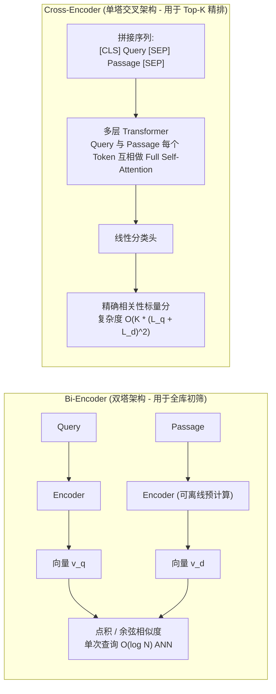
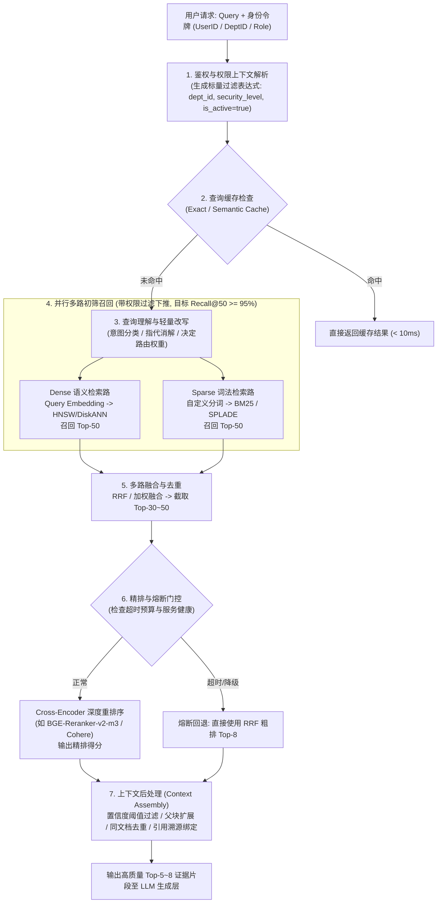
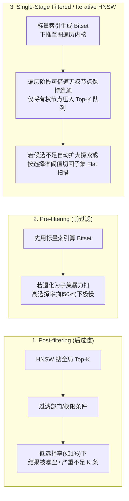
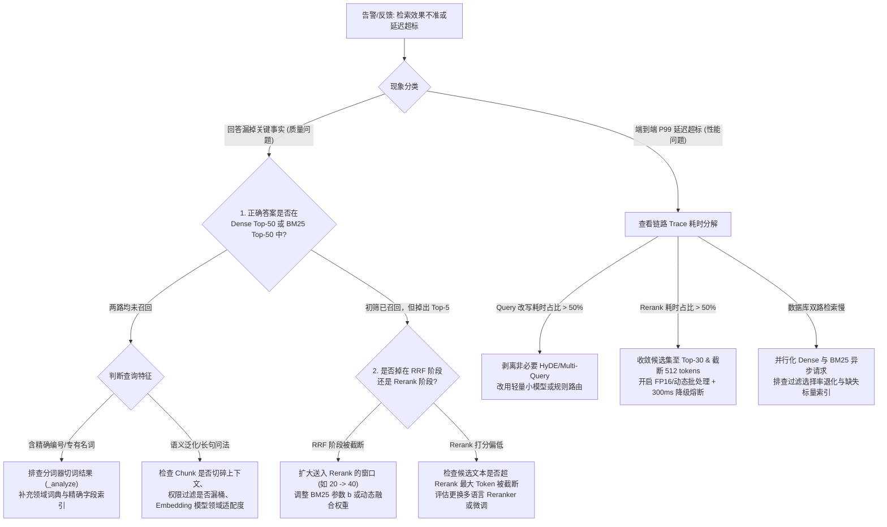

# 混合检索与重排序：倒排 BM25、多路召回融合、Cross-Encoder Rerank 与过滤优化

> **学习路径定位**：本文面向技术研发负责人、大数据研发经理与 AI 数据架构师，围绕“**是什么 → 为什么需要 → 如何实现 → 设计取舍 → 工程应用 → 常见问题 → 面试表达**”展开，并按“**基础认知 / 深入机制 / 架构师决策**”三层递进。重点剖析从单一向量检索迈向工业级多路召回漏斗（Hybrid Search + Rerank + Metadata Filtering）的核心机制，并与传统大数据查询优化器及 OLAP 执行引擎建立架构级映射。

---

## 1. 核心概念

### 1.1 基础认知：什么是混合检索与重排序

- **混合检索（Hybrid Search）**：在同一条用户查询链路中，并行执行**稀疏词法检索（Sparse Retrieval，如 BM25、SPLADE）**与**稠密语义检索（Dense Retrieval，基于 Embedding 向量索引）**，再通过排序融合算法（如 RRF 或分数归一化加权）合并去重，生成高召回率候选集的技术体系。
- **重排序（Rerank）**：在初筛召回的少量候选片段（如 Top-30 ~ Top-100）上，使用精度更高但计算更重的深度交互模型（典型为 **Cross-Encoder 交叉编码器**），将查询与每个候选文档拼接后执行全注意力交互打分，最终精选出 Top-5 ~ Top-8 注入 LLM 上下文的过程。

### 1.2 核心概念与术语对照表

| 概念 | 英文术语 | 核心职责 | 所属漏斗阶段 |
| :--- | :--- | :--- | :--- |
| **倒排索引** | Inverted Index | 建立“词项 → 文档列表（Posting List）”的映射，支持毫秒级精确词法定位。 | 稀疏召回底座 |
| **BM25** | Okapi BM25 | 基于词频饱和度、逆文档频率与文档长度归一化的经典概率检索打分函数。 | 稀疏召回打分 |
| **学习型稀疏检索** | Learned Sparse (SPLADE / BGE-M3 Lexical) | 用神经网络为词表中的 Token 预测上下文权重与同义扩展词，仍通过倒排索引高效检索。 | 语义增强稀疏召回 |
| **倒数排名融合** | RRF (Reciprocal Rank Fusion) | 仅依赖各路召回的名次（Rank）而非原始分数进行无量纲融合的鲁棒算法。 | 多路粗排融合 |
| **交叉编码器** | Cross-Encoder Reranker | 将 `[CLS] Query [SEP] Passage [SEP]` 联合编码，在 Transformer 内部执行 Token 级全交叉注意力计算。 | 精排重排序 |
| **查询改写** | Query Transformation | 在检索前对原始提问进行指代消解、多视角扩展（Multi-Query）、假设回答生成（HyDE）或上位抽象（Step-back）。 | 检索前置增强 |
| **元数据过滤** | Metadata Filtering | 基于租户、部门权限（RBAC）、生效状态、时间区间等结构化条件裁剪检索范围。 | 全链路权限与范围约束 |

### 1.3 三层学习递进视角

- **基础层**：理解 BM25 与向量检索为何互补、RRF 融合公式的直观作用，以及 Rerank 在“召回 → 精排”漏斗中的位置。
- **深入层**：掌握倒排索引底层结构与中文专业分词陷阱、BM25 参数 $k_1/b$ 调优、RRF 与线性归一化的数学边界、Cross-Encoder 与 Bi-Encoder 的注意力计算复杂度差异，以及 Pre/Post/Single-Stage 过滤对 HNSW 图连通性的影响。
- **架构师层**：能够基于业务查询分布判断是否需要混合检索与 Rerank（避免无效堆砌延迟）、设计多租户严密权限过滤方案、拆解端到端 P99 延迟预算并建立超时降级预案。

---

## 2. 解决的问题

### 2.1 单一检索路径的固有盲区

仅靠某一种检索技术，在真实企业文档问答中都会出现系统性漏召回或排序失真：

1. **纯 BM25 / 关键词检索的局限**：
   - **语义鸿沟（Vocabulary Mismatch）**：用户问“服务器内存被打爆怎么定位”，文档写的是“Java 进程触发 OOM Killer（Exit Code 137）排查指南”。字面几乎不重合，BM25 召回极差。
   - **长尾口语与跨语言失效**：口语化提问、英文缩写与中文全称之间缺乏语义泛化能力。
2. **纯稠密向量检索（Dense Retrieval）的局限**：
   - **精确标识符失明**：面对设备型号（`VALVE-DN200-PN16`）、报错码（`ERR_4092`）、制度编号（`HR-2026-014`）、专有人名或生僻行业缩写（OOV 词），向量空间倾向于返回语义上下文相似但编号完全错误的文档。
   - **Bi-Encoder 信息压缩瓶颈**：双塔编码器把整段 500 字文本压成单个定长向量，Query 与 Document 在编码阶段**零交互**，容易被主题相似但结论相反或缺少关键限定条件的干扰片段排到 Top-5。
3. **无 Rerank 直接送给 LLM 的危害（Lost in the Middle & 幻觉放大）**：
   - 即使正确答案排在第 18 位，受限于 LLM 上下文窗口成本与注意力“中间遗忘”效应，工程上通常只喂给大模型 Top-5 ~ Top-8 片段；如果初筛粗排无法把真正精准的证据顶进前 5，LLM 要么拒答，要么基于噪声片段拼凑幻觉答案。

### 2.2 混合检索与重排序的协同价值

- **混合检索解决“找得全”（Maximize Recall@50）**：用 Dense 兜住语义泛化，用 BM25/Sparse 锁死精确型号、错误码与专有名词，把正确证据稳稳纳入前 50~100 候选池。
- **重排序解决“排得准”（Maximize Precision@5 / NDCG@5）**：在缩小 1,000 倍后的候选池上，动用高精度的 Cross-Encoder 做深层字词交互判别，将最直接回答问题的片段精准推送到 Top-5，同时利用绝对置信度分数剔除不相关噪声。

### 2.3 适用边界：什么情况下不需要混合检索或 Rerank？

避免把“Hybrid + Rerank”当成机械教条，以下场景应克制复杂度：

- **无需混合检索**：纯精确日志/工单编号检索（直接用倒排 BM25 + 结构化过滤，更快更可控）；或纯跨语言图像/非结构化语义推荐（无有效词法匹配信号，纯 Dense 更合适）。
- **无需重型 Rerank**：对 P99 延迟要求极其苛刻（如 < 20 ms 的高频搜索补全），或领域语料极其规整、初筛 Precision@5 已稳定超过 90% 时，引入 Cross-Encoder 的算力与延迟代价可能大于收益。

---

## 3. 底层原理

### 3.1 倒排索引底层结构与中文分词痛点

#### 倒排索引核心物理结构（以 Lucene / Doris 倒排实现为例）
1. **Term Index（词项前缀树 / FST）**：常驻内存的有限状态转换器（Finite State Transducer），将词项前缀映射到磁盘 Term Dictionary 的偏移区间，减少内存占用并实现 $O(\text{len}(term))$ 查找。
2. **Term Dictionary（词项词典）**：磁盘上按字典序排列的所有独立词项，指向对应的倒排链位置。
3. **Posting List（倒排列表）**：记录包含该词项的有序 `DocID` 列表、词频（TF）及位置偏移（Positions）。为加速多词 `AND` 求交与权限过滤，底层普遍使用 **Frame of Reference (FOR) 差值压缩 + Skip List 跳表 / Roaring Bitmap**。

#### 企业中文文档分词的三大工程陷阱
标准中文分词器（IK Analyzer、Jieba、HanLP）在企业私有知识库中常引发隐蔽漏召回：

1. **专有名词与复合型号被错误切碎**：例如设备型号 `VALVE-DN200-PN16` 或错误码 `ERR_4092_TIMEOUT`，默认分词器可能按符号切成 `valve`、`dn`、`200`、`pn`、`16`，导致搜索完整型号时误匹配大量无关的含 `200` 或 `16` 的文档；反之，若按整串切分，用户只搜 `DN200` 又无法命中。
2. **行业术语未登录词（OOV）过切**：例如企业内部项目代号、工业协议术语、财务科目简称被切成单字，拉低 IDF 区分度。
3. **多粒度索引不一致**：建索引与查索引采用不匹配的分词策略（例如建库用 `ik_smart` 粗切、查询用 `ik_max_word` 细切，导致短语位置错乱）。

**工程通用解法**：
- **索引期细粒度 + 查询期智能切分**（如 `index: ik_max_word`, `search: ik_smart`）；
- **对编号/代码字段采用多字段（Multi-fields）策略**：同时保留 `keyword` 精确匹配、自定义正则/Word Delimiter 分词（保留原串 + 拆分词元）以及 2-gram/3-gram 兜底；
- **领域词典动态热更新**：结合业务术语表定期同步扩展词典与同义词词典（Synonym Graph）。

### 3.2 BM25 算法公式与参数深度解析

Okapi BM25 是信息检索领域历经数十年生产检验的概率相关性模型。给定查询 $Q = \{q_1, q_2, \dots, q_n\}$ 与文档块 $D$，其相关性得分为：

$$\text{Score}(Q, D) = \sum_{i=1}^{n} \text{IDF}(q_i) \cdot \frac{f(q_i, D) \cdot (k_1 + 1)}{f(q_i, D) + k_1 \cdot \left(1 - b + b \cdot \frac{|D|}{\text{avgdl}}\right)}$$

其中：
- **$\text{IDF}(q_i)$（逆文档频率）**：衡量词项的稀缺度与区分度（Lucene 采用非负平滑变体）：
  $$\text{IDF}(q_i) = \ln\left(1 + \frac{N - n(q_i) + 0.5}{n(q_i) + 0.5}\right)$$
  $N$ 为库内总文档块数，$n(q_i)$ 为包含词项 $q_i$ 的文档块数。像“的”、“系统”这类高频词 IDF 极低，而 `ERR_4092` 这种罕见错误码 IDF 极高，能瞬间主导排序。
- **$f(q_i, D)$ 与参数 $k_1$（词频饱和度控制，默认 1.2 ~ 2.0）**：
  - 传统 TF-IDF 中词频线性增长，文档重复堆砌 100 次关键词会刷高得分。
  - BM25 通过分母中的 $f(q_i, D) + k_1(\dots)$ 使词频贡献趋近于上限 $(k_1 + 1)$，形成边际递减饱和曲线。$k_1$ 越小饱和越快；$k_1 = 0$ 时退化为仅判断词项是否出现（布尔匹配）。
- **$|D| / \text{avgdl}$ 与参数 $b$（文档长度归一化，默认 0.75）**：
  - 长文档天然更容易偶然命中查询词。$b \in [0, 1]$ 控制对超长文档的惩罚力度（$b=0$ 关闭长度惩罚，$b=1$ 完全按长度比例惩罚）。
  - **RAG 场景的关键调优细节**：在 RAG 系统中，文档已前置切分为长度相近的 Chunk（如 400~600 tokens），此时过高的 $b=0.75$ 反而会过度偏向极短的标题块或残缺碎片块（因为 $|D| \ll \text{avgdl}$）。生产实践中常将 RAG Chunk 库的 $b$ 下调至 **0.3 ~ 0.5**。

### 3.3 Dense Retrieval vs Sparse Retrieval（BM25 / Learned Sparse）

| 对比维度 | Dense Retrieval（稠密向量） | BM25（统计稀疏倒排） | Learned Sparse（SPLADE / BGE-M3 Lexical） |
| :--- | :--- | :--- | :--- |
| **核心原理** | Bi-Encoder 连续语义向量空间近邻搜索 | 词项统计频率（TF-IDF 演进）倒排打分 | 神经模型预测词表级稀疏非零权重 + 上下文同义词扩展 |
| **语义泛化能力** | **强**（跨表达、跨语言、意群理解） | **弱**（严格依赖字面词项重合） | **中强**（能将隐含近义词激活为正权重） |
| **精确编号/OOV 词** | **弱**（易受语义上下文稀释） | **极强**（精确字面锁死，IDF 权重极高） | **中强**（依赖分词器词表切分粒度，Subword 切分对生僻码不如原生精确词典） |
| **索引与计算成本** | 高内存（HNSW）+ Embedding 推理算力 | 极低 CPU/内存，无 GPU 依赖，毫秒级极速 | 需神经编码推理；检索复用倒排引擎，但扩展词过多会导致倒排链变长 |
| **可解释性** | 低（黑盒 1024 维浮点数） | **极高**（可精确指出命中哪些词项及其 IDF 贡献） | **高**（可查看激活的关键词及权重分布） |

### 3.4 Bi-Encoder vs Cross-Encoder 注意力交互本质

为什么 Cross-Encoder Rerank 能显著提升 Top-5 准确率，却不能直接用于全库检索？核心差异在于 Transformer 内部注意力交互模式与计算复杂度：



- **信息无损交互**：在 Cross-Encoder 中，查询中的否定词（“不适用”）、限定条件（“仅针对华东区 2026 版”）与文档中的具体条款在每一层 Transformer 中直接执行 Token-to-Token 交叉注意力，彻底消除了单向量池化造成的信息瓶颈。
- **算力不可扩展边界**：因为必须在收到 Query 后实时拼接推理，无法离线预计算文档表征。面对 30 万条 Chunk，全库跑 Cross-Encoder 需要数十秒甚至数分钟，因此它只能作为漏斗后段的精排器，处理初筛压缩后的 Top-30 ~ Top-100 候选。

---

## 4. 系统架构

### 4.1 工业级多路召回与重排序全链路漏斗



### 4.2 与大数据查询优化器及 OLAP 执行引擎的架构类比

结合原知识库 [Apache Doris 实时 OLAP 架构](../01-bigdata/08-doris-lakehouse/01-doris-realtime-olap.md) 与 [数据库底层与 PostgreSQL/MySQL 事务](../03-java-engineering/03-database-storage-engine.md)，AI 混合检索漏斗与传统分析型数据库执行引擎存在高度同构的优化思想：

| 传统 OLAP / RDBMS 查询优化机制 | AI 混合检索与重排序对等机制 | 共同工程本质 |
| :--- | :--- | :--- |
| **谓词下推（Predicate Pushdown）** | 权限与版本过滤下推至存储引擎内部（Pre/Single-Stage Filtering） | 尽早裁剪无效数据，避免将无权限数据搬运至计算层再丢弃 |
| **Runtime Filter（动态运行时过滤）** | 基于用户 RBAC 权限位图（Roaring Bitmap / Bitset）在 HNSW 遍历期间动态跳过无权节点 | 运行时动态剪枝，降低无效距离计算与 I/O |
| **CBO 基于代价的计划选择** | 根据过滤选择率（Selectivity）动态决策走 HNSW 图搜索、Iterative Scan 还是退化为子集精确 Flat 扫描 | 当满足过滤条件的子集极小（如仅 500 行）时，暴力扫描比图跳转更快更准 |
| **多阶段流水线（Filter → Local Agg → TopN）** | 粗排并行多路召回（Top-100）→ RRF 归并（Top-40）→ Cross-Encoder 精排（Top-5） | 按算力单价由低到高逐级收敛候选集，用最贵的算子处理最少的数据 |
| **Doris 倒排索引加速日志检索** | BM25 倒排索引锁定错误码/型号与结构化过滤 | 倒排结构是精确词项定位的不可替代基础设施 |

---

## 5. 关键算法或实现机制

### 5.1 多路融合算法：RRF vs 线性加权融合

两路召回并行返回后，如何把 Dense（余弦相似度，通常集中在 `[0.65, 0.92]`）与 BM25（无上界非负实数，可能分布在 `[0, 45.0]`）合并为一个统一排序？

#### 1. RRF（Reciprocal Rank Fusion，倒数排名融合）
由 Cormack 等人提出，完全抛弃不同引擎尺度各异的原始分值，仅依据文档 $d$ 在各检索列表 $r \in R$ 中的排名 $\text{rank}_r(d)$（从 1 开始）进行倒数加权累加：

$$\text{RRF}(d) = \sum_{r \in R} \frac{w_r}{k + \text{rank}_r(d)}$$

标准无权形式取 $w_r = 1$，常数 $k$ 经典值为 **60**：

$$\text{RRF}(d) = \sum_{i=1}^{m} \frac{1}{60 + r_i(d)}$$

- **为什么常数 $k=60$ 至关重要？**
  - 若 $k=0$，第 1 名（$1/1=1.0$）对第 2 名（$1/2=0.5$）拥有压倒性优势，单路偶然排第 1 的噪声会轻松击败两路同时排第 3 的共识文档。
  - 引入 $k=60$ 后，第 1 名得分为 $1/61 \approx 0.01639$，第 5 名为 $1/65 \approx 0.01538$；而同时在两路分别排第 5 名与第 8 名的文档得分为 $1/65 + 1/68 \approx 0.03009$，显著反超仅在单路排第 1 名的文档。**$k$ 平滑了头部陡峭度，放大了“多路共识”效应**。
- **优势**：零超参调优成本、免训练、对不同检索引擎分数分布漂移完全免疫，是生产冷启动的默认基线。
- **局限**：丢弃了分数绝对置信度差异（例如 BM25 第 1 名得 35 分精确命中错误码、第 2 名仅得 1.2 分，RRF 看不出这之间巨大的绝对鸿沟）。

#### 2. 线性加权融合（Convex / Linear Combination）
对各路分数先执行归一化，再按权重 $\alpha \in [0, 1]$ 线性组合：

$$S_{\text{hybrid}}(d) = \alpha \cdot \tilde{s}_{\text{dense}}(d) + (1 - \alpha) \cdot \tilde{s}_{\text{sparse}}(d)$$

- **核心难点：分数归一化方法选择**：
  - **Min-Max 归一化**：$\tilde{s} = \frac{s - s_{\min}}{s_{\max} - s_{\min}}$。极易受极端异常高分挤压（如 BM25 某条垃圾文档反复出现关键词得 50 分，导致其余正常高相关文档全被压缩到 0.1 以下）；且当某一路完全无相关文档时，最不相关的第一名也会被硬拉成 `1.0`。
  - **Z-Score / DBSF（Distribution-Based Score Fusion）**：基于均值 $\mu$ 和标准差 $\sigma$，将分数映射到 $[\mu - 3\sigma, \mu + 3\sigma]$ 区间并裁剪至 $[0, 1]$，抗单点异常值干扰能力显著优于 Min-Max（Qdrant 等引擎原生支持 DBSF）。
  - **静态理论区间 / Sigmoid 映射**：针对 BM25 采用 $\frac{s}{s + c}$ 或 $\text{atan}$ 压缩映射，保持不同查询间的跨请求可比性。
- **选型原则**：**冷启动与缺乏标注数据时首选 RRF**；当积累了领域评测集且明确存在“强词法类查询”与“强语义类查询”分化时，再引入 **DBSF + 动态意图权重 $\alpha$**（例如检测到查询含错误码/型号正则时自动将 BM25 权重上调至 0.7）。

### 5.2 元数据过滤与 HNSW 图连通性交互机制

在企业多租户、多部门权限（RBAC）知识库中，**元数据过滤不是简单的 SQL `WHERE` 附加项，而是直接决定向量索引生死的底层性能陷阱**。



- **Post-filtering（后过滤）缺陷**：假设全库 100 万 Chunks，某部门仅有 5,000 条权限可见文档（选择率 0.5%）。先用 HNSW 搜全库 Top-50 再过滤，大概率 50 条里 0 条属于该部门，直接返回空结果。
- **Pre-filtering（前过滤）双刃剑**：先算出符合权限的 5,000 条 `DocID` Bitset。如果只有 5,000 条，直接对这 5,000 条做 SIMD 暴力 Flat 扫描耗时反而不到 2 ms 且召回率 100%；但如果过滤后仍有 50 万条（选择率 50%），暴力扫描延迟会飙升至数十甚至上百毫秒。
- **Single-Stage Filtered / Iterative HNSW（现代引擎标配）**：
  - **pgvector 0.8+ Iterative Index Scans**：遍历 HNSW 时持续迭代扩展候选集，直到凑满满足 `WHERE` 条件的 Top-K 为止（受 `hnsw.max_scan_tuples` 保护上限约束）。
  - **Qdrant Filterable HNSW**：建图时针对高频 Payload 字段（如 `tenant_id` / `dept_id`）额外补充同租户内部的跨节点连接边，彻底防止按租户过滤时发生图孤岛断裂。
  - **Milvus Iterative Filtering & ACORN 思路**：根据过滤选择率动态评估代价——极低选择率直接走子集 Brute-Force，中等选择率走图内单阶段遍历（允许借道无效节点维持连通性，但仅收集有效节点）。

### 5.3 查询改写（Query Transformation）策略与风险边界

| 改写技术 | 核心机制 | 适用场景 | 延迟与成本代价 | 核心风险与防线 |
| :--- | :--- | :--- | :--- | :--- |
| **Query Rewrite（指代消解与规整）** | 结合多轮对话历史，将“它怎么配置？”改写为“Flink Checkpoint 存储后端怎么配置？” | **所有多轮对话 RAG 必选** | 增加 1 次轻量小模型调用（100~300 ms） | 改写模型需低温度（`temperature=0`），严禁改变用户原始专有名词 |
| **Multi-Query（多视角发散）** | 用 LLM 将 1 个复杂问题拆解为 3~4 个子查询并行检索，再 RRF 融合 | 复合对比类、多跳长尾问题 | 检索并发放大 3~4 倍，增加 1 次 LLM 调用 | 限制最大子查询数（$\le 3$），避免稀释核心意图 |
| **HyDE（假设性文档嵌入）** | 让 LLM 先编造一段“假设答案”，用该答案的向量去检索真实文档 | 问句极短、与陈述型专业文档存在严重句式鸿沟 | 延迟高（需等 LLM 生成整段假设文本，500~1500 ms） | **高幻觉风险**：对企业私有专有名词/型号，LLM 编造的假设文档会严重带偏向量检索，**严禁用于精确编号或私域专有名词查询** |
| **Step-back（退步抽象）** | 将过于具体的细节问题抽象为上位原理问题补充检索 | 故障根因推导、复杂制度原则解释 | 增加 1 次 LLM 调用 + 1 路并行检索 | 仅作为辅助召回分支，不能替代原始细节查询 |

> **工程红线**：在线低延迟问答（SLA < 1.5s）中，通常只保留**规则提取 + 轻量指代消解**；HyDE 与 Multi-Query 仅在意图路由识别为“深度研究/复杂分析”模式时按需触发。

---

## 6. 技术选型与替代方案

### 6.1 混合检索引擎架构选型：一体化引擎 vs 双引擎组合

| 选型模式 | 代表技术栈 | 架构优势 | 劣势与隐性成本 | 适用场景 |
| :--- | :--- | :--- | :--- | :--- |
| **模式 A：单引擎原生混合（PG 生态）** | PostgreSQL + `pgvector` + `pg_search` (ParadeDB BM25) / `pg_jieba` | **一套数据库同时承接 ACID 事务、RBAC 权限、BM25 与 HNSW**，零跨库双写、运维门槛最低 | 中文分词生态与超大规模分布式全文扩展不如 ES 成熟 | **1 万 ~ 500 万文档块**，中小研发团队、强权限强一致企业知识库 |
| **模式 B：单引擎原生混合（搜索/向量引擎）** | Elasticsearch 8.x / OpenSearch 或 Milvus 2.5+ (原生 BM25 + Dense) 或 Qdrant (Dense + Sparse) | 避免维护两套异构检索引擎，原生支持单查询 RRF/混合打分 | ES 内存与 JVM 成本偏高；专用向量库仍需与业务 RDBMS 做元数据/权限同步 | 已有成熟 ES 集群复用，或千万级以上高并发搜索团队 |
| **模式 C：双引擎组合（ES + 专用向量库）** | Elasticsearch (BM25) + Qdrant/Milvus (Dense) + 应用层聚合网关 | 两路均发挥各自最强专业能力（ES 最强中文分词与复杂过滤，专用向量库最优量化与图索引） | **双写一致性、故障孤岛、两套集群运维与双倍存储成本** | 亿级超大规模、极高 QPS 且拥有专职搜索与基础设施团队的大型互联网业务 |

### 6.2 Reranker 方案选型：开源自部署 vs 商业 API vs Late Interaction

| 维度 | 开源自部署 Cross-Encoder (`BGE-Reranker-v2-m3` / `Qwen3-Reranker`) | 商业 Rerank API (`Cohere Rerank 3.5` / 厂商 Rerank API) | Late Interaction (`ColBERT v2`) | LLM Listwise Rerank (`RankGPT` / 轻量 LLM) |
| :--- | :--- | :--- | :--- | :--- |
| **排序精度** | 高（多语言中文场景表现优异） | 极高（多语言与长上下文处理稳定） | 中高（介于 Bi-Encoder 与 Cross-Encoder 之间） | 极高（具备全局列表对比视角） |
| **延迟（Top-30 候选）** | GPU (L4/A10 + TEI/ONNX FP16) 约 **30 ~ 80 ms** | 公网 RTT + 推理约 **150 ~ 400 ms** | 离线存 Token 向量，在线 MaxSim 约 **20 ~ 50 ms** | **500 ~ 2,000 ms**（不适合普通实时链路） |
| **数据合规与锁定** | **数据不出内网、零厂商锁定** | 文档片段外发存在合规审查风险，依赖供应商配额与定价 | 数据不出内网，无锁定 | 可自部署，但算力消耗极大 |
| **维护与演进成本** | 需维护 GPU 推理容器（可与 Embedding 共享卡池） | 零运维，按调用次数（如每千次搜索请求）计费 | 索引存储膨胀 10x~50x，工程集成复杂度高 | 仅用于离线评估或深度 Agent 研究链路 |

### 6.3 架构师战略决策准则（自研 vs 采购、集成 vs 重写）

1. **集成复用优先于重写**：优先在现有已落地的存储底座（如 PG 或现有 ES 集群）上开启混合检索，**不要在验证业务闭环前就引入“ES + Milvus + Kafka CDC”三套重型系统**。
2. **Rerank 选型看合规与调用密度**：
   - 数据必须私有化部署：直接用 **TEI (Text Embeddings Inference) / vLLM / Infinity** 部署开源 `BGE-Reranker-v2-m3`，并与 `BGE-M3` Embedding 服务共享 GPU 实例（通过并发限流隔离），将硬件利用率拉满。
   - 允许出云且初期日查询量 < 10 万次：先接商业 Rerank API 验证端到端准确率增益，避免空烧 GPU 固定月租；待流量跨过盈亏拐点后再平滑切回自部署。
3. **禁止盲目自研融合/重排模型**：绝大多数企业应复用开源 SOTA Reranker + 业务规则加权；只有在积累了数万条带真实点击/人工反馈的标注对后，才考虑对开源 Reranker 做轻量 LoRA 微调。

---

## 7. 工程实践

> [!NOTE] 案例性质说明：本案例为教学假设场景，用于系统训练 AI 数据架构设计能力，不属于个人过往真实任职项目。

### 7.1 教学假设场景：10,000 份企业文档混合检索与重排序流水线

**延续教学假设场景设定**（对齐 [PROFILE_FACTS.md](../PROFILE_FACTS.md) 与 [Embedding 与向量索引](./03-embedding-vector-index.md)）：
- **数据体量**：10,000 份企业 PDF/Word 文档（含扫描件 OCR 文本、技术规格表格、设备型号/物料号、错误码、多版本修订及多部门 RBAC 权限），切分为约 **30 万有效 Chunks**。
- **典型混合查询样本**：
  - *语义类*：“换热站冬季运行能耗异常偏高一般先查哪些原因？”（依赖 Dense 语义泛化）
  - *精确词法类*：“`ERR_4092` 报警代码对应的 `VALVE-DN200-PN16` 校验步骤是什么？”（依赖 BM25 精确锁死型号与错误码）
  - *权限限定类*：研发部员工查询最新生效版本制度，严格禁止召回财务机密文档或已作废的 `v1` 旧版文件。

### 7.2 端到端检索引擎集成方案（PostgreSQL 一体化教学架构）

在 30 万 Chunks 规模下，采用 **PostgreSQL (`pgvector 0.8+` + `pg_search` BM25 / 自定义中文分词)** 承接双路初筛，并通过独立微服务执行 **RRF 融合 + `BGE-Reranker-v2-m3` 精排**：

```sql
-- 教学推演 SQL：在单一事务快照下完成“权限过滤下推 + Dense/BM25 双路并行召回 + RRF 融合”
WITH
-- 路由 1：Dense 稠密语义召回（利用部分 HNSW 索引与 Iterative Scan）
dense_candidates AS (
    SELECT
        chunk_id,
        ROW_NUMBER() OVER (ORDER BY embedding <#> $1::halfvec(1024)) AS dense_rank
    FROM kb_document_chunks
    WHERE is_active = TRUE
      AND dept_id = ANY($2::varchar[])      -- 用户所属部门集合
      AND security_level <= $3              -- 用户最大密级
    ORDER BY embedding <#> $1::halfvec(1024)
    LIMIT 50
),
-- 路由 2：Sparse 词法 BM25 召回（基于自定义企业词典 + 型号原串保留分词）
sparse_candidates AS (
    SELECT
        chunk_id,
        ROW_NUMBER() OVER (ORDER BY paradedb.score(chunk_id) DESC) AS sparse_rank
    FROM kb_document_chunks
    WHERE chunk_id @@@ paradedb.parse($4)   -- BM25 全文检索表达式
      AND is_active = TRUE
      AND dept_id = ANY($2::varchar[])
      AND security_level <= $3
    LIMIT 50
),
-- 阶段 3：RRF 倒数排名融合 (k = 60)，合并去重输出 Top-40 送交 Cross-Encoder Rerank
rrf_fused AS (
    SELECT
        COALESCE(d.chunk_id, s.chunk_id) AS chunk_id,
        COALESCE(1.0 / (60 + d.dense_rank), 0.0) +
        COALESCE(1.0 / (60 + s.sparse_rank), 0.0) AS rrf_score
    FROM dense_candidates d
    FULL OUTER JOIN sparse_candidates s ON d.chunk_id = s.chunk_id
    ORDER BY rrf_score DESC
    LIMIT 40
)
SELECT c.chunk_id, c.doc_id, c.content, c.metadata, r.rrf_score
FROM rrf_fused r
JOIN kb_document_chunks c ON r.chunk_id = c.chunk_id
ORDER BY r.rrf_score DESC;
```

### 7.3 工程配置基线与关键护栏

1. **检索漏斗参数基线**：
   - Dense 初筛 `Top-50` + BM25 初筛 `Top-50` → RRF（$k=60$）融合去重截断至 **`Top-30` ~ `Top-40`** → Cross-Encoder Rerank 输出 **`Top-5` ~ `Top-8`**。
   - BM25 参数调优：因 Chunk 长度集中在 400~600 tokens，设 `k1 = 1.2`，将长度惩罚 `b` 从默认 `0.75` 下调至 **`0.4`**，防止极短的标题碎片霸榜。
2. **置信度阈值与“拒答护栏”**：
   - RRF 分数仅反映相对名次，无法判断“库里压根没答案”。必须依据 Cross-Encoder Rerank 输出的归一化概率分（经 Sigmoid 映射至 $[0, 1]$）设立经验下限（例如 `< 0.25` 视为低置信度丢弃），当全部片段被过滤时直接触发“知识库未收录该信息”的合规拒答，源头抑制 LLM 幻觉。
3. **父子块回溯（Small-to-Big Context Expansion）**：
   - 检索与 Rerank 使用紧凑的 400~500 tokens 子块保证打分精准；精选 Top-5 后，按 `parent_section_id` 回查其所属的完整章节或完整表格 Markdown（关联多模态表格解析），去重合并后再喂给 LLM。
4. **安全与可观测性治理**：
   - 权限过滤表达式必须由服务端网关基于 JWT/IAM 强行注入，严禁信任前端传入的 `dept_id`（参见 [数据 API 网关与安全治理](../02-data-platform/05-data-api-security.md)）。
   - 全链路记录 Trace：保存 `raw_query`、`rewritten_query`、`dense_top10`、`bm25_top10`、`rrf_top10`、`rerank_top5` 及各阶段耗时，为后续坏案例归因（区分“初筛没召回”还是“精排排错了”）提供观测依据（参见 [数据平台可观测性与高可用架构](../02-data-platform/06-observability-ha.md)）。

---

## 8. 常见故障与解决思路

### 8.1 典型生产故障模式

| 故障现象 | 根因剖析 | 快速止损 | 长期根治 |
| :--- | :--- | :--- | :--- |
| **包含具体型号/错误码的提问始终漏召回** | 中文分词器将 `VALVE-DN200-PN16` 切碎或过滤掉连接符；或 BM25 路被关闭/权重过低 | 临时将型号字符串加双引号强制短语匹配 | 增加正则/Multi-field 精确词元索引，建立企业术语词典热更新机制，规则检测含编号时提高 BM25 路权重 |
| **混合检索上线后，某些长尾问句反而比纯向量差** | 极短噪声块偶然命中查询中的 1~2 个生僻字，借 BM25 高 $b=0.75$ 长度奖励冲到第 1 名，经 RRF 拉低了纯语义正确答案 | 下调 BM25 长度惩罚参数 `b` 至 `0.3~0.4` | 引入 Cross-Encoder Rerank 过滤伪高分词法噪声，并过滤长度过短（如 < 30 字符）的无实质碎片块 |
| **高权限隔离部门用户频繁搜不到文档（空结果）** | 向量库执行 Post-filtering，部门数据仅占全库 1%，初筛 Top-50 全部被权限条件滤光 | 临时调大向量初筛 `efSearch` 与 Candidate Limit | 切换为 Single-Stage Filtered / Iterative Scan；超低选择率租户采用按 `dept_id` 路由的子集过滤或独立 Partition |
| **Rerank 服务偶发超时拖垮整个问答接口** | 上游送入 Rerank 的候选数过大（如 Top-100 且每段 1,500 tokens），超长序列导致 Transformer $O(L^2)$ 显存与耗时爆炸 | 截断 Rerank 输入至 Top-30、单段最多 512 tokens；配置 300ms 超时自动熔断回退 RRF Top-6 | 部署 FP16/ONNX/TensorRT 加速，启用动态 Batching，并对高频查询增加前端缓存 |
| **相同意思换个问法，答案波动剧烈** | 查询改写 Prompt 温度过高（`temperature > 0.3`）或 HyDE 编造了偏离企业私域术语的假设文本 | 将改写温度锁定为 `0`；对私域专业查询关闭 HyDE | 建立确定性规则改写 + 轻量受控指代消解；用评测集回归锁定改写模板版本 |

### 8.2 检索质量与性能排障决策树



---

## 9. 性能及成本分析

### 9.1 端到端检索链路 P99 延迟预算分解（不含下游 LLM 生成）

以企业级实时 RAG 检索层 **P99 总预算 $\le 300\text{ ms}$**（复杂多轮改写放宽至 $\le 500\text{ ms}$）为目标，各阶段精细化耗时拆分如下：

| 链路阶段 | 执行方式 | 推荐 P50 | 推荐 P99 预算 | 核心优化手段 |
| :--- | :--- | :--- | :--- | :--- |
| **1. 鉴权 + 缓存查询** | 同步（Redis / 本地内存） | 2 ms | 5 ms | 热点权限映射缓存 + Exact/Semantic Cache 拦截重复高频问答 |
| **2. 轻量指代消解（按需）** | 仅多轮对话触发 | 0 ms（单轮跳过） | 180 ms（多轮） | 单轮直通跳过；多轮用 1B~7B 量化小模型独立部署 |
| **3. Query Embedding** | 同步（TEI / API） | 12 ms | 30 ms | 短文本推理极快；Batching + 常驻连接池 |
| **4. Dense + BM25 并行召回** | **异步并行（关键！）** | 18 ms | 45 ms | 两路必须并发发起（取 `max(T_dense, T_bm25)` 而非相加）；权限过滤下推 |
| **5. RRF 融合 + 取候选文本** | 内存计算 + 批量主键回表 | 5 ms | 15 ms | 主键批量 `IN (...)` 一次拉回 Top-30 内容，杜绝 N+1 查询 |
| **6. Cross-Encoder Rerank** | GPU Batch 推理（Top-30） | 45 ms | 110 ms | 严格限制 `candidates <= 30`、`max_len <= 512`、FP16 + ONNX/TEI；设 250ms 超时降级 |
| **总计（单轮直通链路）** | — | **~82 ms** | **~205 ms** | 完全满足亚秒级交互体验，把主要时间预算留给下游 LLM 首字延迟（TTFT） |

### 9.2 Rerank 计算复杂度与成本测算（API vs 自部署 GPU）

假设生产环境日均 **50,000 次** RAG 检索（月均 **150 万次**查询），每次对 **Top-30** 候选文档块执行 Rerank：

| 成本与性能维度 | 商业 Rerank API（参考 Cohere Rerank 约 \$2.0 / 1,000 searches 估算） | 开源自部署 `BGE-Reranker-v2-m3`（双实例高可用 L4 / A10 GPU 估算） |
| :--- | :--- | :--- |
| **月度直接费用** | $1,500 \times \$2.0 \approx$ **\$3,000 / 月**（约 2.1 万人民币/月） | 2 张 L4/A10 云卡（可与 Embedding 复用）约 **4,000 ~ 8,000 元人民币/月** |
| **低流量期（日均 2,000 次，月 6 万次）** | $60 \times \$2.0 \approx$ **\$120 / 月**（约 850 元人民币/月，极低） | 固定双卡高可用仍需 4,000 ~ 8,000 元人民币/月（利用率低） |
| **吞吐极限与弹性** | 弹性免运维，但受公网延迟（+100~200ms）与厂商 QPS 限流约束 | 单张 L4（FP16 + TEI）处理 `30 pairs × 512 tokens` 约需 40~60 ms，单卡稳态支撑 **15~25 QPS** |
| **成本拐点结论** | **日查询量低于 5,000 ~ 10,000 次且允许数据出云时，商业 API 更经济** | **日查询量超过 1~2 万次，或涉及内网合规红线时，自部署开源 Reranker 具备明显 TCO 优势** |

### 9.3 成本与延迟压降三板斧

1. **分级缓存拦截**：企业知识库问答具有显著的帕累托长尾分布（高频 20% 的政策、报销、常见故障问题占据 60% 以上流量）。在检索前加一层按 `(dept_id, security_level, normalized_query / semantic_cache)` 隔离的缓存，可直接省去大量 Embedding、Rerank 与 LLM 推理成本。
2. **动态路由跳过 Rerank**：当 BM25 精确命中唯一编号且得分断层领先，或者 Dense Top-1 相似度极高且与 Top-2 拉开显著差距时，可按规则跳过 Rerank 节省算力。
3. **共享 GPU 池与错峰调度**：将离线文档批量 Embedding 调度至夜间低峰期，白天 GPU 算力优先保障在线 Query Embedding 与 Rerank 的 P99 延迟。

---

## 10. 面试题

1. **Q1**：BM25（词法检索）与稠密向量检索各自的优势与劣势是什么？在实际业务中，什么情况下必须引入混合检索，什么情况下单路检索更合适？
2. **Q2**：既然已经做了混合检索（BM25 + Dense），为什么还需要引入 Cross-Encoder Rerank？它从底层机制上解决了什么问题，成本与延迟边界在哪里？
3. **Q3**：多路召回结果融合时，RRF（Reciprocal Rank Fusion）和线性加权融合各自的数学原理与优缺点是什么？公式中的平滑常数 $k=60$ 有什么工程意义？
4. **Q4**：在多部门权限（RBAC）与多版本状态过滤的企业知识库中，Pre-filtering、Post-filtering 和 Single-Stage Iterative Filtering 对 HNSW 向量检索的召回率和延迟分别有什么影响？
5. **Q5**：中文企业文档包含大量设备型号、错误码和专有名词，直接使用默认分词器和默认 BM25 参数（$k_1=1.2, b=0.75$）会出现什么问题？如何针对性优化？
6. **Q6**：混合检索加上查询改写与 Cross-Encoder Rerank 后，线上 P99 检索延迟飙升到 1.2 秒，作为架构师你会如何定位瓶颈、拆解优化并设计防雪崩降级预案？

---

## 11. 参考答案

### Q1：BM25 与向量检索各自的优势与劣势？什么情况下需要混合检索？

#### 1. 1分钟简洁回答
**BM25** 基于倒排索引和词频统计，优势是**对专有名词、型号、错误码、生僻词精确匹配极强、可解释性高、成本极低**，劣势是无法跨越同义表达和语义鸿沟；**稠密向量检索**基于语义空间近邻，优势是**语义泛化、口语理解与跨语言能力强**，劣势是对精确字面编号失明且受单向量信息压缩限制。当企业知识库同时包含“概念/操作类语义提问”和“型号/代码/制度条款编号类精确提问”时，必须引入混合检索；若业务是纯日志精确排查或纯无词法意义的推荐场景，则单路检索更具 ROI。

#### 2. 深入原理解释
- **BM25 的核心武器是 IDF 稀缺度加权与词频饱和度**：当查询包含 `ERR_4092` 这类低频强区分词时，其 IDF 值远高于普通动词，倒排引擎能毫秒级把含该错误码的文档精准锁定在 Top-3。但只要文档换了个同义词（如把“宕机”写成“进程非正常退出”），词项交集为零，BM25 彻底失效。
- **Dense 向量的核心武器是对比学习构建的语义流形**：即便字面完全不同，只要在训练语料中语义共现，向量夹角依然很小。但 Bi-Encoder 对未见过的企业内部编号（OOV）往往按 Subword 切分后池化为噪声特征，导致 `VALVE-DN200` 和 `VALVE-DN300` 在向量空间里几乎重合。
- **互补效应**：实际评测中，混合检索相比单一 Dense 或单一 BM25，往往能将 Recall@20 稳定提升 **10%~25%**，尤其显著改善长尾专业查询的漏召回问题。

#### 3. 架构师视角分析
- **选型不教条，按查询日志分布决策**：在架构落地前，先抽样 200~500 条真实业务查询做意图分布统计。如果 30% 以上包含专有代号、指标名、错误码或制度条文号，必须从 Day 1 规划混合检索；若纯属泛化客服 FAQs（如短问句匹配标准问答对），单路 Dense + 轻度改写可能已满足 90%+ 需求，此时盲目叠加第二套搜索引擎反而徒增维护成本。
- **优先单底座集成**：中小规模下（如百万级 Chunk 以内）优先用单一引擎（如 PG + `pgvector` + BM25 或已有 ES 8.x）实现混合，避免过早引入双库同步复杂度。

#### 4. 典型追问
- **追问**：现在有 BGE-M3 这种自带 Learned Sparse（学习型稀疏向量）的模型，它能完全替代传统 BM25 吗？
  - **应对要点**：**不能无条件完全替代**。Learned Sparse（如 SPLADE / BGE-M3 Lexical）具备同义词扩展优势，但它依然受限于 Transformer Tokenizer 的词表切分，对于长串字母数字混合型号或未登录专有名词，精确词典驱动的传统 BM25（配合定制分词器与正则字段）依然更可控、更透明，且无额外模型推理延迟。

#### 5. 常见错误回答
- 认为“向量检索是新一代 AI 技术，已经全面淘汰了过时的 BM25”，忽视企业私域场景中精确编号与专有名词的高频刚需。
- 只背结论“混合检索更好”，说不清底层倒排 IDF 与 Bi-Encoder Subword 池化各自为何失效。

---

### Q2：混合检索之后为什么还需要 Rerank？底层机制、成本与延迟边界是什么？

#### 1. 1分钟简洁回答
混合检索解决的是**“找得全（Recall）”**，但初筛阶段（Bi-Encoder + BM25 + RRF）缺乏 Query 与 Document 的深度语义交互，且 RRF 无法区分绝对相关性，导致 Top-5 中仍混杂主题相近但答非所问的干扰块。**Cross-Encoder Rerank** 将查询与候选块拼接输入 Transformer，执行 Token 级全交叉注意力交互，能够精准识别否定条件、限定范围与因果逻辑，大幅提升 **Precision@5 / NDCG@5**，并输出绝对置信度用于低分拒答。其代价是无法离线预计算、复杂度为 $O(K \cdot L^2)$，因此必须被约束在 Top-20 ~ Top-50 候选池与 512 tokens 截断边界内。

#### 2. 深入原理解释
- **Bi-Encoder 的交互缺失**：双塔模型独立编码 Query 和 Chunk，最后仅靠一次点积衡量相关性。这种“信息压缩瓶颈”使模型难以分辨“A 导致 B”与“B 导致 A”，也难以验证文档是否真正满足查询中的多个复合约束条件。
- **Cross-Encoder 的全注意力交互**：把 `[CLS] Query [SEP] Passage [SEP]` 联合输入模型后，每一层 Self-Attention 都会计算 Query 每个词与 Passage 每个词的注意力权重，直接捕捉细粒度的实体对齐、否定词修饰与数值限定，判别精度远高于单向量点积。
- **绝对分数置信度价值**：RRF 输出的是无量纲名次倒数和，哪怕全库毫无相关内容，RRF 第 1 名分数依然固定在 `~0.032`；而 Cross-Encoder 输出经过 Sigmoid 校准的绝对相关性概率（0~1），可用于拦截低质量上下文，防止大模型强行基于无关材料编造答案。

#### 3. 架构师视角分析
- **ROI 视角下的漏斗配比**：Rerank 的收益高度依赖上游初筛的质量——如果正确答案压根没进 Top-50，再强的 Rerank 也无能为力；反之，若送入 Rerank 的候选从 30 盲目扩到 200，延迟会暴涨 6 倍，但 Precision@5 的边际增益往往微乎其微。生产中通常通过离线实验寻找收益拐点（多数企业文档库落在 **Top-30 ~ Top-40**）。
- **算力与容错边界**：Rerank 是整个检索链路中最容易成为延迟短板与故障单点的组件，架构上必须为其设置**独立的耗时熔断器**（如 250~300 ms 超时自动降级返回 RRF Top-6），保证 RAG 服务高可用。

#### 4. 典型追问
- **追问**：如果业务要求延迟压到 50 ms 以内，跑不动重型 Cross-Encoder，有没有折中替代方案？
  - **应对要点**：① 采用更轻量的蒸馏版 Cross-Encoder（如 MiniLM / TinyBERT 架构）配合 ONNX INT8 量化在 CPU/GPU 极速推理；② 采用 **ColBERT（Late Interaction 延迟交互）**，离线预存 Token 向量、在线算 MaxSim，在精度与速度之间取得折中；③ 缩小精排候选数至 Top-15~20。

#### 5. 常见错误回答
- 误以为 Rerank 可以直接替代向量检索在全库运行，不了解 Cross-Encoder 无法离线预建索引的 $O(N \cdot L^2)$ 复杂度致命瓶颈。
- 忽视 Rerank 的绝对置信度阈值作用，导致“知识库无答案时仍硬塞 Top-5 噪声给 LLM”引发严重幻觉。

---

### Q3：RRF 与线性加权融合的数学原理、取舍及 $k=60$ 的工程意义

#### 1. 1分钟简洁回答
**RRF（倒数排名融合）**按 $\sum \frac{1}{k + \text{rank}_i(d)}$ 仅依赖名次融合，完全规避了 BM25（无界实数）与余弦相似度（窄区间浮点）分数尺度不一致的难题，鲁棒性极强，适合冷启动；其中常数 **$k=60$** 用于平滑头部名次差距、抑制单路偶然噪声霸榜、放大多路共识文档的排名。**线性加权融合**则保留了分数幅值信息（如 BM25 断层高分精确命中），但强依赖归一化算法（如 DBSF）与权重 $\alpha$ 调参，适合有评测集支撑后的精细化调优阶段。

#### 2. 深入原理解释
- **分数分布异构难题**：Dense 检索的余弦相似度常常密集挤在 `[0.72, 0.88]` 极窄区间，而 BM25 分数可能从 `0.5` 横跨到 `38.0`。直接线性相加会让 BM25 彻底淹没 Dense；而简单的 Min-Max 归一化又对极端离群高分极度敏感，且在某一路全部无关时强行把垃圾文档归一化为 `1.0`。
- **RRF 的 $k$ 值敏感性**：
  - 当 $k$ 极小（如 $k=1$）时，第 1 名（$0.5$）与第 2 名（$0.33$）落差极大，退化为“单路榜首通吃”。
  - 当 $k=60$（Cormack 原始论文跨多数据集验证的经验稳健值）时，单路第 1 名得分 $1/61 \approx 0.0164$，而两路同时排第 10 名得分 $2/70 \approx 0.0286$，有效奖励跨模态共识文档。
- **线性融合的正确打开方式**：若业务需要保留分数幅度（例如区分“绝对高分精确命中”和“勉强排第一的低分弱相关”），应采用 **DBSF（基于 $\mu \pm 3\sigma$ 的分布归一化）** 替代 Min-Max，并结合查询意图动态调整 $\alpha$（如检测出错误码正则时下调 Dense 权重 $\alpha$ 至 0.3）。

#### 3. 架构师视角分析
- **分阶段演进策略**：不要在项目初期就陷入对 $\alpha = 0.63$ 还是 `0.67` 的玄学调参。标准工程路径是：**Phase 1 上线 RRF ($k=60$) 作为无参强基线 + 后端 Cross-Encoder Rerank**（只要正确文档进了 RRF Top-40，RRF 内部的微小名次误差都会被 Rerank 修正）；**Phase 2 积累领域标注集与线上日志后，针对特定垂直查询类型引入加权 RRF 或 DBSF 动态融合**。

#### 4. 典型追问
- **追问**：如果某条精确错误码查询只在 BM25 路排第 1 名（得 40 分），在 Dense 路没进 Top-50，RRF 会不会把它排到两路都在第 15 名的平庸文档后面？
  - **应对要点**：**会的，这正是无权 RRF 的典型短板**。两种解法：① 因下游还有 Rerank，只要该文档能稳进 RRF Top-40（单路第 1 名得分 `0.0164` 几乎必进 Top-40），Cross-Encoder 就能把它捞回 Top-1；② 引入带意图的加权 RRF（规则识别含错误码/型号时赋予 BM25 权重 $w_{\text{bm25}} = 2.0$）。

#### 5. 常见错误回答
- 提出把 BM25 原始分与余弦相似度直接乘权重相加，或直接用未经保护的 Min-Max 归一化而不了解异常值挤压效应。
- 答不出 $k=60$ 的平滑与共识放大作用，误以为只是为了防止除以零。

---

### Q4：多部门权限过滤下，Pre-filtering、Post-filtering 与 Single-Stage Iterative Filtering 对 HNSW 的影响

#### 1. 1分钟简洁回答
**Post-filtering（后过滤）**先搜全库 HNSW 再按权限滤除，在低选择率场景（如小部门仅占全库 1%）会导致严重召回空洞甚至返回空集；**Pre-filtering（前过滤）**先算出权限 Bitset，若直接退化为子集暴力扫描，在低选择率下极快且 100% 精准，但在高选择率（如 50% 文档可见）下会拖垮延迟；**Single-Stage Iterative / Filtered HNSW** 将权限 Bitset 下推至图遍历内核，允许搜索借道无权节点保持图连通性，同时持续迭代探索直到凑满有权 Top-K，并在极低选择率时自动切回子集精确扫描，是现代企业多租户检索的最优解。

#### 2. 深入原理解释
- **HNSW 连通性断裂本质**：HNSW 依赖密集邻接边完成多跳导航。如果强行在图遍历时禁止经过不满足过滤条件的节点，当满足条件的节点在空间中稀疏分布时，局部子图会彻底断连成孤岛，搜索陷入局部死胡同导致 Recall 暴跌。
- **主流引擎的工程破局**：
  1. **借道不收录（Iterative Traversal）**：如 `pgvector 0.8+ Iterative Index Scans` 与 Milvus Iterative Filtering——遍历图时仍可经过无权限节点到达远端有效节点，仅将通过 Bitset 校验的节点压入结果堆，持续扩展直到集齐 $K$ 条或触及扫描上限。
  2. **Payload 感知加边（Filterable HNSW）**：如 Qdrant——为高频租户/部门字段在建图期补充同一分组内部的连通边，保障任意租户子图自身也是完整的小世界图。
  3. **代价路由（类比数据库 CBO）**：估算满足过滤条件的基数 $N_{\text{filtered}}$。若 $N_{\text{filtered}} < 5,000 \sim 10,000$，跳过 HNSW 图跳转，直接对该子集执行 SIMD 向量化 Flat 扫描（< 2 ms 且 100% 召回）。

#### 3. 架构师视角分析
- **物理隔离 vs 逻辑过滤的分层治理**：如果租户数量不多（如几十个核心大部门/大客户）且数据绝对隔离，优先按 `tenant_id` 做**物理 Partition / Collection 隔离**或 PostgreSQL 部分索引，从根源消灭跨租户过滤选择率问题；若存在复杂交叉矩阵权限（如人员跨项目组 + 文档密级 + 时效状态），则必须依赖 Single-Stage Filtered HNSW + 部分索引（过滤掉占大头的 `is_active = FALSE` 历史版本）。
- **安全底线**：权限 Bitset 必须在检索引擎内部或可信服务端强执行，严禁把未过滤结果拉到 LLM Prompt 里指望大模型“自觉保密”。

#### 4. 典型追问
- **追问**：为什么给历史失效版本（`is_active = FALSE`）做部分索引（Partial Index）能大幅提升过滤效率？
  - **应对要点**：随着企业文档迭代 2~3 年，历史废弃版本可能占总数据量的 60%~80%。如果全放进同一张 HNSW 图里，所有在线查询都背负着 80% 的无效过路节点；使用部分索引 `WHERE is_active = TRUE` 后，在线图体积缩小 3~5 倍，既省内存又消灭了大量无效过滤跳转。

#### 5. 常见错误回答
- 认为只要给数据库加个 `WHERE dept_id = 'RD'` 就能像普通 MySQL 联合索引一样高效工作，完全不了解高维图索引与标量过滤的冲突机制。
- 只提“调大 Top-K 再过滤”（硬撑 Post-filtering），在 0.5% 选择率下即使放大 10 倍依然大概率召回不足。

---

### Q5：中文企业文档含型号/错误码时，默认分词与默认 BM25 参数的问题及优化

#### 1. 1分钟简洁回答
默认中文分词器（如 IK/Jieba）容易将设备型号（`VALVE-DN200-PN16`）、错误码（`ERR_4092`）或行业专有名词错误切碎，导致搜索精确编号时漏召回或被海量无关数字干扰；同时默认 BM25 参数 $b=0.75$ 针对长短悬殊的网页设计，在 RAG 长度均匀的 Chunk 库中会过度奖励极短的标题碎片块。优化方案包括：**Multi-field 多策略分词（保留原串 + 细粒度拆分）+ 企业领域词典热更新 + 下调 BM25 长度惩罚参数 $b$ 至 `0.3~0.5` + 过滤过短无信息残片**。

#### 2. 深入原理解释
- **切词失真机制**：
  - 混合字母、数字与连字符的编码在标准分析器中常被 `Standard Tokenizer` 按标点切开并小写化，且数字部分（如 `200`、`16`）在企业文档中极高频，IDF 接近 0，失去了精准定位能力。
  - 若粗暴改用 `keyword` 整串不分词，用户搜型号前缀 `DN200` 又完全搜不到。
  - **解法**：使用 `Word Delimiter Graph`（开启 `preserve_original: true` 与 `catenate_all: true`）或 Multi-field 同时索引完整精确串与拆分子词，并给完整精确串字段赋予更高 Boost 权重（如 `^3.0`）。
- **BM25 参数 $b$ 失配机制**：
  - 回顾 BM25 分母中的长度归一化因子：$1 - b + b \cdot \frac{|D|}{\text{avgdl}}$。
  - 假设库内平均 Chunk 长度 `avgdl = 500` 字，此时混入了一个仅 15 字的目录标题块，$|D|/\text{avgdl} = 0.03$。在 $b=0.75$ 时分母惩罚项缩水至 `0.27`，导致这个毫无正文细节的目录标题块得分暴涨近 3 倍，把真正包含操作步骤的 500 字正文挤出前排。将 $b$ 下调至 `0.3~0.4` 可显著缓解这一失真。

#### 3. 架构师视角分析
- **分词治理必须工程化而非一次性手工配置**：随着企业新产品型号、新项目代号持续上线，领域词典必须与企业主数据管理（MDM）或术语元数据表打通，建立定时同步与热加载流水线（避免每次加词都要全量重建索引）。
- **离线验证抓手**：在研发排障工具中暴露分词调试接口（类似 ES `_analyze`），每次出现词法漏召回，第一时间核验“入库分词结果”与“查询分词结果”的交集，避免盲调权重。

#### 4. 典型追问
- **追问**：如果更改了中文分词词典，线上历史已入库的文档会自动生效吗？
  - **应对要点**：**不会！** 热更新词典只影响**新写入的文档**和**在线查询词切分**。历史文档的倒排词项已经固化在旧的 Term Dictionary 中。若查询按新词切出了整词（如“水力平衡”），而旧索引里只存了“水力”和“平衡”，反而会造成历史文档漏召回。因此涉及核心新词时，必须配合低峰期 Reindex 重刷或采用同义词扩展平滑过渡。

#### 5. 常见错误回答
- 仅泛泛回答“换个更好的中文分词器”，未指出 Multi-field 保留原串、BM25 长度惩罚参数 $b$ 与 RAG Chunk 的冲突，以及热更新词典对历史索引不溯及既往的工程陷阱。

---

### Q6：混合检索 + 查询改写 + Rerank 链路 P99 延迟达 1.2 秒，如何定位优化与设计降级预案？

#### 1. 1分钟简洁回答
首先通过全链路分布式 Tracing 对 1.2 秒做耗时切片定位瓶颈（常见大头在**串行调用、重型查询改写如 HyDE、以及 Rerank 候选过多或文本过长**）。优化遵循“**剪枝 → 并发 → 提速 → 缓存 → 熔断**”五步法：剥离单轮查询不必要的 LLM 改写，将 Dense 与 BM25 彻底改为异步并发，将 Rerank 候选收敛至 Top-30 且截断 512 tokens 并启用 FP16/TEI 批处理，叠加权限隔离的高频查询缓存；同时设计**分级熔断降级预案**，当 Rerank 或改写超时（如 > 250 ms）时自动回退至 RRF 粗排结果，保住主链路 SLA。

#### 2. 深入原理解释
- **典型耗时黑洞拆解**：
  1. **隐藏串行调用**：先等 LLM 改写（400 ms）→ 再调 Embedding（40 ms）→ 查向量库（50 ms）→ 再串行查 ES（40 ms）→ 逐条回表查正文（N+1 查询 80 ms）→ 送 Top-100 长文本给 Rerank（600 ms）= 1,210 ms。
  2. **Rerank 二次方爆炸**：Transformer Self-Attention 复杂度与序列长度平方 $O(L^2)$ 成正比，把单段文本从 512 tokens 放到 1,500 tokens，计算量不是涨 3 倍而是涨近 9 倍；候选数从 30 放到 100 又乘 3.3 倍，瞬间打爆单卡延迟。
- **关键架构改造动作**：
  - **并发编排**：单轮查询直接跳过 LLM 改写；Query Embedding 与 BM25 分词检索并发执行（BM25 无需等 Embedding 完成！）；正文回表用单次批量查询替代循环单查。
  - **Rerank 算力瘦身**：严格截断至 `Top-30 × 512 tokens`，推理引擎采用 TEI / ONNX Runtime + FP16 量化与动态 Batching，单次耗时可从 600 ms 压降至 60~100 ms。
  - **前置缓存拦截**：针对企业高频政策/常见故障查询，部署带 `(dept_id, security_level)` 租户键的 Exact Cache + Semantic Cache，直接将热点请求压至 10 ms 内。

#### 3. 架构师视角分析
- **面向故障设计的多级降级矩阵（Circuit Breaker）**：
  - **Level 1（改写超时 > 250 ms）**：直接透传原始 Query 执行检索，不阻塞主链路。
  - **Level 2（Rerank 超时 > 250 ms 或 GPU 节点故障）**：熔断 Rerank，直接取 RRF 融合后的 Top-6 拼接上下文，仅轻微牺牲 Precision@5 而保障服务不雪崩。
  - **Level 3（Dense 向量库或 Embedding 推理故障）**：单路降级为纯 BM25 倒排检索继续提供基础检索服务。
- **端到端体验协同**：RAG 最终用户体验是 `检索延迟 + LLM 首字延迟 (TTFT)`。必须通过流式输出（SSE）并在检索阶段返回状态进度提示，同时把检索 P99 死守在 200~300 ms 红线内。

#### 4. 典型追问
- **追问**：如果引入 Semantic Cache（语义缓存），怎么防止 A 部门员工问过的问题，B 部门无权限员工命中缓存导致数据越权泄露？
  - **应对要点**：**缓存键（Cache Key）必须强绑定用户的权限指纹（Permission Fingerprint）**，例如 `hash(sorted(dept_ids) + security_level + active_kb_version)`。先按权限指纹分区隔离，再在同权限桶内执行语义缓存匹配；且文档发生权限变更或版本发布时，通过递增 `kb_version` 实现秒级批量缓存失效。

#### 5. 常见错误回答
- 不先看 Trace 耗时拆解，盲目建议“给向量数据库加机器、扩 HNSW 集群”（实际瓶颈往往在 600 ms 的 Rerank 和 400 ms 的 HyDE 改写，向量库可能只占 20 ms）。
- 没有降级熔断设计，任由非致命增强环节（如查询改写或 Rerank）的抖动拖死整个核心问答接口。

---

### 11.7 面试现场自然口述示范与一页纸速记卡（Day 46 复盘精华）

> **使用方式**：把混合检索 + Rerank 类比成传统搜索引擎与推荐系统的 **“多路初筛（粗排保召回）$\to$ 精排打分（精排保纯度）”漏斗**，同时把元数据过滤类比成 OLAP 中的 **谓词下推（Predicate Pushdown）**。

#### 口述示范 A：BM25 和向量检索各有什么优势？什么时候必须上混合检索？为什么 RRF 比直接相加更好？
> “BM25 和向量检索不是谁淘汰谁，而是**精确词面匹配**与**跨词面语义泛化**的互补：
> - **BM25（稀疏倒排索引）**：靠 IDF 放大罕见词权重、用 $k_1$ 控制词频饱和、用 $b$ 做文档长度归一化（RAG 切块长度接近时可以把 $b$ 适当调小）。它最强的地方是对**产品型号、错误码（如 `Exit 137`）、合同号、专有名词缩写**几乎零训练成本即刻精确命中；致命短板是**词汇鸿沟**（搜‘电脑死机’匹配不到‘终端无响应’）且依赖中文自定义业务词典。
> - **向量检索（Dense Bi-Encoder）**：擅长理解口语改写、同义词、概念上下位和跨语种语义；短板是信息压缩进 1024 维固定向量后，对未见过的内部编号、型号和否定词区分度很差。
> - **什么时候必须混合检索？** 只要知识库里同时存在**专有名词/编号查询**和**自然语言语义问法**——也就是绝大多数企业内部制度、技术手册、客服工单库——就必须上 Hybrid Search，并行跑 BM25 Top-50 + Dense Top-50，通常能把 Top-10 召回率稳稳拉高 10%~25%。
> - **为什么融合首选 RRF（Reciprocal Rank Fusion）而不是直接线性加权？** 因为 BM25 分数无界（0~30+），余弦相似度有界（-1~1），量纲完全不同，直接相加会被 BM25 淹没；即便做 Min-Max 归一化，遇到离群高分也会严重失真。而 **RRF 公式 $\sum \frac{1}{k + r_i(d)}$（通常 $k=60$）只认各路排名位次**，免调参、对分数分布漂移极度鲁棒，在冷启动和常规生产场景下性价比最高。”

#### 口述示范 B：Rerank 解决了什么问题？线上怎么控延迟、防雪崩？
> “初筛召回（Bi-Encoder）的本质缺陷是**‘Query 和文档各自独立编码，直到最后一步才算点积’**，两边词与词之间没有任何交叉注意力交互，所以经常把‘字面像但条件不符’的文档排在前面。
>
> **Rerank（Cross-Encoder 单塔精排）**把 `[CLS] Query [SEP] Document [SEP]` 拼在一起送进 Transformer 做**全 Token 级双向交叉注意力交互**，能精准识别因果、否定、多条件约束，把初筛 Top-40/50 里的真答案精准顶到 Top-5/8，大幅压缩送给大模型的上下文噪音，顺带降低 LLM Token 费用；同时提供更可信的相关度分数，当 Top-1 精排分低于阈值（如 0.35）时直接触发拒答防幻觉。
>
> **线上性能与容灾红线**：Cross-Encoder 无法离线预计算，延迟随候选数线性上涨。工程上必须做好四件事：
> 1. **严控漏斗输入规模**：只给 Rerank 喂 **Top-30~50** 候选，绝不喂 200 条；
> 2. **推理加速**：私有化部署开源轻量模型（如 `BGE-Reranker-v2-m3`）配合 ONNX/TensorRT/vLLM 批量推理，把 P95 压在 **80~150ms** 内；
> 3. **超时熔断降级**：给 Rerank 设硬超时（如 300ms），一旦超时或 GPU 节点异常，立刻降级直接透传 RRF Top-K，保障问答主链路 SLA 不雪崩；
> 4. **先看召回上限**：Rerank 不能无中生有，如果初筛 Top-50 里根本没召回正确答案，换再贵的 Rerank 也没用。”

#### 口述示范 C：带部门权限过滤做向量检索时，Pre-filtering 和 Post-filtering 有什么坑？怎么破？
> “这是企业级 RAG 最容易踩的底层工程深水区：
> - **Post-filtering（先全库搜 Top-20 再过滤权限）的坑**：如果某部门员工仅有权看全库 2% 的文档，全库 Top-20 过滤完经常只剩 0 条或 1 条，召回率断崖崩盘；
> - **朴素 Pre-filtering（先按权限圈出子集再走 HNSW 图）的坑**：高选择率过滤下（比如只剩 1% 合法节点），HNSW 漫游极易被非法节点包围陷入**图连通性断裂孤岛**，导致搜不准甚至跳数暴增、延迟飙升。
> - **现代工程解法（三管齐下）**：
>   1. 选用支持 **Single-Stage Iterative Scan / Filterable HNSW / ACORN** 的引擎（如 pgvector 0.8+ iterative scan、Qdrant payload index、Milvus partition key），在图遍历过程中动态感知过滤条件并在候选不足时自适应继续扩展；
>   2. **动态退化精确扫描**：当元数据统计显示某用户/租户可见文档数极少（如 < 5,000 个 Chunk）时，直接跳过 HNSW 走**过滤后暴力精确扫描（Exact Scan）**，几毫秒跑完且 100% 召回；
>   3. **语义缓存权限隔离**：缓存 Key 必须绑定用户权限指纹 `hash(sorted(dept_ids) + security_level + kb_version)`，防止高管查过的机密答案被缓存泄露给无权限员工。”

#### Day 46 一页纸速记卡
1. **互补铁律**：**BM25** 擅长型号/错误码/专有词精确匹配；**Dense 向量** 擅长同义/口语/跨语种语义泛化；企业知识库默认必上 **Hybrid Search**。
2. **融合首选 RRF**：$\text{Score}(d) = \sum \frac{1}{k + r_i(d)}$（$k=60$），严禁把无界 BM25 分与有界余弦分直接相加。
3. **精排漏斗**：**Bi-Encoder / BM25 粗排 Top-50**（保 Recall 上限）$\to$ **RRF 融合 Top-40** $\to$ **Cross-Encoder Rerank Top-5~8**（保 Precision 与置信度拒答，设 300ms 超时降级）。
4. **查询改写取舍**：简单指代消解/多查询拆解收益稳；**HyDE（假设性文档生成）**额外增加一次 LLM 延迟且对专有编号/内部黑话易产生幻觉偏移，仅在概念型长尾搜索谨慎按需开启。
5. **权限过滤防坑**：严禁 Post-filtering 导致空召回，也防朴素 Pre-filtering 断图；用 **Iterative/Filterable HNSW + 极窄权限退化 Exact Scan + 缓存 Key 绑权限指纹**。

---

## 12. 官方资料与源码参考

1. **RRF 原始论文**：Cormack, G. V., Clarke, C. L., & Buettcher, S. (SIGIR 2009). *Reciprocal Rank Fusion outperforms Condorcet and individual Rank Learning Methods*. https://plg.uwaterloo.ca/~gvcormac/cormacksigir09-rrf.pdf
2. **BM25 经典综述**：Robertson, S., & Zaragoza, H. (2009). *The Probabilistic Relevance Framework: BM25 and Beyond*. Foundations and Trends in Information Retrieval.
3. **Apache Lucene / Elasticsearch 混合检索与 RRF 官方文档**：https://www.elastic.co/guide/en/elasticsearch/reference/current/rrf.html
4. **SPLADE（学习型稀疏检索）论文与源码**：Formal et al. (SIGIR 2021 / 2022). *SPLADE: Sparse Lexical and Expansion Model for First Stage Ranking*. https://github.com/naver/splade
5. **BAAI FlagEmbedding（BGE-M3 与 BGE-Reranker-v2-m3 官方仓库）**：https://github.com/FlagOpen/FlagEmbedding
6. **Cohere Rerank 官方技术文档**：https://docs.cohere.com/docs/rerank-overview
7. **HyDE 论文**：Gao et al. (ACL 2023). *Precise Zero-Shot Dense Retrieval without Relevance Labels*. https://arxiv.org/abs/2212.10496
8. **ACORN（面向谓词过滤的高性能图检索论文）**：Patel et al. (SIGMOD 2024). *ACORN: Performant and Predicate-Agnostic Search Over Vector Embeddings and Structured Data*. https://arxiv.org/abs/2403.04871
9. **Qdrant Filterable HNSW 与 DBSF 混合检索文档**：https://qdrant.tech/articles/filtrable-hnsw/
10. **pgvector 0.8 Iterative Index Scans 与 ParadeDB `pg_search` (BM25)**：https://github.com/pgvector/pgvector 、https://github.com/paradedb/paradedb
11. **仓内关联文档**：
    - [Embedding 与向量索引](./03-embedding-vector-index.md)（上游语义表示、HNSW/IVF/DiskANN 与成本估算）
    - [Apache Doris 实时 OLAP 架构](../01-bigdata/08-doris-lakehouse/01-doris-realtime-olap.md)（OLAP 谓词下推、Runtime Filter 与倒排索引类比）
    - [数据库底层与 PostgreSQL/MySQL 事务](../03-java-engineering/03-database-storage-engine.md)（标量索引选择性与事务快照一致性）
    - [数据 API 网关与安全治理](../02-data-platform/05-data-api-security.md)（RBAC 权限注入与防越权）
    - [数据平台可观测性与高可用架构](../02-data-platform/06-observability-ha.md)（端到端 Trace 与降级熔断设计）
    - [个人履历真实性事实清单与案例隔离规范](../PROFILE_FACTS.md)
