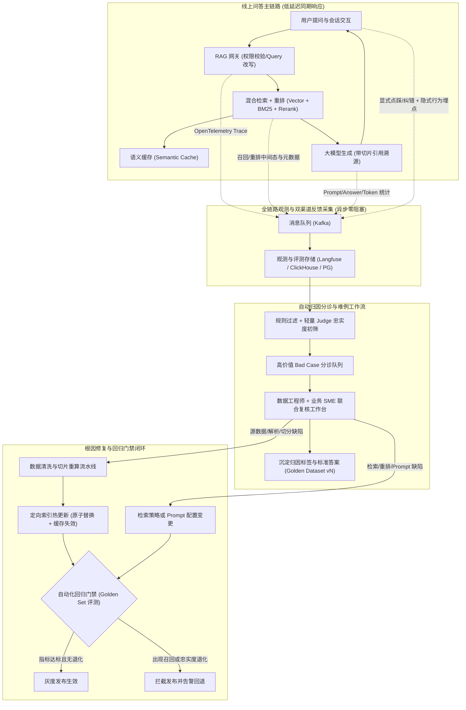
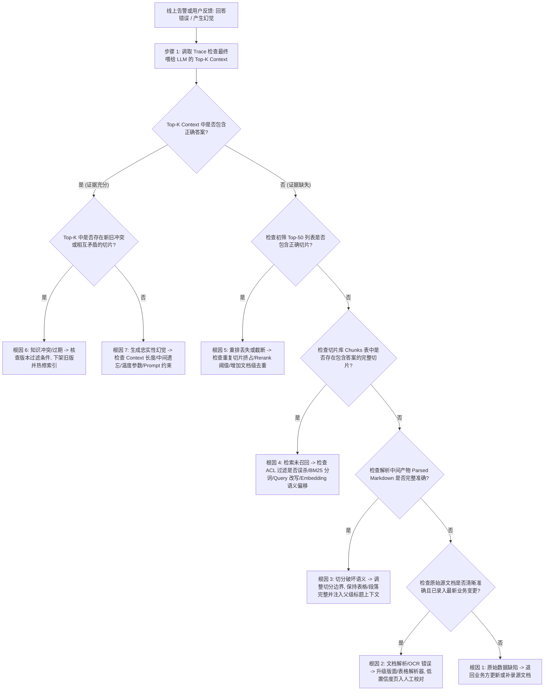

# 数据质量与模型反馈闭环：RAG 错误归因、幻觉治理、双渠道反馈与效果回归体系

> **学习导航（三层递进）**：
> - **基础层**：理解非结构化数据质量维度、模型幻觉的两大分类，以及端到端错误回答的 7 阶段归因框架。
> - **深入层**：掌握双渠道反馈信号采集与降噪、自动化分诊（Triage）、切片级定向热修复与回归门禁验证的工程实现。
> - **架构师层**：建立“数据治理优先于 Prompt 调优”的系统观，将传统大数据可观测性与数据质量管控经验迁移至 AI 领域，在人工运营投入、评估开销与系统稳定性之间做好 ROI 权衡。

---

## 1. 核心概念

### 1.1 是什么（What）

在传统数据仓库中，数据质量主要关注结构化表的空值率、主键唯一性、外键一致性与延迟时效（详见 [数据质量与端到端数据血缘](../02-data-platform/03-quality-lineage.md)）。进入企业级 RAG（检索增强生成）与 AI 数据工程领域后，数据形态转变为 PDF、Word、网页、工单等非结构化文本及多模态内容，**AI 数据质量（AI Data Quality）**的内涵随之扩展为：

1. **源数据清洁度（Source Cleanliness）**：文档是否清晰可读、无 OCR 乱码、表格与跨页结构完整、无大面积重复或噪声页眉页脚。
2. **知识时效与一致性（Freshness & Consistency）**：知识库中不存在已废止的旧版本制度，同类主题的多份文档不存在未声明优先级的口径冲突。
3. **语义切片保真度（Chunk Fidelity）**：切分后的文本块是否保留了主语、生效条件、表格表头与上下文指代，未在关键句中间截断。
4. **检索对齐度（Retrieval Alignment）**：切片的文本内容、元数据标签及向量表示，是否与业务用户的真实提问语言相匹配。

**数据质量与模型反馈闭环（Data-Centric Feedback Loop）**，是指围绕线上问答全链路建立的持续观测与修复机制：通过全链路 Trace 记录每次问答的检索上下文与生成输出，采集用户的显式与隐式反馈信号，将错误答案精准归因到“源数据、解析、切分、检索、重排、知识冲突、生成”中的具体环节，驱动数据清洗、规则优化或索引定向热更新，并在黄金回归测试集验证通过后安全发布上线。

### 1.2 核心术语全景表

| 核心概念 | 英文术语 | 工程定义与职责边界 | 所属层级 |
| :--- | :--- | :--- | :--- |
| 数据级联效应 | Data Cascades | 上游数据采集或解析中的微小缺陷，经切分、向量化、检索逐级放大，最终导致线上生成不可控错误的复合效应 | 数据工程理论 |
| 忠实性幻觉 | Faithfulness / Intrinsic Hallucination | 模型输出违背了已召回上下文（Context）中的明确信息，或编造上下文中未提及的细节 | 生成阶段 |
| 事实性幻觉 | Factuality / Extrinsic Hallucination | 模型输出与客观真实世界不符；在 RAG 中常表现为“模型忠实引用了已过期或错误的文档切片” | 源数据/知识层 |
| 拒答失败 | Abstention Failure | 知识库中无相关依据、或召回证据不足时，模型未按要求声明“未知”，而是强行拼凑或靠参数记忆作答 | 检索阈值/生成层 |
| 显式反馈 | Explicit Feedback | 用户主动触发的评价行为，包括点赞、点踩、结构化错误归类标签及专家纠错文本 | 交互观测层 |
| 隐式反馈 | Implicit Feedback | 用户在会话中自然留下的行为轨迹，如复制答案、点击引用溯源、短时高频改写追问、会话直接跳出 | 交互观测层 |
| 定向热修复 | Targeted Hot-Patching | 针对定位到的单篇或少量缺陷文档，仅重算受影响切片并原子替换索引，同时失效相关语义缓存，避免全量重建 | 索引运维层 |
| 黄金回归集 | Golden Regression Set | 由核心业务高频题与历史真实 Bad Case 沉淀而成的版本化评测基准，用于每次变更上线前的自动化防退化门禁 | 质量门禁层 |

---

## 2. 解决的问题

企业知识库上线初期往往能通过 Demo 演示，但在真实业务高频使用 1~3 个月后，普遍会遇到四类核心痛点：

### 2.1 原始数据的四类质量顽疾
- **文档过期（Stale Knowledge）**：历史年度差旅标准、已下线的产品参数手册仍滞留在索引中。由于旧文档与新文档用词高度相似，向量相似度极高，检索极易将旧内容排在 Top-K 前列。
- **完全重复与近似重复（Exact & Near-Duplicate）**：同一份政策在不同部门文件夹或邮件附件中存有 5 份副本（仅封面日期或水印不同）。Top-5 召回窗口被 5 份重复切片占满，挤占了本该召回的补充条件条款，导致答案片面。
- **多版本口径冲突（Multi-Version Conflict）**：2023 版与 2025 版制度文件同时生效，或总部通则与分公司细则并存但缺乏适用范围元数据。上下文中同时出现“报销上限 500 元”和“报销上限 800 元”，模型无法裁决而出现随机拼接。
- **低清扫描件与复杂版面损毁（Low-Quality Scans & Broken Layout）**：拍照扫描 PDF 存在倾斜、印章遮挡、模糊文字，OCR 识别出“0/O”、“1/l”错字或数字小数点丢失；多栏排版与跨页表格解析时行错位、丢失表头，导致数值与指标张冠李戴。

### 2.2 “只调 Prompt 不治数据”的边际收益递减
当业务方投诉模型“胡说八道”时，团队的本能反应往往是不断往 System Prompt 里追加限制条款（“严禁编造”、“请仔细核对数字”、“如不确定请拒答”）。但工程实践表明，**Prompt 无法修复源数据的残缺与冲突**：若召回的 5 段上下文里有 3 段是过期文档、1 段表格错位，再严密的 Prompt 也只能让模型“忠实地复述错误”。

### 2.3 线上答错后的“跨环节推诿黑盒”
一次 RAG 问答跨越解析、切分、Embedding、向量/全文检索、Rerank、Prompt 组装与 LLM 生成 7 个以上环节。如果系统只记录最终的 `Query` 和 `Answer`，不留存中间态上下文与打分明细，排查时就会陷入盲猜：应用侧怀疑大模型退化，算法侧怀疑检索漏召回，数据团队认为原文档没问题。

### 2.4 缺乏回归门禁导致的“打地鼠式退化”
手动修复了 A 部门的报销问答（例如调整了 Chunk Size 或加了一条硬编码提示词），却在不知情的情况下导致 B 部门的技术规范查询召回率下降 10%。缺乏自动化回归验证，每一次“优化”都在累积系统脆弱性。

---

## 3. 底层原理

### 3.1 端到端错误答案归因矩阵（7 阶段全链路模型）

定位 RAG 线上故障的核心原则是**逆向或顺向逐段切断因果链**，将模糊的“模型答错了”精确映射到 7 个可验证的工程环节之一。

| 归因阶段 | 核心判定问题 | 关键观测证据（Trace 字段） | 典型故障表现 | 责任归属与修复动作 |
| :--- | :--- | :--- | :--- | :--- |
| **1. 原始数据缺陷** | 源文档本身是否准确、完整、最新、无重复？ | `doc_id`、原文件预览、版本状态、重复度聚类报告 | 原 PDF 扫描件数字模糊、文档已废止未下架、存在 3 份口径打架的旧版副本 | **数据治理/业务方**：源头修订、下架废止文档、源库去重与元数据补齐 |
| **2. 文档解析错误** | 从原始文件提取的 Markdown/文本是否保真？ | 原始文件 vs `parsed_markdown` 人工/自动比对、OCR 置信度均值 | 跨页表格丢失表头、双栏文本串行、公式/数字被 OCR 误识别 | **数据管道工程**：切换版面分析/VLM 解析器、低置信度扫描件入人工复核队列 |
| **3. 切分破坏语义** | 包含答案的原文在切分后是否仍语义自洽？ | 目标原文在 `chunks` 表中的起止偏移、`chunk_text` 内容 | 条件句与结论被切在两个 Chunk；表格被腰斩丢失列名；主语被省略成“该设备” | **切分策略工程**：按标题层级/表格完整性切分、注入文档路径与父级上下文（Contextual Retrieval） |
| **4. 检索未召回** | 正确的切片是否进入了初筛 Top-N（如 Top-50）？ | `rewritten_query`、`dense_scores`、`bm25_scores`、目标 `chunk_id` 是否在初筛列表 | 专有名词/工单编号用纯向量检索漏召回；口语化提问与书面语存在语义鸿沟 | **检索工程**：引入混合检索（BM25+Dense+RRF）、领域词典/同义词扩展、Query 改写与元数据过滤 |
| **5. 重排丢失** | 目标切片在初筛里，但被 Rerank 挤出最终 Top-K（如 Top-5）？ | 初筛排名 vs `rerank_scores`、截断阈值 `score_threshold` | 正确切片初筛排第 12，重排后排第 7 被 Top-5 截断；重复切片占满前 5 名 | **重排与后处理**：MMR/文档级去重（每篇文档限入 2 块）、微调 Reranker 或调优 Top-K 与分数阈值 |
| **6. 知识冲突/过期** | 最终 Top-K 中是否混入了冲突或过期切片？ | Top-K 切片的 `effective_date`、`version`、`dept_scope` 对比 | 同时召回 2023 版和 2025 版规定，模型混淆作答或取了旧版 | **版本控制与排序策略**：引入时效衰减加权、检索前强制过滤 `status=active`、显式标注版本号供模型裁决 |
| **7. 生成幻觉/拒答失败** | 给定干净准确的 Top-K，模型输出是否严格忠实于证据？ | `final_prompt`、`context_chunks` vs `answer`、NLI 忠实度得分 | 证据写“7 个工作日”，模型写成“5 个工作日”；上下文无依据时未拒答而靠预训练记忆编造 | **Prompt 与模型工程**：强化引用强制约束（Inline Citation）、降低温度参数、升级指令遵循更强的模型、接入后置忠实度校验 |

### 3.2 模型幻觉的分类与定量排查路径

在工程治理中，切忌将所有错误笼统称为“大模型幻觉”，必须严格区分两类幻觉：

1. **忠实性幻觉（Faithfulness / Intrinsic Hallucination）**
   - **定义**：模型生成的陈述与输入的检索上下文直接冲突，或凭空捏造了上下文中不存在的实体、数值与因果逻辑。
   - **底层诱因**：
     - **Lost in the Middle（中间信息遗忘）**：当 Top-K 上下文过长（如 15~20 个切片）时，Transformer 注意力机制对首尾段落敏感，容易忽略排在中间的关键限定条款。
     - **先验参数知识覆盖（Parametric Knowledge Override）**：当企业私有规则与模型预训练常识冲突时（例如企业内部对某个通用缩写有特殊定义），模型倾向于听从权重中的高频常识而非上下文。
     - **生成解码随机性**：`temperature` 过高或上下文包含大量无关噪声，稀释了有效证据的注意力权重。
2. **事实性幻觉（Factuality / Extrinsic Hallucination）**
   - **定义**：模型输出的结论偏离真实世界的最新业务事实，哪怕它一字不差地复述了召回的文本切片。
   - **底层诱因**：本质是**数据工程与知识治理失败**（第 1~6 阶段的问题），如文档未及时下架、OCR 解析把“10.5%”识别成“105%”、切分丢掉了“仅适用于华东区”的前提条件。

**定量排查两步法（解耦检索与生成）**：
- **第一步：计算上下文充分性（Context Recall / Evidence Sufficiency）**
  将标准答案拆解为独立事实声明，验证这些声明是否能从最终喂给 LLM 的 `Top-K Context` 中推导得出。若 Context 本身不包含正确事实，**直接排除生成阶段幻觉，锁定问题在第 1~6 阶段（数据与检索链路）**。
- **第二步：计算回答忠实度（Faithfulness Score）**
  将模型生成的 `Answer` 拆解为若干原子声明（Atomic Claims），使用轻量级 NLI（自然语言推理）模型或裁判模型（LLM-as-a-Judge）逐条判断每条声明是否被 `Top-K Context` 蕴含（Entailed）：
  $$\text{Faithfulness} = \frac{\text{被上下文严格支撑的原子声明数}}{\text{回答包含的总原子声明数}}$$
  若 Context 充分但 Faithfulness 偏低，则确认为**第 7 阶段忠实性幻觉**；若 Context 充分且 Faithfulness 高，但用户仍反馈“不对”，则需回溯核查源文档本身是否已过期或与最新业务事实不符（**事实性幻觉**）。

---

## 4. 系统架构

数据质量与反馈闭环的设计必须遵循**“主链路低延迟、观测链路全异步、修复链路可回滚”**三项原则，避免质量监控拖慢线上用户体验。



### 架构关键边界说明
1. **复用传统大数据可观测性底座**：该架构并非推倒重来，而是将传统数仓与平台治理中成熟的 **Metrics / Logs / Traces** 体系（参见 [大数据平台可观测性与容灾高可用](../02-data-platform/06-observability-ha.md)）向 AI 场景延伸：
   - **Metrics**：监控端到端 P95 延迟、空召回率、低分拒答率、点踩率、缓存命中率。
   - **Traces**：以全局 `trace_id` 串联 Query 改写、初筛 Top-50、重排 Top-5、Prompt 组装与 LLM 生成全过程。
   - **Evaluations（AI 特有第四支柱）**：基于 Trace 异步产出的 Faithfulness、Context Relevance 与错误归因分布指标。
2. **数据面与控制面分离**：观测埋点和异步评测定位于旁路（Sidecar / Async Consumer），哪怕评测平台宕机或裁判模型限流，也不影响线上正常问答服务。

---

## 5. 关键算法或实现机制

### 5.1 双渠道用户反馈采集与信号降噪

仅靠页面上的“点赞/点踩”按钮，企业内部知识库的反馈率通常低于 2%~5%（用户不满意时往往直接关掉页面或去问同事）。必须建立**显式 + 隐式双渠道信号融合机制**：

1. **显式反馈设计（降低输入门槛，提高归因信息量）**：
   - 点踩时弹出 1 次点击即可完成的结构化原因 chips（非必填，减少阻力）：`内容已过期`、`回答与原文不符`、`没找到我要的资料`、`缺少具体数字/表格`、`回答太啰嗦`。
   - 面向内部核心专家（SME）开放“标注标准答案 / 指定正确文档”快捷入口，直接写入难例池。
2. **隐式反馈信号挖掘（捕捉沉默的大多数）**：
   - **正向强信号**：点击“复制回答”按钮、展开引用卡片后停留阅读超过 10 秒、将链接分享给他人、任务型会话自然结束无重试。
   - **负向强信号**：
     - **短时语义重问（Query Reformulation）**：同一用户在 60 秒内发起新提问，且新旧 Query 的 Embedding 余弦相似度大于 0.75（或编辑距离相近），表明上一轮未解决问题。
     - **快速跳出（Immediate Abandonment）**：收到长回答后 3 秒内关闭窗口或直接转人工客服。
     - **引用证伪行为**：用户点击查看引用原文后紧接着发起追问“原文写的不是这个意思”。
3. **信号降噪与置信度打分（Risk Scoring）**：
   使用加权规则将多维信号合成 `bad_case_score`（0~100），过滤偶发误操作：
   - 显式点踩 + 选填原因标签：+80 分（直接进入分诊队列）；
   - 显式点踩无原因：+50 分；
   - 60 秒内语义重问（相似度 > 0.75）且无复制行为：+45 分；
   - 检索 Top-1 重排分数低于阈值 `0.35` 但模型仍输出长篇非拒答内容：+60 分；
   - 分数达到阈值（如 >= 60）的会话自动进入异步自动化初筛。

### 5.2 自动化初筛归因（Triage Pipeline）

面对每天数千条问答日志，全量人工核查不可持续，需通过**两级漏斗**将人工审查量压缩 90% 以上：
- **L1 确定性规则初筛（零 LLM 成本）**：
  - 检查 Top-K 切片中是否存在 `expiry_date < today` 或多版本同主题文档（直接标记疑似“知识过期/冲突”）；
  - 检查 `rerank_top1_score < threshold` 但回复未命中拒答模板（直接标记疑似“拒答失败”）；
  - 检查返回切片是否存在 OCR 低置信度标记或解析异常告警（标记疑似“解析缺陷”）。
- **L2 轻量级模型异步评测（针对抽样及高风险会话）**：
  - 使用成本较低的裁判模型或本地 NLI 分类器计算 Faithfulness（忠实度）和 Answer Relevance（答非所问检测）。
  - 输出结构化初筛标签与置信度，按 `问题频次 x 业务严重度` 排序推送给复核团队。

### 5.3 数据清洗与难例标注工作流

复核团队确认根因后，必须遵循**“治本优先于治标”**的分级修复策略：

1. **一级修复（根因治理，长期有效）**：修正源文档错误、下架过期版本、升级表格/OCR 解析规则、优化切分边界或补充同义词典。
2. **二级修复（策略调优）**：调整混合检索权重、重排截断阈值、补充领域元数据过滤条件或精简优化 Prompt。
3. **三级修复（临时止血，严格管控）**：针对极高频、影响核心业务且源文档短期内无法由业务方修订的紧急问题，允许写入**临时纠偏知识卡片（Override FAQ）**，但必须强制绑定 `owner` 和 `TTL`（如 30 天到期自动告警提醒清理），防止系统退化为难以维护的规则泥潭。

所有确认过的真实 Bad Case（包含原始 Query、正确参考文档/切片 ID、标准答案要点与期望行为）同步沉淀进版本化的**黄金回归测试集（Golden Dataset）**。

### 5.4 索引定向修复与热更新（Targeted Hot-Patching）

定位到具体缺陷文档后，无需等待夜间全量重建，通过定向热修复流水线实现分钟级生效：

1. **精准定位**：通过 `doc_id` 在元数据血缘库查出该文档关联的所有 `active` 状态 `chunk_id` 列表。
2. **离线重算与预校验**：对修订后的文档或新解析结果重新执行解析、切分与 Embedding 计算，生成新批次切片（赋予新的 `doc_version` 与 `batch_id`，初始状态 `staging`）。
3. **双索引原子可见性切换**：
   - 先将新切片批量写入向量库（Milvus / pgvector）与全文检索库（BM25 / Elasticsearch），此时查询条件带 `status == 'active'`，新数据尚未暴露；
   - 写入校验通过后，将新批次切片状态置为 `active`，同时将旧批次切片标记为 `deprecated`（软删标记，后台定时 Compaction 物理回收）。在支持事务的 pgvector 中可在单个 SQL 事务内完成；在分布式向量库中采用“先写新、再切版本元数据指针/过滤条件、后删旧”的幂等序列，杜绝查询空窗期。
4. **下游缓存联动失效**：根据受影响的 `doc_id` / `chunk_id` 反向索引，定向清除语义缓存（Semantic Cache）中引用过旧切片的缓存条目，防止线上继续返回历史错误回答。

### 5.5 效果回归验证闭环（Regression Gate）

任何解析器升级、切分参数修改、重排阈值调整或 Prompt 变更合并主干前，触发 CI/CD 自动化回归流水线：
- **测试数据集**：分层运行（核心高频 Golden Set 200 题 + 历史 Bad Case 回归集 150 题 + 拒答对抗集 50 题）。
- **核心门禁指标**：
  - 检索层：`Recall@5`、`MRR@10` 相比基线下降不超过 1%；
  - 生成层：`Faithfulness` 不低于 0.92，`Abstention Accuracy`（无依据时的正确拒答率）不低于 0.90；
  - 专项验证：本次目标修复的 Bad Case 通过率达到 100%。
- 未通过门禁的变更自动阻断发布，并输出逐题 Diff 报告（哪些题变好了、哪些题退化了）。

---

## 6. 技术选型与替代方案

建设数据质量与反馈闭环时，核心架构权衡在于**避免重复造轮子，同时守住数据与协议控制权**。

### 6.1 开源自建 vs 商业 SaaS 选型对比

| 评估维度 | 开源组合自建（OTel + Langfuse + RAGAS + 轻量自研） | 商业 SaaS（LangSmith / Braintrust / Arize Cloud） | 传统 APM 扩展（Datadog / Elastic APM） |
| :--- | :--- | :--- | :--- |
| **数据隐私与合规** | 全量数据留存内网，满足政企/金融/制造敏感文档合规要求 | 数据默认出境或上第三方云（私有化部署商业授权费高昂） | 取决于现有 APM 是自建还是云托管 |
| **初始落地速度** | 中等（Docker/K8s 部署约 1~2 周，含埋点与看板配置） | 极快（接入 SDK 当天可见 Trace 与评测界面） | 较快（复用已有集群，但 AI 专属评测与标注流较弱） |
| **定制扩展能力** | 极高，可深度绑定企业内部文档血缘、部门 ACL 与热修管道 | 受限于平台 API 与数据模型，难以深度联动内部索引热修 | 擅长系统延迟/错误率监控，难承载 SME 难例标注工作流 |
| **长期 TCO 成本** | 固定服务器与维护人力，规模扩大后边际成本极低 | 按 Trace 条数或席位阶梯计费，高频问答场景年费迅速攀升 | 按日志摄入量（GB）计费，存储完整 RAG 上下文文本成本偏高 |
| **适用边界** | 内部知识含敏感数据、具备基础数据工程团队的中大型企业 | 早期 POC 验证、无敏感数据限制、追求极致验证速度的小团队 | 已重度采购该 APM 且仅需基础延迟/可用性监控的场景 |

### 6.2 自研 vs 采购、集成 vs 重写决策指南

1. **采集协议层（坚决标准化，严禁私有锁定）**：统一基于 **OpenTelemetry GenAI Semantic Conventions** 埋点。无论底层换成 Langfuse、Arize Phoenix 还是自建 ClickHouse，业务代码无需重写。
2. **可观测与评测 UI 层（优先集成开源，避免从零重写）**：Trace 树形可视化、Prompt 版本管理与批量评测界面属于通用基础设施，直接集成 Langfuse（MIT 开源核心）或 Arize Phoenix 即可，没必要耗费 2 名全栈工程师自研 UI。
3. **归因规则与定向热修执行器（轻量自研，贴合内部业务）**：每个企业的文档元数据、版本定义、权限体系和索引架构不同，将“归因工单 -> 源文档血缘定位 -> 定向重算切片 -> 缓存失效”这一段控制逻辑轻量自研，沉淀为企业自有数据工程资产。
4. **避免过度设计的阶段边界**：
   - **冷启动期（日均查询 < 500 次）**：不要急于引入复杂的 Kafka + 实时 Flink 评测流 + 全自动 LLM Judge。直接用 PostgreSQL 记录 Trace JSON + 显式点踩，每周由研发与业务导出 50 条会话用表格人工归因，ROI 最高。
   - **规模运行期（日均查询 > 2,000 次，多部门接入）**：再上线异步评测队列、隐式信号挖掘、Golden Set CI 门禁与自动化定向热修管道。

---

## 7. 工程实践

> [!NOTE] 案例性质说明：本案例为教学假设场景，用于系统训练 AI 数据架构设计能力，不属于个人过往真实任职项目。

### 7.1 教学假设场景：10,000 份多版本多部门文档知识库的质量闭环落地

**场景约束**：
- **文档规模**：10,000 份 PDF/Word 企业文档（含约 20% 扫描件、复杂财务/技术规格表格、多版本制度修订稿），覆盖研发、财务、法务、HR、运维 5 个部门，存在严格的部门访问权限隔离。
- **典型上线痛点**：上线首月业务反馈“财务报销标准答出前年旧口径”、“部分设备参数表数字错位”、“员工点踩率仅 3%，但实际满意度不高”。

### 7.2 端到端观测 Trace 数据模型设计

为了实现“一眼定位 7 阶段根因”，每次问答异步写入的 Trace JSON 必须包含完整的中间快照与元数据血缘：

```json
{
  "trace_id": "tr_20261118_9f8a21c0",
  "timestamp": "2026-11-18T10:15:32Z",
  "user_context": {
    "dept_id": "dept_finance",
    "role_tags": ["employee_regular"]
  },
  "query_stage": {
    "raw_query": "2026年一线城市出差住宿标准是多少？",
    "rewritten_query": "2026年 一线城市 差旅 住宿 报销上限 标准"
  },
  "retrieval_stage": {
    "filter_applied": "status='active' AND acl_group IN ('all', 'dept_finance')",
    "candidate_count": 50,
    "top_k_after_rerank": [
      {
        "chunk_id": "doc_4082_v3_c014",
        "doc_id": "doc_4082",
        "doc_version": "v3",
        "effective_date": "2025-01-01",
        "ocr_confidence": 0.98,
        "dense_score": 0.86,
        "bm25_score": 14.2,
        "rerank_score": 0.91
      }
    ]
  },
  "generation_stage": {
    "model_id": "qwen2.5-72b-instruct",
    "prompt_version": "rag_strict_v2.4",
    "abstained": false,
    "cited_chunk_ids": ["doc_4082_v3_c014"],
    "latency_ms": 1840
  },
  "feedback_signals": {
    "explicit_rating": "thumbs_down",
    "explicit_reason": "outdated_info",
    "implicit_copied": false,
    "implicit_reformulated_within_60s": true
  }
}
```

### 7.3 与传统大数据可观测性及数据质量体系的架构映射

具备传统大数据中台经验的团队，可直接复用既有治理范式，无需重新发明管理机制（对比参考 [大数据平台可观测性与容灾高可用](../02-data-platform/06-observability-ha.md) 与 [数据质量与端到端数据血缘](../02-data-platform/03-quality-lineage.md)）：

| 治理维度 | 传统大数据平台实践 | AI 知识库反馈闭环对应落地 |
| :--- | :--- | :--- |
| **入库前质量校验（DQC）** | ODS -> DWD 校验主键唯一性、空值率、枚举值域，异常阻断入库 | 文档解析后校验文本乱码率、OCR 置信度（< 0.85 进复核）、表格行列完整度、内容哈希去重、必填元数据（生效日期/部门/版本） |
| **端到端血缘追踪** | SQL AST 解析表级/字段级血缘，定位下游报表错误源头 | 建立 `Source File -> Version -> Parsed Block -> Chunk ID -> Index Record -> Trace Citation` 六级血缘，点踩一键反查原始文件与页码 |
| **SLA 黄金指标监控** | Prometheus + Grafana 监控延迟、吞吐、任务失败率、Kafka Lag | 同一套 Grafana 增加 AI 业务面板：P95 首字延迟、空召回率、Faithfulness 周趋势、分部门点踩率、缓存失效率 |
| **变更发布与告警收敛** | 灰发布、分级告警（P0/P1/P2）、防告警疲劳 | Golden Set 回归门禁；仅对高频同类归因聚合告警（如某篇核心文档 24 小时内触发 >= 5 次点踩），禁止单条点踩直接刷屏 |

### 7.4 常态化周度运营 SOP（人机协同节奏）
- **实时自动拦截**：低 OCR 置信度文档、缺失生效时间元数据文档在入库阶段自动挂起，通知对应部门文档管理员补齐。
- **每日自动巡检**：凌晨定时对当日高风险会话（约占总流量 5%~10%）运行轻量级 Faithfulness 与冲突检测，生成日报。
- **每周 1 次 60 分钟三方分诊会**：数据工程师（负责解析/切分/血缘）+ 应用/检索研发（负责召回/重排/Prompt）+ 业务 SME（确认口径真伪），集中处理排名前 20 的高频 Bad Case，产出具体修复工单并更新 Golden Set。

---

## 8. 常见故障与解决思路

### 8.1 线上错误回答排障决策树



### 8.2 四类高频生产故障实战剖析

#### 故障一：旧版制度未彻底退役导致“新旧混答”
- **现象**：财务部上传了《2026 版差旅管理办法.pdf》，但用户询问出差补贴时，模型回答把 2024 版和 2026 版的金额混在一起。
- **根因**：新文档文件名为 `2026版差旅管理.pdf`，与旧文件 `差旅管理办法_final.pdf` 路径不同，系统将其识别为两篇独立文档同时设为 `active`，检索时两者向量得分均高达 0.88。
- **解决思路**：
  1. 短期止血：通过主题聚类或人工核查将旧文档元数据置为 `status=deprecated`，立即触发索引过滤屏蔽与缓存失效。
  2. 长期根治：建立“文档逻辑标识（Canonical Doc Key）”机制，同类型制度更新必须关联父文档 ID 并自动触发旧版归档；在检索后处理阶段检测同一主题存在多个生效日期切片时，优先保留最新生效版本并向管理员发冲突告警。

#### 故障二：完成定向热修后，线上仍持续返回旧的错误答案
- **现象**：数据工程师已修复解析错位的参数表并重新入库，在测试接口验证正确，但生产用户反复提问同一问题依然得到旧错误答案。
- **根因**：系统前置了语义缓存（Semantic Cache，基于 Query 向量相似度 >= 0.95 直接命中缓存返回）以降低 LLM 延迟与费用，但热修管道只更新了向量索引，未联动清理语义缓存。
- **解决思路**：建立 `chunk_id -> cache_key` 的反向依赖映射（如在 Redis 中维护 Set 索引）。每当某个 `doc_id` 或 `chunk_id` 发生变更、下架或定向热修时，自动精准驱逐所有引用该切片的语义缓存条目。

#### 故障三：LLM-as-a-Judge 评测指标虚高或偏误导致错误调优
- **现象**：自动化评测面板显示 Faithfulness 高达 0.96，但业务部门投诉回答准确率依然很低。
- **根因**：
  1. 混淆了“忠实度”与“正确性”：模型 100% 忠实于召回的过期文档，裁判模型仅凭上下文判定为高忠实度，掩盖了事实性幻觉。
  2. 裁判模型存在位置偏见（Position Bias）或冗长偏见（Verbosity Bias），且采用与线上生成相同的模型充当裁判，产生“自我肯定偏差”。
- **解决思路**：
  1. 评测看板强制分离展示 `Context Recall`（相对 Golden Set 标准答案）、`Faithfulness` 与 `Freshness Violation Rate`；
  2. 裁判模型选用异构更强模型，并每月人工盲抽 100 条核对“裁判模型与人类专家一致性（Cohen's Kappa >= 0.8）”，用人工校准自动裁判。

#### 故障四：FAQ 强插补丁失控引发的知识库腐化
- **现象**：为了快速平息业务投诉，团队把所有点踩问题都做成人工编写的 QA 强插进高优先级库。半年后积累了 1,500 条 QA 补丁，当源制度改版后，旧 QA 补丁覆盖了新文档，导致系统到处答错。
- **根因**：缺乏“止血补丁生命周期管理”，把临时缓存当成永久知识源，切断了源文档与知识库的单点事实来源（Single Source of Truth）。
- **解决思路**：严控 FAQ 补丁准入红线（仅限源文档短期不可修改的 P0 事故），强制所有补丁绑定源文档 ID 与 30 天 TTL；一旦源文档发生更新，关联补丁自动失效并通知复核。

---

## 9. 性能及成本分析

基于 **10,000 份企业文档**（估算约 400,000 个有效切片，日均问答 3,000 次）的教学假设规模，定量分析质量闭环的算力开销与人工运营 ROI（以下数值为行业常见单价下的工程推算，实际需结合企业部署模式实测校准）：

### 9.1 全量重索引 vs 定向增量热修成本对比

假设单次排查发现 20 份高频核心文档存在解析错误或版本冲突（占总库 0.2%，约 800 个切片）：

| 对比维度 | 全量重新解析与索引重建（Full Re-index） | 切片级定向热修复（Targeted Hot-Patching） | 差异与工程收益 |
| :--- | :--- | :--- | :--- |
| **处理范围** | 10,000 份文档 / 400,000 切片 | 20 份受影响文档 / 800 切片 | 计算量缩减 99.8% |
| **解析与 OCR 耗时** | 8 核 CPU + 1 张中端 GPU 约 4~8 小时 | 约 30 秒 ~ 2 分钟 | 修复生效时间从小时级降至分钟级 |
| **Embedding 计算/API 成本** | 约 2 亿 Token（按商用 API 估算约 150~300 元/次） | 约 40 万 Token（不足 1 元/次） | 边际计算成本近乎为零 |
| **线上服务影响** | 高 I/O 与写入压力，易挤占线上检索延迟，需维护窗口 | 微量增量写入 + 原子状态切换，线上 P99 无感知 | 支撑全天候随时修复高优故障 |

### 9.2 质量观测、自动评测与人工闭环 ROI 测算

1. **观测存储与自动评测成本控制**：
   - **反模式（全量无差别 LLM Judge）**：若对每天 3,000 次问答全量调用高价旗舰大模型做 3 项指标打分，单日评测 Token 消耗可达线上问答推理成本的 2~3 倍，严重倒挂。
   - **分层抽样优化方案**：
     - 100% 流量执行 L1 确定性规则检查（零 Token 成本）；
     - 100% 高风险流量（显式点踩 + 隐式负向高分，约占 8%，即 240 次/天）+ 5% 随机基线抽样（150 次/天）执行 L2 轻量级模型评测（共约 390 次/天）；
     - 评测 Token 开销控制在总推理成本的 **10%~15% 以内**。
2. **人工复核运营投入与 ROI 评估**：
   - **投入端**：在漏斗收敛后，每周需复核的高频聚焦 Bad Case 约 20~30 类，投入约 1 名数据工程师（2 小时/周）+ 轮值业务 SME（1~2 小时/周），折合人力成本极低。
   - **产出端**：通过持续 8~12 周闭环运营，通常可将高频业务场景的回答可用率（端到端准确率）从初期的 65%~70% 提升至 88%~92%，并显著降低人工客服/内部咨询答疑的重复工时消耗；同时沉淀出的 300~500 题 Golden Set 成为后续更换基座大模型或升级检索架构的长期数字资产。

---

## 10. 面试题

1. **Q1（高频核心·幻觉归因）**：线上企业知识库 RAG 系统频繁被业务投诉“大模型产生幻觉、胡说八道”，作为架构师，你如何系统化定位根因？事实性幻觉与忠实性幻觉在排查和治理上有什么本质区别？
2. **Q2（高频核心·闭环设计）**：如何将非结构化原始数据质量问题（过期、重复、解析错误、版本冲突）与线上模型问答效果建立可持续的数据反馈闭环？
3. **Q3（信号工程）**：在实际企业内部落地时，员工很少主动点击“点踩”按钮，导致显式反馈极度稀疏。你如何结合隐式信号构建高信噪比的反馈采集体系？
4. **Q4（工程落地·热修复）**：排查确认某份核心制度文档因跨页表格解析错误导致线上答错，如何在不停机、不全量重建向量索引的前提下完成定向修复，并保证修复生效且不引入其他问题退化？
5. **Q5（架构取舍·防补丁腐化）**：业务高管要求一旦线上出现答错，研发团队必须在 1 小时内直接加一条人工 FAQ 强插规则把答案写死。作为技术负责人，你如何平衡“短期止血”与“长期知识库质量”？
6. **Q6（成本与管理·ROI）**：面对 10,000 份多部门文档的企业级知识库，如何控制可观测追踪、自动化 LLM 评测与人工运营的综合成本，避免监控治理投入反超业务收益？

---

## 11. 参考答案

### 题目 1：如何系统定位模型幻觉根因？事实性幻觉与忠实性幻觉有何本质区别？

#### 1分钟简洁回答
定位 RAG 幻觉不能靠拍脑袋调 Prompt，必须依赖全链路 Trace 做**分段归因**，核心先切一刀：**查看最终喂给大模型的 Top-K 上下文里，到底有没有准确无冲突的答案证据**。如果有干净证据但模型没照着说，这是**忠实性幻觉**，归因在生成层（Prompt、温度、上下文过长遗忘）；如果上下文里压根没有证据，或是召回了过期、错乱的文档，导致模型“忠实地答错”或被迫自由发挥，则属于**事实性幻觉或上游链路缺陷**，必须顺着重排、检索、切分、解析一直回溯到原始源数据。两者的本质区别在于：忠实性幻觉考的是“模型听不听话”，治在模型与 Prompt；事实性幻觉考的是“给的料对不对”，治在数据工程与知识治理。

#### 深入原理解释
1. **建立 7 阶段端到端归因链路**：通过 Trace 回放 `Query -> 改写 -> 初筛 Top-50 -> 重排 Top-5 -> 最终 Prompt -> 输出`，逆向逐层排错：
   - **第 7 层（生成层）**：用 NLI 原子声明拆解计算 Faithfulness。若 Top-K 证据充分但 Faithfulness 低，检查是否存在 Lost in the Middle（无关切片过多稀释注意力）、参数先验知识覆盖私域规则、或解码温度过高。
   - **第 6 层（知识冲突/过期）**：Top-K 同时包含新旧两版规定导致模型拼接错误。
   - **第 5 层（重排层）**：正确切片在初筛 Top-50 里但被 Rerank 压到 Top-K 之外，或被多份重复文档挤出窗口。
   - **第 4 层（检索层）**：切片库里有完整原文但初筛未召回（如专有名词缺失 BM25 稀疏检索、ACL 权限过滤误杀、口语与书面语语义鸿沟）。
   - **第 3 层（切分层）**：原文在解析后完好，但切分把表格表头或前提条件截断。
   - **第 2 层（解析层）**：扫描件 OCR 错字、跨页表格串行。
   - **第 1 层（源数据层）**：源文档本身错误、缺失或未下架。
2. **两类幻觉的定量解耦**：必须同时看 `Context Recall`（上下文是否涵盖真实答案）与 `Faithfulness`（回答是否忠实于上下文）。高 Faithfulness + 低事实正确率 = 典型的“垃圾进、忠实垃圾出”（事实性幻觉），此时调 Prompt 毫无意义。

#### 架构师视角分析
在企业级 RAG 生产事故统计中，**超过 70% 被业务方称为“模型幻觉”的问题，根因都在第 1~6 阶段的数据与检索侧，而非大模型本身**。架构师的价值在于通过 OpenTelemetry 规范强制落盘中间态上下文与血缘元数据，终结算法、应用与数据团队之间的扯皮，将“玄学调优”转化为确定性的软件工程排障。

#### 典型追问
- **追问 1**：如果上下文里确实没有答案，模型靠预训练记忆猜了一个看似合理的答案，这算哪类问题？怎么治？
  - **应对要点**：属于“拒答失败（Abstention Failure）”引发的外在编造。需双管齐下：检索侧设置重排分数硬阈值（低于阈值直接触发拒答兜底，不送入自由生成）；生成侧强化“无依据必须声明未找到相关文档”指令，并在回归集中保留专门的“无解拒答测试集”。
- **追问 2**：怎么快速发现隐蔽的“表格数字错位”解析错误？
  - **应对要点**：入库阶段增加自动化 DQC 门禁，对解析出的 Markdown 表格校验列数一致性与 OCR 置信度分布；高价值财务/规格文档优先采用支持版面理解的解析器或 VLM 辅助核验。

#### 常见错误回答
- **错误一**：一上来就说“加 Prompt 约束、调低 Temperature、换更强的大模型”，完全不提查看检索上下文与源数据质量。
- **错误二**：混淆两类幻觉，以为用 RAGAS 测出 Faithfulness 达到 95% 就说明系统没有幻觉了，忽略了过期文档造成的事实性错误。

---

### 题目 2：如何将原始数据质量问题与线上模型效果建立可持续的反馈闭环？

#### 1分钟简洁回答
建立数据质量与模型效果的反馈闭环，核心是打通**“观测捕获 -> 归因定位 -> 血缘回溯 -> 定向修复 -> 回归验证”**五步流水线。第一步在线上用全链路 Trace 把每次问答关联到具体的 `doc_id` 和 `chunk_id`；第二步融合用户显式点踩与隐式行为，经规则与轻量模型漏斗筛出高价值 Bad Case；第三步通过文档血缘反向定位到源数据、解析或切分缺陷；第四步在数据管道完成清洗并触发切片级定向热更新与缓存失效；第五步将案例沉淀进黄金测试集，通过自动化回归门禁验证无退化后上线，形成持续越用越准的正向飞轮。

#### 深入原理解释
1. **数据血缘是闭环的骨架**：借鉴传统数仓的字段级血缘思想，构建 `源文件 -> 文档版本 -> 解析块 -> 切片 ID -> 向量/倒排索引 -> 线上 Trace 引用` 的完整血缘链。没有血缘，线上发现答错后根本不知道要修哪篇源文档的哪一页。
2. **闭环的异步解耦架构**：线上推理通过异步队列（如 Kafka）把 Trace 写入观测存储（Langfuse / ClickHouse），零阻塞主链路；离线/准实时分诊流水线先用确定性规则拦截过期文档、低分未拒答、低 OCR 置信度问题，再用轻量级裁判模型检测忠实度，将噪音过滤 90% 以上后推给人工复核台。
3. **分级修复与版本化回归**：修复动作分为根因治理（改源文档/解析/切分规则）与参数调优，每次改动入库前必须在 Golden Set（包含历史所有修过的 Bad Case）上自动跑通 Recall@K、Faithfulness 和拒答率门禁，防止“修好新问题、破坏老问题”。

#### 架构师视角分析
这个闭环本质上是将传统数据中台的 **DataOps 与 DQC（数据质量管控）** 延伸到了 AI 推理端。管理落地的关键不在于搭多炫酷的平台，而在于明确跨角色协作机制：数据工程团队对解析、切分与血缘负责，业务 SME 对源文档真伪与版本有效性负责，应用研发对检索与生成策略负责，通过周度 1 小时联合分诊会维持闭环运转，避免闭环停留在架构图上。

#### 典型追问
- **追问**：业务部门往往不愿意花时间配合清理源文档，技术负责人如何推动？
  - **应对要点**：用数据说话而不是行政施压。在可观测大盘按部门展示“因过期/冲突文档导致的错误回答占比”与具体文档清单，把模糊的质量抱怨变成可视化的 Top-10 缺陷文档列表，同时提供极简的一键下架/上传新版入口，大幅降低业务方配合成本。

#### 常见错误回答
- **错误一**：只讲了线上监控和画大盘，没有讲清楚发现问题后怎么反查源文档、怎么更新索引、怎么防退化，闭环在“发现问题”就断了。
- **错误二**：把反馈闭环等同于“收集点踩数据去微调大模型（SFT/RLHF）”。对于企业私域知识库，绝大多数知识更新与数据缺陷应通过数据清洗和 RAG 检索优化解决，盲目微调不仅成本高且难以应对知识时效变化。

---

### 题目 3：用户很少主动点踩，如何设计显式与隐式结合的用户反馈采集体系并降噪？

#### 1分钟简洁回答
企业内部知识库显式点踩率普遍低于 5%，必须采用**“低摩擦显式采集 + 多维隐式信号挖掘 + 漏斗置信度加权”**的组合方案。显式侧把点踩原因做成一键可选的结构化标签（如“信息过期”、“找不到资料”），并给内部专家开放直接纠错入口；隐式侧通过前端与网关埋点捕获复制、引用点击、60 秒内语义相似重问、快速跳出等行为；最后通过组合规则加权打分剔除单一行为噪声，只把高置信度负样本送入归因分诊队列。

#### 深入原理解释
1. **隐式信号的行为语义拆解**：
   - **单一信号噪声大**：例如“用户快速关闭页面”可能是看到了简短准确的答案满足离开了，也可能是觉得太烂直接放弃；“继续追问”可能是上一轮答错了，也可能是深入探索下一个子问题。
   - **组合特征显著提纯**：
     - 负向组合：`无复制动作` + `60秒内再次提问` + `新旧 Query 向量相似度 > 0.75`（典型的“换种说法再问一次”）；
     - 负向组合：`点击展开引用原文` + `随后追问含否定词（不对/不是/原文写的是）`；
     - 正向组合：`点击复制答案` + `无短时重复提问`。
2. **显式与隐式融合打分模型**：为每条 Trace 计算风险分 `bad_case_score`，将显式点踩（高权重）、隐式负向组合（中权重）与系统内部异常信号（如重排最高分低于阈值但未拒答、命中临期文档）叠加排序，优先筛选 Top 5% 高风险会话做异步评测与人工复核。

#### 架构师视角分析
隐式信号埋点必须兼顾**隐私合规与前端轻量性**。所有交互埋点复用企业现有前端观测 SDK，只采集匿名会话 ID 与结构化事件枚举，严禁记录敏感输入框草稿或越权采集无关页面轨迹。同时，在产品交互层面要让用户感受到“反馈有用”——当用户点踩的文档被修复后，可以通过站内消息通知用户问题已解决，这比任何考核都能提升显式反馈参与度。

#### 典型追问
- **追问**：如何验证你设计的隐式负向打分规则本身准不准？
  - **应对要点**：定期（如每两周）从被隐式规则判定为“负向”的会话中随机抽样 50 条，由人工盲审计算精确率（Precision）。如果误报率超过 30%，立即回溯调整时间窗口、相似度阈值或权重系数。

#### 常见错误回答
- **错误一**：只把“用户没点赞”当成负反馈，或者把“连续多轮对话”一刀切判定为回答不满意，导致大量正常深入咨询被误报，淹没复核队列。
- **错误二**：设计复杂的弹窗问卷要求用户点踩时写满 20 字原因，导致本就稀疏的显式反馈率直接归零。

---

### 题目 4：发现单篇文档解析错误导致线上答错，如何在不停机、不全量重建的前提下完成定向修复与回归验证？

#### 1分钟简洁回答
核心流程是**“血缘定位 -> 隔离重算 -> 原子热切 -> 缓存失效 -> 回归验证”**五步闭环。先按 `doc_id` 从血缘库查出旧切片，离线用修复后的文档或解析器重算新切片；写入向量库与 BM25 索引时采用“先写新版本切片、再切换生效状态/版本号、后软删旧切片”的原子可见性策略，确保线上零停机、无检索空窗；紧接着按 `chunk_id` 反向索引精准清除关联的语义缓存；最后在测试与线上验证该 Bad Case 并跑通 Golden Set 回归检查，确认无副作用。

#### 深入原理解释
1. **消除写入竞态与空窗期**：
   - 反模式是“先 `DELETE WHERE doc_id = X`，再解析重算写入”。如果解析耗时 20 秒或中途报错，线上用户在这 20 秒内会查不到这篇核心文档。
   - 正确做法是**先写后删 + 版本隔离**：新批次切片携带递增 `doc_version` 且初始标记 `status = staging`；全部写入向量库与全文检索库校验成功后，再将新批次切为 `active`、旧批次标记 `deprecated`（pgvector 可单事务原子完成；分布式向量库如 Milvus 通过元数据版本指针或双步状态更新实现，后台 Compaction 定期回收软删数据）。
2. **联动清理语义缓存与多级缓存**：若系统启用了 Semantic Cache 或文档摘要缓存，必须维护 `doc_id/chunk_id -> cache_key` 反向映射，热修切换瞬间同步执行缓存驱逐，防止旧答案幽灵复现。
3. **变更类型分流回归**：如果是**单篇文档内容修订**，只需验证该文档关联查询及引用正确性；如果是为了修这篇文档而**改动了全局表格解析器或切分代码**，则必须在合并上线前全量运行 Golden Set 回归门禁，验证不会误伤其他 9,999 份文档。

#### 架构师视角分析
这项能力决定了企业知识库的运维响应 SLA（从“天级批处理重建”进化为“分钟级精准手术”）。在工程实现上，架构师需要求整个定向热修流水线具备**幂等性（Idempotency）与可回滚性**：因为保留了旧版本切片的短周期软删状态，一旦热修后发现新解析反而导致线上效果下降，只需反向切回旧版本号状态即可在秒级完成回滚。

#### 典型追问
- **追问**：如果是因为修改了全局 PDF 表格解析逻辑，受影响的不止 1 篇文档，可能涉及库里 2,000 份含表格的 PDF，怎么处理？
  - **应对要点**：通过元数据标签筛选出 `has_table = true` 的 2,000 份文档子集，先在小样本（50 份典型表格文档）跑回归对比确认正向收益，再通过限流批处理管道（带令牌桶与断点续传）分批执行定向热更新，依然无需牵连其余 8,000 份纯文本文档。

#### 常见错误回答
- **错误一**：回答“直接把原文档删了重新传一遍”，没有考虑删除到写入之间的查询空窗期、旧切片残余（孤儿切片）以及下游语义缓存未失效问题。
- **错误二**：未区分“修单篇数据”和“改全局解析代码”的影响面，改了全局解析逻辑却不做全量 Golden Set 回归测试直接发布。

---

### 题目 5：业务方要求对每个 Bad Case 加人工 FAQ 强插规则快速止血，如何权衡短期止血与长期质量？

#### 1分钟简洁回答
我的原则是**“分级响应、止血有界、到期必清、根因必治”**。面对影响核心业务的高频 P0 错误，可以允许临时写入人工纠偏卡片（Override FAQ）在 1 小时内快速止血，避免业务受损；但绝不能把 FAQ 强插变成默认常态，否则半年后大量硬编码补丁会与更新后的源文档剧烈冲突，导致系统不可维护。必须对每一条临时补丁设置强制准入门槛、绑定源文档血缘与 30 天 TTL 过期机制，同时建一张同步的根因修复工单，根因修好后立即销毁临时补丁。

#### 深入原理解释
1. **FAQ 强插失控的技术债机理**：
   - **破坏单一事实源（SSOT）**：当 HR 部门在源库更新了休假制度 PDF，但之前手动写死的 FAQ 优先级高于普通文档检索，系统就会持续给出过时的“人工硬编码答案”。
   - **语义碰撞与泛化失控**：若用向量相似度匹配 FAQ 补丁，阈值设宽了会误拦截相似但条件不同的新问题；阈值设严了用户换两个字就命中不了，形同虚设。
2. **建立补丁治理三道防线**：
   - **准入分级**：仅限 P0/P1 高频核心故障、且源文档因审批流程短期无法修改时才允许启用 Override 层。
   - **血缘联动失效**：每条 FAQ 补丁必须强制关联至少一个 `source_doc_id`。只要关联源文档发生版本更新，该补丁自动置为失效并触发人工确认。
   - **配额与 TTL 红线**：设定全局活跃补丁上限（如不超过总文档量的 1%）和默认 30 天 TTL，超期未转正或未清理则在周度例会上标红升级。

#### 架构师视角分析
这是一道典型的“业务短期压力 vs 系统长期演进”管理博弈题。技术负责人切忌生硬拒绝业务方的紧急止血诉求（显得不懂业务），也不能无原则妥协沦为“人肉写死补丁的客服”。正确的沟通姿态是：先承接紧急诉求给出 1 小时止血方案，同时向业务高管亮明“补丁超期会引发更大面积新旧政策冲突”的客观风险，把“补丁绑定 TTL + 业务方承诺 2 周内修订源文档”作为双向契约，把一次性救火转化为规范的治理机制。

#### 典型追问
- **追问**：有没有哪些场景其实是适合长期保留结构化 FAQ 层的？
  - **应对要点**：有。对于定义清晰、极高频、跨多份长文档综合计算才能得出的“标准口径官方口径库”（且有明确业务团队负责与源制度同步维护），可以将其定位为一等正式数据源（Standard Q&A Knowledge Source）纳入统一版本与生命周期管理，而不是凌驾于系统之上的黑盒硬编码补丁。

#### 常见错误回答
- **错误一**：彻底否定临时止血方案，坚称“必须等源文档和解析器全部重构完才能上线”，忽视生产业务紧急止损诉求。
- **错误二**：全盘接受业务要求，认为“攒够几千条人工 FAQ 就能把 RAG 准确率做到 99%”，完全忽视源文档变化带来的维护雪崩。

---

### 题目 6：在 10,000 份文档的企业知识库中，如何控制可观测、自动评测与人工运营的综合成本并量化 ROI？

#### 1分钟简洁回答
控成本的核心策略是**“采集标准化开源化、评测分层漏斗化、人工聚焦头部化”**。采集与观测用 OpenTelemetry + 开源 Langfuse 自建，避免商业 SaaS 按量计费失控；自动化 LLM 评测严禁对 100% 流量全量跑旗舰模型，而是先用零成本的确定性规则筛查，再仅对高风险会话（约 8%）加 5% 随机基线抽样运行轻量级裁判模型，将评测 Token 成本压在总推理成本的 15% 以内；人工复核则利用聚类聚焦每周 Top 20 高频错误模式，以每周不到 4 小时的跨团队投入换取 80% 的高频体验提升。

#### 深入原理解释
1. **三项主要隐性成本的精准压缩**：
   - **存储成本**：完整 Prompt 与 Top-K 原文体积大，Trace 仅存 `chunk_id` 与快照哈希指针（原文统一查版本化文档库），并对 90 天前的普通成功 Trace 降采样归档至冷对象存储，存储费用可降 70% 以上。
   - **评测算力成本**：采用三级评测架构——L1 规则校验（过期、低分、OCR 异常，0 Token 成本）-> L2 轻量级本地 NLI / 小参数模型检测忠实度 -> L3 仅在回归门禁或核心抽检时调用强裁判模型。
   - **人力运营成本**：对高风险 Bad Case 先按 Query 向量聚类，把 100 条重复抱怨归并为 3 个共性问题，避免 SME 在重复案例上空耗工时。
2. **向管理层呈现可量化的 ROI 模型**：
   - **直接降本指标**：同类内部咨询转人工率下降比例 × 单次人工专家平均解答耗时（如从 15 分钟降至 2 分钟）。
   - **风险规避指标**：因制度/参数引用错误导致的合规风险或业务返工次数下降。
   - **研发效能指标**：Golden Set 自动化回归门禁将每次迭代的回归测试周期从 3 人天人工点测压缩至 15 分钟全自动验收。

#### 架构师视角分析
很多团队做 AI 治理容易走两个极端：要么完全裸奔零观测，线上烂了都不知道；要么照搬超大规模互联网大厂的做法，上来就采购昂贵商业评测 SaaS 并给每条日志跑 5 个大模型指标，结果评测账单比业务推理还贵。成熟架构师要按业务阶段匹配投入水位，让质量闭环的运维总成本始终被约束在系统整体预算的合理占比内（通常控制在 10%~20%）。

#### 典型追问
- **追问**：如果老板说“既然闭环运营还要业务专家每周花 2 小时，我不想投入人力，能不能 100% 全自动闭环？”你怎么回应？
  - **应对要点**：客观说明边界：机器可以 100% 自动发现“回答违背了上下文”（忠实性问题）和“系统延迟/检索异常”，但机器无法凭空判断“公司最新未发文调整的真实业务口径到底是什么”。少量 SME 专家把关（Human-in-the-Loop）不是系统的短板，而是防止自动化闭环发生“模型自我强化错误（Model Collapse / Bias Amplification）”的必要安全阀。

#### 常见错误回答
- **错误一**：提出“对每条线上用户提问实时同步调用 GPT-4 级模型做忠实度校验，不通过就重试 3 次”，既拉爆端到端延迟，又让推理费用直接翻 3~5 倍。
- **错误二**：只谈技术指标（MRR 提升了 0.05），无法将其翻译为管理层听得懂的人效节省、风险下降与迭代提速等商业 ROI。

---

## 12. 官方资料与源码参考

1. **OpenTelemetry GenAI Semantic Conventions**：[OpenTelemetry GenAI Telemetry Specifications](https://opentelemetry.io/docs/specs/semconv/gen-ai/) — 业界标准的 AI 推理、检索与评估链路追踪语义规范。
2. **Langfuse 开源可观测与评测平台**：[Langfuse Documentation & Architecture](https://langfuse.com/docs) — 包含 Trace 数据模型、显式/隐式 Score 采集、Dataset 版本化与回归实验工程实现。
3. **Google Research 数据级联经典论文**：Sambasivan, N., et al. (2021). *“Everyone wants to do the model work, not the data work”: Data Cascades in High-Stakes AI*. ACM CHI 2021. — 深刻剖析上游数据质量缺陷如何在 AI 系统中级联放大。
4. **大模型幻觉综述文献**：
   - Ji, Z., et al. (2023). *Survey of Hallucination in Natural Language Generation*. ACM Computing Surveys.
   - Huang, L., et al. (2023/2025). *A Survey on Hallucination in Large Language Models: Principles, Taxonomy, Challenges, and Open Questions*. ACM TOIS.
5. **RAG 自动化评估框架参考**：[RAGAS Official Documentation](https://docs.ragas.io/) 与 [DeepEval Documentation](https://docs.confident-ai.com/) — Faithfulness、Context Recall、Context Precision 等核心指标算法定义与实现。
6. **仓内关联知识文档**：
   - [大数据平台可观测性与容灾高可用](../02-data-platform/06-observability-ha.md)
   - [数据质量与端到端数据血缘](../02-data-platform/03-quality-lineage.md)
   - [RAG 架构设计与向量检索实战](../06-ai-agent/03-rag-vector-search.md)
   - [个人履历事实边界与教学案例说明](../PROFILE_FACTS.md)
