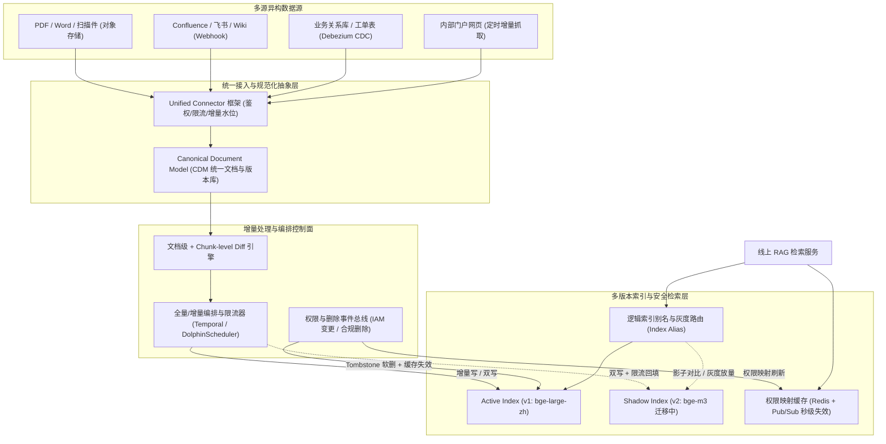
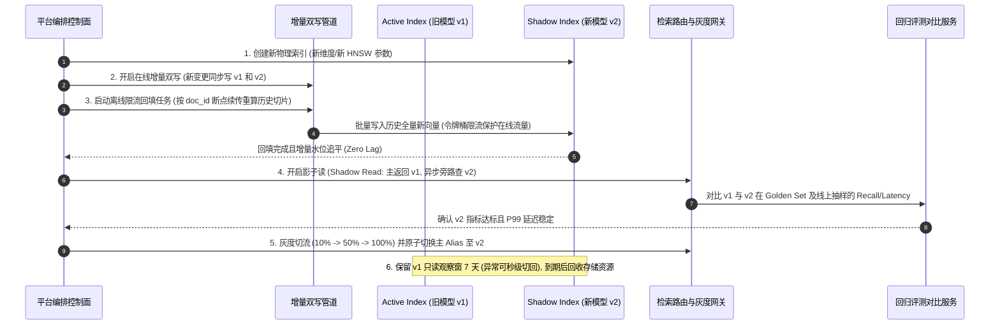
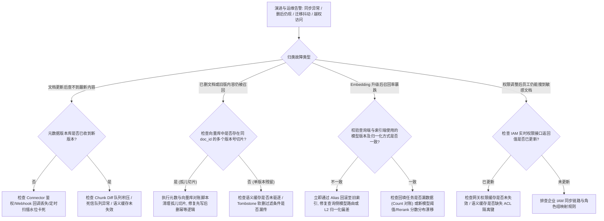

# 知识库长期演进：多源抽象、增量更新、Embedding 平滑迁移与三年架构路线

> **学习导航（三层递进）**：
> - **基础层**：理解企业知识库从“静态离线灌库”走向“长期活资产演进”的核心挑战，掌握统一连接器、规范化文档模型与文档生命周期概念。
> - **深入层**：掌握 Chunk-level Diff 局部增量更新、Embedding 升级的影子索引平滑迁移、Tombstone 软删 Compaction 与权限秒级回收的底层实现机制。
> - **架构师层**：建立面向 1~3 年的系统抽象边界规划能力，避免初期过度设计与后期技术债务失控，量化全量重建与增量演进的成本 ROI，统筹数据工程团队能力平滑转型。

---

## 1. 核心概念

### 1.1 是什么（What）

企业级 AI 知识库在完成首次上线（Day 1）后，真正的工程挑战才刚刚开始（Day 2 ~ Day 1000）。**知识库长期演进（Knowledge Base Long-Term Evolution）**是指在业务数据源不断扩张、文档高频修订与废止、组织权限动态变更、底层解析器与 Embedding 模型持续换代的长期周期内，保障知识库**持续新鲜、查询零停机、权限合规不越界、总体维护成本线性可控**的系统架构与治理体系。

从数据工程视角看，知识库本质上不是静态的“文件堆”，而是**面向非结构化数据的持续集成与交付管道（Continuous Knowledge Delivery Pipeline）**，其生命周期与企业数仓的元数据、血缘和缓慢变化维管理具有高度同源性。

### 1.2 核心术语全景表

| 核心概念 | 英文术语 | 工程定义与职责边界 | 所属层级 |
| :--- | :--- | :--- | :--- |
| 统一连接器抽象 | Unified Connector | 屏蔽 PDF/Word/Confluence/飞书/关系库/网页等不同源系统的鉴权、翻页、限流与增量拉取差异的标准接口层 | 数据接入层 |
| 规范化文档模型 | Canonical Document Model (CDM) | 隔离上游源格式与下游切分/索引管道的统一中间表示（结构化区块 + 版本/时效/权限元数据） | 中间抽象层 |
| 块级增量差异更新 | Chunk-level Diff Update | 文档修订后仅对发生变化的局部语义块重新计算 Embedding 并替换索引，未改动段落直接复用旧向量 | 增量计算层 |
| 影子索引 | Shadow Index | 升级 Embedding 模型或切分策略时新建的隔离物理索引，通过双写与离线回填完成构建，再经别名原子切换 | 迁移演进层 |
| 墓碑软删与段合并 | Tombstone Soft Delete & Compaction | 向量图索引（如 HNSW）删除数据时先写位图标记屏蔽查询可见性，再由后台异步合并物理回收并修复图连通性 | 索引存储层 |
| 权限解耦预过滤 | Decoupled ACL Pre-filtering | 将高频变动的“用户-角色”映射与相对稳定的“文档-访问组”标签解耦，在检索前毫秒级动态组装过滤条件 | 安全合规层 |
| 隐藏技术债务 | Hidden Technical Debt | 胶水代码、管道丛林、幽灵切片、未版本化切分/模型耦合等随时间推移急剧推高维护成本的隐性工程隐患 | 架构治理层 |

---

## 2. 解决的问题

缺乏长期演进设计的 RAG 系统，往往在上线 6~12 个月后陷入五类结构性困境：

1. **数据源扩张引发的“管道丛林（Pipeline Jungle）”**：一期只做本地 PDF 目录同步，二期接入 Confluence、三期接入数据库工单表、四期接入内部 Wiki 与飞书文档。如果没有统一抽象层，下游解析、切分、去重和权限校验逻辑会与每个源系统深度耦合，每新增一个数据源都要改遍核心代码。
2. **全量重建不可持续**：当文档规模达到万级甚至十万级时，若采用“每天凌晨全量重解析 + 重算 Embedding + 删库重建”的粗放方案，算力与 API 费用高企，更新延迟长达 24 小时，且频繁写放大冲击线上检索 SLA。
3. **Embedding 模型升级陷入停机死锁**：开源或商用 Embedding 模型每 6~12 个月便有显著代际提升（如从单语 768 维升级至多语长上下文 1024/1536 维）。由于不同模型的向量空间完全不可通约，无法直接在原索引混写新向量，缺乏迁移架构的团队只能面临“要么永远不升级、要么停机两天重灌”的两难。
4. **文档删除与权限回收滞后的合规风险**：员工离职、跨部门调岗、或法务要求彻底撤回某份保密合同时，如果旧切片残留在向量库或缓存中未能即时屏蔽，极易引发越权信息泄露与审计不合规。
5. **初期过度设计与后期失控的两极分化**：部分团队在业务尚未验证价值时就耗资搭建多模态 + GraphRAG + Flink 实时流式向量平台，结果维护成本拖垮团队；另一部分团队则完全放任一次性 Python 脚本堆叠，一年后无人敢动任何切分或索引代码。

---

## 3. 底层原理

### 3.1 规范化文档模型（CDM）的解耦原理

借鉴数据湖中“统一表格式隔离上游采集引擎与下游计算引擎”的架构哲学，知识库演进的第一道护城河是在**源系统**与**AI 索引管道**之间切入 **Canonical Document Model（CDM）**：
- **上游（Connector 侧）**只需关心如何把 PDF、Word、Confluence API、MySQL 行记录或网页 DOM 抽取成统一的 CDM 对象（包含有序语义区块 `Blocks`：标题、段落、表格、图片引用，以及标准化 `Metadata`：`doc_id`, `source_uri`, `content_hash`, `version`, `effective_from`, `effective_to`, `acl_groups`, `parent_doc_id`）。
- **下游（Chunking / Indexing / Retrieval 侧）**完全不知道也不关心数据来自 Confluence 还是本地 PDF，只消费标准 CDM Schema。由此将“M 种数据源 × N 种下游处理策略”的 `M × N` 耦合复杂度降维为 `M + N`。

### 3.2 文档版本控制与双时间维度血缘

参照数仓缓慢变化维（SCD Type 2）与端到端数据血缘原理（参见 [数据质量与端到端数据血缘](../02-data-platform/03-quality-lineage.md)），每篇文档在演进系统中需同时维护两级指纹与两个时间轴：
- **两级内容指纹**：
  - `doc_content_hash`（基于归一化正文与关键元数据计算的 SHA-256）：用于文档级快速去重与变更判定（文件内容未变时跳过全部下游计算）。
  - `chunk_content_hash`（基于 `section_path + normalized_chunk_text` 计算）：用于文档小幅修改时的块级 Diff。
- **双时间轴**：
  - **业务有效时间（Valid Time：`effective_from` / `effective_to`）**：声明制度或手册何时生效、何时废止，用于线上检索过滤与多版本裁决。
  - **系统入库时间（Transaction Time：`ingested_at` / `superseded_at`）**：记录版本入库和被新版本替代的精确时间，支持任意历史时间点的问答回溯审计。

### 3.3 向量索引更新、删除与图退化的底层机制

理解底层索引结构是设计高频增删改与合规删除的前提：

1. **HNSW 图索引的删除难题与 Tombstone 机制**：
   - HNSW（Hierarchical Navigable Small World）基于多层近邻图实现毫秒级近似检索。如果直接原地物理删除一个关键枢纽节点，会导致图的连通路径断裂，后续检索极易陷入局部极小值，造成召回率断崖下跌。
   - 因此 Milvus、Qdrant、Elasticsearch 等主流引擎均采用 **Tombstone（墓碑软删）机制**：删除操作仅在内存 Bitset / Delete Log 中将该向量 ID 标记为“已删除”（毫秒级生效，检索阶段实时过滤），节点本身仍临时保留作为图遍历的跳板；当软删比例达到阈值（如 20%~30%）时，后台异步触发 **Segment Compaction**，剔除死节点并重建干净的 HNSW 图段。
2. **pgvector 的 MVCC 与 Vacuum 机制**：
   - pgvector 依托 PostgreSQL 原生 MVCC，删除与更新天然支持 ACID 事务隔离（无脏读或切换空窗），但频繁 `UPDATE / DELETE` 会产生大量死元组（Dead Tuples）导致索引膨胀（Index Bloat）与扫描变慢，需要合理调优 `autovacuum` 并在大批量变更后结合 `REINDEX CONCURRENTLY` 维护索引健康度。

### 3.4 向量空间不可通约性与影子迁移原理

不同 Embedding 模型（甚至同一模型的不同版本）输出的向量坐标轴没有物理对齐关系——即使维度碰巧都是 1024 维，模型 A 的向量与模型 B 的向量计算余弦相似度在数学上毫无意义。因此：
- 物理索引必须严格绑定 `(embedding_model_id, embedding_dim, chunking_strategy_version)` 三元组。
- 业务查询代码严禁硬编码物理索引名，必须通过**逻辑别名（Index Alias / Routing Table）**访问。升级模型时通过并行构建 Shadow Index 并原子切换别名，实现零停机无损演进。

---

## 4. 系统架构

### 4.1 知识库长期演进全景架构

### 4.2 Embedding 模型升级零停机迁移时序图

---

## 5. 关键算法或实现机制

### 5.1 增量变更捕获三模式对比与选型

不同数据源支持的技术能力不同，统一连接器需适配三种增量捕获模式：

| 捕获模式 | 适用数据源 | 同步延迟 | 实现机制与注意事项 |
| :--- | :--- | :--- | :--- |
| **Webhook 事件推送** | 飞书/钉钉文档、Confluence、Git 仓库、CMS | 秒级 ~ 分钟级 | 源端编辑/删除触发回调事件写消息队列；必须搭配**每日低频全量对账扫描**，防范网络抖动导致的 Webhook 丢消息 |
| **数据库 CDC** | MySQL / PostgreSQL 业务工单、产品参数表、FAQ 表 | 秒级 | 基于 Debezium 消费 Binlog/WAL 日志，精准捕获 Insert/Update/Delete；需处理大字段关联组装与事务边界 |
| **定时增量扫描（Polling）** | 本地/对象存储文件目录、SharePoint、静态网页 | 分钟级 ~ 小时级 | 优先利用 `ETag`、`Last-Modified`、`Modified Cursor` 缩小扫描范围，再计算 `doc_content_hash` 过滤内容未变的假更新 |

### 5.2 Chunk-level Diff 局部增量更新机制

当一份 80 页的技术规范文档仅修改了第 45 页的两段参数说明时，整篇重算 160 个切片的 Embedding 会造成 95% 以上的算力浪费。Chunk-level Diff 的工程实现如下：

1. **确定性切片标识**：解析新版本 CDM 生成有序块列表后，为每个切片计算指纹 `chunk_hash = SHA256(section_heading_path + "|" + normalized_text)`。
2. **集合差分运算**：拉取该 `doc_id` 上一活跃版本的所有 `(chunk_id, chunk_hash)` 集合 `OldSet`，与新版本 `NewSet` 求差集：
   - **Unchanged（`OldSet ∩ NewSet`）**：内容与所属标题路径完全一致。**直接跳过 Embedding 计算**，仅在必要时原地更新文档版本号元数据（或保留原切片引用）。
   - **Added（`NewSet - OldSet`）**：新增或被修订的段落，连同受滑动窗口重叠（Overlap）影响的前后 1 个相邻切片，一并送入 Embedding 模型生成向量并写入索引。
   - **Deleted（`OldSet - NewSet`）**：已删减或被替代的旧段落，在 `Added` 批次全部写入校验成功后，执行软删标记（彻底杜绝“孤儿切片”残留）。
3. **边界权衡（为什么需要稳定切分边界）**：如果采用纯固定字符长度（如每 500 字硬切）的切分算法，文档第 1 页插入 10 个字会导致后面 79 页全部切片字符偏移、哈希全部失效（Diff 退化为全量重算）。因此，**Chunk-level Diff 的前提是采用基于文档自然结构（标题层级、独立段落、独立表格）的结构化切分策略**，将变更影响严格隔离在受修改的章节内部。

### 5.3 数据删除与权限即时回收机制

企业知识库最易触碰安全红线的两个环节是“员工离职/调岗后的越权查询”与“保密文件撤回后的残留召回”。

#### 1. 权限变更不触发重算向量（解耦设计）
- **反模式**：把有权查看某文档的 500 个员工 `user_id` 数组直接写入该文档 40 个切片的向量库 Metadata 中。每次员工入职、转岗或离职，都要修改数千篇文档、数十万条向量索引的元数据，引发严重写入风暴与同步延迟。
- **推荐架构（资源组标签 + 实时 IAM 解析）**：
  - 切片 Metadata 仅存储相对稳定的**访问控制组标签**（如 `acl_groups: ["dept_finance", "role_manager"]` 或 `doc_acl_id`）；
  - 用户发起查询时，网关从统一权限服务（企业 IAM/LDAP + Redis 缓存）毫秒级获取该用户当前实时拥有的 `allowed_groups` 列表，动态拼入检索前置过滤条件（Pre-filtering）；
  - 员工离职或部门调整时，IAM 通过消息总线推送事件，**秒级失效该用户的权限缓存**，下一次查询立即失去对应文档可见性，向量库无需改动一条记录。
  - 若文档自身密级收紧（如某份公开文档改为仅法务可见），则仅更新该 `doc_id` 对应切片的 `acl_groups` 元数据并同步失效相关语义缓存。

#### 2. 合规彻底删除的双阶段保障
- **阶段一（秒级不可见）**：收到删除指令后，同步执行三项动作——标记向量库与 BM25 索引中该 `doc_id` 所有切片为 Tombstone 软删、清理语义缓存关联条目、更新元数据状态为 `deleted`。确保秒级内任何查询无法再命中该文档。
- **阶段二（异步物理擦除与审计）**：后台定时任务执行对象存储源文件擦除、触发向量段 Compaction 物理释放存储块、清理历史观测 Trace 中的敏感正文快照，并生成不可篡改的合规删除审计日志（含 `doc_id`、操作人、完成时间戳）。

### 5.4 全量重新索引（Re-indexing）编排与限流保护

即便有完善的增量机制，以下四种场景仍必须触发大范围或全量 Re-indexing：解析器版本升级、全局切分策略重构、Embedding 模型换代、向量索引类型/参数变更。工程上必须将其作为**高危批处理作业**严格编排：
1. **状态机与断点续传**：使用 Temporal、Airflow 或 DolphinScheduler（参见 [任务调度与大数据组件管理](../02-data-platform/04-orchestration-scheduler.md)）编排，以 `doc_id` 为最小幂等单元记录 `pending / parsing / embedded / indexed / failed` 状态；任务中断后从断点续跑，不重复消耗已算完的 Embedding 费用。
2. **多维度令牌桶限流（Rate Limiting）**：
   - 限制对上游源系统（如 Confluence API）的拉取 QPS，防触发源端封禁；
   - 限制 Embedding API / 本地 GPU 推理并发度，预留至少 30%~40% 算力余量给线上实时 Query 向量化；
   - 限制向量库批量写入速率（Batch Size 与 Flush 间隔），防止后台建索引打满磁盘 I/O 与 CPU 导致线上查询 P99 抖动。
3. **死信队列隔离（DLQ）**：损坏加密 PDF、超大异常文件（如 500MB 纯图扫描件）自动重试 2 次失败后转入死信队列并告警，绝不阻塞其余 99.9% 正常文档的回填进度。

---

## 6. 技术选型与替代方案

### 6.1 连接器、编排与向量存储的多维选型对比

| 架构层次 | 开源方案 | 商业/托管方案 | 自研 vs 采购 / 集成 vs 重写建议 |
| :--- | :--- | :--- | :--- |
| **多源连接器与文档摄取** | Airbyte（结构化/SaaS 强）、Unstructured / LlamaIndex Ingestion（文档解析强） | Fivetran（结构化）、Glean / Amazon Kendra（开箱即用企业搜索连接器） | **优先集成开源连接器 + 自研轻量 CDM 适配层**。不要自己重写 15 个 SaaS 的 OAuth 刷新与限流逻辑；但内部定制 ERP/老旧 OA 需自研标准化 Connector 插件 |
| **批处理与增量编排** | 复用企业已有 DolphinScheduler / Airflow，或引入 Temporal（长周期工作流强） | 云厂商托管工作流（AWS Step Functions 等） | **优先集成复用现有数仓调度底座**，减少团队运维新组件负担；当实时增量与状态重试复杂度极高时再引入 Temporal |
| **向量与混合索引底座** | PostgreSQL + pgvector（中小规模、强事务一致）、Milvus / Qdrant（大规模高并发、原生 Alias/多租户） | Pinecone / Zilliz Cloud / Azure AI Search（免运维托管） | **按规模分阶段演进，严守检索接口抽象**。10 万文档 / 千万切片以内优先评估 pgvector 或单集群 Milvus；超大规模多租户与高频删改采用 Milvus/Qdrant 独立集群 |

### 6.2 明确系统抽象边界与避免过度设计

架构长期可扩展的关键，不在于第一天就把所有重型组件都部署上线，而在于**第一天就划清四条低成本、高价值的抽象边界**：

1. **Connector -> CDM 契约边界**：强制所有数据源先落标准 CDM JSON/Parquet 到对象存储再进入切分，哪怕初期只有本地 PDF 一个数据源。成本几乎为零，却为未来接入 10 个新源省去推倒重来的代价。
2. **Chunking -> Embedding 解耦边界**：把切分产物落盘持久化（带 `chunk_hash` 与版本元数据），而非内存流式直连向量库。未来换 Embedding 模型时无需重新跑耗时的 PDF/OCR 解析。
3. **Retrieval -> Index Alias 路由边界**：检索代码永远只读配置中心的逻辑别名（如 `kb_prod_read_alias`），绝不写死物理表名或 Collection 名，为未来 Shadow Index 零停机迁移留好插槽。
4. **ACL 认证与内容索引解耦边界**：权限校验统一走企业 IAM 组标签动态预过滤，绝不把细粒度员工列表写死在文档文本或静态索引里。

---

## 7. 工程实践

> [!NOTE] 案例性质说明：本案例为教学假设场景，用于系统训练 AI 数据架构设计能力，不属于个人过往真实任职项目。

### 7.1 教学假设场景：10,000 份多版本多部门文档知识库的三年演进路线

以 **10,000 份含多版本、多部门权限与扫描件的企业文档知识库** 为起点，规划未来 36 个月的分阶段演进路径，严格践行“业务驱动、按需扩容、避免过度设计”原则：

| 演进阶段 | 业务与数据规模假设 | 核心建设范围（必须做） | 明确克制边界（坚决不做，防过度设计） |
| :--- | :--- | :--- | :--- |
| **Year 1（0~12 个月）MVP 与基线规范** | 1 万份 PDF/Word/少量 Wiki；5 个部门；约 40 万切片；日均问答 1,000~3,000 次 | 1. 建立 CDM 规范与文档级 Hash 去重； 2. 复用 PostgreSQL + pgvector（或单集群 Milvus）+ BM25 混合检索； 3. 落地部门级 IAM 预过滤与 Index Alias 抽象； 4. 定时增量扫描 + 黄金评测集基线 | 不自研分布式 OCR 集群；不上马全量 GraphRAG 知识图谱；不引入复杂流计算框架做秒级文档同步 |
| **Year 2（12~24 个月）规模化与多租户治理** | 扩至 5~10 万份文档；接入 Confluence/飞书/工单库 CDC；多业务线多租户隔离 | 1. 上线 Webhook + CDC 与 Chunk-level Diff 局部增量更新； 2. 落地 Shadow Index 双写双读，支持年度 Embedding 模型零停机升级； 3. 建立完整“文档-切片-索引-问答”端到端血缘（融合 [数据质量与端到端数据血缘](../02-data-platform/03-quality-lineage.md)）； 4. 完善合规物理擦除与自动 Compaction 巡检 | 仅对明确高价值场景做定制解析优化，不做“全库无差别重模型多模态重解析” |
| **Year 3（24~36 个月）多模态与 Agentic 知识中枢** | 全企业非结构化文档 + 结构化数仓指标协同；支持复杂跨文档推理任务 | 1. 按业务验证需求引入图文/CAD/财报图表多模态检索（如按需路由至 VLM 索引）； 2. 在高价值关系密集域（如设备故障知识网）局部引入轻量图检索； 3. 演进为 Agentic RAG：将知识库检索封装为标准 MCP/Tool，与结构化 SQL 查询工具协同编排 | 保持检索工具与底层存储解耦，防止被单一 Agent 框架厂商绑定 |

### 7.2 隐藏技术债务控制与团队能力建设

结合 Google 经典论文 *Hidden Technical Debt in Machine Learning Systems* 以及本知识库 [研发效能度量与技术债务治理](../04-tech-management/03-productivity-tech-debt.md) 中的治理框架，AI 知识库系统必须重点防控四类特有的技术债务：

1. **胶水代码与临时脚本债务**：禁止线上长期运行个人本地维护的 Python 一次性灌库脚本；所有连接器、解析与回填任务纳入 Git 版本管理、CI 单元测试与统一调度平台。
2. **幽灵切片与版本漂移债务**：建立每周自动对账作业（Reconciliation Job），比对“元数据有效文档切片集合”与“向量库实际活跃切片集合”，自动清理孤儿切片并补齐漏同步切片。
3. **隐式配置耦合债务**：切分参数（Chunk Size / Overlap）、Embedding 模型 ID、Rerank 阈值必须随索引版本号打包成不可变配置清单（Manifest），禁止线上随意热改导致新旧切片参数不一致。
4. **技术债务“20% 演进配额制”与团队转型**：
   - 在团队迭代容量中硬性预留 **20% 工程演进配额**，专项用于清理解析器债、优化 Compaction 策略、补齐 Golden Set 与执行年度索引健康巡检。
   - **团队能力平滑转型（无需孤立另起高薪算法团队）**：在 5~10 人规模的企业数据研发团队中，AI 知识库长期演进 80% 的工作量属于**数据接入、元数据血缘、增量管道、权限治理、可观测与分布式存储运维**。通过内部技术赋能，让熟悉 Java/Python、ETL 调度、数据治理与安全网关的资深大数据工程师平滑延伸掌握文档解析、向量索引运维与评测工程，即可低成本支撑企业级知识库长期稳健演进。

---

## 8. 常见故障与解决思路

### 8.1 知识库演进与同步故障排障决策树

### 8.2 四类高频演进故障实战剖析

#### 故障一：增量更新引发“孤儿切片（Orphan Chunks）”堆积
- **现象**：同一篇制度文档经过半年 6 次修订后，检索接口反复返回 2 个月前早已被删除的段落。
- **根因**：研发在设计增量更新时，每次修订都生成了随机 UUID 作为新 `chunk_id` 直接 `UPSERT`，但忘记删除该 `doc_id` 下不再属于新版本的旧 `chunk_id`，导致 6 个版本的切片同时存活在向量库里。
- **解决思路**：建立 `doc_id -> active_chunk_ids` 的严格元数据账本，在写入新切片确认成功后按集合差集精确软删旧切片；同时上线每周全量账本与向量库 ID 集合的对账巡检任务自动兜底清理。

#### 故障二：高频删除触发 HNSW 索引碎片化与召回率断崖下跌
- **现象**：知识库接入高频变动的工单/日报源半年后，总文档数未变，但检索 P95 延迟翻倍且 Recall@10 莫名下降 12%。
- **根因**：向量库采用 Tombstone 软删，持续增删导致部分 Segment 内死节点占比超过 40%，查询图遍历需要跳过大量被屏蔽的无效节点，同时破坏了 HNSW 近邻图的有效连通性；而集群自动 Compaction 阈值设置过高或被人工关闭。
- **解决思路**：监控各 Collection/Segment 的 `deleted_ratio`（死节点比例），设定阈值告警（如 > 20% 自动在凌晨业务低峰窗口触发异步 Compaction / 图重建）；对高频日更的临时资讯类数据与低频稳定的制度文档做物理分区（Partition）隔离，避免高频垃圾拖累核心制度索引。

#### 故障三：全量 Re-indexing 无流控打爆线上服务与外部 API 限流
- **现象**：团队在工作日白天启动 10,000 份文档的 Embedding 模型升级回填脚本，10 分钟后线上问答大面积超时报 504，同时商用 Embedding API 返回大量 HTTP 429 错误。
- **根因**：回填脚本并发无上限，既打满了 Embedding 接口配额（导致线上用户的实时 Query 向量化排队超时），又把向量库磁盘写 IOPS 与内存缓存挤爆。
- **解决思路**：回填作业强制接入分层令牌桶限流与离线低优先级队列；在线 Query 向量化与离线回填使用独立 API Key 配额或独立计算资源池；仅在夜间低峰期放宽离线回填并发，并基于线上 P99 延迟指标配置自动背压减速熔断。

#### 故障四：语义缓存跨部门串权导致越权泄露
- **现象**：财务部经理问“今年研发高管薪酬调整方案”，获得准确回答并写入语义缓存；10 分钟后一名普通研发员工问了几乎相同的问题，竟然命中了语义缓存并看到了无权查看的机密内容。
- **根因**：语义缓存仅以 `Query Embedding` 作为检索键，遗漏了用户的权限上下文隔离，绕过了底层向量库的 ACL 预过滤（参见 [数据服务 API 与多租户权限体系](../02-data-platform/05-data-api-security.md) 的多租户安全原则）。
- **解决思路**：高密级、细粒度多部门文档场景下，**禁止无权限隔离的全局共享语义缓存**；缓存 Key 必须强制绑定排序归一化后的 `acl_groups_hash`（甚至仅对公共全员可读文档开启共享语义缓存，部门私有文档仅做单用户会话级缓存或直接绕过语义缓存）。

---

## 9. 性能及成本分析

基于 **10,000 份企业文档**（假设平均每份 20 页、40 个 Chunks，总计 400,000 Chunks，平均每 Chunk 约 500 Tokens，总语料约 2 亿 Tokens）的教学假设场景，对不同演进策略进行量化成本与性能推演：

### 9.1 全量 Re-indexing vs 文档级增量 vs 块级 Diff 增量成本对比

假设企业知识库日均变更文档率为 **1%**（每天约 100 份文档发生修订），每份修订文档平均仅改动 **15%** 的段落（其余 85% 段落未变）：

| 更新策略 | 每日需重新 Embedding 切片数 | 每日 Embedding Token 量 | 月度（30 天）Embedding 费用估算* | 索引写入压力与更新延迟 |
| :--- | :--- | :--- | :--- | :--- |
| **策略 A：每日全量重建** | 400,000 Chunks | 2.0 亿 Tokens/天 | 约 4,500 ~ 9,000 元/月（外加高额每日 OCR GPU 算力） | 极高写放大，更新延迟 24 小时 |
| **策略 B：文档级增量更新** | 4,000 Chunks（100 份 × 40 块） | 200 万 Tokens/天 | 约 45 ~ 90 元/月 | 低写入压力，分钟级更新 |
| **策略 C：Chunk-level Diff 局部更新** | ~800 Chunks（含重叠边界） | 40 万 Tokens/天 | 约 9 ~ 18 元/月 | 极低写入压力，秒级~分钟级更新，显著降低 HNSW 碎片率 |

*\*注：按主流商用 Embedding API 约 0.75~1.5 元 / 百万 Tokens 的工程估算区间测算；若采用企业自托管 GPU（如单张 A10/L40 部署 BGE-M3），差异同理体现在 GPU 算力占用时长与扩容门槛上。*

### 9.2 Embedding 升级 Shadow Index 迁移期临时成本
- **存储成本**：400,000 条 1024 维 FP32 向量原始大小约 `400,000 × 1024 × 4B ≈ 1.6 GB`，加上 HNSW 图结构与元数据开销约 `4~6 GB` 内存占用。迁移期双索引并存（含 7 天回滚观察窗）仅需临时增加约 `6 GB` 内存与对应磁盘空间，在万级文档规模下成本极低；即便扩展至百万文档（4,000 万切片，约 `400~600 GB` 内存），也可通过云原生按需弹性扩容节点 + 观察窗结束后自动释放，将额外硬件支出压缩在两周按量计费范围内。
- **单次全量回填算力成本**：2 亿 Tokens 一次性调用商用 Embedding API 约 150~300 元，或自建单卡 GPU 夜间跑批约 2~4 小时即可完成（因解析后的 CDM 与切分文本已持久化，**无需重跑耗时最长的 PDF/OCR 解析**）。

### 9.3 长期架构抽象的人力 ROI 分析
- **前期投入**：在 Year 1 落地 Unified Connector 接口、CDM 规范落盘、Index Alias 与权限解耦，约增加 **2~3 人周** 的初期设计开发工作量。
- **三年累计回报**：
  - 后续每新增接入一种企业数据源（Confluence / 飞书 / 工单表），研发周期从无抽象时的 2~3 人周缩短至 2~4 人天；
  - 每年 1~2 次 Embedding 模型升级或切分优化从“停机两天 + 手动写脚本 + 频繁回滚救火”变为“全自动零停机灰度迁移”，单次节省约 1~2 人周的运维与排障工时；
  - 彻底避免因权限漂移或孤儿切片引发的数据安全合规事故，保障系统在三年周期内无需推倒重写。

---

## 10. 面试题

1. **Q1（高频核心·增量更新）**：企业知识库中的文档每天都在新增、修订和删除，如何设计向量索引的增量更新机制？如何避免每次改动整篇重算，同时杜绝“孤儿切片”残留？
2. **Q2（高频核心·Embedding 平滑迁移）**：线上运行的企业知识库需要升级 Embedding 模型（模型结构改变且向量维度从 768 维升级到 1024 维），如何在零停机、不影响线上 SLA 的前提下完成平滑迁移并具备快速回滚能力？
3. **Q3（高频核心·三年规划与防过度设计）**：作为数据平台与 AI 架构负责人，如何规划一套面向未来三年的企业知识库演进架构，既保证多源扩展、模型迭代与多模态演进的弹性，又避免第一年过度设计？
4. **Q4（系统抽象）**：企业内部数据分散在 PDF、Word、Confluence、关系型数据库和网页中，如何设计多源接入的系统抽象边界以降低长期维护成本？
5. **Q5（安全与底层机制）**：当法务要求立即撤回一份保密文档，或某名员工调岗/离职时，如何保证敏感内容在秒级不可被 RAG 召回？频繁删除对底层向量索引有什么影响，如何治理？
6. **Q6（技术债务与团队管理）**：很多企业 RAG 系统上线一年后变得越来越难维护、改一处坏三处。你认为 AI 数据工程有哪些特有的“隐藏技术债务”？如何通过工程机制和团队建设控制债务？

---

## 11. 参考答案

### 题目 1：文档变更后如何更新向量索引？如何避免整篇重算与“孤儿切片”？

#### 1分钟简洁回答
文档变更后的增量更新核心分三步：**精准捕获变更、结构化块级 Diff、先写后删原子切换**。接入侧通过 Webhook、数据库 CDC 或带 ETag/内容哈希的定时扫描过滤掉未实质变更的文件；处理侧依赖基于标题和段落的结构化切分，用 `section_path + chunk_text` 的哈希值与旧版本切片做集合差集（Chunk-level Diff），只对新增或修改的局部段落重算 Embedding，未改动的段落直接复用旧向量；入库侧严格执行“先写新批次切片 -> 校验成功 -> 切换生效版本并软删旧差集切片 -> 失效关联语义缓存”，同时配合周期性元数据账本与向量库对账，彻底消灭孤儿切片。

#### 深入原理解释
1. **为什么必须依赖结构化切分才能做 Chunk-level Diff**：如果按固定 500 字符滑动硬切，文档开头加一句话会导致全文偏移、所有切片哈希失效，Diff 退化为全量重算。按 Markdown 标题层级、独立段落与独立表格切分后，改动第 5 章不会影响第 1~4 章的切片指纹。
2. **处理相邻重叠（Overlap）边界**：若切分策略启用了相邻上下文重叠，某一段修改除了重算自身切片外，需连带识别其相邻前后 1 个重叠块纳入 `Added` 重算集合，旧切片则纳入 `Deleted` 软删集合。
3. **消灭孤儿切片的幂等机制**：
   - 元数据表维护 `doc_id -> (doc_version, active_chunk_ids)` 权威账本；
   - 严禁“先删整篇再写入”（会产生查询空窗期，一旦中途解析报错文档直接丢失）；
   - 改为“写新版本切片（staging）-> 原子激活新版本并将旧差集切片标记 Tombstone 软删 -> 清理引用了旧切片的语义缓存”；
   - 每周执行一次低峰期账本对账作业，扫除因极端进程崩溃残留的孤儿向量。

#### 架构师视角分析
在万级文档场景下，从“每日全量重建”升级到“文档级增量 + 块级 Diff”，能将每日 Embedding 计算量与向量库写 IOPS 压低两个数量级，更重要的是大幅减少了对底层 HNSW 图结构的频繁破坏，从根源上延长了索引健康周期。架构师在评审方案时，要重点盯住**Webhook 丢消息的兜底对账**以及**多级缓存（尤其是语义缓存）的联动失效**两个容易漏掉的边缘条件。

#### 典型追问
- **追问**：如果仅修改了文档的元属性（例如生效截止日期延长、或归属部门标签微调），正文一个字没变，需要重算 Embedding 吗？
  - **应对要点**：如果向量本身未拼接该元数据文本，则完全不需要重算 Embedding，只需在向量库中执行 Metadata Partial Update（或依赖解耦的外部权限/版本映射表更新）并失效关联语义缓存即可。

#### 常见错误回答
- **错误一**：回答“文档修改时直接按 `doc_id` 把向量库旧数据 `DELETE` 掉，再重新解析写入”，忽略了中间的查询空窗期与中途失败导致数据永久丢失的风险。
- **错误二**：提出用固定 512 Token 切分再做 Chunk Diff，没有意识到字符偏移会导致整篇文档后续哈希雪崩失效。

---

### 题目 2：Embedding 模型升级（含维度变化）如何实现零停机平滑迁移与快速回滚？

#### 1分钟简洁回答
不同 Embedding 模型的向量空间完全不可通约，绝不能在原索引直接混写。标准的零停机无损迁移采用**“影子索引（Shadow Index）+ 在线双写 + 离线限流回填 + 影子读对比 + 别名灰度切换”**五步法：先用新模型维度建好隔离的 Shadow Index；再开启在线增量双写接住新变更；同时对已持久化的历史切片限流回填；追平后先开影子流量与 Golden Set 对比确认效果与延迟达标；最后按 10% -> 50% -> 100% 灰度切流并原子切换逻辑别名（Index Alias），同时保留旧索引 7 天作为秒级回滚保险。

#### 深入原理解释
1. **前提解耦降低迁移成本**：如果系统在设计之初已将解析后的规范化文档（CDM）与切分产物持久化在对象存储/关系库中，模型升级时**无需重跑耗时昂贵的 PDF 版面与 OCR 解析**，只需直接读取已有切片重新向量化，耗时可缩减 80% 以上。
2. **双写与回填的并发一致性**：
   - 在线增量写入先写旧索引保证当前 SLA，同时异步写新索引（带幂等重试与时间戳版本号 `updated_at`）；
   - 离线回填读取历史快照写入新索引时，采用版本乐观比较（仅当待回填版本 >= 新索引已有版本时写入），防止老历史数据覆盖在线双写刚落盘的新文档。
3. **验证与灰度风控**：
   - 更换 Embedding 模型往往伴随着余弦相似度整体分布漂移（例如旧模型 0.75 代表强相关，新模型可能 0.62 就代表强相关），因此影子读阶段不仅要看 Recall@K，还必须同步校准检索分数截断阈值与混合检索 RRF/加权参数；
   - 切换通过逻辑别名（Alias）或配置中心路由原子完成，若灰度期间发现业务点踩率异常飙升或 P99 延迟恶化，直接把路由切回旧索引即可实现秒级无损回滚。

#### 架构师视角分析
模型换代是 AI 时代的基础常态，绝不能把系统做成“只能上线一次的铁板”。架构师的核心考量包括两点：一是**资源限流保护线上主链路**，离线回填必须通过令牌桶控制 GPU/API 并发与向量库写入速率，严禁回填任务拖垮白天在线查询；二是**成本精细化控制**，双索引并存产生的双倍内存/存储开销是临时性的，通过云上弹性节点在迁移窗开启、7 天观察期确认无误后自动下线旧索引释放资源，将迁移边际成本压到最低。

#### 典型追问
- **追问**：如果线上系统同时用了混合检索（BM25 全文索引 + 向量索引），升级 Embedding 模型时 BM25 索引需要一起重建吗？
  - **应对要点**：如果本次升级**只换了 Embedding 模型、没有改变切分策略和 `chunk_id`**，BM25 倒排索引完全可以复用，无需重建；只有当同步调整了分词器或切分粒度导致 `chunk_id` 集合变化时，才需要配套建立新版本 BM25 索引一起切换。

#### 常见错误回答
- **错误一**：认为可以在原表加一个新向量列在线逐行 `UPDATE`，或忽略离线回填期间新产生文档的增量追平，导致切换后丢失迁移窗口内的新文档。
- **错误二**：切换后忘记校准检索分数阈值（Score Threshold）和清理语义缓存（若语义缓存依赖旧 Embedding 模型，必须随模型升级同步重建或版本隔离）。

---

### 题目 3：如何规划知识库未来三年的可扩展架构并避免初期过度设计？

#### 1分钟简洁回答
防止过度设计又不牺牲三年扩展性的核心原则是**“接口抽象先行，重型组件后置，业务验证驱动演进”**。第一年严守克制，只针对核心文档形态用轻量栈跑通 MVP（如 pgvector 或单集群 Milvus + 定时增量扫描），但在架构第一天就必须把**四道低成本抽象边界**定死：统一连接器与规范化文档模型（CDM）、切片持久化与 Embedding 解耦、逻辑索引别名路由、权限标签与实时 IAM 解耦。第二年随数据源与流量增长再平滑引入 Webhook/CDC、块级 Diff 与 Shadow Index 自动化迁移；第三年按明确业务场景局部演进多模态与 Agentic 工具化，做到三年内平滑扩容不推倒重写。

#### 深入原理解释
1. **为什么很多团队会在第一年陷入过度设计**：盲目追逐行业热点，在文档只有几千份、业务价值尚未闭环时，就强行自研分布式解析调度、上马全库 GraphRAG 图数据库、引入 Flink 实时计算与多模型路由网关。结果 80% 研发精力耗在基础设施运维上，核心检索准确率却长期不及格。
2. **三年分阶段演进控制点**：
   - **Year 1（MVP 与规范基线）**：聚焦数据质量、核心混合检索、权限隔离与 Golden Set 评估基线；选型尽量复用企业现有 Postgres/ES/调度平台。
   - **Year 2（规模化与自动化治理）**：接入多部门实时源（Webhook/CDC），补齐 Chunk-level Diff、Shadow Index 灰度升级、自动化 Compaction 监控与端到端文档血缘。
   - **Year 3（多模态与 Agentic 协同）**：针对高价值图表/扫描件按需路由引入多模态索引；在关系推理强需求领域局部叠加图索引；将知识库检索抽象为标准 MCP/Tool，与结构化数仓分析能力融合。
3. **抽象边界如何确保平滑演进**：因为检索层只面向 `Retriever` 契约与逻辑 Alias，底层第一年用 pgvector，第二年文档涨到十万级需要独立 Milvus 集群，第三年局部叠加图检索引擎，对上层应用和业务接口都几乎透明。

#### 架构师视角分析
架构师的成熟度不体现在“能画出多复杂的架构图”，而体现在**知道今天不该做什么，同时给明天留出低成本演进的接缝**。面向管理层汇报三年规划时，每一阶段的扩容投入都要绑定明确的触发阈值（如“文档超 5 万份或并发 QPS 超 100 时触发独立向量集群拆分”、“多源接入超过 5 个时升级标准 Connector 编排框架”），让技术演进与业务 ROI 节奏严丝合缝。

#### 典型追问
- **追问**：如果在 Year 1 选了 PostgreSQL + pgvector，到 Year 2 什么时候说明必须迁移到专用的分布式向量库（如 Milvus / Qdrant）？
  - **应对要点**：给出客观量化触发指标：一是切片规模突破千万级导致单机内存难以装下 HNSW 索引、P99 检索延迟明显劣化；二是高频并发删改引发严重的 MVCC Vacuum 抖动与索引膨胀；三是多租户物理隔离、原生分片水平扩展与复杂标量/向量混合过滤性能触及单机瓶颈。

#### 常见错误回答
- **错误一**：一上来就列出全套重型分布式组件（Kafka + Flink + Milvus 分布式集群 + Neo4j GraphRAG + 多模态大模型全量解析），完全不考虑团队人数（如 5~10 人）与当前 1 万份文档的真实负载。
- **错误二**：反过来走向另一个极端，认为“先用最快方式写个硬编码脚本上线，以后大了再推倒重写”，忽略了 CDM 和权限解耦这类初期成本极低但后期改造成本极高的核心边界。

---

### 题目 4：面对 PDF、Word、Confluence、数据库表与网页等异构数据源，如何设计系统抽象边界？

#### 1分钟简洁回答
核心是在上游数据源与下游 AI 索引管道之间切入**“Unified Connector（统一连接器接口）+ Canonical Document Model（CDM 规范化文档中间模型）”**两层解耦边界。Connector 层屏蔽各类源系统的协议、鉴权、翻页、限流与增量水位差异，并将源内容归一化为包含结构化区块（标题/段落/表格/图片）和标准元数据（`doc_id`、版本号、内容哈希、生效时间、权限组）的 CDM 对象落盘；下游切分、向量化与索引构建全部只面向 CDM 编程，从而把 `M × N` 的网状耦合压缩为 `M + N` 的线性扩展成本。

#### 深入原理解释
1. **Connector 标准契约接口**：每个数据源插件只需实现三个标准能力——`discover()`（探测目录/表/空间结构）、`sync_incremental(cursor)`（基于游标/Webhook/CDC 输出新增、修改、删除事件流）以及 `extract_acl()`（抽取源端权限组映射）。常见 SaaS/DB 源优先集成 Airbyte 或 Unstructured 开源连接器，避免团队陷入繁琐的第三方 API 适配泥潭。
2. **CDM 中间模型的统一结构设计**：
   - **文档级信封（Envelope）**：`doc_id`（全局稳定逻辑 ID）、`source_type`、`source_uri`、`version`、`doc_content_hash`、`effective_from / effective_to`、`acl_groups`、`status`。
   - **内容区块列表（Structured Blocks）**：保留文档树状层级（`Heading`、`Paragraph`、`Table` 以 Markdown/HTML 结构完整保存、`Image` 存对象存储 URI 与描述文本），严禁在接入层就把所有格式粗暴拍平为一段无结构纯文本。
3. **结构化数据库表如何映射为 CDM**：并非把数据库每行硬拼成 `k=v` 文本灌向量库，而是按业务实体聚合（如一张工单主表 + 处理日志子表组装为一个语义完整的工单文档对象），并保留结构化主键和分类字段作为元数据，方便检索阶段精准预过滤。

#### 架构师视角分析
将 CDM 持久化至对象存储（如 S3/MinIO 的 JSON/Parquet 格式）是极其高性价比的架构设计——它直接把传统数据湖的 **Bronze（原始文件）-> Silver（标准 CDM）-> Gold（切片与多版本索引）** 分层思想引入 AI 数据工程。这样不仅新数据源接入标准化，未来解析器升级、切分策略调优、合规审计与多模态扩展全都有了稳定的统一基准层。

#### 典型追问
- **追问**：像数据库实时业务数据（如库存、实时交易额），是否应该也全部通过 CDM 灌进向量知识库？
  - **应对要点**：绝不应该。高频动态数值类结构化数据不适合向量化进 RAG（延迟高、数值聚合不准），应划分清晰的路由边界：静态/低频文本说明与工单知识进入 CDM + RAG；高频实时数值查询通过 Text-to-SQL 或标准化 Data API（MCP Tool）直连 OLAP/业务数据库实时查询。

#### 常见错误回答
- **错误一**：为每种数据源单独写一条端到端脚本（`pdf_to_milvus.py`、`confluence_to_milvus.py`、`mysql_to_milvus.py`），导致切分、去重、权限和异常处理逻辑在多个脚本里复制粘贴、彻底失控。
- **错误二**：过早丢失文档结构，在连接器阶段就把 Word/HTML/表格全部用正则剥离成纯文本字符串，导致下游切分与表格问答质量从源头损毁。

---

### 题目 5：文档撤回或员工权限变更时，如何保障秒级回收？频繁删除对向量索引有何影响？

#### 1分钟简洁回答
秒级回收靠**“权限映射解耦 + 双阶段删除 + 缓存联动驱逐”**实现。权限侧严禁把员工 ID 写死在切片元数据里，而是让切片只挂稳定的部门/角色组标签，线上查询时实时从 IAM（配合 Redis + Pub/Sub 秒级失效）拉取用户当前组列表做检索预过滤，离职/调岗秒级生效且无需改向量库；文档撤回时则同步执行向量与倒排索引 Tombstone 软删标记、驱逐语义缓存实现秒级不可见，随后由后台异步物理擦除源文件、执行段合并 Compaction 并留存审计日志。频繁删除会造成 HNSW 图连通性退化与性能抖动，必须监控死节点比例并定时在低峰期触发 Compaction 重建。

#### 深入原理解释
1. **Pre-filtering vs Post-filtering 的安全底线**：
   - 严禁使用后置过滤（先查 Top-10 再把用户无权的删掉，既可能剩 0 条破坏召回，也浪费排序算力）；必须采用向量库原生的前置过滤（Pre-filtering）或分区隔离，且严禁跨权限组共享无隔离键的语义缓存。
2. **高频删除对底层索引的物理冲击**：
   - **HNSW 图索引（Milvus/Qdrant/ES）**：Tombstone 标记虽快，但被删除节点仍占据内存和图遍历路径。当死节点比例过高（> 25%~30%），查询搜索跳数剧增导致 P99 延迟恶化，且有效邻居减少导致召回率明显下滑；
   - **pgvector**：高频删除累积大量死元组引发索引膨胀，拉慢扫描并增加 Vacuum I/O 争抢。
3. **工程治理手段**：
   - 按变更频率冷热分 Partition（低频核心制度文档与高频日更公告物理分区隔离）；
   - 建立 `deleted_ratio` 监控指标，达到阈值自动排入凌晨低峰窗口执行异步 Compaction 或 `REINDEX CONCURRENTLY`；
   - 满足 GDPR 等严苛合规要求时，明确记录从“逻辑屏蔽（秒级）”到“磁盘与备份物理擦除（小时/天级 SLA）”的完整审计闭环。

#### 架构师视角分析
在企业级 B2B 或内部落地中，**一次严重的越权泄露事故足以直接叫停整个 AI 知识库项目**，其优先级远高于“召回率多提升 2%”。架构师必须在系统上线前就将安全权限与合规删除纳入强制验收红线，并重点排查两个常被忽略的泄露侧信道：**语义缓存串权**与**历史可观测 Trace 日志明文泄露**（对 Trace 平台本身也要做脱敏与分权审计）。

#### 典型追问
- **追问**：如果某份文档原本是“全员公开”，突然被法务改成“仅法务总监一人可见”，在你的权限解耦设计里怎么实现秒级生效？
  - **应对要点**：文档自身访问组变更属于低频事件（远低于人员流动频率）。变更触发事件后，仅需更新该 `doc_id` 对应切片的 `acl_groups` 元数据（从 `["all"]` 改为 `["role_legal_director"]`），并同步按 `doc_id` 反向索引驱逐语义缓存中的关联条目，全流程可在秒级完成，同样无需重算向量。

#### 常见错误回答
- **错误一**：把几百名有权限员工的工号数组直接存进每个 Chunk 的 Metadata，每次公司人员变动都要批处理刷向量库，导致严重的写入阻塞与同步延迟。
- **错误二**：以为调用了向量库的 `delete()` 接口数据就立刻从磁盘物理清空且不影响查询性能，完全不了解 Tombstone 软删、HNSW 图退化与 Compaction 机制。

---

### 题目 6：AI 知识库运行一年后常见哪些“隐藏技术债务”？技术负责人如何治理？

#### 1分钟简洁回答
参考 Google 的机器学习技术债务研究并结合 RAG 工程特点，运行一年后最典型的四类隐藏技术债务是：**无抽象的胶水脚本与管道丛林、增量同步遗留的幽灵切片与过期文档堆积、未版本化的切分/模型/Prompt 隐式耦合、以及人工 FAQ 强插补丁泛滥**。技术负责人治理的核心抓手是“架构规范 + 度量巡检 + 20% 债务配额制”：用标准 CDM 与不可变配置 Manifest 封死新增债务，用周度账本对账与 Golden Set 回归门禁让债务显性化，在迭代计划中硬性预留 20% 容量常态化偿债，并推动现有大数据工程师平滑承担 AI 数据工程职责，避免团队能力断层。

#### 深入原理解释
1. **四类 AI 数据特有债务的破坏机理**：
   - **管道丛林与胶水代码**：各种临时解析脚本、格式转换补丁首尾相接，缺乏统一重试与监控，一旦某个源文档换了模板整条链静默失败。
   - **数据腐化与幽灵切片**：旧版未归档、孤儿切片残留、HNSW 死节点未合并，系统表现不是直接报错宕机，而是“温水煮青蛙式”的准确率逐月下滑（静默退化）。
   - **隐式配置耦合（Configuration Debt）**：前期文档用 500 字切分、后期改成了 800 字切分，或者 Prompt 隐式依赖了某个旧版 Reranker 的打分区间，无人说得清线上全库到底混杂了几种参数。
   - **补丁叠加债务**：为了应急堆砌了上千条无 TTL 的硬编码 FAQ 和正则替换规则，最终与源文档打架。
2. **可落地的治理工程机制**：
   - **配置不可变与版本化**：所有解析器版本、切分策略、Embedding 模型与 Prompt 全部纳入 Git 并绑定索引 Manifest，任何变更过 CI 回归门禁；
   - **自动化巡检看板**：在研发效能与系统健康看板中显性追踪“过期文档占比、孤儿切片数、死节点比例、活跃临时 FAQ 数量、Golden Set 回归得分”，让隐藏债务看得见；
   - **20% 演进配额制**：与业务方达成契约，每个迭代固定保留 20% 研发容量用于数据治理、债务重构与架构演进，向管理层用“新源接入周期缩短、故障率下降、运维人力节省”等商业语言汇报治理 ROI。

#### 架构师视角分析
很多技术管理者在推进 AI 落地时容易犯一个组织错误：把知识库完全当成“算法实验项目”，交由缺乏生产工程经验的原型团队长期维护，却把熟悉数据治理、血缘、调度与高可用的大数据团队晾在一边。实际上，知识库长期演进的核心壁垒是**扎实的数据工程与治理纪律**。引导成熟的 5~10 人大数据团队将既有工程规范（CR、CI/CD、DQC、血缘、技术债务配额）迁移到 AI 数据管道，既能低成本化解人才瓶颈，也是避免系统一年后烂尾的最可靠保障。

#### 典型追问
- **追问**：业务方催着不断接新部门、上新功能，根本不批那 20% 的技术债务治理时间，作为技术负责人你怎么办？
  - **应对要点**：绝不把 20% 配额包装成“重构底层代码”去请求批准，而是用客观数据把债务利息具象化——例如展示“因缺少统一 Connector 与 Chunk Diff，接入第 6 个数据源的工期已从 3 天恶化到 3 周，且月度问答过期错误率上升了 12%”。将债务治理拆分绑定到业务里程碑中（如“接法务部前先完成权限解耦和 CDM 标准化，换取后续 3 个部门接入提速 3 倍”），用清晰的商业 ROI 争取管理层共识。

#### 常见错误回答
- **错误一**：把技术债务简单等同于“代码写得不规范、缺注释”，完全没有识别出幽灵切片、配置混杂、数据静默退化等 AI 系统特有的隐性数据债务。
- **错误二**：认为债务治理只能等“业务停下来，花两个月彻底停产重构”，缺乏在持续交付过程中渐进式偿债与配额管理的工程实践。

---

### 11.7 面试现场自然口述示范与一页纸速记卡（Day 50 复盘精华）

#### 口述示范 A：知识库有 10,000 份文档且日常高频增删改，文档修订后如何更新向量索引？如何避免全量重建？
> “在真实业务中，文档修订是常态，我们坚决反对‘一改动就全库重建’的暴力方案，也反对‘整篇文档全删全插’的粗暴做法：
> 1. **核心机制：Chunk-level Diff + 内容哈希指纹**：
>    - 假设一份 100 页的管理制度只改了其中 1 行金额，整篇重切会产生 200 个 Chunk，如果全量调用 Embedding API 重新计算，既浪费算力费用又耗时；
>    - 我们在切分阶段为每个 Chunk 计算内容哈希：`chunk_hash = SHA256(cleaned_text + metadata)`；
>    - 增量流水线通过比对旧版本的 Chunk 哈希集合：**未变动的 Chunk 直接复用已有向量和 `chunk_id`**，仅将真正新增或修改的局部切片送入 Embedding 模型计算；
> 2. **原子无锁版本切换**：
>    - 新版本切片携带递增版本号写入向量库与 ES，校验写入成功后原子将新版本状态切换为 `ACTIVE`；
>    - 旧切片打上 Tombstone 软删标记，并精准驱逐关联的语义缓存，实现线上零停机、零空窗期，通常能将日常增量更新的 API 与算力成本压降 90% 以上。”

#### 口述示范 B：底层开源或商业 Embedding 模型需要升级换代时，新旧向量空间不兼容，如何实现零停机平滑迁移？
> “Embedding 模型升级是 AI 系统的刚需。由于新旧模型向量空间完全异构，数学上余弦相似度无法混算，必须采用**影子索引（Shadow Index）双写迁移策略**：
> 1. **双写与限流回填（五步法）**：
>    - **第一步 创建影子索引**：在向量库新建独立 Collection/Index，绑定新模型的维度与相似度度量（如 1024 维 BGE-M3）；
>    - **第二步 开启增量双写**：线上新产生或修改的文档同时写入旧索引和影子索引（影子索引仅接收写入，不承接线上查询）；
>    - **第三步 离线限流回填存量**：通过基于 CDM 规范化文档的离线任务读取存量快照，通过令牌桶（Token Bucket）严格控制 GPU 推理与写入并发，分批回填历史文档，避免挤占白天线上查询 I/O；
>    - **第四步 影子读与阈值校准**：增量追平后开启影子读（Shadow Read），用 Golden Set 自动化回归验证新模型召回率，并**重点重新校准检索分数截断阈值**（因为新模型的余弦相似度分布往往与旧模型不同）；
>    - **第五步 别名原子切换**：通过逻辑别名（Alias）毫秒级原子将查询路由切向新索引；保留旧索引观察 7 天，无异常后物理销毁释放资源，做到线上用户完全无感。”

#### 口述示范 C：面对 PDF、Word、Confluence、数据库表与网页等异构源，如何设计系统抽象边界并规划未来三年架构？
> “设计长期演进的知识库平台，核心原则是**‘接口抽象先行，重型组件后置，业务验证驱动演进’**：
> 1. **两层解耦抽象边界（将 $M \times N$ 网状耦合压缩为 $M + N$ 线性扩展）**：
>    - **Unified Connector（统一连接器）**：屏蔽各类源系统的协议、鉴权、游标增量拉取差异；
>    - **Canonical Document Model（CDM 规范化中间模型）**：统一抽取为包含结构化区块（保留标题/段落/表格层级）与统一信封（`doc_id`、版本、哈希、权限组）的 CDM 对象。下游切分、向量化和检索引擎全部只面向 CDM 编程；
>    - 对于数据库表，按业务实体（如工单主表+子表）聚合为 CDM 文档；高频实时数值类查询直接走 Text-to-SQL 或 Data API（MCP Tool），绝不强行灌入 RAG。
> 2. **未来三年克制演进路线**：
>    - **Year 1（MVP 与规范基线）**：克制使用轻量成熟栈（如 pgvector / 单集群 Milvus），定死 CDM、向量解耦、别名路由与权限解耦四道低成本接口；
>    - **Year 2（规模化与自动化治理）**：接入 CDC/Webhook 实时源，补齐 Chunk Diff、影子索引自动化、端到端文档血缘与 Tombstone Compaction 监控；
>    - **Year 3（多模态与 Agentic 赋能）**：高价值图表按需引入多模态索引，将知识库包装为标准 MCP/Tool 赋能 Agent；
>    - 在团队管理上，将成熟的 5~10 人大数据工程团队的质量规范（血缘、调度、CI/CD、20% 债务治理配额）迁移到 AI 知识工程，是避免系统一年后沦为技术债务孤岛的关键支柱。”

#### Day 50 一页纸速记卡
1. **统一连接器与 CDM 抽象**：`Unified Connector` 屏蔽多源差异 $\to$ 归一化为 `Canonical Document Model (CDM)`（结构化区块 + 统一信封元数据）$\to$ 下游仅面向 CDM 编程，将 $M \times N$ 网状耦合降维为 $M + N$。
2. **Chunk-level Diff 增量更新**：段落级 `SHA256` 内容哈希比对，未改动段落复用旧向量，仅对增量/变更切片重算 Embedding，写入带版本号原子切换，节省 90% 批处理算力。
3. **影子索引零停机平滑迁移**：异构向量空间严禁混查；五步法：新建影子索引 $\to$ 在线双写 $\to$ 离线限流回填历史 $\to$ 影子读校验与分数阈值重新校准 $\to$ 别名（Alias）毫秒级原子切换与旧库下线。
4. **权限解耦与 Tombstone 软删**：切片只挂角色组标签，用户转岗刷 Redis（零重算向量）；文档撤回走 Tombstone 软删并驱逐语义缓存；监控死节点比例，低峰期异步 Compaction。
5. **三年演进节奏与技术债务治理**：Year 1 MVP 定死四道抽象接口 $\to$ Year 2 自动化 Diff 与血缘 $\to$ Year 3 多模态与 MCP Tool；坚持 20% 技术债务常态化配额，大数据团队工程纪律降维赋能 AI 管道。

---

## 12. 官方资料与源码参考

1. **Google 机器学习系统技术债务经典论文**：Sculley, D., et al. (2015). *Hidden Technical Debt in Machine Learning Systems*. NeurIPS 2015. — 深入剖析胶水代码、管道丛林与配置债务等 AI 工程长期演进顽疾。
2. **Milvus 索引维护与无缝迁移文档**：
   - [Milvus Compaction & Segment Lifecycle](https://milvus.io/docs/compact_data.md) — 深入说明 Tombstone 软删、Segment 合并与图索引健康度维护机制。
   - [Milvus Collection Alias Management](https://milvus.io/docs/manage-collections.md) — 基于逻辑别名实现零停机索引切换的官方机制。
3. **pgvector 与 PostgreSQL 维护参考**：[pgvector Official Repository & Indexing Guide](https://github.com/pgvector/pgvector) — HNSW/IVFFlat 索引维护、MVCC 膨胀控制与 `REINDEX CONCURRENTLY` 工程指南。
4. **多源数据连接器与文档摄取规范**：
   - [Airbyte Connector Development Kit (CDK)](https://docs.airbyte.com/connector-development/) — 标准化增量游标、状态检查点与多源抽象工程实践。
   - [Unstructured Connectors & Partitioning Architecture](https://docs.unstructured.io/) — 非结构化多源文档归一化中间表示参考。
5. **仓内关联知识文档**：
   - [研发效能度量与技术债务治理](../04-tech-management/03-productivity-tech-debt.md)
   - [数据质量与端到端数据血缘](../02-data-platform/03-quality-lineage.md)
   - [数据服务 API 与多租户权限体系](../02-data-platform/05-data-api-security.md)
   - [RAG 架构设计与向量检索实战](../06-ai-agent/03-rag-vector-search.md)
   - [个人履历事实边界与教学案例说明](../PROFILE_FACTS.md)
