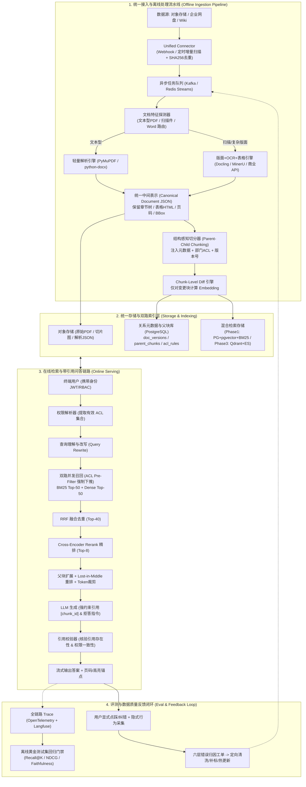

# 贯穿式实战项目设计与 15 道 AI 数据架构师专项面试精解

> [!NOTE] 案例性质说明
> 本文档第一部分设计的《企业级非结构化文档知识库与 RAG 问答系统》为**教学假设场景**，用于系统演练 AI 数据架构选型、统一抽象建模、容量成本测算与分阶段原型验证，**不属于作者过往真实任职企业的生产项目经历**（详见 [PROFILE_FACTS.md](../PROFILE_FACTS.md)）。

---

# 第一部分：贯穿式教学实战项目蓝图

## 1. 业务假设与工程边界定义

### 1.1 假设场景规模与核心约束
- **数据体量**：10,000 份企业内部 PDF 与 Word（`.docx`）文档（涵盖制度规范、产品手册、财务/招投标文件、研发设计文档）。
- **文档复杂度**：
  - 约 25% 为扫描件或含嵌入图片（需 OCR 与版面分析）；
  - 约 40% 包含复杂表格（合并单元格、无线表、跨页长表）；
  - 文档持续更新，存在 `v1.0 / v2.0 / 废弃` 多版本并存问题。
- **权限与安全要求**：不同部门（研发、财务、法务、销售）及职级具备严格访问权限边界，严禁越权召回或通过模型推断泄露无权限文档内容。
- **核心交付目标**：支持自然语言问答、给出可点击溯源的精确引用（文档名 + 版本 + 页码 + 段落定位）、具备可量化的 RAG 质量评估体系与增量更新机制。

### 1.2 容量与数据量级预估（面向架构选型的硬核基线）
避免“拍脑袋选最重组件”，先做量化摸底：
- 假设平均每份文档 30 页 $\implies$ 总计约 **300,000 页**；
- 假设每页平均切分为 4~5 个子块（Child Chunks，约 400~512 Tokens） $\implies$ 全量约 **120 万 ~ 150 万个 Chunks**；
- 假设 Embedding 维度为 1024 维：
  - FP32 原始向量体积：$1.5 \times 10^6 \times 1024 \times 4\text{ bytes} \approx 6.14\text{ GB}$；
  - 开启 **FP16 / Int8 标量量化**后，向量本体仅约 **1.5 GB ~ 3.1 GB**；加上 HNSW 图结构索引与元数据（约 1.5~2 倍放大），全量常驻内存仅需 **8 GB ~ 16 GB**。
- **架构师关键结论**：150 万向量规模处于**中小规模甜点区**——完全不需要在第一阶段盲目部署复杂的多节点分布式 Milvus 集群（避免过度设计与高昂运维成本），**单主从 PostgreSQL（pgvector + BM25/pg_search）或单集群 Qdrant/OpenSearch** 即可轻松支撑亚百毫秒检索；同时在应用层通过抽象 `Retriever Interface` 屏蔽底层存储，确保未来膨胀到数千万/上亿 Chunk 时可无痛平滑迁移至分布式引擎。

---

## 2. 端到端系统架构设计

---

## 3. 核心架构决策与取舍设计

### 3.1 统一中间表示（Canonical Document Model）设计
为隔离上游解析器变更（今天用 Docling，明年换 VLM OCR）与下游切分/索引，强制引入中间标准模型：
- `Document`：`doc_id`, `source_uri`, `title`, `owner_dept`, `latest_version_id`, `status(ACTIVE/ARCHIVED)`
- `DocumentVersion`：`version_id`, `doc_id`, `content_sha256`, `effective_from`, `effective_to`, `parser_version`, `parse_quality_score`
- `DocumentElement`：`element_id`, `type(HEADING/PARAGRAPH/TABLE/IMAGE)`, `parent_element_id`, `page_no`, `bbox[x1,y1,x2,y2]`, `raw_text`, `table_html`, `caption_text`
- `ChildChunk`：`chunk_id`, `doc_id`, `version_id`, `parent_chunk_id`, `section_path`, `text`, `chunk_sha256`, `acl_principals[]`, `is_latest`

### 3.2 关键组件选型与防过度设计取舍

| 环节 | 第一阶段推荐选型（1万份文档原型） | 备选商业/重型方案 | 选型取舍逻辑 |
| :--- | :--- | :--- | :--- |
| **文档解析** | 路由策略：纯文本 PDF 用 PyMuPDF；复杂版面/表格/扫描件用开源 **Docling / MinerU**，核心高价值财务合同兜底商业 API | 全量采购商业解析 API（如 Azure DI / TextIn） | 1 万份文档共 30 万页，全量商业 API 一次性费用约 ¥3万~¥6万，且涉及内网合规；**路由混合策略**可将 70% 简单文档零成本本地解析，复杂页定向走开源 GPU 或合规 API |
| **切分策略** | **结构感知 + Parent-Child Chunking**（子块 300~500 Token 检索，父块 1200~1500 Token 进上下文；表格整体独立成块+保留表头） | 固定长度切分 / 纯语义切分 | 固定切分破坏表格与制度条款；纯语义切分计算开销大且对结构文档收益有限 |
| **Embedding & Rerank** | 私有化部署开源双语模型（如 **BGE-M3** 同时支持 Dense+Sparse，配合 **BGE-Reranker-v2-m3**） | 商业 Embedding/Rerank API（OpenAI / Cohere） | 企业内部文档敏感不宜出网；单张 L4/A10/4090 GPU 即可支撑全量离线向量化与线上百 QPS 精排，边际成本极低且无厂商锁定 |
| **检索与权限库** | **PostgreSQL + pgvector（HNSW）+ 全文检索（BM25 / pg_search）**，或 **Qdrant + OpenSearch** | 分布式 Milvus + 独立 ES 集群 | 150 万 Chunk 级别下，PG 方案可实现“关系元数据 + ACL 权限 + 向量 + 关键词”单库 ACID 强一致，运维成本最低；封装 `Retriever` 接口保留未来水平拆库能力 |

### 3.3 阶段性原型验证路线（不一步到位，小步闭环验证）
1. **Phase 1（第 1~2 周，100 份代表性难例文档）**：精选含扫描件、跨页表格、多栏排版的 100 份文档，跑通 `解析 -> Canonical JSON -> Parent-Child 切分 -> 混合检索 + Rerank` 原型，用人工核验解析 TEDS/CER 与 50 条黄金问题的 Recall@10。
2. **Phase 2（第 3~4 周，1,000 份文档 + 权限与评估闭环）**：补齐 ACL Pre-filter 权限测试集（含 20 条越权攻击用例要求 100% 拦截）、接入 RAGAS 自动化评估与带页码引用校验，建立 CI 回归基线。
3. **Phase 3（第 5~6 周，10,000 份全量压测与增量演进）**：上线异步 MQ 队列、Chunk 级增量 Diff 更新、Trace 观测与用户反馈工单闭环，完成 P95 延迟与单次问答成本压测。

### 3.4 10,000 份文档成本与资源预算估算（参考基线）
- **一次性冷启动解析与向量化（30 万页 / 150 万 Chunks）**：
  - 使用 2 台单卡 GPU 节点（如 L4 / A10）按需租用约 2~3 天完成复杂页 OCR + 全量 Embedding，一次性算力成本仅 **¥1,000 ~ ¥2,500**（若走纯商业 API 约 ¥3万~¥5万）；
- **在线常驻基础设施（日均 5,000 次问答，峰值 20 QPS）**：
  - 检索与元数据层：1 主 1 从高配 PG（16C 64G SSD）或独立检索集群，月成本约 **¥4,000 ~ ¥8,000**；
  - 在线 Embedding + Rerank 推理：1 台单卡推理节点（主备两台保障高可用），月成本约 **¥5,000 ~ ¥10,000**；
  - LLM 生成 Token 成本：单次问答输入 4,000 Token + 输出 600 Token，日均 5,000 次 $\approx$ 每月 6 亿输入 + 9,000 万输出 Token，配合 Prompt Caching 与分级路由，商业 API 月费约 **¥3,000 ~ ¥8,000**。
- **综合 ROI 结论**：整套 1 万份文档企业级知识库稳态月度基础设施与模型直接成本可控制在 **¥1.2 万 ~ ¥2.6 万元/月**，远低于盲目采购重型分布式集群或按坐席收费的昂贵 SaaS 方案。

---

# 第二部分：15 道 AI 数据架构师专项面试真题全解

> 每道真题严格按 **1分钟简洁回答 / 深入原理解释 / 架构师视角分析 / 典型追问 / 常见错误回答** 五维展开。

---

### 题目 1：如何决定购买商业 RAG 产品还是基于开源技术自研？

#### 1. 1分钟简洁回答
> “我不会非黑即白地选‘全采购’或‘全自研’，而是按**业务核心度、数据合规要求、定制深度和团队维护能力**做分层决策：如果只是快速验证通用客服或内部标准知识库、团队缺乏工程人手，优先采购商业产品或基于成熟开源套件（如 Dify/RAGFlow）集成，3 周内跑出业务价值；但如果涉及**强数据私有化合规、复杂非结构化文档（扫描件/跨页表）深度定制、细粒度企业权限集成和长期可控的迭代成本**，则采用**‘核心数据管道与统一抽象自研 + 成熟开源引擎集成’**的混合路线，避免被商业黑盒锁定。”

#### 2. 深入原理解释
> 商业 RAG 与开源自研的核心差异在于**可控层级的边界**：
> - **商业 RAG（云厂商知识库 / SaaS）**：把解析、切分、Embedding、索引、排序和生成封装为端到端黑盒 API。前期零运维、上线极快；但当出现召回漏查或表格错乱时，开发者无法干预版面分析逻辑、无法自定义 ACL 过滤下推、无法自由替换解析或排序模型，且随着文档量和调用量增长，按页/按次/按席位计费会出现明显的非线性成本攀升。
> - **开源集成与自研**：底层引擎（PostgreSQL pgvector / Qdrant / OpenSearch / Docling / BGE）绝不重复造轮子，而是自研**业务强相关的控制面与数据管道**（统一数据源连接器、Canonical Document Model、企业权限同步器、评测与反馈闭环）。

#### 3. 架构师视角分析
> 作为技术负责人，我会用 7 维评估矩阵向管理层出具正式选型 ADR：
> 1. **扩展性与定制力**：企业内部权限（OA/LDAP/行级 ACL）和复杂表格解析往往是商业 SaaS 最大的短板；
> 2. **TCO 全生命周期成本**：算清 3 年总成本（商业按量/订阅费 vs 自研人力 + 服务器 + 运维成本）；
> 3. **厂商锁定风险**：商业方案一旦把文档元数据与业务流程深度绑定在私有格式里，后续迁移代价极高；
> 4. **团队匹配度**：若团队仅 2 人且无专职算法/SRE，硬上全自研只会导致烂尾。**最佳实践是先用商业/开源现成方案 2 周验证业务 PMF，确认核心瓶颈后再逐步替换关键管道模块**。

#### 4. 典型追问
- **追问**：如果老板要求 1 个月内必须上线演示，同时又要求未来 2 年不踩厂商锁定的坑，怎么折中？
- **破题**：采用**外层接口抽象 + 内核可替换**策略。1 个月内底层解析可先接商业 API、检索直接用 PG/开源框架快速交付；但强制要求团队建立自有的 Canonical Document 存储与标准 `Parser/Retriever` 抽象接口，后续任何引擎替换只改 Adapter，零侵入上层应用。

#### 5. 常见错误回答
- **错误 1**：“开源免费所以一定要全自研”——忽略了工程师人力成本、GPU 运维成本和漫长的上线周期，违背商业 ROI；
- **错误 2**：“直接买大厂商业 RAG 一劳永逸”——忽略了复杂企业内部权限同步、内网数据合规以及遇到 Bad Case 无法深度归因调优的致命隐患。

---

### 题目 2：如何设计可长期扩展的统一文档解析架构？

#### 1. 1分钟简洁回答
> “核心设计思想是**‘接入解耦、特征路由、统一中间表示（IR）与质量门禁’**。第一，上游通过统一 `Connector` 屏蔽本地文件、对象存储、Wiki、网页等来源差异；第二，引入轻量特征探测器，将纯文本 PDF、扫描件、Word、HTML 分别路由至最经济准确的解析 Adapter；第三，所有解析器输出必须转换为与引擎无关的 **Canonical Document JSON（保留章节树、表格结构、页码与坐标 BBox）**；第四，引入异步队列、解析版本字段与质量评分拦截，让任何解析算法升级都能平滑回刷而零侵入下游。”

#### 2. 深入原理解释
> 文档解析是整个 AI 数据链路中技术迭代最快、工具碎片化最严重的环节（传统规则提取 $\to$ OCR+版面模型 $\to$ 多模态 VLM 端到端解析）。
> - **隔离变化点**：定义标准抽象接口 `DocumentParser.parse(raw_bytes, doc_meta) -> CanonicalDocument`。`CanonicalDocument` 以树形/有序元素列表表达文档，包含 `Heading / Paragraph / Table(HTML+Markdown) / Image(URI+Caption)` 及其精确的 `page_no` 与 `bbox` 物理坐标。
> - **多级路由策略（Tiered Routing）**：先用低成本探针检测 PDF 是否含有效文字层、是否存在乱码（CMap 缺失）或大图占比 > 70%。纯文本页走毫秒级 `PyMuPDF`，复杂双栏/表格/扫描页才路由至 GPU 版面分析与 OCR 引擎，既省 70% 算力又保精度。
> - **异步与幂等**：大文件解析耗时数十秒，必须通过 MQ（Kafka/Redis Streams）解耦，按 `content_sha256 + parser_version` 做幂等去重与死信队列隔离。

#### 3. 架构师视角分析
> 这一架构直接复用了大数据平台 ETL 的**分层沉淀思想**：原始文件留在对象存储相当于 **ODS 层**，标准化 `CanonicalDocument` 相当于 **DWD 明细层**，下游切片和索引相当于 **DWS/ADS 服务层**。未来出现更强的 VLM 解析器时，只需新增一个实现类，针对历史解析分低的 ODS 原始文件离线重跑回刷，完全不影响在线服务与下游切分逻辑。

#### 4. 典型追问
- **追问**：新接入一个非标格式（如 CAD 图纸说明或带宏的 Excel），这套架构需要改动哪些地方？
- **破题**：仅需新增一个该格式的 `Parser Adapter`，将其关键信息映射为 `CanonicalDocument` 中的 `Table/Paragraph/Image` 元素即可；下游切分器、元数据模型、向量化与检索引擎零代码修改。

#### 5. 常见错误回答
- **错误 1**：把 `Unstructured` 或某个商业解析 SDK 的原始返回对象直接透传给切分器和数据库——导致上游换工具时全链路大面积返工；
- **错误 2**：所有文档无脑全部走最贵的 VLM 或商业 OCR——造成极高的延迟与成本浪费。

---

### 题目 3：PDF 跨页表格如何处理？

#### 1. 1分钟简洁回答
> “跨页表格的本质痛点是**‘视觉物理分页打断了逻辑表结构，导致后半页丢失表头和上下文关联’**。工程上分四步解决：**第一，版面去噪**，先根据物理坐标 `bbox` 剔除页眉、页脚和页码；**第二，跨页连续性判定**，检测上一页底部元素为表格且下一页顶部元素也是表格，结合列数一致、列宽 X 坐标对齐、无新标题插入及表头复用特征判定为同一逻辑表；**第三，逻辑合并与表头补全**，剔除重复表头（或为独立切分的子表行复制表头）；**第四，结构化表达与检索优化**，用 HTML 保留合并单元格结构，同时为大表生成自然语言摘要用于向量检索，原表整体或按行带表头进上下文。”

#### 2. 深入原理解释
> PDF 协议本身没有“逻辑表格”概念，它只是一堆带坐标的线条和字符流，分页后两个页面在底层对象树中完全独立。
> - **精准判定规则（Heuristic + Model）**：
>   1. 剔除页眉/页脚区域（如 Y 坐标在页面顶部 8% 或底部 8% 的重复文本块）；
>   2. 检查 Page $N$ 最后一个语义块是否为 `Table`，Page $N+1$ 第一个语义块是否为 `Table`；
>   3. 校验几何与语义特征：列边界 X 轴重叠度（IoU > 0.8）、列数相同（或存在明确的“续表”字样）、两表之间无新的章节标题；
>   4. 若 Page $N+1$ 首行与 Page $N$ 表头文本完全一致，则视为“分页重复表头”并在合并时去重；若不一致，则直接拼接数据行。
> - **超大合并表格的切分策略**：跨 10 页的大表无法整体塞入单个 Chunk，切分时必须按行分块，并且**强制在每个表格子块头部重新注入原始表头 + 表格标题 + 所在章节路径**，同时保留 `table_id` 关联完整 HTML 表格供大模型按需展开。

#### 3. 架构师视角分析
> 在真实企业文档中，跨页表格是最容易导致“答案张冠李戴”的高发区（例如财务报表或参数表第 2 页丢失表头后，模型把“2023年数据”当成“2024年数据”）。架构师必须把**表格结构提取准确率（TEDS 指标）**纳入解析质量评估基线；对于极复杂无线跨页表，可采用“规则+开源版面初判，置信度低时路由至多模态大模型（VLM）将相邻两页截图联合识别”的兜底机制，用局部高成本换取核心业务零差错。

#### 4. 典型追问
- **追问**：表格存成 Markdown 还是 HTML 更好？为什么？
- **破题**：**简单规整无合并单元格的表格优先用 Markdown**（Token 消耗少、LLM 理解友好）；**包含大量 `rowspan`/`colspan` 合并单元格的复杂财务/工程表格必须用 HTML**（Markdown 语法无法表达合并单元格，强转会导致列错位失真）。

#### 5. 常见错误回答
- **错误 1**：“按页独立解析、每页单独切分”——直接造成跨页表下半段丢失表头和语义；
- **错误 2**：“直接用纯文本抽取把表格拉平成空格分隔字符串”——彻底丢失行列对应关系，检索和生成必然产生严重幻觉。

---

### 题目 4：OCR 错误会如何影响检索和模型回答？

#### 1. 1分钟简洁回答
> “OCR 错误会沿整个 RAG 链路产生**级联放大效应（Data Cascade）**：在**检索层**，关键专有名词、产品型号、数字或金额错认一个字符（如 `0` 认成 `O`、`100万` 认成 `1000万`），会直接导致 **BM25 精确匹配彻底漏召回**，也会使 Embedding 向量偏离真实语义；在**生成层**，即便勉强召回，大模型也会把错误的 OCR 文本当作‘权威上下文证据’忠实复述甚至基于错误数字推导结论，产生极具迷惑性的‘高置信度错误答案’。”

#### 2. 深入原理解释
> 具体影响发生在四个环节：
> 1. **分词与倒排索引失效**：BM25 高度依赖精确 Token 匹配，一旦领域术语（如型号 `S7-1500` 识别为 `S7-I500`）出现字符级识别错误（CER 升高），倒排索引完全无法命中；
> 2. **切分边界破坏**：若章节编号（如 `3.2` 识别为 `32`）或标点识别错误，结构感知切分器无法识别标题层级，导致无关段落混切或句子断裂；
> 3. **Embedding 语义漂移**：连续错别字与乱码片段会触发分词器切出大量无意义子词（Subwords），污染整个 Chunk 的语义向量表示；
> 4. **生成侧事实扭曲与“忠实性陷阱”**：现代 RAG Prompt 强约束模型“严格依据上下文作答”，若上下文因 OCR 把“不含税”错识为“含税”，模型越忠实于上下文，给出的业务结论越致命。

#### 3. 架构师视角分析
> 治理 OCR 错误不能指望下游 LLM“靠猜纠正”，必须在数据入口建立**前移防线**：
> 1. **源头优先拿原生电子版**：能从系统拿到原生 Word/电子 PDF 绝不对打印扫描件做 OCR；
> 2. **置信度分层与图像预处理**：解析引擎输出字符/行级置信度分数，对倾斜、低 DPI、印章遮挡页面先做去倾斜、二值化/去红章预处理；整页平均置信度低于阈值（如 0.85）的文档自动进入**低质量隔离队列**，路由至更强 VLM OCR 重跑或触发人工校对；
> 3. **领域词典后处理与溯源高亮**：结合企业专有术语库做轻度纠偏（注意对数字/金额严禁随意由 LLM 改写以防篡改事实），前端返回答案时必须展示原 PDF 页面截图与 BBox 高亮，允许业务人员一眼核对原文。

#### 4. 典型追问
- **追问**：能不能在 OCR 之后统一加一步 LLM 文本纠错来修复所有错别字？
- **破题**：**需极其谨慎，绝不能全量无脑上**。LLM 纠错对自然语言错别字有效，但对**型号、编号、人名、金额、日期**极易发生“合理化篡改（过度纠正）”，且成本高昂；仅适合在低置信度文本段落做有限标记或人工辅助校对，且必须保留原始 OCR 文本对照审计。

#### 5. 常见错误回答
- **错误 1**：“现在大模型很聪明，OCR 错几个字模型自己能猜对”——忽视了在检索阶段就已经漏召回，根本轮不到模型去猜，且关键数字模型根本无法靠常识猜对；
- **错误 2**：只看模型最终回答好不好，从不统计和监控上游文档解析的 CER 与置信度分布。

---

### 题目 5：Chunk Size 如何选择？

#### 1. 1分钟简洁回答
> “Chunk Size 没有全局唯一标准答案，本质上是**‘检索信噪比’与‘生成上下文完整性’之间的权衡**。切得太小，单块语义残缺、缺少背景因果；切得太大，多个主题混杂导致 Embedding 语义稀释、检索精度下降并挤占上下文预算。工程最佳实践是：**不要用单一 Chunk Size 既做检索又做生成**，而是按文档类型做结构感知切分，并采用 **Parent-Child Chunking（小块 256~512 Token 精准检索，命中后回溯 1000~1500 Token 的父块或前后窗口交给 LLM 生成）**，同时基于黄金测试集的 Recall@K 与 Context Precision 做网格对照实验定参。”

#### 2. 深入原理解释
> Chunk Size 受三大底层机制约束：
> 1. **Embedding 模型的有效容量与信息压缩瓶颈**：向量是固定维度的信息瓶（如 1024 维），即便某些 Embedding 模型宣称支持 8192 Token，把 5 个不同段落压缩进同一个向量也会导致语义平均化（向量稀释），查询其中某个细节时相似度大幅下降。通常事实类问答检索块在 **256~512 Tokens** 精度最高。
> 2. **问题类型差异**：
>    - 精确事实/参数查询（如“报销标准是多少”）：适合偏小 Chunk（200~400 Tokens）；
>    - 制度推理/流程综述（如“变更审批全流程及例外条款”）：需要大上下文（800~1500 Tokens）。
> 3. **Overlap（重叠窗口）的作用与代价**：通常设为 Chunk Size 的 **10%~15%**（约 50~100 Tokens），仅用于缓解机械切分在边界处截断句子的风险；在采用结构感知切分或 Parent-Child 后，可大幅降低甚至省去 Overlap，减少冗余存储与重复召回。

#### 3. 架构师视角分析
> 架构师绝不靠主观拍脑袋写死 `chunk_size=500`。标准工程做法是：
> - **分文档类型配置切分策略模板**（FAQ 按问答对独立成块、制度规范按章节树切分、表格独立成块+补表头、代码按函数/类 AST 切分）；
> - **实验驱动调参**：在 100 条黄金问题上，固定模型与索引，对照评测 `256 / 512 / 1024 / Parent-Child(300->1200)` 四组策略的 `Recall@10`、`MRR` 和 `Faithfulness` 与 Token 成本，用量化数据敲定最终基线。

#### 4. 典型追问
- **追问**：随着大模型上下文窗口已经到 128K 甚至 1M，还需要做精细 Chunking 吗？
- **破题**：**依然需要**。第一，企业知识库动辄百万/千万级 Token，无法全量塞入单次请求；第二，长上下文面临显著的延迟飙升、Token 账单暴涨以及 **Lost in the Middle** 注意力衰减问题；高质量 Chunking 与检索仍然是平衡精度、延迟与成本的核心手段。

#### 5. 常见错误回答
- **错误 1**：“统一按 500 字符固定长度切分加 50 字符重叠”——粗暴截断表格、代码块和完整逻辑条款；
- **错误 2**：“切得越小越精准，直接按单句切分”——丢失主语、代词指代（如“该条款不适用于上述情况”）和限定条件，召回大量碎片噪音。

---

### 题目 6：BM25 与向量检索各有什么优势？

#### 1. 1分钟简洁回答
> “BM25（稀疏词法检索）和向量检索（稠密语义检索）是**互补而非替代关系**。**BM25 的核心优势在于精确词项匹配**：对产品型号、错误码、人名、专有缩写、合同编号和生僻新词召回极准，且可解释性强、索引轻、无需 GPU；**向量检索的核心优势在于跨词面语义泛化**：能理解同义词、口语化改写、概念上下位和跨语言表达（例如搜‘电脑死机怎么办’命中‘终端无响应排查手册’）。工程上各自有盲区，组合使用才能扬长避短。”

#### 2. 深入原理解释
> 从底层算法原理看二者的本质边界：
> - **BM25（词袋 + 倒排索引）**：基于词项精确重合度打分，引入 TF 饱和度（参数 $k_1$ 防止高频词刷分）、IDF 逆文档频率（放大罕见专有名词权重）和文档长度归一化（参数 $b$）。其根本局限是**词汇鸿沟（Vocabulary Mismatch）**——只要字面词项未出现，语义再相近得分也是 0，且严重依赖中文分词质量。
> - **向量检索（Bi-Encoder + ANN）**：将文本映射到连续高维语义空间，用余弦/点积度量语义相似度。其根本局限是**信息压缩导致的细节失真**——对未在预训练中充分见过的专有内部代号（如 `ERR_9042`、`SKU-8821A`）、精确数字或否定词（“不包含” vs “包含”）区分度很弱，常常召回“看起来主题相关但型号完全不对”的干扰文档。

#### 3. 架构师视角分析
> 在企业数据架构选型中，还要考虑**基础设施与领域迁移成本**：
> - BM25 在新业务/新术语刚上线时**零训练成本即刻生效**（只需维护好业务自定义分词词典）；
> - 向量检索在强垂直专业领域（医疗、法律、工业设备、企业内部黑话）若未做领域适配或微调，泛用 Embedding 模型的区分度可能反而不如调优后的 BM25。因此企业知识库切忌迷信“纯向量检索”。

#### 4. 典型追问
- **追问**：BM25 的中文分词在企业知识库里经常出什么坑？如何解决？
- **破题**：默认分词器会把内部专有名词、设备型号、报错码切碎（如把 `Kafka-KRaft` 或 `换热站A3` 乱切）。解决方式是结合企业元数据词库动态加载**自定义业务词典**，或引入字符级 N-gram / SPLADE / BGE-M3 Sparse Lexical 权重来降低对传统分词器的脆性依赖。

#### 5. 常见错误回答
- **错误 1**：“向量检索是新一代技术，已经全面淘汰 BM25”——在真实企业生产检索评测中，纯向量在专有名词和编号查询上的 Recall 往往惨不忍睹；
- **错误 2**：“BM25 只是简单关键字 `LIKE` 匹配”——忽略了 IDF 权重、TF 饱和曲线与文档长度归一化机制。

---

### 题目 7：什么情况下需要混合检索？

#### 1. 1分钟简洁回答
> “当知识库同时面临**精确专有名词查询与模糊语义问法**时——也就是绝大多数真实企业级知识库（技术文档、产品手册、制度合规、客服工单）——就必须上混合检索（Hybrid Search）。只有在极简单一场景（如纯图片/音频跨模态搜索，或纯精确编号查表且无自然语言表达）才考虑单路检索。混合检索通过并行执行 BM25 与向量召回，再用 RRF 或加权融合，通常能将 Top-10 召回率稳定提升 10%~25%。”

#### 2. 深入原理解释
> - **必须启用混合检索的四大典型信号**：
>   1. **查询分布混合**：既有“错误码 137 怎么排查”、“《财管字〔2024〕15号》第三条”这类强字面查询，又有“帮我总结一下差旅住宿超标怎么特批”这类语义查询；
>   2. **垂直专业术语密集**：通用 Embedding 模型对企业内部缩写、项目代号、物料编码未见过，必须靠稀疏检索兜底；
>   3. **多语言/中英混排文档**：中英文术语混用时，向量检索补足跨语种语义，BM25 锁定精确英文 API/类名；
>   4. **冷启动无领域微调**：没有人力微调专属 Embedding 模型时，Hybrid Search 是投入产出比最高的召回提效手段。
> - **融合机制关键点**：BM25 得分无界（如 `0 ~ 35`），余弦相似度有界（`-1 ~ 1`），**严禁直接相加**；推荐使用无参数、鲁棒性极强的 **RRF（Reciprocal Rank Fusion）**：$\text{Score}(d) = \sum \frac{1}{k + r_i(d)}$（通常 $k=60$），仅依赖各路排名位次融合，彻底规避分数尺度差异。

#### 3. 架构师视角分析
> 引入混合检索会带来**双路存储/索引维护复杂度**和约 **10~30ms 的并行融合开销**。架构选型上要避免“为混合检索而硬拼两套割裂系统导致数据不一致”：
> - 中小规模（千万级以下）：优先选择原生支持 Hybrid Search 的一体化引擎（如 **PostgreSQL + pgvector + pg_search/BM25**、**OpenSearch / Elasticsearch**、**Qdrant Dense+Sparse**），把双路写入、权限过滤与事务删除收敛在单一引擎内，大幅降低运维和一致性成本。

#### 4. 典型追问
- **追问**：RRF 和线性加权融合（$\alpha \cdot \text{Dense} + (1-\alpha) \cdot \text{BM25}$）怎么选？
- **破题**：**冷启动与通用场景首选 RRF**，免调参、对分数分布漂移极度鲁棒；**当你已有充足黄金评测集且做过 Min-Max / Z-Score 分数分布校准**，并能按查询意图动态调整权重（如识别到含代码/编号时调高 BM25 权重）时，动态加权融合可进一步榨出 2%~5% 的上限收益。

#### 5. 常见错误回答
- **错误 1**：“把 BM25 得分和向量余弦相似度直接乘以 0.5 相加”——两者量纲完全不同，BM25 的 15 分会彻底淹没余弦的 0.85 分；
- **错误 2**：“先用 BM25 搜，搜不到再用向量”——这种串行降级既增加延迟，又会因为 BM25 召回了一堆含常见词的弱相关噪音而根本不触发向量补救。

---

### 题目 8：Rerank 解决什么问题？

#### 1. 1分钟简洁回答
> “Rerank（重排序）解决的核心问题是**‘初筛召回（Bi-Encoder / BM25）速度快但语义交互粗、Top-K 排序不够准，且多路召回结果缺乏统一语义标尺’**的痛点。它采用 **Cross-Encoder** 架构，将用户的 Query 和候选 Chunk 拼接后一起送入 Transformer 做全 Token 级细粒度交叉注意力计算，从初筛的 Top-50/100 候选中精准挑出真正能回答问题的 Top-5/8 送给大模型，显著提升 Context Precision、降低上下文噪音和 LLM Token 成本。”

#### 2. 深入原理解释
> 对比召回阶段（Bi-Encoder）与精排阶段（Cross-Encoder）的物理机理差异：
> - **Bi-Encoder（双塔向量召回）**：Query 和 Document **完全独立编码**成两个向量，只在最后一步做一次点积。优势是文档向量可离线预计算、毫秒级搜索百万数据；致命短板是 Query 的每个词和 Document 的每个词之间**没有直接的 Token-to-Token 交叉注意力交互**，导致细微语义差异（如因果关系、否定限定、多条件同时满足）经常排序错位。
> - **Cross-Encoder（单塔交互精排）**：把 `[CLS] Query [SEP] Document [SEP]` 联合输入模型，每一层 Self-Attention 都能直接捕捉 Query 关键词与文档上下文的深层对齐关系，精度大幅超越双塔模型。代价是无法离线预计算，计算复杂度随候选数线性增长，因此只能作为漏斗第二级，对 Top-30~100 候选做精排。
> - **附带收益**：解决混合检索中 RRF 丢失原始相关度强弱的问题，并提供更可靠的**相关性置信度阈值**（当 Top-1 精排分都极低时，直接触发拒答，减少幻觉）。

#### 3. 架构师视角分析
> Rerank 是典型的**“计算漏斗：粗排保召回与吞吐，精排保精度与上下文纯度”**设计哲学（与搜索引擎、推荐系统一脉相承）。但线上引入 Rerank 必须严控**延迟预算**：
> - 候选集太大（如 Top-200）或单块文本过长，Cross-Encoder 延迟会飙升至 500ms~1s+；
> - 工程实践需做好三点：**控制精排候选数为 Top-30~50**、使用 ONNX/TensorRT/vLLM 批量并发推理（将 P95 压在 80~150ms 内）、对精排服务配置**超时熔断降级**（精排超时 300ms 时直接降级返回 RRF Top-K，保障主链路 SLA 不挂）。

#### 4. 典型追问
- **追问**：如果初筛召回 Top-50 里根本没有正确文档，加更强的 Rerank 有用吗？
- **破题**：**完全没用**。Rerank 只能重新排列候选集内部的顺序，不能无中生有。精排的天花板被初筛的 `Recall@50` 死死锁住——排查效果差时必须先看初筛召回率，再看精排 MRR/NDCG。

#### 5. 常见错误回答
- **错误 1**：“用 Rerank 替代向量数据库直接对全库文档打分”——百万文档逐一跑 Cross-Encoder 耗时数小时，完全不可行；
- **错误 2**：“加上 Rerank 就不用管 Chunking 和混合检索了”——忽略了上游 Recall 上限约束与延迟预算。

---

### 题目 9：如何评估 RAG 系统的检索质量？

#### 1. 1分钟简洁回答
> “评估 RAG 必须严守**‘分层解耦评估’**原则，绝对不能只看最终回答好不好，必须明确拆分**检索层指标、生成层指标和端到端业务指标**。针对**检索质量本身**，核心依托带标注相关文档/Chunk 的黄金测试集，重点衡量四个无大模型干扰的硬指标：**Recall@K（有没有找全）、Precision@K（噪音多不多）、MRR（第一条正确答案排第几）以及 NDCG@K（整体排序质量，支持多级相关性打分）**；同时在无人工块级标注时辅以 `Context Recall` 与 `Context Precision` 监控。”

#### 2. 深入原理解释
> 明确三大指标体系与公式职责：
> 1. **纯检索层指标（Retrieval Metrics，确定性、低成本、可进 CI）**：
>    - **Recall@K**：Top-K 中命中的相关文档占全部真实相关文档的比例，决定系统能力天花板；
>    - **Precision@K**：Top-K 中真正相关文档的占比，衡量信噪比；
>    - **MRR（Mean Reciprocal Rank）**：首个相关结果排名的倒数均值，适合唯一标准答案型查询；
>    - **NDCG@K**：对排在越靠前的高相关文档赋予更高对数折损权重，适合多文档综合问答与 Rerank 效果评估。
> 2. **生成层指标（Generation Metrics，如 RAGAS / LLM-as-a-Judge）**：
>    - **Faithfulness（忠实度）**：答案里的每个陈述是否都能从召回上下文中推导出（衡量幻觉）；
>    - **Answer Relevance（相关性）**：答案是否直接切题回答了用户问题；
>    - **Groundedness & Citation Accuracy（引用准确率）**：标注的 `[doc_id]` 是否确实支撑对应句子。
> 3. **端到端业务指标（Business Metrics）**：任务一次解决率、用户点赞/点踩率、引用核验点击率、人工转接率与单次问答成本。

#### 3. 架构师视角分析
> 很多团队做评估时直接拿一个端到端总分看趋势，结果发现分数掉了根本不知道该改切分、改索引还是改 Prompt。作为数据架构负责人，我会建设**三级评测金字塔**：
> - **底座（黄金集检索单测）**：200~500 条带 Ground-truth Chunk 标注的问答对，每次改解析/切分/Embedding/Rerank 时在 CI 中 2 分钟跑完 Recall@K 与 NDCG@10，零 LLM 费用；
> - **中层（LLM-as-a-Judge 抽样回归）**：使用校准后的强模型评测 Faithfulness 与拒答准确率，并定期与人工双盲打分核对一致性（防 Judge 偏好偏差）；
> - **顶层（线上真实流量监控）**：持续采集隐式行为与显式点踩，把线上 Bad Case 不断沉淀回黄金集。

#### 4. 典型追问
- **追问**：冷启动期没有任何人工标注测试集，怎么低成本快速构建第一批黄金评测集？
- **破题**：采用**“三源合一 + 人工兜底审核”**：（1）抽取核心高频文档，用强模型基于指定段落自动合成问题与标准答案（并附带源 Chunk ID），再由业务专家快速抽检过滤掉过于机械的问法；（2）导入历史客服工单/内部高频 FAQ；（3）刻意构造 15%~20% 的**无答案拒答题、多跳综合题和越权测试题**。50~100 条高纯度测试集 3 天即可成型。

#### 5. 常见错误回答
- **错误 1**：“直接让同一个大模型给自己的 RAG 回答打 1~5 分就算评估完成”——存在严重的自我偏好偏差（Self-Enhancement Bias），且无法区分检索失败还是生成失败；
- **错误 2**：只测 Recall@50 不测 Precision@5 和 NDCG——导致虽然答案在候选里，但塞进 Prompt 时被大量噪音淹没引发模型出错。

---

### 题目 10：如何定位模型幻觉的根因？

#### 1. 1分钟简洁回答
> “定位 RAG 场景的模型幻觉，核心方法是**‘先分型、再沿数据链路逆向定界’**。首先区分两类幻觉：**事实性幻觉**（知识库本身过时/错误/有冲突）与**忠实性幻觉**（上下文里明明写了 A，模型却编造了 B）。排查时依托全链路 Trace 按 6 层逐级排查：**原始数据是否过期冲突 $\to$ 文档解析/OCR 是否错乱 $\to$ 切分是否丢失前提条件 $\to$ 检索是否未召回关键块 $\to$ 上下文排序是否引发注意力遗忘 $\to$ 最后才归因为 LLM 推理或未遵循拒答指令**。实践中 70% 以上的‘模型幻觉’根因都在上游数据与检索层。”

#### 2. 深入原理解释
> 对应 6 层归因诊断表：
> 1. **数据层根因**：知识库里同时存在 2023 版和 2025 版报销制度且未标失效时间，或文档本身内容缺失但系统未触发拒答，模型被迫用预训练旧记忆“脑补”；
> 2. **解析层根因**：表格合并单元格错位、OCR 识错数字或漏掉“不含/除外”否定词；
> 3. **切分层根因**：切分把“适用前提条件”和“具体标准”拆成了两块，只召回了后者，导致模型给出了脱离前提的错误结论；
> 4. **检索与精排层根因**：真答案根本没进 Top-K，上下文全是似是而非的弱相关文档，模型强行拼凑作答；
> 5. **上下文组织根因**：注入过多冗余块，关键证据落在超长上下文正中间触发 **Lost in the Middle** 效应；
> 6. **生成层根因**：模型确实看到了完整正确的上下文，但因温度过高、Prompt 约束不严或跨文档逻辑推理能力不足，依然张冠李戴或编造引用。

#### 3. 架构师视角分析
> 将每条线上幻觉 Bad Case 强制打上上述 6 类归因标签并按周统计帕累托分布（Pareto Chart），你会迅速看清团队研发精力应该投向哪里：如果 45% 是知识冲突和过期，调一万遍 Prompt 也没用，必须立刻治理文档版本生命周期；如果 30% 是召回失败，就该补混合检索与查询改写；只有在上下文 100% 干净完整仍编造时，才通过降低温度、强化“无证据必须拒答”指令、引入 NLI/Groundedness 校验或升级推理模型来解决。

#### 4. 典型追问
- **追问**：如何降低知识盲区导致的“强行编造”？
- **破题**：建立**双保险拒答机制**：第一道在检索精排层设置**相关性置信度下限阈值**（如 Rerank 最高分 < 0.35 直接拦截并返回“知识库未收录相关信息”）；第二道在 Prompt 中明确要求“每句关键结论必须绑定 `[chunk_id]` 引用，若上下文无直接证据严禁推测，必须明确拒答”，并把拒答测试纳入黄金回归集。

#### 5. 常见错误回答
- **错误 1**：“模型出现幻觉就是大模型能力不行，换更贵更大的模型或者调低 temperature 到 0 就行”——对上游数据过期、解析错位和检索漏召回完全无解；
- **错误 2**：“在 Prompt 里多写几遍‘请不要产生幻觉’”——属于最典型低效的表面修补。

---

### 题目 11：文档发生变更后如何更新向量索引？

#### 1. 1分钟简洁回答
> “核心原则是**‘事件驱动增量感知 + 块级 Diff 局部更新 + 原子版本切换’**，严禁因为一份文档改了两段话就触发全库重算。具体流程：通过 Webhook/CDC/定时扫描发现文档 `content_sha256` 变化后，重新解析并切分为新 Chunks；将新旧 Chunks 按 `chunk_sha256` 做集合 Diff，**仅对新增或修改的 Chunk 重新计算 Embedding 并写入新版本标识**；删除或标记失效旧 Chunk，在业务查询层基于 `is_latest=true` 或版本指针原子切换，后台异步执行物理删除与索引 Compaction，避免高并发读写抖动与脏读。”

#### 2. 深入原理解释
> 向量索引（尤其是 HNSW 图结构）的底层删除与更新机制和传统 B+Tree 截然不同：
> - **HNSW 删除的物理代价**：在 HNSW 图中直接物理删除节点会导致图连通性断裂，因此几乎所有向量引擎（pgvector / Milvus / Qdrant / Lucene HNSW）都采用**软删除（Tombstone / Bitset 标记屏蔽）**。如果长期高频更新删除而不做 Compaction，大量墓碑节点会占据内存并导致搜索跳数增加、召回率退化。
> - **防中间态脏读（双版本原子切换）**：若先删除旧文档的所有 Chunks、再逐条写入新 Chunks，在写入的几秒窗口内用户查询会完全搜不到该文档或搜到残缺半成品。正确做法是**先写入带 `version_id = v2` 且 `status = STAGING` 的新 Chunks** $\to$ 全部落盘并建好索引后，在元数据/索引层将 `v2` 置为 `ACTIVE`、将 `v1` 置为 `DEPRECATED`（原子状态切换）$\to$ 异步任务延时清理 `v1` 的旧 Chunks。
> - **Chunk-Level Diff 降本**：对于 200 页长文档仅修改了第 5 页的场景，对比新旧 `chunk_sha256`，98% 未变更块直接复用已有向量，大幅节约 Embedding 算力与写入压力。

#### 3. 架构师视角分析
> 文档更新只是小变更；真正考验架构师功力的是**全量级变更（如升级 Embedding 模型或大改切分策略）**：此时无法局部更新，必须采用**影子索引（Shadow Index）+ 双写双读蓝绿切换**——新建一套新索引 Collection，后台限流全量回刷历史文档，期间增量变更双写新旧索引，新索引经黄金评测集验证无误后，在线路由一键切流，老索引观察 7 天后下线释放资源。

#### 4. 典型追问
- **追问**：如果只改了文档的访问权限（例如某份文档从“全员可见”变成“仅财务可见”），需要重新解析和算 Embedding 吗？
- **破题**：**绝对不需要**！应将易变的权限元数据与不可变的文本向量解耦：若检索库支持高效的 Payload/Metadata 原地更新（如 Qdrant/PG），直接原子更新对应 `doc_id` 下的 `acl_roles` 字段；或采用“向量库仅存 `doc_id` + 独立实时权限服务/关系表联查”避免因高频组织架构调整引发海量向量重写。

#### 5. 常见错误回答
- **错误 1**：“每天半夜把全库 1 万份文档清空重跑一遍索引”——数据新鲜度差（T+1）、算力极度浪费，且在重建期间服务不可用；
- **错误 2**：“先 Delete 旧文档，再慢慢 Parse 和 Insert 新文档”——导致更新窗口期出现严重的搜索空白与一致性故障。

---

### 题目 12：如何实现企业级知识库权限隔离？

#### 1. 1分钟简洁回答
> “企业级知识库权限隔离的铁律是：**权限校验必须在检索阶段强制前置（Pre-Filtering），绝对不能等检索出文档喂给大模型之后再靠 Prompt 嘱咐模型‘不要泄密’**。架构上分四步落地：接入期从企业 IAM/OA/文档系统同步每份文档的 ACL 权限标签写入元数据；查询期提取终端用户实时 JWT 与所属角色/部门集合，自动将权限条件作为强制过滤谓词下推至 BM25 与向量检索层；权限变更通过事件总线近实时同步并刷新缓存；对强合规核心租户提供独立 Collection 或独立物理实例级隔离。”

#### 2. 深入原理解释
> 权限过滤在向量检索中面临两个核心底层技术难点：
> 1. **Post-filtering 导致结果为空与越权风险**：如果先做全库 Top-20 向量召回，再在应用层把用户无权看的 19 篇过滤掉，最后只剩 1 篇甚至 0 篇结果，召回率断崖下跌；而如果把无权文档喂给 LLM 再靠指令过滤，一次简单 Prompt Injection 就能套出机密数据。
> 2. **Pre-filtering 对 HNSW 索引性能与连通性的影响**：当某用户仅有权访问全库 1% 的文档（高选择率过滤）时，在 HNSW 图上漫游极易陷入被过滤节点包围的“孤岛”，导致检索变慢甚至搜不到。工程解决方案：
>    - 选用支持 **Single-Stage Iterative / ACORN 过滤**的现代引擎（如 pgvector 0.8+ iterative scan、Qdrant payload index、Milvus partition key）；
>    - 对权限集合极窄的部门/项目，设置路由阈值——候选文档数少于一定规模（如 < 5,000 个 Chunk）时，直接退化为**过滤后的精确暴力扫描（Exact Scan）**，毫秒级完成且 100% 召回；
>    - **多层权限模型**：同时支持 `tenant_id`（租户隔离）、`dept_ids`（部门）、`role_ids`（岗位）、`explicit_allow/deny_users`（特例白名单/黑名单），并遵循**显式拒绝优先（Deny Overrides Allow）**原则。

#### 3. 架构师视角分析
> 权限系统最容易被忽略的死角是**“权限撤销延迟”与“共享缓存越权穿透”**：
> - **员工离职或调岗**：必须监听企业 IAM/AD 变更事件，做到分钟级（核心场景秒级）刷新用户角色缓存与文档 ACL 索引，严禁依赖 24 小时定时同步；
> - **语义缓存严禁跨权限共享**：很多团队加了语义缓存提速，结果把高管问过的机密财务答案缓存下来返回给了普通实习生！所有缓存键必须强制绑定 `acl_scope_hash`（权限指纹），或对含受限文档的回答直接禁止进入公共语义缓存。

#### 4. 典型追问
- **追问**：如果某部门员工人数极多，且文档 ACL 粒度细到“单人授权列表”（一篇文档授权给 2,000 个人），把 2,000 个 `user_id` 冗余写进 500 个 Chunk 的 Metadata 里会导致写放大爆炸，怎么设计？
- **破题**：采用**组抽象 + 间接权限映射**：企业权限严禁按个人直接打散到 Chunk，优先收敛到**部门/安全组/角色（RBAC/ABAC）**；若确实存在大量复杂细粒度共享，则在检索前先查询轻量权限图/关系库（如 OpenFGA / Zanzibar 模型或 PG 权限表），拿到该用户可读的 `authorized_doc_ids` 或 `acl_group_ids`，再将紧凑的组 ID 或文档集合下推至检索层。

#### 5. 常见错误回答
- **错误 1**：“在 System Prompt 里写‘如果用户不是财务部，请不要透露以下上下文中的薪资数据’”——严重安全漏洞，模型极易被绕过泄密；
- **错误 2**：“先向量检索 Top-10，再在 Java/Python 代码里把没权限的删掉”——导致低权限用户大量查询返回空结果，体验极差。

---

### 题目 13：如何评估 Embedding 与向量数据库成本？

#### 1. 1分钟简洁回答
> “评估成本必须拆成**一次性离线构建成本**和**长期在线常驻成本**两笔账，并用公式量化驱动架构降本。**Embedding 成本**主要看总 Token 量与更新频率，用‘商业 API 按百万 Token 计费’对比‘自建单卡 GPU 推理折旧与电费’算盈亏平衡点；**向量数据库成本**的最大大头是**内存占用（RAM）**，核心估算公式为 `向量条数 × 维度 × 单维字节数 × 索引放大系数(通常 1.5~2.5x)`。通过合理降维（MRL）、Int8/Binary 量化、冷热分层（DiskANN）和选择合适引擎，通常可将内存成本压降 60%~80%。”

#### 2. 深入原理解释
> 给出可直接用于架构评审的精确测算模型（以 1,000 万 Chunks、1024 维为例）：
> 1. **向量数据库内存成本公式**：
>    $$\text{RAM}_{\text{HNSW}} \approx N \times D \times B_{\text{dtype}} \times F_{\text{overhead}}$$
>    - 未优化（FP32，4 字节，HNSW 放大系数 ~1.8x）：$10^7 \times 1024 \times 4 \times 1.8 \approx 73.7\text{ GB RAM}$（高可用主从双副本需 ~150 GB 内存）；
>    - **优化一：Matryoshka（MRL）降维**至 512 维 $\implies$ 内存直接减半至 ~37 GB；
>    - **优化二：Int8 标量量化（SQ8）**（1 字节）$\implies$ 降至 ~18 GB，配合磁盘保留 FP32 原向量对 Top-100 精算重打分，召回率损失 < 1%；
>    - **优化三：DiskANN / 磁盘存储 + 内存缓存热区**：把冷数据向量留在 NVMe SSD，内存占用可再降 5~8 倍，仅增加 10~20ms 磁盘随机读延迟。
> 2. **Embedding 成本对比（API vs 自部署）**：
>    - 1 万份文档（约 1.5 亿 Tokens）：用主流商业 Embedding API（约 ¥0.1~¥0.7 / 百万 Token）全量初始化仅需几十到百元，**冷启动极便宜**；
>    - 但在海量实时增量（如每日千万级日志/消息）或强内网合规场景，自部署开源模型（1 张 L4/A10 卡月租约 ¥2,000~¥4,000，吞吐可达数千 Chunk/秒）不仅数据不出网，高吞吐下单位成本也远低于商业 API。

#### 3. 架构师视角分析
> 技术负责人做成本汇报时，最容易犯的错是**只算服务器和 API 账，不算工程运维人力账**。对于 100 万~500 万 Chunk 的中小型知识库，强行为了省几百块云资源去运维一套复杂的分布式向量集群，多投入半个专职运维工程师的人力成本就高达 ¥20 万/年！**架构降本的第一原则永远是匹配规模、消除过度设计，其次才是量化压缩与冷热分层**。

#### 4. 典型追问
- **追问**：开启 Binary Quantization（二值量化，内存压降 32 倍）有什么副作用？什么时候能用？
- **破题**：二值量化把每个浮点数压成 1 bit（正负号），信息损失显著，在低维度（如 384 维）或中文细粒度专业文档上召回率可能暴跌 15%+。它仅适用于**高维度向量（如 1536/3072 维）+ 超大规模（上亿级）**，且必须开启 **Oversampling（如放大初筛 4 倍至 Top-200）+ 原向量 Rescore 重打分**才能把召回率拉回可用水位。

#### 5. 常见错误回答
- **错误 1**：只算 `条数 × 维度 × 4B` 作为所需内存，忘算 HNSW 邻接图结构、Metadata Payload、操作系统 PageCache 和主从高可用副本，导致上线即 OOM；
- **错误 2**：把 Embedding 成本和 LLM 生成成本混为一谈——实际上在多数企业问答系统中，**LLM 生成 Token 与 Rerank 推理占在线总成本的 70% 以上**，Embedding 往往占比很小。

---

### 题目 14：如何保障系统未来三年的可扩展性？

#### 1. 1分钟简洁回答
> “保障未来三年可扩展性的核心不是第一天就造一艘巨型航空母舰，而是**‘极简实现 + 刚性抽象边界 + 渐进演进路线’**。在架构上重点抽象五个稳定接口：**统一数据源连接器、统一文档中间表示（Canonical IR）、统一检索抽象层（Retriever）、统一模型网关（AI Gateway）和独立评测基线**。只要这五层契约清晰、核心数据（原始文件 + IR + 元数据 + 黄金评测集）牢牢掌握在自己手里，未来三年无论是文档量从 1 万涨到 100 万、解析从 OCR 升级到 VLM、引擎从 PG 迁移到分布式向量库，还是从普通 RAG 演进到 Agentic RAG，都可以局部平滑替换而无需推倒重来。”

#### 2. 深入原理解释
> 面向未来三年的演进规划（避免过度设计 vs 避免死胡同）：
> - **Year 1（MVP 闭环与价值验证期，1万~10万文档）**：
>   - 极简底座：对象存储 + PostgreSQL（元数据/ACL/pgvector/BM25）+ 开源解析与 Rerank + 黄金测试集；
>   - 重点把**统一数据模型（Canonical IR）和评测/反馈闭环**立稳，绝不提前引入重型分布式集群。
> - **Year 2（规模化与多租户扩展期，10万~100万+文档）**：
>   - 读多写少瓶颈出现时，借助已有的 `Retriever` 抽象接口，将向量/全文检索平滑拆出至独立 Qdrant/OpenSearch/Milvus 集群，保留 PG 作为主元数据与权限真相源；
>   - 离线解析层迁移至 K8s 弹性 GPU Worker 池（按队列积压扩缩容），上线多租户配额与冷热分层索引。
> - **Year 3（多模态与 Agentic RAG 融合期）**：
>   - 利用保留的原始文档与图片坐标，接入原生多模态 Embedding/VLM 检索（直接理解图表、设计图纸）；
>   - 将知识库封装为标准 **MCP Retrieval Tools**，支持多步推理 Agent 自主拆解子问题、联合调用结构化数仓（Text-to-SQL）与非结构化知识库。

#### 3. 架构师视角分析
> **如何平衡“面向三年可扩展”与“避免当下过度设计”？** 我的架构判断准则非常简单：
> - **投资在“难改的契约”上**：数据 Schema、ID 规范、版本机制、权限模型、评测资产——这些一旦写脏后期重构代价极大，第一天就必须设计严谨；
> - **克制在“易换的组件”上**：向量数据库选型、具体解析工具、某个 LLM 供应商——这些被接口隔离在 Adapter 后面，第一天选用最简单、团队最熟的方案即可，等监控指标真实触达瓶颈水位（如 P99 超 300ms 或内存超 70%）再触发演进升级。

#### 4. 典型追问
- **追问**：三年里如果团队规模从 3 人扩到 15 人，如何保障架构不腐化、技术债务不失控？
- **破题**：建立三项工程治理机制：（1）重要组件选型和接口变更必须沉淀 **ADR（架构决策记录）**；（2）将解析质量指标、检索 Recall@K 和越权拦截纳入自动化 CI 门禁，阻止劣质改动合并；（3）按 80/20 配额制持续投入 20% 研发资源清理僵尸索引、重构老旧解析 Adapter 与维护黄金评测集。

#### 5. 常见错误回答
- **错误 1**：“一开始就上微服务拆分 15 个服务 + Kafka + Flink + Milvus 分布式集群 + 自研图谱”——典型的过度设计，1 万份文档还没跑通业务价值，团队就被运维拖垮；
- **错误 2**：“先全写死在一起跑起来再说，连数据模型和版本字段都没留”——后期一升级 Embedding 模型或加权限就要推倒重写。

---

### 题目 15：如何将数据质量问题与模型效果建立反馈闭环？

#### 1. 1分钟简洁回答
> “核心是将传统数据平台的**可观测性与数据治理闭环**完整迁移到 AI 数据链路，构建**‘线上反馈采集 $\to$ 全链路 Trace 归因 $\to$ 分层数据修复/热更新 $\to$ 黄金集回归验证’**的飞轮。用户点踩或隐式放弃时，系统自动关联完整 Trace 快照进入归因看板，精准区分是原始文档过期、解析错乱、切分不当、检索漏查还是生成幻觉；将高频数据缺陷转化为清洗/补标工单定向修复并触发增量索引更新，同时把该 Bad Case 自动沉淀进黄金回归集，确保修复有效且不引发其他场景退化。”

#### 2. 深入原理解释
> 闭环运行的五个标准工程节点：
> 1. **双渠道信号采集**：
>    - **显式反馈**：点踩时提供轻量结构化原因勾选（信息过时 / 答非所问 / 引用错误 / 信息缺失），降低用户反馈门槛；
>    - **隐式行为信号**（往往量级是显式反馈的 10 倍）：用户连续 3 次改写相似问题追问、生成后迅速关闭未复制、点开引用后立刻点踩、或直接转人工客服。
> 2. **自动化初筛 + 人工精归因**：
>    - 每日离线任务通过 LLM-as-a-Judge 扫描低分 Trace（如 Faithfulness < 0.7 或 Rerank 最高分过低），自动聚类高频问题并归类到 6 层根因（原始数据/解析/切分/检索/排序/生成）。
> 3. **分层定向修复动作**：
>    - 原始文档过期/冲突 $\to$ 通知业务知识管理员（Knowledge Owner）下架旧版、上传新版；
>    - 解析/表格错误 $\to$ 修复解析规则或将文档切入高质量 VLM 解析重试队列；
>    - 检索词汇鸿沟 $\to$ 补充业务同义词库、自定义分词词典或优化 Query 改写 Prompt；
>    - 特定高频痛点 $\to$ 沉淀为高优先级人工审定 FAQ 知识条目（Golden Q&A 强干预层）。
> 4. **增量热更新与灰度回归**：修复后仅对受影响文档执行块级增量索引更新，并把原 Bad Case 纳入黄金测试集跑回归验证，确认该问题通过且全局 Recall/Faithfulness 无回退。

#### 3. 架构师视角分析
> 很多企业 RAG 上线首月很惊艳，半年后沦为“无人问津的垃圾库”，根本原因在于**只建了“技术管道”，没建“知识运营与数据质量闭环机制”**。作为技术负责人，必须在组织层面打通两点：
> - **明确 Knowledge Owner 权责**：技术团队负责解析、检索和评估工具，但业务文档的权威性与时效性必须由各业务部门指定负责人认领，平台每月自动向各部门推送《过期文档与高频未命中知识缺口报告》；
> - **量化闭环效能指标**：以“高频 Bad Case 平均修复周期（MTTR）”、“同类问题复发率”和“月度端到端解决率提升曲线”作为 AI 数据平台团队的核心 OKR。

#### 4. 典型追问
- **追问**：业务方反馈“今天某个重要政策的答案答错了，10 分钟内必须修好”，但走完整的解析优化或模型迭代来不及，怎么应对？
- **破题**：设计**两级热修复通道**：
  - **快通道（分钟级止血）**：提供运营侧高优先级 **Canonical Q&A / 纠错覆盖表**或手动编辑单条 Chunk 文本并即时重算该条向量，5 分钟内线上生效；
  - **慢通道（根因治本）**：同时生成溯源工单，复盘究竟是解析 Bug 还是旧版文档未下架，在周迭代中从根源修复管道并清理临时补丁，避免补丁堆积成新的技术债务。

#### 5. 常见错误回答
- **错误 1**：“加一个点赞点踩按钮存进数据库表就算闭环了”——只收集不归因、不派单、不驱动数据清洗与回归验证，属于典型假闭环；
- **错误 2**：“全靠收集用户反馈去微调（Fine-tune）大模型参数”——微调成本高、周期长、极易灾难性遗忘且无法解决实时文档过期与权限问题，**知识类错误永远优先治数据与检索，最后才考虑微调**。

---

## 知识自检与口述演练清单

- [ ] 能否在 5 分钟内用白板画出 10,000 份企业文档 RAG 系统的离线/在线/评估三段式架构，并说明为什么第一阶段不直接上重型分布式向量集群？
- [ ] 能否现场口算出 150 万条 1024 维向量在 FP32 与 Int8 量化下的大致内存占用？
- [ ] 面对上述 15 道专项面试题，能否不看答案，用“1分钟破题 + 原理推导 + 架构权衡”清晰作答并主动规避常见错误回答？
- [ ] 能否结合自己 14 年传统数据平台与数据治理经验，自然阐述“传统 ETL/元数据/血缘/权限治理 $\to$ AI 非结构化数据架构”的底层迁移逻辑，同时诚实、专业地界定个人真实履历与系统学习演练边界？
