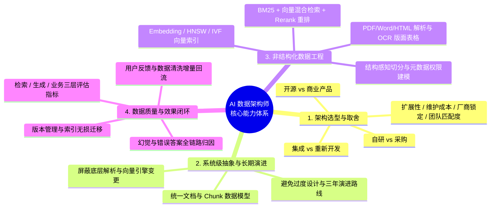

# 模块 10：AI 数据架构与非结构化数据工程 (AI Data Engineering)

> [!NOTE] 能力边界与案例性质说明
> 本模块面向 **AI 数据架构师、数据平台研发负责人与技术总监** 岗位需求构建，聚焦非结构化数据解析、混合检索、企业级 RAG 架构、质量评估与数据反馈闭环的系统性学习与架构演练。  
> 依据 [PROFILE_FACTS.md](../PROFILE_FACTS.md) 规范，本模块所涵盖的能力属于**当前系统学习与技术拓展领域**，贯穿本模块的《10,000 份企业文档知识库与 RAG 问答系统》属于**教学假设场景**，严禁将其包装为作者过往任职企业的真实生产项目经历。

---

## 一、模块核心定位与四大面试能力支柱

传统大数据平台擅长处理结构化/半结构化数据（关系型库表、日志流、指标数仓）；而 AI 时代的企业级数据架构需要把**非结构化文档（PDF/Word/网页/扫描件/图片表格）**转化为**高质量、可追溯、带权限、可持续演进的模型上下文资产**。

本模块严格围绕 AI 数据架构师岗位的四大核心考察维度展开：

---

## 二、专题目录导航（共 8 篇核心专题 + 1 篇实战与真题手册）

| 序号 | 专题文件 | 核心内容覆盖 | 建议学习节奏（90分钟/天） |
| :---: | :--- | :--- | :--- |
| **01** | [01-document-parsing.md](./01-document-parsing.md) | PDF 对象结构、文本 vs 扫描路由、OCR 流水线与 VLM OCR、版面分析、跨页表格提取、Word/HTML 解析、工具选型与质量指标 | Day 43（拓展日 1） |
| **02** | [02-chunking-metadata.md](./02-chunking-metadata.md) | 固定/递归/语义/结构感知切分、Parent-Child 与 Late Chunking、Chunk Size/Overlap 权衡、统一元数据与权限 Schema、切分质量评估 | Day 44（拓展日 2） |
| **03** | [03-embedding-vector-index.md](./03-embedding-vector-index.md) | Embedding 原理与 MRL、余弦/点积/L2 距离、ANN 三角权衡、HNSW/IVF/DiskANN、量化压缩与内存测算、pgvector vs Milvus 等选型 | Day 45（拓展日 3） |
| **04** | [04-hybrid-search-rerank.md](./04-hybrid-search-rerank.md) | 倒排索引与 BM25 推导、Dense vs Sparse、Hybrid Search 与 RRF 融合、Cross-Encoder Rerank、查询改写、元数据 Pre/Post Filter 优化 | Day 46（拓展日 4） |
| **05** | [05-rag-architecture.md](./05-rag-architecture.md) | 离线处理与在线检索双链路、异步解析流水线、上下文组织与强引用溯源、RBAC/ABAC 文档级权限过滤、多租户四级隔离、高可用与成本 | Day 47（拓展日 5） |
| **06** | [06-retrieval-evaluation.md](./06-retrieval-evaluation.md) | 严格区分检索指标（P@K/R@K/MRR/NDCG）、生成指标（Faithfulness/Groundedness）与业务指标、黄金测试集构建、RAGAS 与回归门禁 | Day 48（拓展日 6） |
| **07** | [07-data-quality-feedback.md](./07-data-quality-feedback.md) | 原始数据缺陷、全链路 6 层错误归因、幻觉分类定位、显式/隐式用户反馈收集、难例清洗重标、索引热修复与回归验证闭环 | Day 49（拓展日 7） |
| **08** | [08-knowledge-evolution.md](./08-knowledge-evolution.md) | 统一数据源连接器抽象、文档版本与增量 Chunk Diff 更新、Embedding 模型升级影子索引平滑迁移、权限即时回收、三年架构演进路线 | Day 50（拓展日 8） |
| **09** | [09-capstone-project-and-interviews.md](./09-capstone-project-and-interviews.md) | **贯穿式教学实战项目**（10,000 份企业文档 RAG 架构与成本测算）+ **15 道 AI 数据架构师专项面试题 5 维逐题全解** | Day 51（综合演练与模拟答辩） |

---

## 三、与原有大数据/架构知识库的系统映射（打破知识孤岛）

AI 数据架构并不是另起炉灶，而是传统企业数据平台工程能力向非结构化与语义计算空间的自然延伸。以下 9 组核心映射有助于将 14 年传统数据平台实战积累，系统转化为 AI 数据架构师的核心竞争力：

| AI 数据工程领域 | 映射至原有知识库领域 | 核心底层相通点与架构迁移 | 相关参考文档 |
| :--- | :--- | :--- | :--- |
| **非结构化文档解析** | 数据采集与 ETL | 异构协议/格式接入、脏数据清洗、解析失败死信重试、幂等入湖与结构化标准建模 | [01-platform-blueprint.md](../02-data-platform/01-platform-blueprint.md) |
| **文档与 Chunk 元数据** | 数据治理与元数据管理 | 技术/业务/权限元数据分层建模、统一元模型屏蔽底层异构存储变化 | [02-metadata-governance.md](../02-data-platform/02-metadata-governance.md) |
| **文档版本与引用溯源** | 端到端数据血缘 | `原始文件版本 -> 解析产物 -> Chunk -> 向量索引 -> 答案引用` 全链路血缘与影响分析 | [03-quality-lineage.md](../02-data-platform/03-quality-lineage.md) |
| **Embedding 与向量索引** | 数据存储与底层索引 | B+Tree / LSM-Tree 与 HNSW / IVF / DiskANN 在磁盘/内存/写放大/删除墓碑上的本质权衡 | [03-database-storage-engine.md](../03-java-engineering/03-database-storage-engine.md) |
| **混合检索与 Rerank** | 搜索引擎与查询优化 | 倒排索引、谓词下推（Pre-filtering）、多路召回剪枝与分层代价优化（粗排 $\to$ 精排） | [01-doris-realtime-olap.md](../01-bigdata/08-doris-lakehouse/01-doris-realtime-olap.md) |
| **企业级 RAG 架构** | 分布式系统与权限网关 | 离线/在线解耦、异步队列削峰、多租户资源隔离、RBAC/ABAC 行级权限校验与缓存防穿透 | [05-data-api-security.md](../02-data-platform/05-data-api-security.md) |
| **RAG 质量评估体系** | 数据质量管理 | 从“表完整性/波动率稽核”升级为“检索 Recall/NDCG + 生成 Faithfulness”的自动化门禁 | [03-quality-lineage.md](../02-data-platform/03-quality-lineage.md) |
| **数据质量与反馈闭环** | 平台可观测性与持续改进 | OpenTelemetry 全链路 Trace 定界、异常告警收敛、数据修复与回归验证闭环 | [06-observability-ha.md](../02-data-platform/06-observability-ha.md) |
| **AI 数据平台长期演进** | 技术选型、债务治理与团队管理 | 开源 vs 商业 ROI 测算、三年演进路线、技术债务控制与数据+AI 复合团队协同 | [03-productivity-tech-debt.md](../04-tech-management/03-productivity-tech-debt.md) |

---

## 四、贯穿式教学实战项目总纲（假设演练场景）

为避免“纸上谈兵”，本模块贯穿使用同一套教学假设业务场景——**《企业级非结构化文档知识库与 RAG 问答系统》**（完整架构、验证步骤与精确成本测算见 [09-capstone-project-and-interviews.md](./09-capstone-project-and-interviews.md)）：
- **数据规模假设**：10,000 份企业 PDF / Word 文档（含扫描图片、跨页复杂表格、图文混排）；
- **业务复杂度假设**：文档持续存在多版本迭代；不同部门/岗位具备差异化访问权限；要求自然语言问答结果具备段落/页码级精确引用；
- **分阶段学习目标**：第一阶段不盲目铺开全量生产开发，而是聚焦**架构抽象设计、核心组件选型取舍、关键链路原型验证（解析/切分/混合检索/评估）与三年演进成本分析**。
