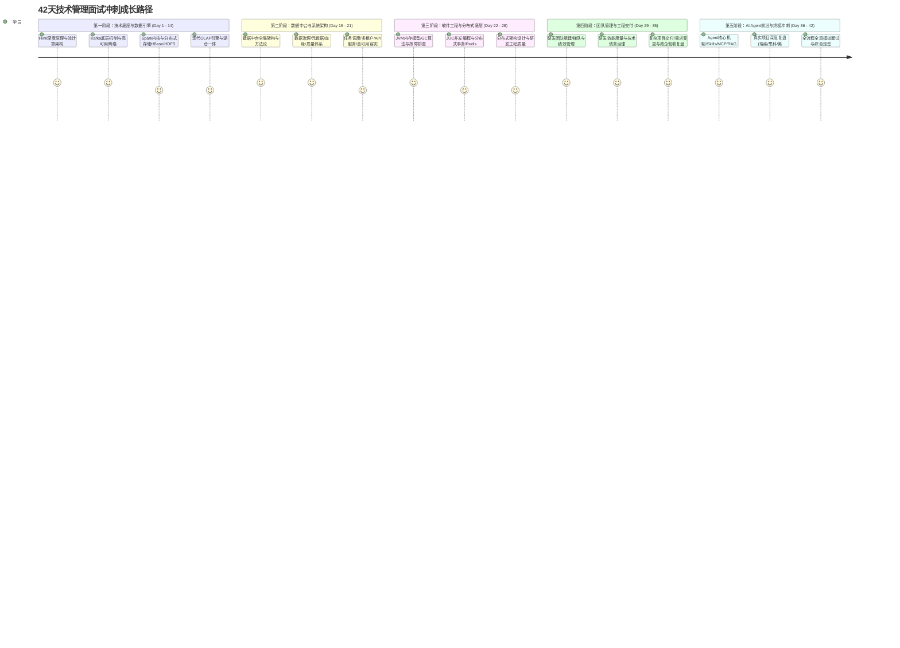

# 42天技术管理与架构师学习全景计划 (PLAN.md)

> **学习原则**：系统唤醒 · 深度原理 · 架构取舍 · 结构化表达 · 持续验证  
> **每日投入**：严格控制在 **90分钟**（30分钟核心原理 + 20分钟机制推演 + 20分钟架构与管理场景 + 15分钟高频面试口述 + 5分钟复盘记录）  
> **三层知识划分**：
> - **【必学知识】（核心必修）**：每天 90 分钟的核心主线，必须在当日完全掌握并通过自测，涵盖底层核心拓扑、核心参数、排障主路径与高频面试应答；
> - **【进阶知识】（拔高加分）**：大厂资深技术面与架构师加分项，针对底层源码流转、极端并发边界条件与复杂性能调优，可在周末阶段复盘或专项突击时深入；
> - **【拓展知识】（前沿视野）**：行业前沿演进（云原生、存算分离、AI-Native）、新技术替代选型与跨领域方案，用于拓宽技术管理者的技术战略视野。  
> **案例边界声明**：学习计划中涉及的工业中台、太原项目、思科网络遥测与 Zoom 场景，统一依据 `PROFILE_FACTS.md` 规范作为“教学推演案例”进行演练，不绑定个人未经核实的事实。

---

## 本轮面试准备目标

按下表从原计划中取用已有时段。每次仍用 90 分钟，最后 15 分钟闭卷口述两题，5 分钟核对答案并记录真实错题。学完一个方向的标准是能把结论、运行机制和一次工程决策连贯地说出来。

| 顺序 | 对应学习日 | 口述练习 |
| --- | --- | --- |
| 1 | Day 01–03 | [Flink](08-interview-questions/01-flink.md) |
| 2 | Day 13 | [Paimon](08-interview-questions/02-paimon.md) |
| 3 | Day 11 | [Doris](08-interview-questions/03-doris.md) |
| 4 | Day 12、14 | [数据湖](08-interview-questions/04-data-lake.md) |
| 5 | Day 22 | [JVM](08-interview-questions/05-jvm.md) |
| 6 | Day 26 的服务设计与 Day 28 的综合复盘 | [Spring 框架](08-interview-questions/06-spring.md) |

## 阶段规划概览

---

## 详细每日学习计划表

### 第一周：大数据核心计算与传输引擎（Day 1 - Day 7）

| 天数 | 模块与主题 | 必学知识（核心必修·90分钟） | 进阶知识（拔高加分） | 拓展知识（前沿视野） | 每日90分钟核心产出与验收 |
| :--- | :--- | :--- | :--- | :--- | :--- |
| **Day 01** | Flink 运行架构与资源管理 | JobManager/TaskManager/Slot 概念；四层图演进（StreamGraph $\to$ JobGraph $\to$ ExecutionGraph $\to$ 物理执行）；Operator Chain 链化 6 大条件；Slot 内存切分与 CPU 软共享哲学 | DefaultScheduler 与自适应调度器（Adaptive Scheduler）机制；SlotSharingGroup 资源隔离与峰谷互补实现 | Flink 2.0 存算分离架构（Disaggregated State）演进趋势；K8s Operator 云原生弹性伸缩 | 能够脱稿默画四层图与组件拓扑；流畅口述 6 个链化条件与 Exit 137 排查三步法 |
| **Day 02** | Flink 状态管理与 Checkpoint | Managed vs Raw 状态；KeyedState 与 OperatorState；ABS（Asynchronous Barrier Snapshotting，异步屏障快照）算法；Changelog 机制；两阶段提交（2PC）端到端 Exactly-Once 闭环 | RocksDB 状态后端本地内存调优（BlockCache / WriteBuffer）；增量 Checkpoint 状态文件元数据管理；大状态冷热分层 | 分布式快照对齐超时降级（Aligned $\to$ Unaligned Checkpoint）；跨可用区双活状态容灾 | 讲清从 Kafka 到 Flink 到 Sink 的 2PC 提交时序；掌握 Checkpoint 超时排查决策树 |
| **Day 03** | Flink 反压机制与窗口时间语义 | Credit-based 基于信用的流控机制；Netty 网络缓冲区传输水位；Watermark 生成机制与对齐；迟到数据三级保障（AllowedLateness / SideOutput） | 反压从下游往上游定位的方法（Web UI 反压看板识别转折点）；KeyBy 数据倾斜与加盐两阶段聚合方案 | 跨分区 Watermark 闲置源倾斜治理（Idleness Detection）；流批一体自适应时间语义 | 掌握生产级反压定位 3 步排查闭环；能写出加盐两阶段聚合代码骨架并推演 |
| **Day 04** | Kafka 底层架构与高吞吐核心 | Broker/Topic/Partition/Replica 模型；顺序写磁盘与 OS PageCache；零拷贝机制（Sendfile / mmap）；ISR 副本同步与 HW/LEO 水位对齐 | 生产级 Producer 批量聚合参数配置（`batch.size`, `linger.ms`, `acks`）；Consumer 协调机制与 Coordinator 交互 | Kafka 3.6+ KRaft 架构彻底去 ZooKeeper 机制；分层存储（Tiered Storage）架构降本方案 | 能画出零拷贝内核态/用户态对比图；说透 Kafka 支撑百万 QPS 的四大底层原因 |
| **Day 05** | Kafka 高可用容灾与幂等/事务 | Leader Epoch 机制与脑裂数据恢复；Producer 幂等性底层（PID + Sequence Number）；Kafka 事务机制与跨 Partition 事务协调者（Transaction Coordinator） | 生产级重平衡（Rebalance）诱因排查与规避；死信队列（DLQ）与非阻塞异步重试链路设计 | 跨机房多集群 MirrorMaker 2.0 / Confluent Replicator 双活容灾方案与网络带宽权衡 | 掌握 Kafka 消息不丢、不重、有序的三大边界约束；口述 Rebalance 优化实践 |
| **Day 06** | Spark 内核架构与 Shuffle 机制 | Driver/Executor 拓扑与 DAG 调度；宽窄依赖与 Stage 划分；SortShuffleManager 工作流程（Bypass vs Sort Shuffle）；内存管理模型（统一内存管理） | Spark Shuffle 溢写调优（Buffer / Spill）；数据倾斜 Broadcast Join 广播小表治理；动态资源调度与推测执行 | Spark 3.5+ AQE（自适应查询执行）底层运行时重分区机制；Spark on K8s 云原生编排 | 对比 Spark 与 Flink 在计算模型、延迟与状态管理的本质差异；掌握 Shuffle 调优清单 |
| **Day 07** | **【阶段复盘 1】** 计算传输综合实操 | 第一周错题深度复盘；Flink + Kafka 核心拓扑白板演练；大促级高吞吐流计算架构设计（千亿级实时日志入库） | 极端场景推演：全链路反压雪崩伴随 TM 频繁 Exit 137 的阶梯式救灾 SOP | 架构降本推演：流计算常驻资源 30% 算力削减的架构手段 | 完成第一周 10 道综合大厂真题自测，更新 `PROGRESS.md`，错题归入 `09-review/` |

---

### 第二周：存储底座、OLAP分析与湖仓一体（Day 8 - Day 14）

| 天数 | 模块与主题 | 必学知识（核心必修·90分钟） | 进阶知识（拔高加分） | 拓展知识（前沿视野） | 每日90分钟核心产出与验收 |
| :--- | :--- | :--- | :--- | :--- | :--- |
| **Day 08** | HDFS 底层机制与高可用架构 | NameNode/DataNode 架构；FSImage 与 EditLog 合并（Secondary NameNode / Standby）；QJM 元数据高可用与安全模式；读写完整数据流与租约恢复 | NameNode 亿级小文件内存治理方案（Har 打包 / ViewFS / 联邦 Federation）；RPC 并发瓶颈优化 | 对象存储（S3 / OSS / MinIO）替代 HDFS 后的存算分离架构演进与 Rename 瓶颈规避 | 讲清 HDFS 写入全流程 Pipeline 容错；口述 NameNode OOM 根治方案 |
| **Day 09** | HBase 存储架构与 LSM-Tree | RegionServer/HMaster 架构；LSM-Tree 写入模型（WAL + MemStore + HFile）；Region 分裂（Split）与 Compaction（Major/Minor）机制；RowKey 设计三大原则 | 高并发写入热点 RowKey 盐化与散列；读流程多级缓存优化（BlockCache + BucketCache）；GC 抖动与读长尾治理 | HBase 存算分离演进；基于 Apache Phoenix 的 SQL-on-HBase 二级索引机制 | 掌握高并发点查毫秒级保障方案；能设计工业设备时序高吞吐 RowKey |
| **Day 10** | Hive 数仓分层与计算引擎优化 | 数仓标准分层架构（ODS/DWD/DWS/ADS）；内部表与外部表；分区与分桶裁剪；ORC 与 Parquet 列式存储与向量化计算（Vectorization） | CBO 基于代价的优化器原理；MapJoin 底层分布式缓存；数据倾斜处理技巧（Count Distinct、倾斜 Key 打散） | 基于 Flink/Spark 的数仓流批一体统一建模方案；数据安全脱敏（Apache Ranger）集成 | 讲透数据分层核心商业价值与数据血缘作用；阐述行存 vs 列存底层 I/O 差异 |
| **Day 11** | Apache Doris 实时 OLAP 架构 | FE 与 BE 架构；三种数据模型（Aggregate / Unique / Duplicate）；向量化执行引擎与 Pipeline 执行模型；高并发秒级点查与大宽表聚合 | 物化视图（Materialized View）与 Rollup 自动路由；Join 优化策略（Colocation Join / Bucket Shuffle Join） | Doris 存算分离架构演进；Doris 与 ClickHouse 在生产运维、弹性扩展维度的取舍矩阵 | 讲透选择 Doris 作为实时数据平台核心 OLAP 引擎的决策依据与架构推导 |
| **Day 12** | Apache Iceberg 架构与数据湖存储内核 | 快照隔离机制（Snapshot Isolation）；元数据树三层结构（Metadata File $\to$ Manifest List $\to$ Manifest File）；隐式分区（Hidden Partitioning）；并发提交乐观并发控制（OCC） | 快照回溯（Time Travel）与增量流读实现；小文件自动化 Compaction 治理任务编排；Schema 演进（Schema Evolution）无感机制 | 数据湖 ACID 事务保障机制；Iceberg 与 Apache Hudi 架构选型深度对比 | 讲清 Iceberg 相比传统 Hive 规避元数据目录扫描瓶颈的底层原理与工程实操 |
| **Day 13** | Apache Paimon 实时流批湖仓一体 | LSM-Tree 湖存储结构；Changelog 生成机制（None / Input / Lookup / Full-Compaction）；主键表（Primary Key Table）局部更新（Partial-Update）；Append-Only 表高频写入 | 实时数仓分钟级湖仓入库流水线（Kafka $\to$ Flink $\to$ Paimon）；实时维表 Lookup Join 机制与性能调优 | Paimon 跨引擎统一查询（Flink / Spark / Trino / Doris）；流批一体存储降本 ROI 分析 | 结合业务场景阐明引入 Paimon 实现分钟级实时湖仓的技术方案与延迟边界 |
| **Day 14** | **【阶段复盘 2】** 大数据存储与查询综合演练 | 第二周错题复盘；千亿级异构时序与明细混合数仓存储架构设计；Doris + Iceberg 实时离线双引擎集成方案推演 | 针对工业制造/高并发场景的多维存储选型决策树白板推演 | 存储降本：冷热数据自动分层归档（SSD $\to$ HDD $\to$ 对象存储）的平台化落地 | 完成第二周自测题，更新掌握度清单，巩固 OLAP 与数据湖核心机制 |

---

### 第三周：企业级数据中台与全景架构设计（Day 15 - Day 21）

| 天数 | 模块与主题 | 必学知识（核心必修·90分钟） | 进阶知识（拔高加分） | 拓展知识（前沿视野） | 每日90分钟核心产出与验收 |
| :--- | :--- | :--- | :--- | :--- | :--- |
| **Day 15** | 数据中台顶层设计与产品化路线 | 数据中台定义与核心价值；“盘、规、治、用”中台方法论；数据中台产品功能蓝图（可视化开发、调度、资产、治理、服务）；开源组件产品化打包集成模式 | 标准核心域与定制适配域解耦架构；私有化轻量部署 vs 云原生托管中台架构设计；交付滋养产品正向循环机制 | 现代 Data Mesh（数据网格）去中心化数据架构；企业数据中台向 AI 基础设施演进路径 | 能在白板上画出完整的数据中台功能与技术架构大图；讲清中台产品化边界 |
| **Day 16** | 数据治理体系与元数据管理 | 数据治理全景框架；元数据分类（技术元数据 / 业务元数据 / 操作元数据）；基于 Apache Atlas 的元数据采集机制与图数据库（JanusGraph）存储 | 自动化元数据采集插件设计（Hook 与 Agent 机制）；统一统一物料/设备主数据（MDM）标准化治理流程 | 知识图谱（Knowledge Graph）赋能智能元数据治理；DataOps 敏捷数据工程闭环 | 阐述元数据驱动如何贯穿数仓开发、数据安全与成本分析全生命周期 |
| **Day 17** | 数据质量与端到端数据血缘 | 数据质量六大维度（完整性、唯一性、准确性、一致性、时效性、有效性）；基于 Calcite 的 SQL 语法树 AST 字段级血缘提取机制；血缘影响分析（Impact Analysis） | 业务规则校验引擎设计（波动率阈值、基线对比、对账稽核）；下游脏数据阻断与熔断告警闭环 | 结合机器学习实现数据质量动态阈值自适应告警；全链路数据血缘在隐私合规中的应用 | 能从原理层讲清从 SQL AST 语法树遍历提取字段级输入输出血缘关系的流程 |
| **Day 18** | 任务调度系统与大数据组件管理 | 调度系统核心定位；DolphinScheduler 去中心化架构（Master/Worker 分布式容错与 ZK 选举）；DAG 依赖拓扑解析与环路检测；优先级抢占与资源限额 | 万级任务并发下的负载均衡与资源隔离（Worker 租户分组）；长尾依赖与任务超时重试自愈 SOP | 现代声明式调度与 Airflow / Prefect 对比；批流统一调度演进方向 | 讲透调度系统在高并发和长尾任务下的负载均衡、容错与多租户隔离机制 |
| **Day 19** | 数据服务API与多租户权限体系 | Data API 网关架构（可视化 SQL 配置生成 RESTful API）；动态连接池、缓存机制与防穿透防护；RBAC 与 ABAC 权限模型；Apache Ranger 权限管控与 Kerberos 认证 | 高并发 API 限流降级（Token Bucket / Leaky Bucket）；数据脱敏（静态脱敏与动态脱敏）与行级/列级细粒度权限控制 | GraphQL 在企业级多数据源聚合服务中的应用；数据 API 计量计费与资产变现 | 讲清中台“数据资产化、资产服务化”的 API 网关落地实操与安全防御 |
| **Day 20** | 大数据平台可观测性与容灾高可用 | 监控三大支柱（Metrics / Logs / Traces）；Prometheus + Grafana 平台级指标监控体系；分布式链路追踪（OpenTelemetry / SkyWalking）；SLA 黄金指标保障体系 | 跨机房容灾高可用方案（同城双活 / 异地冷备）；物理机房断电应急预案与恢复演练（DR SOP） | 混沌工程（Chaos Mesh）在数据平台故障容灾演练中的落地；全链路智能告警收敛 | 结构化口述回答“当核心机房光纤挖断或断电，数据中台如何快速恢复？” |
| **Day 21** | **【阶段复盘 3】** 数据中台端到端架构答辩 | 第三周错题复盘；模拟技术总监面试：从 0 到 1 设计企业级数据中台全局技术与产品方案（45分钟深度答辩） | 数据中台架构反思：如果重新选型，湖仓流批一体应推翻哪些历史妥协？ | 成本 ROI 答辩：如何向 CEO / 业务部门证明中台建设的技术与经济价值？ | 完成中台架构大图脱稿白板推演；准备并熟练应对 3 个深度架构反思追问 |

---

### 第四周：Java底层底座与分布式系统工程（Day 22 - Day 28）

| 天数 | 模块与主题 | 必学知识（核心必修·90分钟） | 进阶知识（拔高加分） | 拓展知识（前沿视野） | 每日90分钟核心产出与验收 |
| :--- | :--- | :--- | :--- | :--- | :--- |
| **Day 22** | JVM 内存模型与垃圾回收调优 | JVM 运行时数据区（堆、元空间、虚拟机栈、本地方法栈、程序计数器）；JMM 内存模型（可见性、有序性、原子性）；G1 垃圾收集器核心原理（Region、Mixed GC、STW 根因） | ZGC 染色指针（Colored Pointers）与读屏障（Read Barrier）低延迟机制；频繁 Full GC 生产三步排查（jcmd / jstat / MAT 堆转储分析） | 堆外内存泄露排查与 Jemalloc 内存分配器应用；云原生环境容器 Exit 137 防御基线 | 掌握生产级 Full GC 与堆外内存排查路径；口述三色标记与并发漏标应对策略 |
| **Day 23** | Java 并发编程与 JUC 核心机制 | CAS 与 ABA 问题；AQS 同步器底层原理（state 状态与双向 FIFO 队列）；线程池核心参数配置、线程生命周期与四种饱和拒绝策略 | synchronized 的无竞争路径与竞争时的锁膨胀（JDK 17 默认禁用偏向锁）；CompletableFuture 异步编排与线程池动态调整 | 无锁队列 Disruptor 底层环形缓冲区（RingBuffer）设计；Java 21 虚拟线程（Virtual Threads）高并发架构 | 深入讲清 AQS 的 `acquire/release` 独占与共享模式协作机制；能设计动态线程池 |
| **Day 24** | 数据库底层与 PostgreSQL/MySQL 事务 | ACID 特性与事务隔离级别；MVCC 多版本并发控制（UndoLog 链条与 ReadView 机制）；InnoDB B+Tree 索引底层结构与最左前缀原则；行锁、间隙锁（Gap Lock）与临键锁（Next-Key Lock） | 长事务导致回滚段膨胀治理；死锁检测与排查（Deadlock Analysis）；深分页优化与联合索引覆盖优化策略 | 分库分表（ShardingSphere）选型与分布式事务折中；NewSQL（TiDB）分布式数据库架构 | 讲透 MVCC 的 ReadView 快照生成时机；熟练排查分析生产环境 SQL 慢查询与死锁 |
| **Day 25** | Redis 高性能架构与分布式缓存 | 单线程模型与 I/O 多路复用（epoll）；核心数据结构底层实现（SDS、ziplist、dict、skiplist）；持久化机制（RDB 快照 + AOF 增量）；缓存三剑客（穿透、击穿、雪崩）防御架构 | 缓存与数据库一致性方案（延迟双删、Binlog 异步监听重试）；分布式锁实现机制与 Redlock 争议深度剖析 | Redis 7.0 Multi-Threaded I/O 演进；高可用哨兵（Sentinel）与集群（Cluster）分片拓扑 | 讲透高并发分布式锁的安全边界（守护线程续期、Lua 原子释放）；掌握双写一致性 |
| **Day 26** | 分布式理论与微服务架构工程 | CAP 定理与 BASE 理论；Raft 共识算法（Leader 选举、日志复制、脑裂防范）；分布式事务三大方案（2PC / TCC / Saga / Seata 框架） | 微服务限流熔断与降级（Sentinel / Resilience4j）；分布式唯一 ID 生成方案（Snowflake 时钟回拨应对） | 跨数据中心分布式共识网络延迟权衡；Service Mesh（服务网格）通信与治理架构 | 深入讲透 Raft 算法脑裂应对与日志提交条件；对比 TCC 与 Saga 适用业务场景 |
| **Day 27** | 软件工程质量体系与 CI/CD 落地 | SOLID 设计原则与领域驱动设计（DDD）核心概念；Sonar 静态代码扫描质量门禁；自动化单元测试规范与 Mock 机制；GitLab CI/CD 流水线设计与自动化发布 | 技术债务量化度量与重构模式；灰度发布（Canary Release）与蓝绿部署机制；生产故障应急响应机制与事故复盘文化 | 平台工程（Platform Engineering）在研发团队提效中的落地；CI/CD 安全与供应链合规 | 阐明如何为 10 人研发团队建立高质量代码评审（CR）机制与防回滚发布流程 |
| **Day 28** | **【阶段复盘 4】** 分布式基础与故障演练 | 第四周错题复盘；高并发分布式系统综合排查推演；底座性能抖动排查（GC 停顿、线程池打满、慢 SQL 级联拖垮 RPC） | 架构答辩：面对亿级流量冲击，如何设计弹性高可用服务端架构？ | 团队工程素养：如何提升研发团队代码质量与单元测试覆盖率？ | 完成第四周自测题，建立完备的 Java 底座与分布式故障排障心智模型 |

---

### 第五周：研发团队管理与大型交付项目实战（Day 29 - Day 35）

| 天数 | 模块与主题 | 必学知识（核心必修·90分钟） | 进阶知识（拔高加分） | 拓展知识（前沿视野） | 每日90分钟核心产出与验收 |
| :--- | :--- | :--- | :--- | :--- | :--- |
| **Day 29** | 研发团队组建、招聘与人才梯队 | 团队能力矩阵模型搭建；技术面试官考察维度与 STAR 面试提问法；新人入职 30-60-90 天培养机制；团队核心骨干梯队搭建与关键人风险规避 | 研发团队绩效考核体系（OKR vs KPI）；低绩效员工识别与汰换流程；员工离职风险识别与核心人才挽留策略 | 远程分布式跨地域/跨时区团队协同治理；敏捷小组（Feature Team）自组织运作机制 | 制定一份针对 8~10 人大数据团队的核心岗位画像标准与面试打分表 |
| **Day 30** | 研发计划拆解、方案评审与 Code Review | WBS 工作分解结构与研发估时（Planning Poker）；技术方案评审（RFC / Design Review）机制与红线；代码审查（CR）推行规范与准入准出标准 | 如何破解 CR 流于形式与“形式主义”推行阻力；技术债务与业务需求的时间配额制（如 80/20 法则）；发布窗口与变更风控门禁 | 研发度量平台与代码提交流程自动化检查；异步文档驱动的工程决策文化 | 讲清楚作为技术负责人如何主导一次高效的技术方案评审与争议仲裁 |
| **Day 31** | 研发效能度量与技术债务治理 | DORA 核心效能指标（部署频率、变更提前期、变更失败率、故障恢复时间）；技术债务四象限分类与量化评估；研发过程浪费识别与交付瓶颈定位 | 建立面向管理层与业务部门的透明研发效能大屏；如何避免“唯代码行数/提交次数论”的度量反模式 | 生成式 AI 对传统研发效能指标的重构；敏捷度量与持续改进看板（Kanban）实操 | 给出成熟的“业务快速交付与底层技术债务治理平衡方案”标准管理应答 |
| **Day 32** | 团队冲突化解、低绩效沟通与向上管理 | 刺头员工（Brilliant Jerk）软硬兼施管理策略；基于 SBI 模型的低绩效面谈流程；跨部门协同推诿破解（RACI 职责矩阵）；向上管理的核心原则（预期对齐、带着答案汇报、展示客观物理边界） | 合规 PIP（绩效改进计划）闭环流程与法律劳动风控；跨部门资源争夺战中的商业价值量化呈现法 | 复杂组织环境中的政治博弈与技术影响力建设；跨文化/跨国团队沟通技巧 | 演练“核心骨干消极怠工”和“向上汇报工期紧张”的 2 个高难度管理沟通话术 |
| **Day 33** | 大型项目需求基线与变更控制（政企交付案例）| 需求基线建立与三方签字确认流程；需求蔓延（Scope Creep）预防机制；变更控制委员会（CCB）运作流程；定制化需求与通用平台产品的边界隔离策略 | 面对甲方强势高管频繁提出口头变更时的商务与技术协同博弈技巧；需求变更成本量化评估与增补合同谈判准备 | 敏捷与瀑布混合交付模型（Hybrid Agile-Waterfall）在企业项目中的落地 | 讲清如何守住项目交付范围基线，同时维护客户高层关系与团队士气 |
| **Day 34** | 供应商管理、客户验收攻坚与项目复盘 | 软硬件供应商接口规范契约管理；第三方协同推诿定责机制；政企客户验收全流程（准备、预验收、现场考核、专家答辩、终验签字）；项目复盘会 SOP | 软硬件联调现场突发协议丢包的工程排查与管理协同；项目回款关键里程碑控制与商务协同技巧 | 建立公司级硬件兼容性测试台；将一次性交付成果沉淀为标准化软件资产的路径 | 还原大型政企项目验收答辩全流程，口述专家评审答辩关键准备工作 |
| **Day 35** | **【阶段复盘 5】** 技术管理与项目总监实战模拟 | 第五周管理复盘；5 道高频技术管理场景大题模拟演练（刺头、绩效、推诿、向上汇报、延期危机）；从资深架构师到技术负责人的认知跃迁总结 | 架构师与技术负责人的核心思维模型蜕变：从关注“代码与系统”到关注“组织、商业与人” | 成本 ROI 与战略协同：技术负责人如何成为业务伙伴（Business Partner） | 梳理出符合个人真实背景的 3 套代表性技术管理方法论，自测答辩流畅通过 |

---

### 第六周：AI Agent前沿架构与真实项目终极冲刺（Day 36 - Day 42）

| 天数 | 模块与主题 | 必学知识（核心必修·90分钟） | 进阶知识（拔高加分） | 拓展知识（前沿视野） | 每日90分钟核心产出与验收 |
| :--- | :--- | :--- | :--- | :--- | :--- |
| **Day 36** | LLM 底层原理、Agent 运行机制与线上生产部署架构 | Transformer 核心机制；Agent 四要素与 ReAct 循环；生产级线上 Agent 六层部署架构（状态外置 Checkpointer、AI Gateway 容灾路由、工具沙箱与幂等、护栏与全链路 Trace） | Function Calling 协议与 JSON Schema 校验；Human-in-the-Loop 异步挂起恢复；Eval-Driven CI 门禁与 Shadow/Canary 灰度发布 | Multi-Agent 多智能体协同拓扑；私有化 vLLM/SGLang 推理部署与 Prompt Caching 降本 | 讲清 Demo Agent 到线上生产系统的 6 大核心改造点，能画出生产级 Agent 部署拓扑 |
| **Day 37** | Skills 设计与 MCP 协议标准体系 | Skills 架构模式与规范定义；Anthropic Model Context Protocol (MCP) 核心规范；MCP 客户端、服务端与传输协议（stdio / SSE）；工具沙箱与权限安全管控 | 基于 MCP 协议设计自定义数据运维与查询工具（Prompts / Resources / Tools）；动态上下文注水机制 | MCP 生态演进与跨平台 Agent 工具集成；企业级私有 MCP 工具注册中心设计 | 能讲清 MCP 协议解耦模型与工具生态的商业技术价值，口述开发步骤 |
| **Day 38** | RAG 架构设计与向量检索实战 | RAG 核心三步（Retrieval $\to$ Augmentation $\to$ Generation）；文档切分策略（Chunking）；Embedding 语义向量模型；向量数据库（Milvus / Pgvector / Faiss）检索机制 | 混合检索架构（向量稠密检索 + BM25 稀疏关键字检索）；重排序（Reranking）模型优化；多跳推理与查询改写（Query Rewrite） | GraphRAG 知识图谱增强检索；海量企业技术文档 RAG 的幻觉抑制与评测基准 | 能设计企业级技术管理知识库 RAG 系统的架构方案与召回率调优链路 |
| **Day 39** | AI 辅助研发工作流与工程实践 | 现代 Coding Agent 工作流（Codex / Antigravity / Claude Code）；基于 Spec / ADR 的需求驱动开发；AI 在自动化测试用例编写与 Code Review 中的应用 | 团队内部推进 AI 编程工具落地的阻力与突破策略；AI 生成代码的质量门禁与安全扫描拦截 | AI-Native 组织形态演进；软件工程从“写代码”转向“系统规范与评测设计” | 结合自身真实实践，总结出 3 点 AI 赋能大数据研发与团队效能提升的核心心得 |
| **Day 40** | **【核心项目复盘 1】** 瑞纳数据中台与太原验收 | 瑞纳智能数据中台从 0 到 1 建设与太原项目落地全景复盘；严格对齐 `PROFILE_FACTS.md` 事实边界；STAR-L 结构化展开（背景、技术拓扑、产品化演进） | 提炼 3 个最具深度的技术攻坚点（高并发时序、状态治理、OLAP选型）；提炼 2 个代表性项目交付与专家答辩亮点 | 架构反思与前沿升华：如果今天重新架构，如何用现代流式湖仓提升架构弹性与降本 | 脱稿白板演练 30 分钟，从容应对所有关于中台产品化与项目验收的追问 |
| **Day 41** | **【核心项目复盘 2】** 思科/美的/Zoom 技术攻坚 | 美的集团制造中台、思科网络遥测与 Zoom 在线会议日志三大案例复盘；严格遵守教学推演案例隔离规范；展现跨国协作、高并发与企业治理三维能力 | 提炼 3 个跨公司技术攻坚亮点（数据倾斜治理、秒级遥测计算、海量日志写入高可用）；跨公司工程文化对比矩阵 | 国际化视野与企业级软件研发标准对齐；技术领导力在不同组织文化下的迁移力 | 流畅阐明多段经历的技术连续性与成长脉络，完成三维经历交叉互证 |
| **Day 42** | **【终极模拟面试】** 综合实战演练与复盘冲刺 | 90 分钟全真高管模拟面试（涵盖技术底层 30% + 架构设计 30% + 团队管理 20% + 项目交付 20%）；全面检验表达从容度与逻辑闭环 | 检查 `09-review/wrong-questions.md` 错题本，确保全部高频问题完全清零 | 最终面试状态调整与气场定型：形成沉稳、客观、具备商业大局观的技术总监沟通姿态 | 达成全面具备数据平台负责人/技术总监/大数据架构师面试通关标准的最终目标 |

---

### 拓展专项模块：AI 数据架构与非结构化数据工程（Day 43 - Day 51，面向 AI 数据架构师岗位）

> **模块说明**：保留原有 42 天核心主线不变，本专项模块提供 9 天 × 90 分钟的深度延伸学习计划（对应 `10-ai-data-engineering/`），支持随时前置冲刺或在第 6 周后接续完成。所有实战内容均以“10,000 份企业文档 RAG 教学假设场景”展开，严守 `PROFILE_FACTS.md` 能力边界。

| 天数 | 模块与主题 | 必学知识（核心必修·90分钟） | 进阶知识（拔高加分） | 拓展知识（前沿视野） | 每日90分钟核心产出与验收 |
| :--- | :--- | :--- | :--- | :--- | :--- |
| **Day 43** | 非结构化数据解析（`01-document-parsing.md`） | PDF 对象结构与文本/扫描路由；OCR 三阶段原理；版面分析与阅读顺序；跨页表格判定与拼接；Word/HTML 解析 | 表格 HTML vs Markdown 表达；图片与文本跨模态关联；解析质量评估指标（CER/WER、TEDS 树编辑距离） | VLM 端到端文档解析（Qwen2.5-VL / GOT-OCR）与开源工具（Docling/MinerU）vs 商业 API ROI 对比 | 画出统一文档解析与 Canonical IR 架构图；口述 PDF 跨页表格处理四步法与 OCR 错误级联影响 |
| **Day 44** | 文档切分与元数据建模（`02-chunking-metadata.md`） | 固定/递归/结构感知切分对比；Parent-Child Chunking 原理；Chunk Size 与 Overlap 权衡；统一文档与 Chunk 元数据 Schema | Late Chunking 上下文保持原理；文档版本与部门 ACL 权限继承；章节树与图表交叉引用保留 | 语义切分成本与收益评估；映射至数据治理统一元模型与血缘体系 | 能手写统一 Chunk 元数据核心字段；讲清为什么不能靠单一 Chunk Size 同时兼顾检索与生成 |
| **Day 45** | Embedding 与向量索引（`03-embedding-vector-index.md`） | Embedding 双塔语义表示；余弦/点积/L2 距离等价性；ANN 召回/延迟/内存权衡；HNSW 与 IVF 底层机理；内存估算公式 | MRL 可变降维；FP16/Int8/Binary 量化压缩与重打分；pgvector vs Milvus vs Qdrant vs ES 选型矩阵 | DiskANN SSD 混合索引与 ColBERT 多向量检索；HNSW 墓碑删除退化与 Compaction | 能现场口算千万级 1024 维向量的 FP32/Int8 内存占用；讲透 pgvector 与分布式向量库选型边界 |
| **Day 46** | 混合检索与重排序（`04-hybrid-search-rerank.md`） | 倒排索引与 BM25 公式（$k_1/b/\text{IDF}$）；Dense vs Sparse 互补边界；Hybrid Search 与 RRF 融合；Cross-Encoder Rerank 机理 | 元数据 Pre-filtering vs Post-filtering 对 HNSW 连通性影响；查询改写（Rewrite/Multi-Query/HyDE） | BGE-M3 稠密+稀疏统一检索；精排服务 ONNX/TensorRT 延迟优化与超时降级 | 讲清 BM25 与向量检索各自不可替代的场景；说透为什么 RRF 比直接线性加权更鲁棒 |
| **Day 47** | 企业级 RAG 架构设计（`05-rag-architecture.md`） | 离线异步流水线与在线检索解耦；上下文组织、Lost-in-the-Middle 排序与强引用溯源；RBAC/ABAC 检索期强制 Pre-filter 权限隔离 | 多租户四级隔离模型权衡；开源自研 vs 商业 RAG 选型七维评估矩阵；语义缓存防越权穿透 | 高可用容灾与 TTFT/P99 端到端延迟分解；与大数据平台 API 网关及权限体系融合 | 脱稿画出 10,000 份带权限企业文档 RAG 架构图；讲清为什么绝不能把权限过滤留给 LLM Prompt |
| **Day 48** | RAG 质量评估（`06-retrieval-evaluation.md`） | 严格区分检索指标（Precision@K/Recall@K/MRR/NDCG）、生成指标（Faithfulness/Relevance/Groundedness）与业务指标；黄金测试集构建 | RAGAS/DeepEval 自动化评估；LLM-as-a-Judge 偏差（位置/长度/自我偏好）与人工校准；拒答准确率评估 | CI/CD 回归评测门禁与离线/在线双层评估体系；对标传统数据质量稽核体系 | 能手写 Recall@K、MRR 与 NDCG 核心逻辑；设计冷启动黄金集与防退化回归流程 |
| **Day 49** | 数据质量与模型反馈闭环（`07-data-quality-feedback.md`） | 原始数据缺陷与知识冲突；6 层错误归因矩阵（数据/解析/切分/检索/排序/生成）；事实性 vs 忠实性幻觉定界 | 显式点踩+隐式行为信号采集；坏例清洗重标工作流；快慢双通道热修复机制 | 跨部门 Knowledge Owner 责任体系；将可观测 Trace 与数据质量闭环飞轮打通 | 拿到一个真实幻觉 Case 能 3 分钟完成 6 层定界；阐述“避免假闭环”的完整工程与运营方案 |
| **Day 50** | 知识库长期演进（`08-knowledge-evolution.md`） | 统一数据源连接器抽象；内容哈希去重与版本生命周期；Chunk-Level Diff 增量更新与原子版本切换；权限即时回收与合规划除 | Embedding 模型升级的影子索引（Shadow Index）双写双读无损迁移；全量 Re-indexing 限流编排 | 未来三年架构演进路线（MVP $\to$ 规模化多租户 $\to$ 多模态与 Agentic RAG）；避免过度设计与技术债务控制 | 讲清文档变更与模型升级两类更新的工程方案；阐述“难改契约严谨、易换组件克制”的演进哲学 |
| **Day 51** | **【AI 数据架构综合实战】** 1万文档项目与 15 题答辩（`09-capstone-project-and-interviews.md`） | 完整复盘 10,000 份企业文档教学假设项目的架构、成本与三阶段原型路线；15 道专项面试题全覆盖脱稿口述自测 | 演练 15 道题的高压典型追问与常见错误回答避坑；梳理传统大数据经验向 AI 数据架构的迁移叙事 | 结合 `PROFILE_FACTS.md` 边界演练诚实、专业、有架构穿透力的高管级面试表达 | 15 道专项面试题全部达到三层流畅口述标准，能独立完成 AI 数据架构师白板系统设计 |

---

## 学习执行机制与自律保障

1. **固定时间槽**：建议每天固定一个不受打扰的时间窗口（如晚间 20:30 - 22:00），确保 90 分钟专注学习。
2. **严格守住 90 分钟边界**：
   - 优先攻克**【必学知识】**，保证必学内容在 90 分钟内彻底闭环；
   - 对学有余力或有疑问的知识点，标注在 `PROGRESS.md` 或错题本中，留待周日复盘日或进阶选学，避免当日认知过载。
3. **拒绝被动阅读**：必须手脑结合，重点概念手绘架构图，核心机制口述推演，真题必须脱稿大声口述作答。
4. **动态微调机制**：
   - 若某天知识点已完全熟练，缩短理论时间，直接进行 1 分钟/深入/架构师三层口述；
   - 若某天内容感到吃力，在 `PROGRESS.md` 中标为 `需要巩固`，在周日复盘日集中攻坚。
