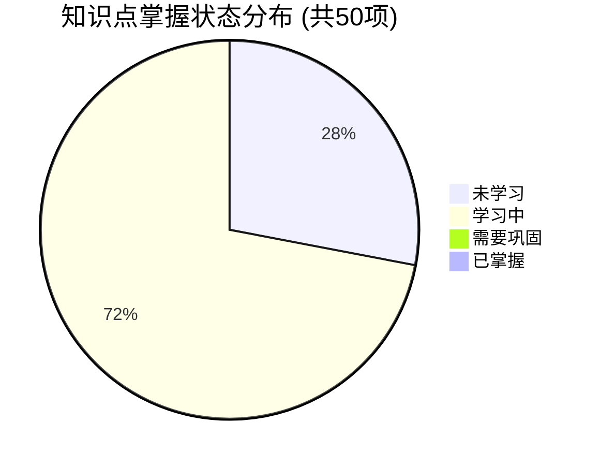
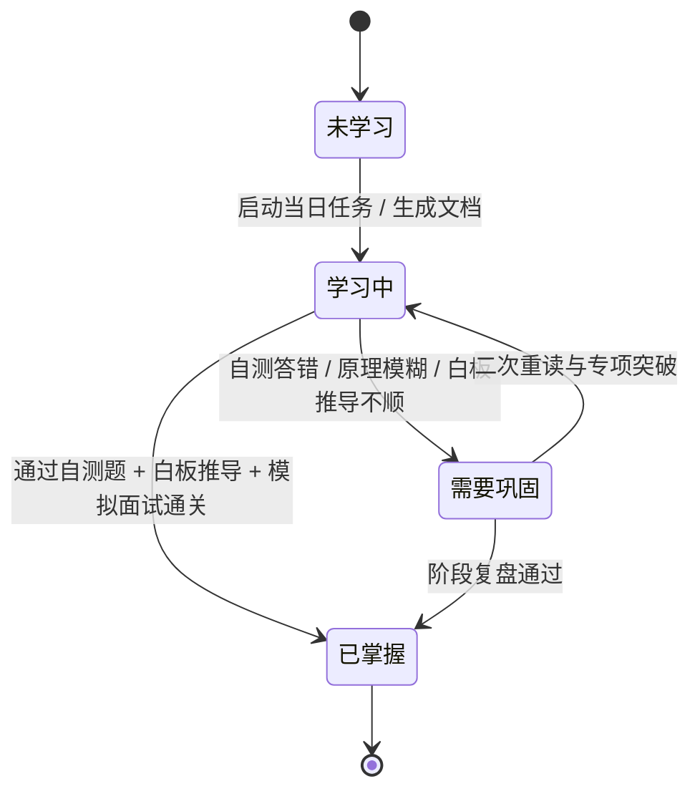

# 学习进度与掌握度追踪看板

> **更新时间**：2026-11-17  
> **当前状态**：第六周冲刺进入终极决战！Day 40 【核心项目复盘 1】瑞纳智能数据中台从0到1全面深度复盘与太原验收攻坚（STAR-L框架全景展开）已完成，系统提炼 10 万点位高并发时序流处理 RocksDB 状态暴涨调优、软硬件交叉推诿定责、CCB 范围蔓延转化为 300 万增补合同、专家评审答辩与中台产品化资产沉淀，涵盖 6 大高管深度追问三层全解；准备进入 Day 41 【核心项目复盘 2】思科/美的/Zoom 技术攻坚与多维交叉互证  
> **进度准则**：严禁无凭据直接标记为“已掌握”。所有状态转换必须基于真实复习、答题与考核记录。

---

## 一、全局进度总览

| 模块编码 | 知识模块名称 | 总知识点数 | 未学习 | 学习中 | 需要巩固 | 已掌握 | 掌握率 |
| :---: | :--- | :---: | :---: | :---: | :---: | :---: | :---: |
| **00** | 基础概念与学习方法 | 3 | 3 | 0 | 0 | 0 | 0% |
| **01** | 大数据核心技术 | 12 | 0 | 12 | 0 | 0 | 0% |
| **02** | 数据中台与架构设计 | 6 | 0 | 6 | 0 | 0 | 0% |
| **03** | Java与软件工程 | 8 | 1 | 7 | 0 | 0 | 0% |
| **04** | 研发团队管理 | 6 | 2 | 4 | 0 | 0 | 0% |
| **05** | 项目管理与交付 | 5 | 3 | 2 | 0 | 0 | 0% |
| **06** | AI Agent与AI辅助研发 | 6 | 2 | 4 | 0 | 0 | 0% |
| **07** | 真实项目复盘与面试 | 4 | 3 | 1 | 0 | 0 | 0% |
| **合计** | **全体系知识点** | **50** | **14** | **36** | **0** | **0** | **0%** |

---

## 二、42天学习执行追踪流水

- [ ] **Day 01**：Flink 运行架构与资源管理 `[学习中]`（已生成标准深度学习文档）
- [ ] **Day 02**：Flink 状态管理与 Checkpoint `[学习中]`（已生成标准深度学习文档）
- [ ] **Day 03**：Flink 反压机制与窗口时间语义 `[学习中]`（已生成标准深度学习文档）
- [ ] **Day 04**：Kafka 底层架构与高吞吐核心 `[学习中]`（已生成标准深度学习文档）
- [ ] **Day 05**：Kafka 高可用容灾与幂等/事务 `[学习中]`（已生成标准深度学习文档）
- [ ] **Day 06**：Spark 内核架构与 Shuffle 机制 `[学习中]`（已生成标准深度学习文档）
- [ ] **Day 07**：【阶段复盘 1】计算传输综合实操 `[学习中]`（已生成第一周综合复盘与架构答辩文档）
- [ ] **Day 08**：HDFS 底层机制与高可用架构 `[学习中]`（已生成标准深度学习文档）
- [ ] **Day 09**：HBase 存储架构与 LSM-Tree `[学习中]`（已生成标准深度学习文档）
- [ ] **Day 10**：Hive 数仓分层与计算引擎优化 `[学习中]`（已生成标准深度学习文档）
- [ ] **Day 11**：Apache Doris 实时 OLAP 架构 `[学习中]`（已生成标准深度学习文档）
- [ ] **Day 12**：Apache Iceberg 架构与数据湖存储内核 `[学习中]`（已生成标准深度学习文档）
- [ ] **Day 13**：Apache Paimon 与 Apache Hudi 实时流式湖仓架构 `[学习中]`（已生成标准深度学习文档）
- [ ] **Day 14**：【阶段复盘 2】大数据存储与查询综合演练 `[学习中]`（已生成第二周综合复盘与架构答辩文档）
- [ ] **Day 15**：数据中台顶层设计与产品化路线 `[学习中]`（已生成标准深度学习文档）
- [ ] **Day 16**：数据治理体系与元数据管理 `[学习中]`（已生成标准深度学习文档）
- [ ] **Day 17**：数据质量与端到端数据血缘 `[学习中]`（已生成标准深度学习文档）
- [ ] **Day 18**：任务调度系统与大数据组件管理 `[学习中]`（已生成标准深度学习文档）
- [ ] **Day 19**：数据服务API与多租户权限体系 `[学习中]`（已生成标准深度学习文档）
- [ ] **Day 20**：大数据平台可观测性与容灾高可用 `[学习中]`（已生成标准深度学习文档）
- [ ] **Day 21**：【阶段复盘 3】数据中台端到端架构答辩 `[学习中]`（已生成第三周综合复盘与架构答辩文档）
- [ ] **Day 22**：JVM 内存模型与垃圾回收调优 `[学习中]`（已生成标准深度学习文档）
- [ ] **Day 23**：Java 并发编程与 JUC 核心机制 `[学习中]`（已生成标准深度学习文档）
- [ ] **Day 24**：数据库底层与 PostgreSQL/MySQL 事务 `[学习中]`（已生成标准深度学习文档）
- [ ] **Day 25**：Redis 高性能架构与分布式缓存 `[学习中]`（已生成标准深度学习文档）
- [ ] **Day 26**：分布式理论与微服务架构工程 `[学习中]`（已生成标准深度学习文档）
- [ ] **Day 27**：软件工程质量体系与 CI/CD 落地 `[学习中]`（已生成标准深度学习文档）
- [ ] **Day 28**：【阶段复盘 4】分布式基础与故障演练 `[学习中]`（已生成第四周综合复盘与架构答辩文档）
- [ ] **Day 29**：研发团队组建、招聘与人才梯队 `[学习中]`（已生成标准管理实践文档）
- [ ] **Day 30**：研发计划拆解、方案评审与 Code Review `[学习中]`（已生成标准管理实践文档）
- [ ] **Day 31**：研发效能度量与技术债务治理 `[学习中]`（已生成标准管理实践文档）
- [ ] **Day 32**：团队冲突化解、低绩效沟通与向上管理 `[学习中]`（已生成标准管理实践文档）
- [ ] **Day 33**：大型项目需求基线与变更控制（太原案例） `[学习中]`（已生成标准管理实践文档）
- [ ] **Day 34**：供应商管理、客户验收攻坚与项目复盘 `[学习中]`（已生成标准项目管理与交付实践文档）
- [ ] **Day 35**：【阶段复盘 5】技术管理与项目总监实战模拟 `[学习中]`（已生成第五周综合复盘与总监答辩文档）
- [ ] **Day 36**：LLM 底层原理与 Agent 核心运行机制 `[学习中]`（已生成标准深度技术文档）
- [ ] **Day 37**：Skills 设计与 MCP 协议标准体系 `[学习中]`（已生成标准深度技术文档）
- [ ] **Day 38**：RAG 架构设计与向量检索实战 `[学习中]`（已生成标准深度技术文档）
- [ ] **Day 39**：AI 辅助研发工作流与工程实践 `[学习中]`（已生成标准深度技术文档）
- [ ] **Day 40**：【核心项目复盘 1】瑞纳数据中台与太原验收 `[学习中]`（已生成王牌主打项目全景复盘与答辩文档）
- [ ] **Day 41**：【核心项目复盘 2】思科/美的/Zoom 技术攻坚 `[未学习]`
- [ ] **Day 42**：【终极模拟面试】综合实战演练与复盘冲刺 `[未学习]`

---

## 三、薄弱知识清单（需重点攻坚）

> 在学习、自测、错题记录中发现掌握不透彻、面试回答卡壳或原理细节模糊的点，自动汇聚于此。每周复盘日优先清空此列表。

| 知识点编号 | 知识点主题 | 首次暴露时间 | 主要薄弱表现与卡壳细节 | 攻坚计划与跟进状态 |
| :--- | :--- | :--- | :--- | :--- |
| *(当前暂无，待学习开启后动态录入)* | - | - | - | - |

---

## 四、已掌握知识清单（可直接实战应答）

> 必须通过自检清单 100% 盲测、白板手画架构图无卡顿，且能在 1 分钟、深入和架构师三个维度流畅口述的知识点方可移入此表。

| 知识点编号 | 知识点主题 | 达标日期 | 考核方式 (自测/模拟面试/白板) | 关键亮点总结 |
| :--- | :--- | :--- | :--- | :--- |
| *(待学习与考核通过后登记录入)* | - | - | - | - |

---

## 五、状态流转准则

