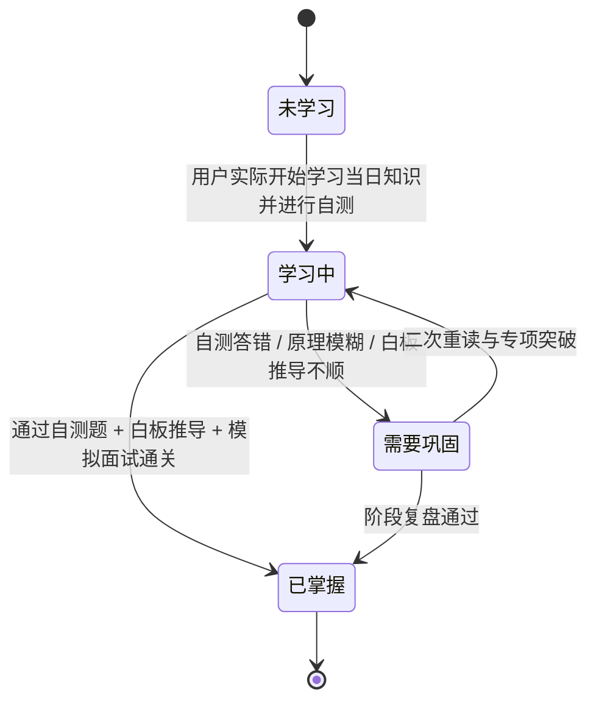

# 学习进度与掌握度追踪看板 (PROGRESS.md)

> **更新时间**　2026-11-24
>
> **当前状态**　[分类面试题库](08-interview-questions/README.md)现有 12 篇，每篇 6 题，合计 72 题。本轮新增 SQL 与建模、数据库、分布式正确性三篇 18 题，均为“未学习”。六道 SQL 已在 SQLite 执行并核对结果，数据库并发与分布式故障部分为待实机验证的推演。此次资料准备未记录学员用时与答题结果，历史记录保留。
>
> **工程验证**　用构造的订单输入复验 Flink 水位线、双流超时和 Paimon 快照，用 H2 的已提交行复验 Spring 事务代理。补充验证支付先到后更新的路径，确认孤儿支付侧流保留最新金额和更新后的截止时刻。运行入口见[示例索引](code-demos/README.md)。
>
> **双角色资料**　完成八轮模拟对话与评分标准，修订项目答辩中的未确认履历表述；SQL 两种截止时间均经执行验证。学习与自测状态待真实口述后更新。
>
> **进度准则**：
> 1. 严格区分**“知识文档编写状态（doc_status）”**与**“用户实际学习状态（learning_status）”**；
> 2. 严禁因文档生成就自动标记为“学习中”或“已掌握”；
> 3. 所有状态流转必须基于学员真实的日常学习打卡、白板演练与面试自测记录。

---

## 一、全局进度总览

按带有学习状态的 Markdown 文档统计，每篇计一次。单道错题的复测结果单列在[错题本](09-review/wrong-questions.md)。

| 模块 | 文档数 | 编写完成 | 未学习 | 学习中 | 需要巩固 | 已掌握 |
| --- | ---: | ---: | ---: | ---: | ---: | ---: |
| 00 基础概念与学习方法 | 1 | 1 | 0 | 1 | 0 | 0 |
| 01 大数据核心技术 | 12 | 12 | 0 | 12 | 0 | 0 |
| 02 数据中台与架构设计 | 6 | 6 | 0 | 6 | 0 | 0 |
| 03 Java 与软件工程 | 6 | 6 | 0 | 6 | 0 | 0 |
| 04 研发团队管理 | 4 | 4 | 0 | 4 | 0 | 0 |
| 05 项目管理与交付 | 2 | 2 | 0 | 2 | 0 | 0 |
| 06 AI Agent 与 AI 辅助研发 | 5 | 5 | 0 | 5 | 0 | 0 |
| 07 项目复盘与面试 | 4 | 4 | 0 | 4 | 0 | 0 |
| 08 技术面试与基础补强 | 12 | 12 | 12 | 0 | 0 | 0 |
| 09 阶段复盘与错题记录 | 8 | 8 | 2 | 6 | 0 | 0 |
| 10 AI 数据架构与非结构化数据工程 | 9 | 9 | 0 | 9 | 0 | 0 |
| **合计** | 69 | 69 | 14 | 55 | 0 | 0 |

文档编写完成率为 100%（69/69），整篇达到“已掌握”的比例为 0%（0/69）。

---

## 二、42天学习执行追踪流水

- [ ] **Day 01**：Flink 运行架构与资源管理 `[学习中]`（2026-11-19 开启首轮系统复盘、口述演练与速记卡学习）
- [ ] **Day 02**：Flink 状态管理与 Checkpoint `[学习中]`（2026-11-19 开启首轮系统复盘、口述演练与速记卡学习）
- [ ] **Day 03**：Flink 反压机制与窗口时间语义 `[学习中]`（2026-11-19 开启首轮系统复盘、口述演练与速记卡学习）
- [ ] **Day 04**：Kafka 底层架构与高吞吐核心 `[学习中]`（2026-11-19 开启首轮系统复盘、口述演练与速记卡学习）
- [ ] **Day 05**：Kafka 高可用容灾与幂等/事务 `[学习中]`（2026-11-19 开启首轮系统复盘、口述演练与速记卡学习）
- [ ] **Day 06**：Spark 内核架构与 Shuffle 机制 `[学习中]`（2026-11-19 开启首轮系统复盘、口述演练与速记卡学习）
- [ ] **Day 07**：【阶段复盘 1】计算传输综合实操 `[学习中]`（2026-11-19 开启首轮系统复盘、口述演练与速记卡学习）
- [ ] **Day 08**：HDFS 底层机制与高可用架构 `[学习中]`（2026-11-19 开启首轮系统复盘、口述演练与速记卡学习）
- [ ] **Day 09**：HBase 存储架构与 LSM-Tree `[学习中]`（2026-11-19 开启首轮系统复盘、口述演练与速记卡学习）
- [ ] **Day 10**：Hive 数仓分层与计算引擎优化 `[学习中]`（2026-11-19 开启首轮系统复盘、口述演练与速记卡学习）
- [ ] **Day 11**：Apache Doris 实时 OLAP 架构 `[学习中]`（2026-11-19 开启首轮系统复盘、口述演练与速记卡学习）
- [ ] **Day 12**：Apache Iceberg 架构与数据湖存储内核 `[学习中]`（2026-11-19 开启首轮系统复盘、口述演练与速记卡学习）
- [ ] **Day 13**：Apache Paimon 与 Apache Hudi 实时流式湖仓架构 `[学习中]`（2026-11-19 开启首轮系统复盘、口述演练与速记卡学习）
- [ ] **Day 14**：【阶段复盘 2】大数据存储与查询综合演练 `[学习中]`（2026-11-19 开启首轮系统复盘、口述演练与速记卡学习）
- [ ] **Day 15**：数据中台顶层设计与产品化路线 `[学习中]`（2026-11-19 开启首轮系统复盘、口述演练与速记卡学习）
- [ ] **Day 16**：数据治理体系与元数据管理 `[学习中]`（2026-11-19 开启首轮系统复盘、口述演练与速记卡学习）
- [ ] **Day 17**：数据质量与端到端数据血缘 `[学习中]`（2026-11-19 开启首轮系统复盘、口述演练与速记卡学习）
- [ ] **Day 18**：任务调度系统与大数据组件管理 `[学习中]`（2026-11-19 开启首轮系统复盘、口述演练与速记卡学习）
- [ ] **Day 19**：数据服务API与多租户权限体系 `[学习中]`（2026-11-19 开启首轮系统复盘、口述演练与速记卡学习）
- [ ] **Day 20**：大数据平台可观测性与容灾高可用 `[学习中]`（2026-11-19 开启首轮系统复盘、口述演练与速记卡学习）
- [ ] **Day 21**：【阶段复盘 3】数据中台端到端架构答辩 `[学习中]`（2026-11-19 开启首轮系统复盘、口述演练与速记卡学习）
- [ ] **Day 22**：JVM 内存模型与垃圾回收调优 `[学习中]`（2026-11-19 开启首轮系统复盘、口述演练与速记卡学习）
- [ ] **Day 23**：Java 并发编程与 JUC 核心机制 `[学习中]`（2026-11-19 开启首轮系统复盘、口述演练与速记卡学习）
- [ ] **Day 24**：数据库底层与 PostgreSQL/MySQL 事务 `[学习中]`（2026-11-19 开启首轮系统复盘、口述演练与速记卡学习）
- [ ] **Day 25**：Redis 高性能架构与分布式缓存 `[学习中]`（2026-11-19 开启首轮系统复盘、口述演练与速记卡学习）
- [ ] **Day 26**：分布式理论与微服务架构工程 `[学习中]`（2026-11-19 开启首轮系统复盘、口述演练与速记卡学习）
- [ ] **Day 27**：软件工程质量体系与 CI/CD 落地 `[学习中]`（2026-11-19 开启首轮系统复盘、口述演练与速记卡学习）
- [ ] **Day 28**：【阶段复盘 4】分布式基础与故障演练 `[学习中]`（2026-11-19 开启首轮系统复盘、口述演练与速记卡学习）
- [ ] **Day 29**：研发团队组建、招聘与人才梯队 `[学习中]`（2026-11-19 开启首轮系统复盘、口述演练与速记卡学习）
- [ ] **Day 30**：研发计划拆解、方案评审与 Code Review `[学习中]`（2026-11-19 开启首轮系统复盘、口述演练与速记卡学习）
- [ ] **Day 31**：研发效能度量与技术债务治理 `[学习中]`（2026-11-19 开启首轮系统复盘、口述演练与速记卡学习）
- [ ] **Day 32**：团队冲突化解、低绩效沟通与向上管理 `[学习中]`（2026-11-19 开启首轮系统复盘、口述演练与速记卡学习）
- [ ] **Day 33**：大型项目需求基线与变更控制（太原案例） `[学习中]`（2026-11-19 开启首轮系统复盘、口述演练与速记卡学习）
- [ ] **Day 34**：供应商管理、客户验收攻坚与项目复盘 `[学习中]`（2026-11-19 开启首轮系统复盘、口述演练与速记卡学习）
- [ ] **Day 35**：【阶段复盘 5】技术管理与项目总监实战模拟 `[学习中]`（2026-11-19 开启首轮系统复盘、口述演练与速记卡学习）
- [ ] **Day 36**：LLM 底层原理、Agent 核心运行机制与线上生产部署架构 `[学习中]`（2026-11-19 开启首轮系统复盘、口述演练与速记卡学习，含 `05-production-agent-architecture.md`）
- [ ] **Day 37**：Skills 设计与 MCP 协议标准体系 `[学习中]`（2026-11-19 开启首轮系统复盘、口述演练与速记卡学习）
- [ ] **Day 38**：RAG 架构设计与向量检索实战 `[学习中]`（2026-11-19 开启首轮系统复盘、口述演练与速记卡学习）
- [ ] **Day 39**：AI 辅助研发工作流与工程实践 `[学习中]`（2026-11-19 开启首轮系统复盘、口述演练与速记卡学习）
- [ ] **Day 40**：【核心项目复盘 1】瑞纳数据中台与太原验收 `[学习中]`（2026-11-19 开启首轮系统复盘、口述演练与速记卡学习）
- [ ] **Day 41**：【核心项目复盘 2】思科/美的/Zoom 技术攻坚 `[学习中]`（2026-11-19 开启首轮系统复盘、口述演练与速记卡学习）
- [ ] **Day 42**：【终极模拟面试】综合实战演练与复盘冲刺 `[学习中]`（2026-11-19 开启首轮系统复盘、口述演练与速记卡学习）

### 拓展专项：AI 数据架构与非结构化数据工程（Day 43 - Day 51）
- [ ] **Day 43**：非结构化数据解析（PDF/Word/HTML/OCR/版面/表格） `[学习中]`（2026-11-18 开启首轮学习与模拟抽考）
- [ ] **Day 44**：文档切分与元数据建模（Chunking/版本/权限） `[学习中]`（2026-11-18 开启首轮理论精讲与速记卡学习）
- [ ] **Day 45**：Embedding 与向量索引（HNSW/IVF/量化/选型） `[学习中]`（2026-11-18 开启首轮理论精讲与速记卡学习）
- [ ] **Day 46**：混合检索与重排序（BM25/RRF/Rerank/过滤） `[学习中]`（2026-11-18 开启首轮理论精讲与速记卡学习）
- [ ] **Day 47**：企业级 RAG 架构设计（权限/多租户/高可用/成本） `[学习中]`（2026-11-18 开启首轮理论精讲与速记卡学习）
- [ ] **Day 48**：RAG 质量评估（检索/生成/业务三层指标与黄金集） `[学习中]`（2026-11-18 开启首轮理论精讲与速记卡学习）
- [ ] **Day 49**：数据质量与模型反馈闭环（幻觉归因/反馈/热修复） `[学习中]`（2026-11-19 开启首轮理论精讲与速记卡学习）
- [ ] **Day 50**：知识库长期演进（连接器/增量Diff/模型迁移/三年演进） `[学习中]`（2026-11-19 开启首轮理论精讲与速记卡学习）
- [ ] **Day 51**：【AI 数据架构综合实战】1万文档项目与 15 题答辩 `[学习中]`（2026-11-19 开启首轮理论精讲与速记卡学习）

---

## 三、薄弱知识清单（需重点攻坚）

> 在学习、自测、错题记录中发现掌握不透彻、面试回答卡壳或原理细节模糊的点，自动汇聚于此。每周复盘日优先清空此列表。

| 知识点编号 | 知识点主题 | 首次暴露时间 | 主要薄弱表现与卡壳细节 | 攻坚计划与跟进状态 |
| :--- | :--- | :--- | :--- | :--- |
| 详见[薄弱知识跟踪](09-review/weakness-tracking.md)，本轮未新增自测记录。 | - | - | - | - |

---

## 四、已掌握知识清单（可直接实战应答）

> 必须通过自检清单 100% 盲测、白板手画架构图无卡顿，且能在简洁破题、深入推导和架构师管理视角三个维度流畅口述的知识点方可移入此表。

| 知识点编号 | 知识点主题 | 达标日期 | 考核方式 (自测/模拟面试/白板) | 关键亮点总结 |
| :--- | :--- | :--- | :--- | :--- |
| 暂无整篇通过记录，单题复测见[错题本](09-review/wrong-questions.md)。 | - | - | - | - |

---

## 五、状态流转准则

