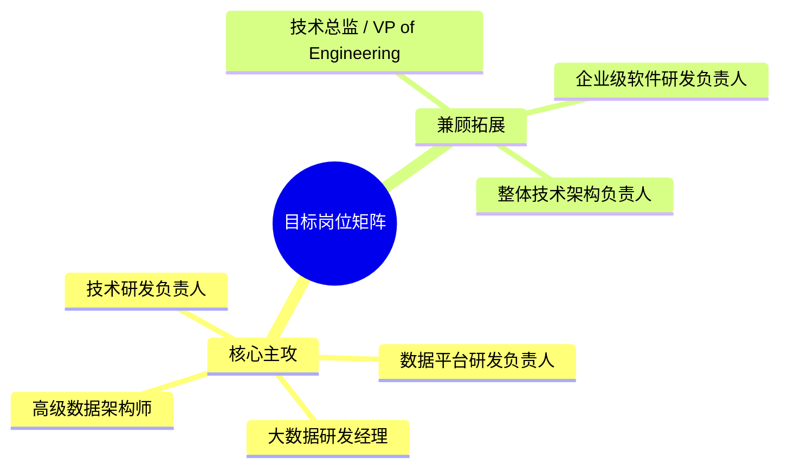

# 技术管理岗位面试知识库 (Tech Management Interview Knowledge Base)

> **专为资深研发工程师向技术管理/技术总监/大数据架构负责人转型量身定制的知识重构与面试冲刺知识库。**

---

## 一、项目背景与学习者画像

- **从业经验**：约 **14 年** 软件研发、大数据平台架构与技术管理经验。
- **履历沉淀**：
  - **早期研发 (2012-2016)**：Java业务系统、大数据底层平台（Hadoop、HBase、Storm、Kafka、Solr）。
  - **架构深耕 (2016-2021)**：美的集团大数据架构师、思科中国（合肥）高级工程师（Flink、Spark、HBase、Doris、Iceberg、数据治理、实时离线平台）。
  - **平台中枢 (2021.04-2021.11)**：Zoom 高级工程师（大规模日志数据平台、分布式链路追踪）。
  - **部门统领与产品落地 (2022.01-2026.08)**：瑞纳智能大数据部门负责人（管理 5~10 人研发团队，从0到1主导企业级数据中台产品化研发，具备独立 Web 界面；作为太原数据中台项目总体负责人，完成全流程需求、研发、供应商协调与正式验收交付）。
- **当前核心诉求**：
  - 过去重心在管理与交付，部分底层原理、源码与细节记忆模糊（如 Flink Checkpoint 内部流转、Kafka 底层 I/O、Shuffle 机制等）。
  - 需要将技术选型、架构权衡、研发效能管理与交付实战转化为结构化、高辨识度的面试表达。
  - 系统整合 AI Agent、Skills、MCP、RAG 等前沿生产力工具体系，打造差异化技术领导力。

---

## 二、目标岗位定位



---

## 三、知识体系与目录导航

本知识库采用模块化、轻量级 Markdown 结构构建，支持 Git 版本追踪与 AI Agent 协同更新：

```text
tech-interview-knowledge-base/
├── README.md               # 项目说明、画像分析与全局导航入口
├── PLAN.md                 # 42天全周期学习冲刺计划（每天90分钟规划）
├── PROGRESS.md             # 当前学习进度看板、状态机流转与掌握度清单
├── AGENTS.md               # AI Agent (Codex/Antigravity) 协同工作准则与质量红线
├── 00-foundations/         # 基础概念、学习方法论与面试表达心法
├── 01-bigdata/             # 模块01：大数据核心技术 (Flink/Kafka/Spark/Hadoop/Doris等)
├── 02-data-platform/       # 模块02：数据中台、数据治理、元数据、调度与架构设计
├── 03-java-engineering/    # 模块03：Java底层、JVM、并发编程、PostgreSQL/Redis与系统架构
├── 04-tech-management/     # 模块04：研发团队管理、团队招聘、绩效激励、效能与技术债务
├── 05-project-management/  # 模块05：项目管理与交付、需求控制、客户沟通、太原验收实战
├── 06-ai-agent/            # 模块06：AI Agent、LLM原理、Skills、MCP、RAG架构与AI工程化
├── 07-project-review/      # 模块07：真实项目复盘 (瑞纳中台从0到1、太原交付、思科/美的/Zoom)
├── 08-interview-questions/ # 分类面试题库 (基础/原理/场景/系统设计/管理行为题)
├── 09-review/              # 错题记录、阶段复习自测与薄弱知识攻坚
├── templates/              # 统一文档模板 (技术文档/管理文档/项目复盘模板)
└── scripts/                # 自动化检查脚本 (完整性校验、元数据检查、断链检测)
```

---

## 四、文档编写标准与三层应答法则

每个技术知识点均严格按照面向技术总监与架构师的 **12 项高阶标准规范** 编写：
1. **知识概述与业务价值**（痛点、核心价值与技术边界）
2. **核心概念与关系**（术语表、概念拓扑、系统全景图）
3. **底层工作机制与设计哲学**（协议时序、状态流转、演进思想，对齐最新主流标准如 Flink 1.19+/2.0、Kafka 3.6+ 等）
4. **高频复杂业务场景实操与落地**（大促拓扑、生产参数基线、SLA黄金指标）
5. **生产异常故障深度排查与根因分析**（故障排查树、真实大促事故复盘）
6. **技术选型对比、架构演进与成本ROI**（多维矩阵、决策树、硬件与运维成本）
7. **技术经理与架构师实战管控（SOP与规范）**（多租户SLA隔离、变更红线、防雪崩降级预案）
8. **互联网大厂高频面试真题库**（精选阿里、字节、美团、快手等一线大厂 6~8 道核心真题）
9. **结构化深度参考答案（逐题三层应答）**（**所有真题逐题全解，严禁留白或只给部分示例**）
10. **知识自检与口述推演清单**（脱稿白板推演）
11. **知识脉络与技术图谱关联**（前后依赖与中台集成）
12. **权威参考与官方进阶资料**（最新官方文档与架构提案）

### 三层深度面试应答法
在面试表达中，针对第 8 板块的所有互联网大厂核心真题，在第 9 板块中**逐题提供完整解题答案**：
- **简洁回答（1分钟电梯破题）**：直奔核心，提炼本质原因与量化结论，适配电梯沟通与初步破题。
- **深入回答（机制推导与边界条件）**：深入协议交互、状态机流转与底层设计哲学，体现过硬技术深度。
- **架构师/总监视角（降维升华）**：从技术取舍、成本ROI、高可用防雪崩、多租户SLA与工程规范落地角度展现高管大局观。

---

## 五、42天学习法与时间管理

每日固定投入 **90分钟**，严守时间切片：
- **30分钟**：核心知识点与原理梳理
- **20分钟**：底层实现机制与源码细节探究
- **20分钟**：真实生产场景与架构取舍推演
- **15分钟**：面试题自测与口述训练（大声口述作答）
- **5分钟**：复盘总结、更新 `PROGRESS.md` 与错题入库

每 7 天安排一次阶段复盘与综合白板实战，确保知识内化。

---

## 六、质量检查与自动化辅助

本项目配套自动化质检工具，用于保障知识库规范性与严谨性：
```bash
# 运行知识库完整性与元数据校验
python3 scripts/verify_knowledge_base.py
```

---

## 七、快速开始

1. 阅读 [AGENTS.md](file:///Users/wanna/tk/tech-interview-knowledge-base/AGENTS.md) 了解协同规约。
2. 查看 [PLAN.md](file:///Users/wanna/tk/tech-interview-knowledge-base/PLAN.md) 确认当日学习目标。
3. 打开对应知识点文档（如第一天：[01-flink-runtime-architecture.md](file:///Users/wanna/tk/tech-interview-knowledge-base/01-bigdata/01-flink/01-flink-runtime-architecture.md)）进入深度学习。
4. 学习后在 [PROGRESS.md](file:///Users/wanna/tk/tech-interview-knowledge-base/PROGRESS.md) 中更新学习状态，错题写入 [wrong-questions.md](file:///Users/wanna/tk/tech-interview-knowledge-base/09-review/wrong-questions.md)。
