# Flink 流计算实战工程

用 Flink 1.20.1 和 Java 17 演练数据接入、事件时间、状态和输出。内置数据由生成器产生，两个自定义 Sink 以日志展示回调。YARN 提交脚本用于已有集群。

---

## 一、全景架构：Source 端 -> 计算端 -> Sink 端 全生命周期版图

```mermaid
flowchart LR
    subgraph S["【Source 端】接入与切片发现"]
        S1["FLIP-27 架构<br>(DataGeneratorSource / SplitEnumerator)"]
        S2["Watermark 生成策略<br>(乱序容忍 / 单调递增 / 标点式)"]
        S3["防流卡死机制<br>(withIdleness 空闲检测)"]
        S4["物理传输分区器<br>(keyBy / rebalance / rescale / partitionCustom)"]
    end

    subgraph C["【计算端】流计算与状态时序核心"]
        C1["多流协同计算<br>(connect / union / 广播规则流)"]
        C2["状态体系与治理<br>(Value/List/Map/ReducingState + TTL)"]
        C3["时间与定时器<br>(TimerService 最小堆去重 / 超时下发)"]
        C4["高阶窗口引擎<br>(增量聚合 + 自定义 Trigger + Evictor)"]
        C5["异步 I/O 维表关联<br>(unorderedWait + Caffeine 本地缓存防击穿)"]
        C6["复杂事件处理 CEP<br>(NFA 状态机 + 模式超时捕获)"]
        C7["极端倾斜治理<br>(流式两阶段加盐打散 Salting)"]
        C8["多级侧输出流<br>(OutputTag 异常兜底 / 分流清洗)"]
    end

    subgraph K["【Sink 端】输出与端到端一致性"]
        K1["现代 SinkV2 架构<br>(SinkWriter + Committer 解耦)"]
        K2["端到端 Exactly-Once<br>(两阶段提交 2PC 状态机)"]
        K3["幂等写入与 At-Least-Once<br>(主键去重 / 状态覆盖)"]
        K4["微批缓冲与优雅排空<br>(Batching + Flush on Close)"]
        K5["死信队列与容错重试<br>(DLQ + 指数退避)"]
    end

    S --> C --> K
```



---

## 二、源码工程目录结构与全量覆盖矩阵

```text
flink-yarn-demo/
├── pom.xml                                      # 模块构建配置 (Java 17, Flink 1.20.1, flink-cep)
├── bin/                                         # YARN 集群运维与提交脚本
│   ├── submit-yarn-application.sh               # [推荐] YARN Application 模式一键提交脚本
│   ├── submit-yarn-session.sh                   # YARN Session 模式交互调试提交脚本
│   └── stop-yarn-job.sh                         # 触发 Savepoint 优雅停机脚本
├── src/
│   ├── main/java/com/tech/interview/flink/
│   │   ├── DualStreamReconciliationJob.java     # [旗舰] 双流对账、Watermark 协同与 EventTime 定时器
│   │   ├── OrderRiskStreamingJob.java           # 滚动窗口增量聚合 (Aggregate+ProcessWindowFunction)
│   │   │
│   │   ├── source/                              # 【Source 端核心实现】
│   │   │   ├── CustomPunctuatedWatermarkJob.java# 标点符号式 (VIP立即触发) vs 周期性 Watermark 对比
│   │   │   └── StreamPartitioningDemoJob.java   # 7 种物理分区策略对照 (rebalance/rescale/partitionCustom)
│   │   │
│   │   ├── compute/                             # 【计算端核心实现】
│   │   │   ├── broadcast/                       # 广播状态模式 (Broadcast State Pattern)
│   │   │   │   ├── DynamicBroadcastRuleJob.java # 动态风控规则热加载 (KeyedBroadcastProcessFunction)
│   │   │   │   └── RuleModel.java               # 规则定义模型 (增删改热生效)
│   │   │   ├── async/                           # 异步 I/O 维表关联
│   │   │   │   ├── AsyncEnrichmentStreamJob.java# unorderedWait + CompletableFuture 异步 RPC 补全
│   │   │   │   ├── LocalTtlCache.java           # 堆内高并发 LRU + TTL 本地缓存防击穿
│   │   │   │   └── EnrichedOrderEvent.java      # 补全后宽表模型
│   │   │   ├── cep/                             # 复杂事件处理 (Flink CEP)
│   │   │   │   ├── FraudDetectionCepJob.java    # NFA 状态机 (3次登录失败+敏感操作) + 超时匹配捕获
│   │   │   │   └── UserLoginEvent.java          # 安全登录事件模型
│   │   │   ├── window/                          # 高级窗口机制与触发器
│   │   │   │   └── AdvancedWindowTriggerJob.java# 自定义提前触发器 (FIRE/FIRE_AND_PURGE) 与会话窗口
│   │   │   ├── state/                           # 状态原语与算子状态深度实践
│   │   │   │   └── StatePrimitivesDeepDiveJob.java# MapState点查点写 vs ListState vs Operator UnionListState
│   │   │   └── skew/                            # 极端数据倾斜治理
│   │   │       └── TwoStageSaltingJob.java      # 大促热点两阶段加盐打散与全局汇总
│   │   │
│   │   ├── sink/                                # 【Sink 端核心实现】
│   │   │   ├── ExactlyOnceSinkV2Job.java        # SinkV2 凭据生成与提交回调演练
│   │   │   └── IdempotentBatchingSinkJob.java   # SinkV2 批内按键去重与定时输出
│   │   │
│   │   ├── metrics/                             # 【横向切面监控】
│   │   │   └── CustomMetricsJob.java            # Counter/Gauge/MeterView 指标度量与反压公式剖析
│   │   │
│   │   ├── model/                               # 核心实体模型 (OrderEvent, PaymentEvent, ReconcileResult 等)
│   │   └── function/                            # 算子实现类 (OrderPaymentCoProcessFunction 等)
│   │
│   └── test/java/com/tech/interview/flink/      # 算子、窗口与凭据序列化测试
│       ├── DualStreamReconciliationJobTest.java # 双流对账测试
│       ├── OrderRiskStreamingJobTest.java       # 增量风控窗口测试
│       ├── PunctuatedWatermarkTest.java         # 标点式 Watermark 测试
│       ├── LocalTtlCacheTest.java               # 本地 LRU+TTL 缓存测试
│       ├── TwoStageSaltingTest.java             # 两阶段加盐算法测试
│       └── SinkPayloadSerializerTest.java       # SinkV2 2PC 事务凭据序列化测试
└── README.md
```

---

## 三、Source 端、计算端、Sink 端 核心机制与底层哲学

### 1. 【Source 端】Watermark 推进与分区拓扑

- **什么时候关闭窗口？** 示例容忍三秒乱序。若分区见过的最大事件时间为 20,000 毫秒，周期发送与 VIP 触发发送都得到 16,999 毫秒。时间戳为 17,000 的记录仍在容忍范围内。下游取活跃输入的最小水位线，全部活跃输入都跨过窗口末端时才触发默认事件时间窗口。持续空闲的输入可以用 `withIdleness` 标记。[Flink 水位线文档](https://nightlies.apache.org/flink/flink-docs-release-1.20/docs/dev/datastream/event-time/generating_watermarks/)
- **改分区会怎样影响网络？** `rebalance()` 把记录轮询给全部下游子任务，`rescale()` 轮询分配给相应的下游子集，`forward()` 要求相同并行度并一对一转发。子任务实际放在哪台机器、能否组成算子链，决定是否跨网络及序列化开销。若后续按业务键聚合，单一热键仍可能集中在一个子任务。[Flink 物理分区](https://nightlies.apache.org/flink/flink-docs-release-1.20/docs/dev/datastream/operators/overview/#physical-partitioning)

---

### 2. 【计算端】状态治理、时序调度与复杂计算
- **广播状态模式（Broadcast State Pattern）**：
  - 低频控制规则流调用 `.broadcast(MapStateDescriptor)` 转化为广播流；
  - 业务流在 `processElement` 中只读规则，广播侧在 `processBroadcastElement` 中更新各并行实例的本地副本。规则与业务事件的到达顺序可能不同；严格的切换时刻需要在记录中约定规则版本。
- **怎样选择状态结构？** 对同一业务键下的大集合，如果常常只改一个条目，`MapState` 提供逐项访问。在 RocksDB 后端，使用 `ValueState<Map>` 更新整张映射会引入额外序列化。若集合很小且总是整体读写，可直接使用 `ValueState`。扩缩容时，算子列表状态的元素可以重新分摊，union 列表状态则给每个新子任务完整列表。[Flink 状态文档](https://nightlies.apache.org/flink/flink-docs-release-1.20/docs/dev/datastream/fault-tolerance/state/)
- **订单更新后何时超时？** 双流对账示例给每个订单号保留最后到达的单边记录。订单事件时间先为第 1 秒、后为第 5 秒，等待期为 10 秒。第二条记录会撤销第 11 秒的旧定时器，水位线推进到第 15 秒仍无支付才输出超时。支付先到也遵循相同规则，回归测试验证更新后的金额 80 和第 15 秒的超时戳一起进入孤儿支付侧流。业务若要求“首单起算”或按版本拒绝旧订单，需要单独定义规则。[可运行回归用例](src/test/java/com/tech/interview/flink/DualStreamReconciliationJobTest.java)
- **异步 I/O（Async I/O）与本地缓存防击穿**：
  - 杜绝在 `map()` 中使用同步阻塞 RPC；
  - 使用 `AsyncDataStream.unorderedWait()` 时，同一水位区间内已完成的请求可先返回。待完成记录仍会阻碍水位线向下游传递。
  - 算子内嵌 `LocalTtlCache`（堆内高并发 LRU + TTL），防击穿外部 Redis/HBase，配合 `timeout()` 优雅兜底降级；
- **复杂事件处理（Flink CEP）**：
  - 采用非确定有限状态自动机（NFA），利用 `SharedBuffer` 共享状态树避免笛卡尔积状态膨胀；
  - 必须设置 `within(Duration)` 进行状态剪枝，通过 `TimedOutPartialMatchHandler` 捕获超时未达成的部分匹配模式（如连续登录失败但超时未转账）；
- **热点店铺聚合**。按店铺加盐后先做 3 秒事件时间局部求和，再按原店铺进入相同边界的窗口。Flink 把局部结果的时间戳设为窗口末端减 1 毫秒，随后才转发 Watermark。即使第二阶段晚收到，它仍计入原窗口。聚合函数应可合并，示例使用默认零允许迟到。[Flink 连续窗口](https://nightlies.apache.org/flink/flink-docs-release-1.20/docs/dev/datastream/operators/windows/)

---

### 3. Sink V2 的提交与重试

`ExactlyOnceSinkV2Job` 在 Writer 中计算当前批次的条数和金额，`prepareCommit()` 生成可序列化凭据，Committer 打印收到的凭据。练习时解释如何把提交回调接到真实事务系统：持久化待提交的数据，提交失败后按同一事务 ID 重试，并能识别“已经提交但确认丢失”。

`IdempotentBatchingSinkJob` 按订单号在批内保留最后一条记录，积满 50 个不同键或定时器满 1 秒时输出日志。跨批重放需要下游按同一业务键执行幂等写入，旧事件晚到时还需用业务版本阻止其覆盖新值。

### 4. 【横向切面】可观测性与反压公式
- **四大度量类型**：`Counter`（累加计数）、`Gauge`（瞬时队列/内存）、`MeterView`（实时 TPS）、`Histogram`（P99 延迟）；
- **FLIP-33 / FLIP-123 现代反压公式**：
  $$\text{BackPressureRatio} = \frac{\text{backPressuredTimeMsPerSecond}}{1000}$$
  $$\text{BusyRatio} = \frac{\text{busyTimeMsPerSecond}}{1000}$$
  $$\text{IdleRatio} = \frac{\text{idleTimeMsPerSecond}}{1000}$$

---

## 四、YARN 资源管理下的提交与运维

### 1. 生产首选：YARN Application 模式一键提交
```bash
# 提交旗舰双流对账作业
./bin/submit-yarn-application.sh reconcile

# 提交实时风控增量窗口作业
./bin/submit-yarn-application.sh risk
```

### 2. 生产优雅停机与 Savepoint 保存
```bash
./bin/stop-yarn-job.sh application_1688888888888_0001 <flink-job-id>
```

---

## 五、编译与质量验证保障

在本模块目录执行 `mvn clean verify`，验证 Java 编译、打包和回归测试。其中的乱序订单用例同时覆盖局部加盐与全局合并。回到仓库根目录执行 `python3 scripts/verify_knowledge_base.py`，检查知识文档结构、题号对应关系和相对链接。
