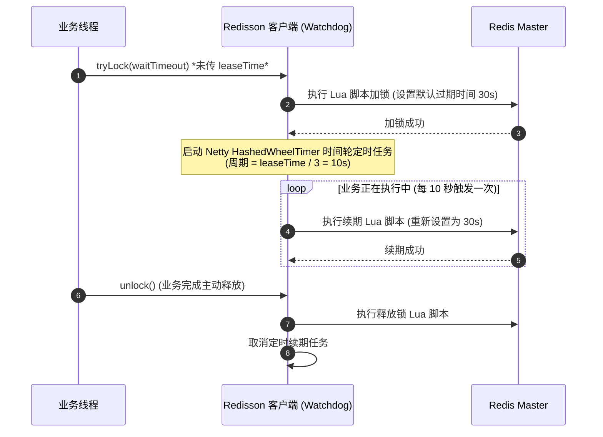

# Java 高并发、动态监控线程池与分布式锁实战工程 (java-distributed-demo)

> 本工程面向 **技术总监 / 数据平台负责人 / 高级后端架构师** 岗位面试中的“Java 核心并发调优”、“高吞吐网关异步编排”与“分布式锁深水区攻防”考察。  
> 结合 **JUC AQS 机制、动态可控线程池、CompletableFuture 异步熔断与 Redisson 看门狗机制**，系统推导底层设计哲学与互联网大厂高频真题。

---

## Spring 事务边界实验

从仓库根目录执行 `mvn -f code-demos/java-distributed-demo/pom.xml -Dtest=SpringTransactionBoundaryTest test`。四个用例使用 Spring 6.2.19 和进程内 H2，比较自调用、代理调用与跨线程调用。先预测订单和审计各留下几行，再核对[六道 Spring 面试题中的结果表](../../08-interview-questions/06-spring.md)。

## 一、业务场景与架构设计

在千亿级实时数据网关与微服务核心账务中，**高并发请求编排与分布式互斥**是系统设计的核心命脉：
1. **异步并行网关**：单笔请求需并发聚合用户画像、实时风控模型与资产账户等多个上游系统。通过 `CompletableFuture` 实现多路并行与超时熔断（`completeOnTimeout`），将端到端延迟从串行累加压缩至最慢单次调用；
2. **生产级监控线程池**：彻底废弃危险的 `Executors` 无界队列工厂，自研支持运行态动态热调整容量、告警追踪慢任务、并记录拒绝指标的有界线程池；
3. **分布式互斥与原子防超卖**：通过 Redisson 看门狗（Watchdog）自动续期，避免长业务执行导致锁提前超时；在高频秒杀路径中引入单线程 Redis Lua 脚本，消灭 Check-Then-Act 竞态风险。

---

## 二、源码工程目录结构

```text
java-distributed-demo/
├── pom.xml                                           # 模块 Maven 依赖 (Redisson 3.28+ / Java 17)
├── src/
│   ├── main/
│   │   └── java/com/tech/interview/distributed/
│   │       ├── pool/
│   │       │   └── MonitoredThreadPoolExecutor.java  # 生产级带监控与热更新能力的线程池
│   │       ├── service/
│   │       │   └── AsyncEnrichmentGatewayService.java# CompletableFuture 多路异步编排与熔断网关
│   │       └── lock/
│   │           └── RedissonDistributedLockService.java # Redisson 看门狗锁与 Lua 原子扣减服务
│   └── test/
│       └── java/com/tech/interview/distributed/
│           └── DistributedConcurrencyTest.java       # 动态调优与异步编排单元测试
└── README.md                                         # 架构机制拆解与大厂真题手册
```

---

## 三、代码核心机制与底层原理深度剖析

### 1. JUC AQS (AbstractQueuedSynchronizer) 底层运行图景

`ReentrantLock`、`CountDownLatch`、`Semaphore` 均构建在 AQS 骨架之上：

```
                    +-----------------------------+
                    |  volatile int state (状态位) |  --> 0: 无锁, 1: 已加锁, >1: 重入次数
                    +-----------------------------+
                                   ▲
                                   | (CAS 竞争修改)
+-----------------------------------------------------------------------------------+
|                        双向链表等待队列 (CLH 变体 FIFO Queue)                      |
|                                                                                   |
|  [Head 虚节点] <---> [Node 1 (Thread A)] <---> [Node 2 (Thread B)] <---> [Tail]   |
|         |                     |                          |                        |
|   (当前持有锁的线程)      (park 阻塞挂起)            (park 阻塞挂起)                |
+-----------------------------------------------------------------------------------+
```

- **加锁逻辑**：调用线程尝试通过 `compareAndSetState(0, 1)` 抢占状态位；若成功则将当前线程记录为排他持有者（`setExclusiveOwnerThread`）；
- **排队与阻塞**：抢占失败则封装为 `Node` 加入 FIFO 尾部，随后调用 `LockSupport.park()` 挂起，交出 CPU 时间片；
- **释放与唤醒**：持有锁的线程执行 `unlock()`，当 `state` 归零后，调用 `LockSupport.unpark(successor)` 唤醒队列头部第一个有效后继节点去竞争锁。

---

### 2. Redisson 看门狗 (Watchdog) 自动续期原理与避坑红线



#### 致命陷阱（面试必考）：
如果在调用时显式指定了 `leaseTime`（例如 `lock.tryLock(10, 30, TimeUnit.SECONDS)`），**Redisson 会彻底绕过并关闭看门狗机制**！此时若业务因数据库慢查询执行了 35 秒，锁在第 30 秒将被 Redis 自动删除，导致其他线程并发进入临界区，引发资金超卖或数据混乱！

---

## 四、高频互联网大厂真题与三层应答示范

### Q1：为什么《阿里 Java 开发手册》强制禁止使用 `Executors.newFixedThreadPool()` 和 `newCachedThreadPool()`？
- **简洁回答**：`newFixedThreadPool` 内部采用了无界阻塞队列 `LinkedBlockingQueue`（容量为 `Integer.MAX_VALUE`），高并发下请求无限堆积直接引发 JVM `OutOfMemoryError`；而 `newCachedThreadPool` 允许的最大线程数为 `Integer.MAX_VALUE`，突发流量会疯狂创建线程，耗尽操作系统线程句柄与内存，引发系统崩溃。
- **深入回答**：线程池的核心参数是 `corePoolSize`、`maximumPoolSize` 与 `workQueue`。`newFixedThreadPool` 默认核心数等于最大数，但任务排队队列无界，导致 `maximumPoolSize` 和拒绝策略完全沦为摆设，任务积压直接撑爆老年代导致频繁 Full GC 直至 OOM；`newCachedThreadPool` 使用同步移交队列 `SynchronousQueue`，只要来任务且当前线程都在忙，就会无节制新建内核线程，导致系统频繁发生上下文切换，耗尽 Linux `/proc/sys/kernel/pid_max`。
- **架构师/管理视角**：在技术团队中必须通过静态代码扫描（SonarQube/ArchUnit）设卡门禁，强制要求必须显式通过 `new ThreadPoolExecutor(...)` 创建线程池，并且必须做到四项规范：① 队列必须是有界的（如 `ArrayBlockingQueue(1000)`）；② 必须显式传入规范命名的 `ThreadFactory` 以便排查堆栈；③ 明确业务容忍度配置合理的拒绝策略（核心链路用带告警的 `CallerRunsPolicy`，非核心用丢弃/降级）；④ 接入平台级动态调参平台（如配置中心 Apollo/Nacos），支持大促期间动态扩缩容量。

### Q2：Redis 分布式锁在主从集群架构下，如果 Master 刚加锁成功尚未同步给 Slave 就宕机了，会导致什么灾难？Redlock 算法真的能完美解决吗？
- **简洁回答**：由于 Redis 主从复制是异步进行的，Master 挂掉后 Slave 晋升为新 Master，但新 Master 丢失了该锁，其他客户端能再次获取锁，导致两台机器同时进入临界区。Redlock 通过多 Master 节点过半投票机制解决单点故障，但在现实中仍无法抵御长时间 GC 停顿或时钟漂移，业界生产更推崇“业务唯一索引/乐观锁版本号”做最终防线。
- **深入回答**：当 Client A 在 Master 写入锁后，数据尚未同步到 Replica，Master 突发宕机被 Sentinel 或 Cluster 故障转移，Replica 成为新的 Master。此时 Client B 尝试加锁成功，违背了互斥性。针对此问题，Antirez 提出了 Redlock（向 N 个独立的 Master 节点并行发锁，超半数成功且在耗时限制内才算成功）。但分布式专家 Martin Kleppmann 指出：在非绝对可靠的分布式环境中，若 Client 发生长达数十秒的 STW GC 暂停，或物理机 NTP 时钟跳变，Redlock 依然会失效。
- **架构师/管理视角**：在金融和强一致核心系统中，不能将一致性 100% 押注在 Redis 分布式锁上。架构设计的黄金法则为**“防御式多层防护”**：
  1. *前置层*：使用 Redisson 配合 Watchdog 进行粗粒度拦截，挡住 99.9% 的并发压力；
  2. *存储底座兜底*：数据库层面强制配置**唯一联合索引（Unique Key）**或基于版本号的 CAS 乐观锁（`UPDATE stock SET num = num - 1, version = version + 1 WHERE id = 1 AND version = old_version AND num >= 1`）；
  3. 即使 Redis 锁发生短暂击穿，存储底座的一致性事务保证绝对不会超卖。
