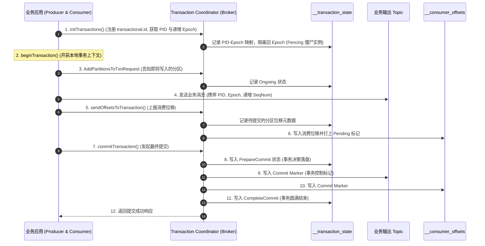

# Kafka 生产级分布式事务与精准一次 (EOS) 管道工程 (kafka-transaction-demo)

> 本工程面向 **数据平台研发负责人 / 大数据架构师** 岗位面试中的“全链路 Exactly-Once 实操”、“跨系统事务一致性”与“Kafka 深度故障排查”考察。  
> 通过一套完整的 **Consume-Transform-Produce（消费-清洗-生产）** 事务闭环，深入推导底层 2PC 协议、事务协调器（Transaction Coordinator）与高频面试真题。

---

## 一、业务场景与架构设计

在金融支付、资产对账与实时特征处理场景中，必须杜绝由于网络重试导致的数据重复，以及消费者 Crash 导致的数据漏处理或双写不一致：
- **上游消费**：从原始交易 Topic 拉取消息，配置 `isolation.level=read_committed`，仅拉取已提交的合法事务；
- **核心转换**：进行严格的防重审计与数据规整；
- **下游生产与位移提交原子绑定**：使用 `producer.sendOffsetsToTransaction(offsets, groupMetadata)`，将**输出 Topic 的消息写入**与**输入 Topic 的位移提交**绑定在同一个两阶段提交（2PC）事务中；
- **重平衡防御**：配置 `CooperativeStickyAssignor`（协作粘性重平衡）与 `SafeRebalanceListener`，杜绝传统 Eager 模式下的全量 Stop-The-World 与脏提交。

---

## 二、源码工程目录结构

```text
kafka-transaction-demo/
├── pom.xml                                   # 模块 Maven 依赖 (Kafka 3.7+ 客户端)
├── src/
│   ├── main/
│   │   └── java/com/tech/interview/kafka/
│   │       ├── KafkaTransactionalApp.java    # 管道服务启动主类 (含优雅停机 Hook)
│   │       ├── model/
│   │       │   └── TransactionRecord.java    # 金融交易明细 POJO 实体
│   │       ├── listener/
│   │       │   └── SafeRebalanceListener.java# 生产级重平衡监听器 (分区撤销拦截)
│   │       └── service/
│   │           └── TransactionalPipelineService.java # 核心 Consume-Transform-Produce 事务实现
│   └── test/
│       └── java/com/tech/interview/kafka/
│           └── TransactionalPipelineTest.java# 核心配置与状态流转单元测试
└── README.md                                 # 架构推导与大厂真题应答手册
```

---

## 三、代码核心机制与底层原理深度剖析

### 1. Kafka 端到端 Exactly-Once (EOS) 2PC 完整时序流转



### 2. 核心底层机制要点（面试答题杀手锏）：
- **僵尸实例隔离（Zombie Fencing）**：当老实例发生长时间 GC 暂停或网络分区后恢复，其 Epoch 已经落后于 Coordinator 中的最新 Epoch。任何后续操作将立即被抛出 `ProducerFencedException` 拒绝，防止旧实例写入脏数据破坏一致性。
- **LSO（Last Stable Offset）与水位控制**：
  - 在 `read_committed` 模式下，Consumer 最多只能拉取到 **LSO**，而不是传统的高水位（HW）。
  - LSO 等于第一个尚未结束（未 Commit 也未 Abort）的事务消息的位移。如果有一个长事务一直挂起，下游 Consumer 的消费进度将被阻塞在 LSO 处，这也是生产中必须严密监控**事务持续时间（transaction.timeout.ms）**的根因。
- **生产者内存缓冲区架构**：
  - `RecordAccumulator`（记录累加器）以 `ProducerBatch`（默认 16KB/64KB）为最小单元。
  - 通过 `BufferPool` 实现堆外内存块的循环复用，避免频繁申请/释放造成的 JVM 堆内存碎片和 GC 压力。

---

## 四、高频互联网大厂真题与三层应答示范

### Q1：为什么仅开启 `enable.idempotence=true` 无法解决跨会话和多分区的数据重复？必须上分布式事务？
- **简洁回答**：幂等性（Idempotence）仅保障**单分区、单 Producer 实例单次生命周期内**的无重复无乱序；一旦 Producer 重启或需要跨多个分区原子落盘，PID 会重新分配且跨分区缺乏协同，必须借助 Transactional ID 与 Transaction Coordinator 统一做两阶段提交。
- **深入回答**：幂等 Producer 依赖 Broker 在内存中维护每个 `<PID, Partition>` 的最近 5 条序列号（Sequence Number）。一旦 Producer 重启，由于没有持久化的业务 ID，Broker 分配全新 PID，原有去重缓存失效；另外，幂等机制无法跨越多个 Topic/Partition 进行协同。事务机制引入了持久化的 `transactional.id`，存储在 `__transaction_state` 内部 Topic 中，使得重启后能延续 Epoch 校验，并用 2PC 协议协同多个分区的原子提交。
- **架构师/管理视角**：开启分布式事务会引入约 15%~30% 的延迟开销（因为增加了多次向 Coordinator 的网络交互与 Commit Marker 写入）。技术决策上，对于金融账务、核心计费必须坚决开启事务 + `read_committed`；而对于日志埋点、用户轨迹等允许极低概率重复的场景，应仅采用“幂等 Producer + 下游业务唯一主键/RocksDB 幂等去重”，兼顾高吞吐与 ROI。

### Q2：Kafka 消费者发生 Rebalance 时，为什么容易出现大量重复消费？新版本 Cooperative Sticky 机制是如何优化的？
- **简洁回答**：传统 Eager Rebalance 要求所有消费者先全量注销（Revoke）已持有的分区，引发全组 Stop-The-World；若在此期间未提交位移，新分配的节点将从上次 Commit 点重复拉取。Cooperative Sticky（协作粘性）采用两阶段渐进式重平衡，未受影响的分区全程不停机，仅剥夺迁移变动的分区，将重复与抖动降到最低。
- **深入回答**：传统 Eager 协议下，只要组内有一台机器闪断，所有正常消费者必须停止消费并全部重新加入组。如果单批处理时间长且业务处理后才提交位移，全量重新分配会导致大量已处理但未提交的消息被重新消费。CooperativeStickyAssignor 引入了协作机制：第一轮只协商需要迁移的分区集合并精准剥夺（其余分区继续消费）；第二轮仅把剥夺的分区分配给新节点。
- **架构师/管理视角**：在生产配置规范中，必须执行两项强制约束：一是配置 `partition.assignment.strategy` 为 `CooperativeStickyAssignor`；二是在代码中实现 `ConsumerRebalanceListener`，在 `onPartitionsRevoked` 触发时同步落盘并提交位移。同时合理调大 `max.poll.interval.ms`，杜绝因为下游慢 SQL/长 RPC 误触发假死离组。
