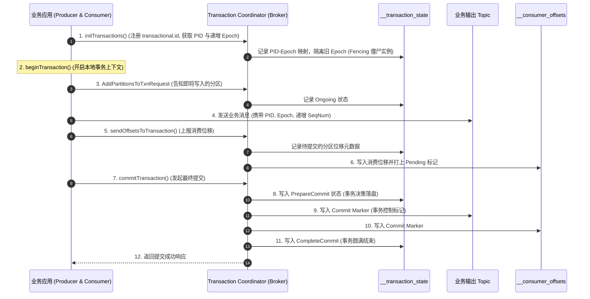

# Kafka 事务与精准一次 (EOS) 教学管道 (kafka-transaction-demo)

> 本工程面向 **数据平台研发负责人 / 大数据架构师** 岗位面试中的“全链路 Exactly-Once 实操”、“跨系统事务一致性”与“Kafka 深度故障排查”考察。  
> 通过一套完整的 **Consume-Transform-Produce（消费-清洗-生产）** 事务闭环，深入推导底层 2PC 协议、事务协调器（Transaction Coordinator）与高频面试真题。

---

## 一、业务场景与架构设计

在金融支付、资产对账与实时特征处理场景中，必须杜绝由于网络重试导致的数据重复，以及消费者 Crash 导致的数据漏处理或双写不一致：
- **上游消费**：从原始交易 Topic 拉取消息，配置 `isolation.level=read_committed`，过滤已中止事务，读取已提交事务及可见的非事务消息；
- **核心转换**：进行严格的防重审计与数据规整；
- **下游生产与位移提交原子绑定**：使用 `producer.sendOffsetsToTransaction(offsets, groupMetadata)`，将**输出 Topic 的消息写入**与**输入 Topic 的位移提交**绑定在同一个两阶段提交（2PC）事务中；
- **重平衡防御**：配置 `CooperativeStickyAssignor`（协作粘性重平衡）与 `SafeRebalanceListener`，减少不必要的分区撤销；事务提交与撤销处理仍需正确实现。

---

## 二、源码工程目录结构

```text
kafka-transaction-demo/
├── pom.xml                                   # 模块 Maven 依赖 (Kafka 3.7+ 客户端)
├── src/
│   ├── main/
│   │   └── java/com/tech/interview/kafka/
│   │       ├── KafkaTransactionalApp.java    # 管道服务启动主类 (含优雅停机 Hook)
│   │       ├── model/
│   │       │   └── TransactionRecord.java    # 金融交易明细 POJO 实体
│   │       ├── listener/
│   │       │   └── SafeRebalanceListener.java# 生产级重平衡监听器 (分区撤销拦截)
│   │       └── service/
│   │           └── TransactionalPipelineService.java # 核心 Consume-Transform-Produce 事务实现
│   └── test/
│       └── java/com/tech/interview/kafka/
│           └── TransactionalPipelineTest.java# 核心配置与状态流转单元测试
└── README.md                                 # 架构推导与大厂真题应答手册
```

---

## 三、代码核心机制与底层原理深度剖析

### 1. Kafka 端到端 Exactly-Once (EOS) 2PC 完整时序流转



### 2. 核心底层机制要点（面试答题杀手锏）：
- **僵尸实例隔离（Zombie Fencing）**：同一 `transactional.id` 的新实例完成初始化后，旧实例的身份可能已被隔离；旧实例恢复请求时会遭遇 fencing 等致命错误，应终止旧实例。单纯发生 GC 暂停或断网不意味着 epoch 必然已经变化，异常形式还需结合具体 API 与客户端版本。
- **LSO（Last Stable Offset）与水位控制**：
  - 在 `read_committed` 模式下，Consumer 最多只能拉取到 **LSO**，而不是传统的高水位（HW）。
  - 存在未结束事务时，LSO 受最早未结束事务位置限制，且不超过高水位；没有未结束事务时可推进到高水位。如果有一个长事务一直挂起，下游 Consumer 的消费进度将被阻塞在 LSO 处，这也是生产中必须严密监控**事务持续时间（transaction.timeout.ms）**的根因。
- **生产者内存缓冲区架构**：
  - Java Producer 按分区累积消息形成批次，批次预算由 `batch.size` 等配置约束；不能把不同版本或客户端的默认值混用。
  - Java Producer 的 `BufferPool` 复用批次缓冲区；不能把它泛称为堆外内存池。应结合具体客户端版本检查分配与内存预算。

---

## 四、高频互联网大厂真题与三层应答示范

### Q1：开启幂等或 Kafka 事务之后，业务重试还会重复吗？
- **简洁回答**：会。幂等发送约束生产协议重试，Kafka 事务协调其边界内的消息及位点；重新提交相同业务请求仍需稳定业务 ID 和业务去重。
- **深入回答**：Kafka 用生产者身份、epoch 与分区序列协调重试和旧实例隔离。稳定的 `transactional.id` 支持事务恢复及 fencing，但不会自动比较业务负载。Consume-Transform-Produce 应把输出记录和输入位点放入同一事务；外部数据库需自己的事务或幂等机制。
- **架构师/管理视角**：先明确一致性边界，再选择普通幂等生产、Kafka 事务或外部数据库去重。事务延迟取决于批次、网络和副本确认，不能套用未经测量的固定百分比。[生产者配置](https://kafka.apache.org/41/configuration/producer-configs/)

### Q2：Kafka 消费者发生 Rebalance 时，为什么容易出现大量重复消费？新版本 Cooperative Sticky 机制是如何优化的？
- **简洁回答**：传统 Eager Rebalance 要求所有消费者先全量注销（Revoke）已持有的分区，引发全组 Stop-The-World；若在此期间未提交位移，新分配的节点将从上次 Commit 点重复拉取。Cooperative Sticky（协作粘性）采用两阶段渐进式重平衡，未受影响的分区全程不停机，仅剥夺迁移变动的分区，将重复与抖动降到最低。
- **深入回答**：传统 Eager 协议下，只要组内有一台机器闪断，所有正常消费者必须停止消费并全部重新加入组。如果单批处理时间长且业务处理后才提交位移，全量重新分配会导致大量已处理但未提交的消息被重新消费。CooperativeStickyAssignor 引入了协作机制：第一轮只协商需要迁移的分区集合并精准剥夺（其余分区继续消费）；第二轮仅把剥夺的分区分配给新节点。
- **架构师/管理视角**：结合客户端与消费组协议选择分配策略；使用协作式分配时验证渐进撤销行为。事务管道的位点要与输出一起提交，不能在撤销回调中随意独立提交。根据最长处理时间设置 poll 预算，并对慢 SQL、远端调用和重试设置上限。

## 五、真实故障实验入口

[Kafka 故障实验](../kafka-fault-lab/README.md)独立验证三节点 Leader 强杀、节点网络隔离、多数派丢失、外部数据库提交间隙与事务可见性。它没有运行本 Java 管道，不能将其结果当作本模块端到端事务测试已通过的证据。
