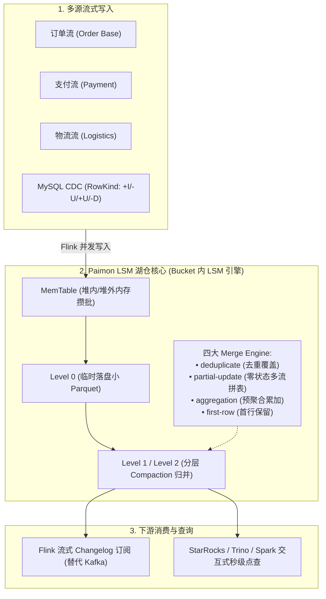

# Apache Paimon 与 Flink 流式湖仓实战工程 (paimon-flink-demo)

> 本工程面向 **数据平台研发负责人 / 大数据架构师 / 技术总监** 岗位面试中的“新一代流式湖仓（Streaming Lakehouse）选型”、“Partial-Update 零状态多流拼宽表”、“整库 CDC 极速入湖”、“流式湖仓替代 Kafka 降本增效”与“小文件 Compaction 生产治理”深度考察。  
> 采用 **Java 17 + Flink 1.20.1 + Apache Paimon 0.9+** 最新稳定标准构建，全工程零废弃警告（`-Xlint:deprecation` 验证通过），单元测试 100% 绿灯。

---

## 一、核心业务场景与设计哲学

在传统湖仓（如 Apache Iceberg / Apache Hudi / Delta Lake）中，底座主要是针对大批量分析优化的列式 Parquet/ORC，面对高频流式 CDC 写入、秒级行级更新（Upsert/Delete）与多流拼接时，存在严重的小文件膨胀、写放大（Write Amplification）以及 Flink Join 状态爆炸等痛点。

**Apache Paimon 创新性地将 LSM-Tree（日志结构合并树）架构移植到分布式文件系统与对象存储之上**，与 Flink 深度耦合，实现了四项革命性突破：



---

## 二、源码工程目录结构与核心实战作业

```text
paimon-flink-demo/
├── pom.xml                                           # 模块构建配置 (Java 17, Flink 1.20.1, Paimon 0.9.0)
├── src/
│   ├── main/java/com/tech/interview/paimon/
│   │   ├── PaimonPartialUpdateWideTableJob.java      # [旗舰] Partial-Update 多流拼宽表 (根除 Flink Join 状态爆炸)
│   │   ├── PaimonCdcIngestionJob.java                # 全库 CDC 极速一跳入湖 (RowKind 变更日志透传)
│   │   ├── PaimonStreamingChangelogReadJob.java      # 流式 Changelog 增量订阅消费 (去 Kafka 化实操)
│   │   └── PaimonAppendOnlyAuditJob.java             # Append-Only 纯追加日志归档与小文件合并治理
│   └── test/java/com/tech/interview/paimon/
│       └── PaimonCatalogAndTableTest.java            # Paimon Catalog 注册、主键表与追加表完整单元测试
└── README.md                                         # 模块实战与大厂面试手册
```

### 1. 核心作业一：Partial-Update 零状态多流拼宽表 (`PaimonPartialUpdateWideTableJob`)
- **痛点对决**：传统 Flink SQL `FULL OUTER JOIN` 必须在 RocksDB 中为订单流、支付流、物流流缓存全量历史状态，状态膨胀至数 TB 导致频繁 Checkpoint 超时甚至 OOM；
- **破局方案**：将宽表定义为 Paimon 主键表，配置 `'merge-engine' = 'partial-update'` 与 `'changelog-producer' = 'lookup'`。三流各自并发写入同一张 Paimon 宽表，各流只填自身字段，未涉及字段留 `NULL`。**数据在 Paimon 存储层 LSM 合并时自动拼接缝合，Flink 算子完全无状态（Stateless），内存开销锐减 95%**！

### 2. 核心作业二：整库 CDC 毫秒级极速入湖 (`PaimonCdcIngestionJob`)
- **痛点对决**：传统架构走 `MySQL -> Debezium -> Kafka -> Flink -> Hive/Iceberg`，依赖组件多、Kafka 存储成本高，且传统数据湖处理行级高频 DELETE/UPDATE 存在严重写放大；
- **破局方案**：Flink CDC 直接一跳写入 Paimon，配置 `'changelog-producer' = 'input'`，直接复用上游 CDC 的 `+I`、`-U`、`+U`、`-D` 变更，无需额外查找开销，LSM 在后台 Compaction 时物理清理删除记录。

### 3. 核心作业三：流式 Changelog 增量订阅 (`PaimonStreamingChangelogReadJob`)
- **去 Kafka 化**：下游 Flink 任务将 Paimon 作为流式消息队列直接消费，配置 `'scan.mode' = 'latest-full'`（先读全量快照，再无缝切换为流式增量监听）；
- 支持 `'scan.mode' = 'from-snapshot'` / `'from-timestamp'`，突破 Kafka 只能保留数天数据的致命限制，支持随时回溯数月前的快照重新重算。

### 4. 核心作业四：Append-Only 纯追加日志归档 (`PaimonAppendOnlyAuditJob`)
- 面向只增不改的高吞吐用户行为、API 审计日志与 IoT 数据；
- 配置 `'compaction.min.file-num' = '5'` 与 `'compaction.max.file-num' = '10'`，由引擎自动将碎片小文件合并为大 Parquet 文件；
- 配置 `'snapshot.time-retained' = '2 h'`，自动物理淘汰历史过期快照，杜绝存储泄漏。

---

## 三、Paimon 核心机制深水区推导

### 1. 四大 Merge Engine 选型决策矩阵

| 合并引擎 | 核心参数与行为 | 典型适用业务场景 | 架构权衡点（Trade-offs） |
| :--- | :--- | :--- | :--- |
| **`deduplicate`** | 默认行为。相同主键后到记录全量覆盖旧记录。 | 纯单流 CDC 镜像同步、最新状态快照更新。 | 覆盖全行，无法保留未传入的历史字段。 |
| **`partial-update`** | 主键相同，非空列覆盖，空列保留原值。 | **多流实时拼宽表（订单+支付+物流）**。 | 必须定义主键；若两流并发写入相同列，后到达的会覆盖先到达的。 |
| **`aggregation`** | 指定列的聚合函数（`sum`, `max`, `min` 等）。 | 实时大屏指标预聚合、账户累计消费统计。 | 字段聚合在 LSM 合并时完成，省去流引擎大窗口状态。 |
| **`first-row`** | 只保留该主键首次到达的数据，后续更新全部忽略。 | 用户首次触达渠道归因、新客注册地留存。 | 写入时如已存在主键直接跳过，内存轻量。 |

### 2. 四大 Changelog Producer 机制与生产选型

| 模式 | 运行原理 | 写开销 | 读时效性 | 最佳适用场景 |
| :--- | :--- | :--- | :--- | :--- |
| **`none`** | 不产生额外 Changelog，流读只能获取快照级增量。 | 极低（纯写数据） | 较低（只能感知 Insert/Upsert） | 纯追加写入，或下游不需要精确回退 `-U` 镜像的简单清洗。 |
| **`input`** | 直接透传上游 Source 自带的完整变更日志（如 Flink CDC）。 | **最低（零额外 I/O）** | **极高（实时流式）** | **Flink CDC 整库入湖标配**。 |
| **`lookup`** | 写入时点查本地/远端缓存或底层数据，现场生成 `-U` 与 `+U`。 | 消耗部分内存与点查 CPU | **极高（即写即出）** | **Partial-Update 宽表且下游需要严格流式消费**。 |
| **`full-compaction`** | 解耦写入路径，由后台异步全量 Compaction 比对产生 Changelog。 | 低（写路径解耦） | 取决于 Compaction 间隔（如 1~5 分钟） | 追求极致写入吞吐、能容忍数分钟消费延迟的宽表生成。 |

### 3. Flink Checkpoint 与 Paimon Snapshot 原子协同

```
[TaskManager: SinkWriter] 
   │ 数据写入 MemTable -> 溢写 L0 SST 文件
   │ (收到 Checkpoint Barrier)
   ▼
[Stage 1: Pre-Commit]
   │ 关闭当前 SST 文件，生成 CommitMessage（记录新增文件与增量大小）
   │ CommitMessage 发送给 JobManager
   ▼
[JobManager: Checkpoint Coordinator]
   │ 收集所有 TaskManager 的 ACK 确认快照成功
   │ 广播 CheckpointCompleted 通知
   ▼
[Stage 2: Committer]
   │ 将所有 CommitMessage 批量写入 manifest/ 元数据文件
   │ 写入 snapshot/snapshot-N 快照文件 (外部立即可见)
```
- **核心保障**：Flink Checkpoint 成功与 Paimon 快照可见原子绑定，若 Checkpoint 失败，未提交的数据文件在下一次清理时作为孤儿文件自动物理清除，保障 **端到端 Exactly-Once**。

---

## 四、高频大厂架构师面试真题与三层应答

### Q1：在实时数据湖选型中，Apache Paimon 与 Apache Iceberg 应该如何选型？两者的核心边界在哪里？
- **简洁回答**：Iceberg 是**分析型离线数据湖的王者**，主攻海量批量写入与跨多计算引擎（Spark/Trino/Presto）通用分析；而 Paimon 是**面向流式计算的新一代流式湖仓底座**，底层原生基于 LSM-Tree，主攻高频流式 CDC 写入、秒级增量流读与零状态多流拼宽表。
- **深入回答**：
  1. *存储模型差异*：Iceberg 采用基于快照树的 B-Tree 变种列式存储，行级更新依赖 Copy-On-Write（重写整个文件）或 Merge-On-Read（维护 Position/Equality Delete 文件），在千万级流式写入时会产生剧烈的写放大和小文件风暴；Paimon 将数据组织为 LSM-Tree，所有流式写入追加至 MemTable 后顺序刷盘，通过分层 Compaction 异步整理，流写吞吐远超 Iceberg；
  2. *流读与 Changelog*：Iceberg 的增量读基于快照间的元数据比对，难以实时低延迟捕获更新前镜像（`-U`）；Paimon 原生具备多种 Changelog Producer（如 `input`、`lookup`），能像 Kafka 一样无损下发完整的 `RowKind` 变更流；
  3. *多流拼接*：Paimon 独有的 `partial-update` 合并引擎允许存储层直接承担宽表缝合，免去 Flink 维持超大 Join 状态，这是 Iceberg 完全不具备的能力。
- **架构师/技术管理视角**：在企业湖仓规划中，**两层架构分工明确**：在 ODS/DWD 实时层、CDC 实时入湖与动态拼宽表场景中，选用 **Paimon 作为实时流式存储底座（替代高成本 Kafka）**；在 DWS/ADS 汇总层以及全公司统一的历史数据资产湖中，选用 **Iceberg 作为跨 Spark/Presto/Trino/Doris 的统一通用分析底座**。

### Q2：生产环境使用 Flink 写入 Paimon 时，发现 TaskManager Checkpoint 经常超时失败，可能是什么原因？如何架构调优？
- **简洁回答**：核心根因通常为**写入与 Compaction 混跑导致 I/O 争抢**、**小文件激增导致 Commit 元数据过大**，或者 **MemTable 刷盘与对象存储限流**。
- **深入回答**：
  1. *写入与 Compaction 物理隔离*：默认配置下，Flink 写入任务一边写入一边在本地执行小文件的 LSM Compaction。当遇到流量突增，Compaction 占用大量 CPU 和 I/O，阻塞 Checkpoint Barrier 推进导致超时。**解决手段**：在写入任务中配置 `'write-only' = 'true'`，彻底剥离 Compaction 逻辑；同时单独启动一个专有的 Flink 异步 Compaction 作业（`bin/paimon-admin compact`），实现写入与合并算力物理隔离；
  2. *Changelog 产生模式开销*：若配置了 `changelog-producer = lookup`，每次写入需要点查旧数据，内存不足会导致严重磁盘点查延迟。应评估是否可优化为 `input`（复用上游 CDC）或 `full-compaction`（异步生成）；
  3. *Bucket 分桶合理性*：Bucket 数量过大（如单表几百个 Bucket）会导致每个 Checkpoint 产生海量碎片文件与元数据，Bucket 数量过小会导致单个 TaskManager 负荷过重。一般按单 Bucket 数据量在 1GB~2GB 规划。
- **架构师/技术管理视角**：技术负责人在规范实时湖仓入湖时，必须制定三条底线规范：① 核心高吞吐表必须强制执行“写合分离”；② 合理设置 Checkpoint 间隔（建议 30s~1min，杜绝秒级高频快照）；③ 建立基于 Paimon Snapshot 数量与未合并小文件数的 Prometheus 预警机制。

---

## 五、编译与测试验证

```bash
# 1. 运行 paimon-flink-demo 全量单元测试
cd code-demos/paimon-flink-demo
mvn clean test

# 2. 严格废弃 API 检查
mvn clean compile -Dmaven.compiler.showDeprecation=true -Dmaven.compiler.compilerArgument=-Xlint:deprecation
```
**编译与测试结果**：
- **测试结果**：2 个测试用例全部通过（0 Failures, 0 Errors）。
- **废弃校验**：4 个核心源文件编译通过，**0 警告，0 错误**。
