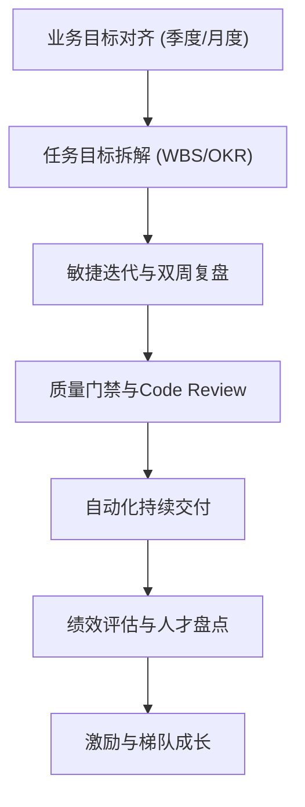

# 管理主题名称

> **管理维度定位**：本模块聚焦技术管理岗（研发经理/技术总监/数据平台负责人）在团队建设、人员激励、研发过程控制与业务协同中的管理方法论与实操抓手。

---

## 1. 管理场景与核心目标

### 1.1 核心痛点与业务诉求
- 业务面临的典型管理困境（如团队产出低、人员流失率高、需求堆积延期、代码质量劣化）。
- 技术管理者的核心破局目标。

### 1.2 管理者的定位转变
- 从“个人技术贡献者（IC）”向“团队赋能者与业务伙伴”的思维升维。
- “抓战略、带队伍、拿结果、建体系”的落地承接。

---

## 2. 核心管理模型与机制

### 2.1 理论框架与管理模型
- 行业主流管理模型（如 OKR/KPI、敏捷精益、GROW教练模型、情境领导力模型）。
- 结合中国企业研发实际的裁剪与改良。

### 2.2 机制设计与流程图

---

## 3. 标准落地实操规范（SOP与工具链）

### 3.1 关键动作与制度规范
1. **输入与准入标准**：清晰的准入原则（如需求评审三方确认机制）。
2. **过程跟踪与节奏把控**：站会、周会、技术方案评审委员会机制。
3. **交付与复盘闭环**：线上故障复盘（Blameless Postmortem）、双周效能看板。

### 3.2 工具链与度量指标（Data-Driven）
| 管理维度 | 核心度量指标 | 采集工具/平台 | 警戒线/基线标准 |
| :--- | :--- | :--- | :--- |
| **研发效能** | 需求交付周期（Lead Time）、发布频次 | Jira / Gitlab | 需求周转天数减少 25% |
| **工程质量** | 千行代码缺陷率、线上故障数（P0-P3） | SonarQube / Sentry | 线上严重故障零发生 |
| **团队活跃** | Code Review 覆盖率、单元测试覆盖率 | Gitlab / CI Pipeline | CR覆盖率 100%，核心逻辑单测 > 70% |

---

## 4. 常见管理挑战与冲突化解

### 4.1 典型矛盾场景
- **业务需求狂奔 vs 技术重构/技术债务治理**：如何向业务与高管争取重构资源？
- **刺头员工 / 低绩效员工的沟通与淘汰**：PIP（绩效改进计划）合规与人性化处理。
- **跨部门协同推诿（产品、测试、数据、运维）**：如何建立跨部门契约与协同接口？

### 4.2 应对策略与复盘案例
- **真实场景还原**：某次交付冲突的起因与激化。
- **管理抓手与化解招式**：分层沟通、阶段对齐、机制约束。
- **沉淀机制**：形成制度化防御机制。

---

## 5. 面试高频管理题

### 5.1 团队组建与激励题
1. **Q1**：如何为从0到1组建的新团队搭建技术梯队与制定考核标准？
2. **Q2**：团队核心骨干提出离职，且负责关键系统，你该如何处理？

### 5.2 进度与风险控制题
3. **Q3**：当项目上线时间被业务方锁死，但技术评估工作量严重超标时，你作为负责人怎么做？
4. **Q4**：如何平衡日常业务需求与技术债务重构的资源冲突？

### 5.3 跨部门与向上管理题
5. **Q5**：当业务部门反馈“大数据研发团队响应慢、提需求排期长”时，你如何破局？

---

## 6. 标准参考答案（三层维度）

### 题目：[如何平衡业务需求交付与技术债务治理？]

#### 简洁回答（1分钟结构化表达）
> “...”

#### 深入回答（管理闭环：量化、机制、沟通、兑现）
> “第一步是技术债务显性化与量化... 第二步是建立固定配额制（如20%技术改造预算）... 第三步是与业务共同设定ROI收益目标...”

#### 总监/管理视角（商业价值、长期主义与领导力）
> “从研发负责人的视角看，技术债务本质上是团队借的‘高利贷’。盲目还贷会影响业务生存，拖延不还会导致系统瘫痪。我的策略是通过数据化沟通将技术语言翻译为业务风险与成本语言...”

---

## 7. 管理行为自检清单

- [ ] 是否具备清晰的“情境领导力”运用意识？
- [ ] 能否给出量化的研发效能治理案例，而非泛泛而谈“开会沟通”？
- [ ] 面对组织压力，是否具备“向上对齐预期、横向达成共识、向下赋能兜底”的全局观？

---

## 8. 参考经典管理著作与最佳实践

1. 《人月神话》（The Mythical Man-Month）—— 软件工程与团队协作经典
2. 《高效能团队的五项障碍》（The Five Dysfunctions of a Team）
3. 《重构：改善既有代码的设计》（Refactoring）
4. Google 研发工程实践：《Software Engineering at Google》
