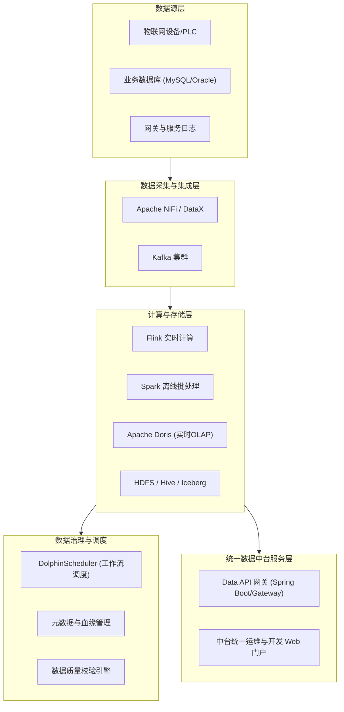

# 项目复盘：项目名称

> **项目定位**：作为面试中的核心主打案例（或备选技术攻坚案例），展现端到端的架构设计、团队管理、供应商协调及复杂项目交付验收综合能力。

---

## 1. 项目背景与业务目标 (Situation & Task)

### 1.1 业务背景与痛点
- 行业背景与客户痛点（如供热智慧化转型、数据孤岛严重、缺乏统一指标规范）。
- 为什么必须启动本项目？不做的商业代价是什么？

### 1.2 部门与团队定位
- 团队规模：管理 5~10 人研发团队（后端、前端、大数据、测试等）。
- 本人职责：部门负责人 / 总体技术架构师 / 交付项目总体负责人。

### 1.3 核心目标与考核指标
- **商业与交付目标**：交付具备独立Web交互能力的企业级数据中台产品，并通过太原大型客户正式验收。
- **技术与平台目标**：打通数据采集、离线计算、实时流处理、指标建模与统一数据服务 API，支撑高并发大屏与业务系统。

---

## 2. 总体架构设计与技术选型

### 2.1 平台全局逻辑架构图

### 2.2 核心技术栈选型与权衡决策矩阵
| 技术选型 | 入选方案 | 备选方案 | 选型权衡与决策理由（性能/成本/生态/运维复杂度） |
| :--- | :--- | :--- | :--- |
| **实时计算** | Apache Flink | Spark Streaming | 需支持毫秒级状态告警与复杂窗口计算，Flink 状态机制与低延迟表现更佳 |
| **OLAP引擎** | Apache Doris | ClickHouse / Kylin | 统一支撑明细查询与高并发聚合，运维简单（无外部依赖），支持标准 SQL 与更新 |
| **任务调度** | DolphinScheduler | Airflow / Azkaban | 分布式去中心化设计，原生支持大数据组件丰富，可视化的拖拽易用性更好 |
| **中台服务** | Spring Boot + Web | 纯开源报表套件 | 满足客户独立自主操作界面要求，需强定制化多租户权限体系与API生成器 |

---

## 3. 关键技术攻坚与深度难点 (Action - Technical)

### 3.1 难点一：[如超大规模实时流聚合与状态暴涨治理]
- **问题现象**：实时监控大屏需要每秒汇聚数十万传感器数据，RocksDB State 暴涨导致任务频繁 Checkpoint 超时失败。
- **排查与根因分析**：状态 TTL 未配置、对象序列化性能低、小文件合并滞后。
- **治理与架构重构**：
  1. 重构 Keyed State 结构，引入细粒度 TTL 清理策略。
  2. 针对聚合状态改用增量聚合 `AggregateFunction` 替代全量 `ProcessWindowFunction`。
  3. 优化 RocksDB 读写缓存分配与 Compaction 并发线程数。
- **成果收益**：Checkpoint 耗时从 45 秒下降至 2.8 秒，内存消耗降低 60%，作业零反压稳定运行。

### 3.2 难点二：[如复杂跨源异构数据血缘与质量监控自动化]
- **问题现象**：上游系统频繁表结构变更（Schema Evolution），导致下游数仓报表数据失真或断流。
- **设计与实现**：
  - 基于 SQL 语法解析器（Calcite）自研轻量血缘解析插件。
  - 接入质量校验规则链，阻断严重错误下发并触发即时告警。

---

## 4. 团队管理与项目交付攻坚 (Action - Management)

### 4.1 研发效能与敏捷流程建立
- **从0到1规范建立**：Git 分支规范（GitFlow）、代码评审机制（CR必经同级+负责人双重把关）、持续集成流水线（Jenkins/GitLab CI）。
- **技术债务与进度平衡**：设立每周五下午固定“架构优化与债务修复”半天时间，保持团队技术活力与代码健康度。

### 4.2 交付验收与跨组织协调（以太原项目为例）
- **客户需求范围控制**：面对甲方不断膨胀的定制需求，建立“需求基线变更控制委员会”，通过需求分级（MVP、增补版本）控制延期风险。
- **供应商协作管理**：协调硬件网关厂商与第三方外包开发团队，制定清晰的接口协议规范（OpenAPI/Protobuf）和联调测试用例。
- **里程碑与正式验收**：通过清晰可量化的测试报告、用户培训手册和驻场保障，一次性通过太原大数据局与客户方专家评审正式验收。

---

## 5. 项目量化成果与价值 (Result)

### 5.1 业务与商业价值
- **交付闭环**：太原项目顺利完成正式验收并全额回款。
- **产品化沉淀**：形成企业级通用标准数据中台产品，后续推广至多个同类城市，研发交付周期缩短 40% 以上。

### 5.2 技术与系统指标
- **吞吐能力**：支撑每日超 X 亿条时序与业务数据实时稳定摄入。
- **查询性能**：P95 OLAP 聚合查询延迟控制在 300ms 以内。
- **平台稳定性**：核心链路服务 SLA 达到 99.95% 以上。

---

## 6. 面试深度追问与结构化应答 (Learning & Interview Q&A)

### 追问1：如果重新做这个中台，你会推翻哪些早期的架构决策？（反思与升华）
> **参考回答**：
> “回顾整个从0到1的过程，如果重新来过，我会在早期更早引入‘湖仓一体（Iceberg/Paimon）’技术。早期为了快速上线，我们将实时链路和离线分层存储割裂开（实时走 Doris/Kafka，离线走 Hive/HDFS），导致存在一定程度的计算逻辑重复和存储冗余。若采用现代湖仓架构，能实现更低成本的流批统一建模...”

### 追问2：你在太原项目中，面对客户现场临时变更核心需求且工期锁死时，作为总负责人你是怎么拍板的？
> **参考回答**：
> “首先，绝不机械拒绝客户，也不盲目口头承诺。我的三步决策法是：
> 1. **澄清业务本质**：深入了解客户提出该变更背后的真正核心目标（通常表面提的是复杂功能，实质是解决某一个特定领导视察或报表口径问题）。
> 2. **方案降维置换**：提出‘第一期用现有中台 API 快速配置实现核心视图，确保上线里程碑不延误；第二期迭代上线深度自动化能力’。
> 3. **形成正式纪要与风险书面确认**：拉齐客户负责人、业务方共同签署变更确认单，保障团队交付合法合规...”

---

## 7. 个人管理与领导力沉淀自检清单

- [ ] 是否清晰掌握了从 0 到 1 组建团队的梯队搭建配比？
- [ ] 能否以数据中台为核心，自然流畅地在白板上画出完整的数据流转拓扑？
- [ ] 能否深刻说出在不同公司（民企/上市公司/外企如思科、Zoom）中工程文化的差异与取舍心得？
