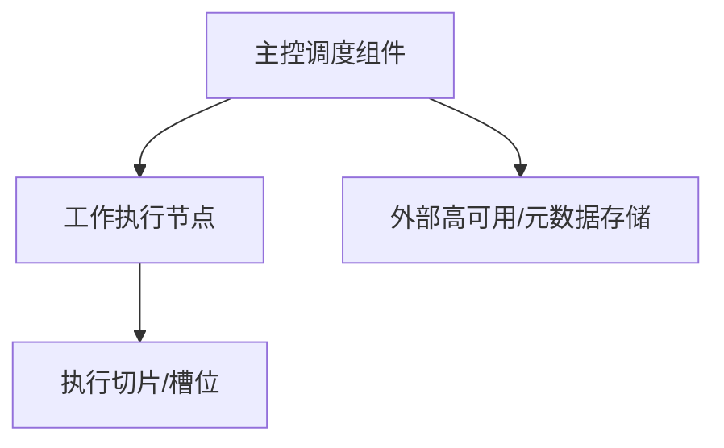
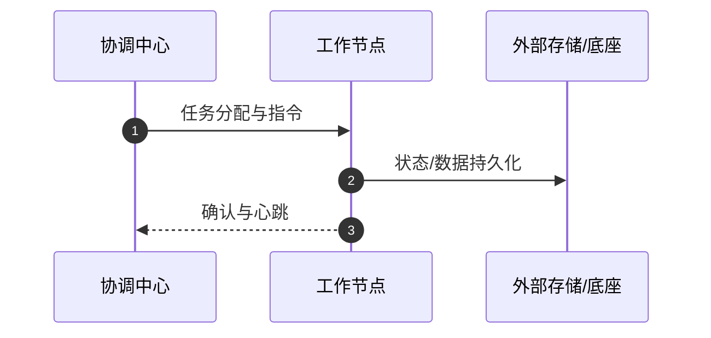
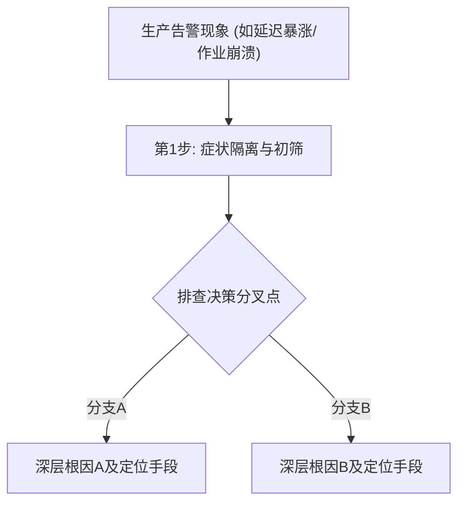
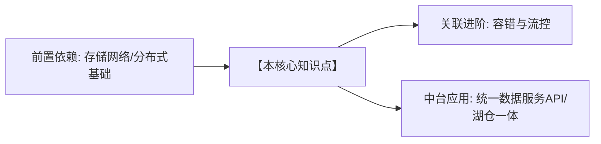

# 知识点名称

> **学习目标定位**：面向技术总监、数据平台研发负责人、高级数据架构师岗位，系统掌握核心技术的底层设计哲学、系统交互机制、高频业务落地场景与全链路生产异常排查体系。结合互联网大厂高频真题，建立架构权衡、成本ROI与技术管理维度的降维表达能力。

---

## 1. 知识概述与业务价值

### 1.1 是什么（What）
- 技术定义与本质特征。
- 最新技术演进（如当前业界主流版本 Flink 1.19 / 1.20 / 2.0 趋势）。

### 1.2 解决什么核心业务痛点（Why）
- 传统架构痛点与瓶颈。
- 引入该技术为企业和业务带来的核心商业与技术价值。

### 1.3 适用场景与技术边界（Where & When）
- 最佳业务场景矩阵（时效性、吞吐量、状态复杂度要求）。
- 明确反模式与不适用边界（什么场景严禁使用）。

---

## 2. 核心概念与关系

### 2.1 核心概念全景表
| 概念名称 | 英文术语 | 核心定义与工程职责 | 资源/生命周期级别 |
| :--- | :--- | :--- | :--- |
| 概念A | Concept A | 职责与协作机制... | 集群级 / 作业级 |
| 概念B | Concept B | 职责与协作机制... | 线程级 / 内存切片 |

### 2.2 系统拓扑与交互关系图


---

## 3. 底层工作机制与设计哲学

### 3.1 核心运行流程与状态机流转
- 调度、计算、通信或容错的全链路底层机制推导。
- 深入拆解内部协议、流转阶段与交互细节。

### 3.2 机制交互时序图（Mermaid）


### 3.3 架构设计思想与演进权衡
- 为什么这样设计？它在延迟、吞吐、一致性与容错之间做了怎样的权衡？
- 最新版本（如 Flink 1.19+ / 2.0）在该机制上的前沿演进与架构革新。

---

## 4. 高频复杂业务场景实操与落地

### 4.1 生产典型业务场景拓扑
- 真实大厂/企业级场景设计（如万亿级数据管道、实时对账、大促大屏、复杂规则匹配）。
- 完整的数据流向、计算拓扑与落盘方案。

### 4.2 生产级配置基线与参数推荐
```properties
# 关键生产参数推荐，附带技术经理维度的配置考量
cluster.resource.allocation: dynamic # 动态按需分配
state.backend.tuning: aggressive    # 高性能状态调优
```

### 4.3 核心性能指标监控（SLA 黄金指标）
- 吞吐量（TPS）、反压时间比例、端到端处理延迟（P99/P95）、GC 暂停时间。
- 技术管理者需紧盯的核心报警阈值。

---

## 5. 生产异常故障深度排查与根因分析

### 5.1 典型生产事故与异常排查树


### 5.2 核心异常场景实战复盘
- **场景一：性能瓶颈与级联反压雪崩**
  - **现象**：...
  - **根因分析**：...
  - **快速止血与根治策略**：...
- **场景二：数据倾斜与长尾节点拖垮全局**
  - **现象与排查**：...
  - **解决方案**：双重加盐、动态切分、本地预聚合。
- **场景三：内存溢出（OOM）、死锁或外部超时崩溃**
  - **现象与定位**：...
  - **防御性治理**：...

---

## 6. 技术选型对比、架构演进与成本ROI

### 6.1 横向多维选型对比矩阵
| 评估维度 | 本方案（如 Flink） | 竞品方案 A（如 Spark Streaming） | 竞品方案 B（如 Ray / 传统MQ） |
| :--- | :--- | :--- | :--- |
| **计算延迟** | 毫秒级 / 亚毫秒级 | 百毫秒 ~ 秒级 | 毫秒级 |
| **吞吐能力** | 极高 | 极高 | 中高 |
| **状态一致性** | 极强（原生快照容错） | 强（微批容错） | 依赖外部存储 |
| **硬件成本** | 较高（长驻内存需求） | 适中（动态批量分配） | 适中 |
| **运维门槛** | 较高（需深入调优） | 中等 | 较高 |

### 6.2 架构师技术选型决策树
- 针对不同的数据体量、延迟容忍度、团队技术栈分布给出清晰的选型决策逻辑。
- **成本与 ROI 考量**：硬件服务器预算、网络带宽开销、团队运维与学习成本综合分析。

---

## 7. 技术经理与架构师实战管控（SOP与规范）

### 7.1 平台级多租户与资源隔离机制
- 如何防止“吵闹邻居（Noisy Neighbors）”影响核心业务 SLA？
- 物理集群隔离 vs 逻辑资源池隔离的权衡与落地方案。

### 7.2 生产变更红线与降级容灾预案（SOP）
- **变更红线**：禁止在业务高峰期动态调整拓扑并发或执行未经验证的 Savepoint 恢复。
- **降级预案**：流量突增超过容量上限时的削峰、采样、丢弃旁路预案设计。
- **代码与SQL门禁**：防范无界状态、缺失 TTL、全表 Join 的自动化审查规范。

---

## 8. 互联网大厂高频面试真题库

### 8.1 基础概念与机制题（大厂基础轮必考）
1. **Q1**：[高频题目]
2. **Q2**：[高频题目]

### 8.2 核心底层原理深度题（二面/三面技术深挖）
3. **Q3**：[深挖内部机制与交互设计思想]
4. **Q4**：[深挖一致性保障与资源调度瓶颈]

### 8.3 复杂生产场景与故障排障题（大厂交叉面/场景实操题）
5. **Q5**：[大促场景千万级流量脉冲下的稳定性保障]
6. **Q6**：[千亿级数据倾斜导致的作业卡死排查实操]

### 8.4 架构设计与系统规划题（技术总监/总架构师必考）
7. **Q7**：[从0到1构建高可用、跨机房容灾的大数据实时平台架构设计]

---

## 9. 结构化深度参考答案（三层应答模型）

### 题目1：[大厂核心真题]

#### 简洁回答（1分钟电梯破题，抓住核心痛点与结论）
> “...”

#### 深入回答（技术深度展开，层层递进，机制推导与边界条件）
> “从底层机制看，主要由三个关键环节协同保障：首先... 其次... 最后...”

#### 架构师/技术管理视角（降维升华：权衡取舍、成本ROI、团队管控与SLA）
> “在技术管理和架构决策中，作为技术负责人，我更看重... 我们在数据中台落地时，采取了‘在...层面做硬隔离，在...层面做软协同’的折中方案，既保障了 P0 链路 99.99% 的 SLA，又将整体服务器成本降低了 30%...”

---

## 10. 知识自检与口述推演清单

- [ ] 能否脱稿在白板上画出系统核心架构交互全景图与关键时序？
- [ ] 能否系统说出生产出现“严重延迟暴涨”时的三步黄金排查路径？
- [ ] 能否站在技术总监视角，向非技术业务方讲清该架构选型的商业价值与成本优势？
- [ ] 能否准确指出最新版本（Flink 1.19+/2.0）带来的核心架构升级点？

---

## 11. 知识脉络与技术图谱关联



---

## 12. 权威参考与官方进阶资料

1. **官方最新文档**：[Apache Flink Official Documentation (v1.19 / 1.20)](https://nightlies.apache.org/flink/flink-docs-release-1.19/)
2. **核心 FLIP 架构改进提案**：相关技术演进提案链接
3. **顶会经典论文与权威白皮书**
