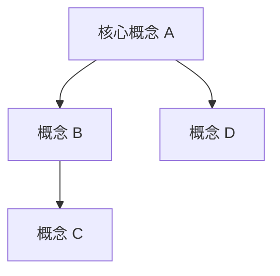
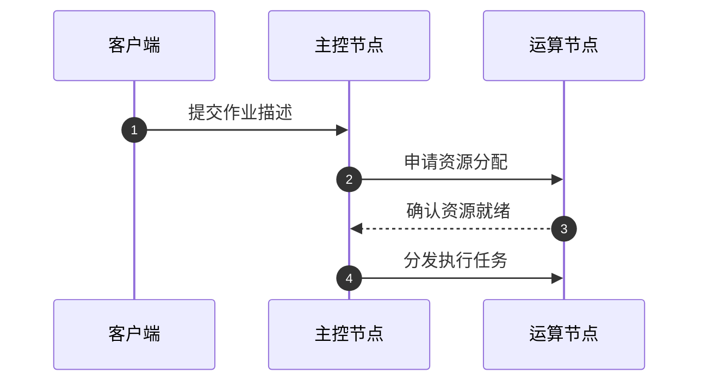
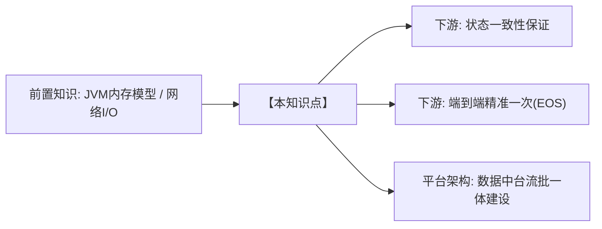

# 知识点名称

> **学习目标定位**：明确本知识点在技术管理/架构师面试中的考察维度与能力深度要求。

---

## 1. 知识概述

### 1.1 是什么（What）
- 简明扼要的技术定义（1-2句话）。
- 核心技术演进历史与当前主流版本。

### 1.2 解决什么问题（Why）
- 该技术/组件出现前行业面临的核心痛点。
- 相比传统方案带来的革命性改进。

### 1.3 适用场景与边界（Where & When）
- 典型应用场景列表。
- 不适用/反模式场景。

---

## 2. 核心概念与关系

### 2.1 核心术语定义
| 术语名称 | 英文对应 | 核心定义与职责 | 关键生命周期/范围 |
| :--- | :--- | :--- | :--- |
| 概念A | Concept A | 职责描述... | 运行时/集群级... |
| 概念B | Concept B | 职责描述... | 任务级/线程级... |

### 2.2 概念关系图


---

## 3. 底层原理

### 3.1 核心工作机制
- 深度拆解运行时生命周期、数据流动通道、状态流转。
- 内部调度机制/协商协议/通信协议。

### 3.2 机制图解（Mermaid流程图/时序图/架构图）


### 3.3 状态流转与边界条件
- 异常场景、网络抖动、节点宕机时的状态自愈逻辑。
- 关键参数控制逻辑（如超时重试、心跳检测）。

---

## 4. 核心实现与源码分析

> [!IMPORTANT]
> 必须基于明确的开源版本（如 Flink 1.17.2）。标明具体类路径、核心方法及数据结构，杜绝凭空编造。

### 4.1 关键算法与数据结构
- 核心数据结构解析（如内存段 `MemorySegment`、图节点 `ExecutionVertex` 等）。
- 核心算法逻辑（如流水线拓扑切分、一致性哈希、调度拓扑排序）。

### 4.2 核心源码类与路径清单
| 角色/模块 | 核心类名 | 源码相对路径 | 关键入口方法 | 核心职责 |
| :--- | :--- | :--- | :--- | :--- |
| 调度核心 | `DefaultScheduler` | `flink-runtime/.../scheduler` | `allocateSlotsAndDeploy()` | 槽位申请与任务部署 |
| 资源管理 | `ResourceManager` | `flink-runtime/.../resourcemanager` | `declareResourceRequirement()` | 动态槽位协商 |

### 4.3 核心实现流程剖析
```text
[调用链代码骨架与核心逻辑说明]
1. 入口方法触发
2. 校验前置条件
3. 状态转换与持久化
4. 下游通知与异步回调
```

---

## 5. 工程实践与落地

### 5.1 生产级配置推荐
```properties
# 生产推荐配置项，必须附带详细参数意义及调优理由
cluster.thread-pool.size: 16 # 说明配置依据（如CPU核数相关）
memory.managed.fraction: 0.4 # 内存占比建议与原因
```

### 5.2 核心代码示例（生产规范）
```java
// 生产可用的最小实现，带有严格的资源管理与异常处理
public class ProductionExample {
    public static void main(String[] args) throws Exception {
        // 核心逻辑
    }
}
```

### 5.3 监控指标与运维实践
- **核心指标（Metrics）**：GC耗时、吞吐量（TPS）、反压（Backpressure）、处理延迟。
- **告警阈值设定**：针对技术管理者关注的 SLA 告警水位设定。

---

## 6. 常见生产问题与排查指南

### 6.1 性能瓶颈与调优
- **现象描述**：CPU被打满/吞吐上不去/长尾延迟。
- **排查路径**：Thread Dump、Flame Graph 火焰图、堆外内存排查。
- **治理策略**：参数微调、拓扑重组、链路精简。

### 6.2 数据倾斜（Data Skew）
- **触发根因**：Key 分布不均、热点广播。
- **生产解决手段**：加盐（Salt）、两阶段聚合、重构分区策略。

### 6.3 内存泄漏与 OOM 排查
- **排查工具与方法**：JProfiler / MAT / Core Dump 分析。
- **防御机制**：内存隔离、DirectBuffer 限制。

### 6.4 容错故障与数据一致性
- 数据丢失与数据重复的边界场景。
- 端到端精准一次（Exactly-Once）如何闭环。

---

## 7. 技术选型对比与取舍

### 7.1 横向对比矩阵
| 评估维度 | 本技术（如 Flink） | 竞品A（如 Spark Streaming） | 竞品B（如 Storm） |
| :--- | :--- | :--- | :--- |
| **计算模型** | 原生流（Event-driven） | 微批处理（Micro-batch） | 纯流处理 |
| **延迟级别** | 亚秒级/毫秒级 | 百毫秒~秒级 | 亚秒级 |
| **状态成熟度** | 极其完善（RocksDB/内存） | Checkpoint机制成熟 | 状态支持较弱 |
| **生态成熟度** | 丰富，湖仓一体核心 | 批流一体，生态极其庞大 | 逐步边缘化 |
| **运维复杂度** | 中高 | 中 | 低 |

### 7.2 架构师选型决策树
- 当业务需要 `< 100ms` 延迟且具备复杂事件驱动/状态计算时：首选本方案。
- 当团队已有完善批处理体系且延迟容忍度在秒级以上时：优先选择竞品A。
- **成本与团队技能考量**：综合运维人力与硬件资源算力成本。

---

## 8. 面试高频问题

### 8.1 基础题
1. **Q1**：[基础概念题]
2. **Q2**：[生命周期/基础配置题]
3. **Q3**：[常用API与语义题]

### 8.2 原理题
1. **Q4**：[底层调度/内存/容错机制深挖]
2. **Q5**：[协议交互/源码类流转细节]
3. **Q6**：[并发模型与资源隔离实现]

### 8.3 场景题
1. **Q7**：[万亿级数据下的延迟激增排查应对]
2. **Q8**：[大促场景下作业频繁重启且恢复缓慢的解决思路]
3. **Q9**：[跨DC/跨集群容灾同步与一致性保障]

### 8.4 架构设计题
1. **Q10**：[从0到1构建高可用、多租户的流式计算平台整体架构设计]

---

## 9. 标准参考答案

### 题目1：[以核心原理题为例]

#### 简洁回答（1分钟电梯沟通，抓住核心）
> “...”

#### 深入回答（技术细节展开，层层递进，体现源码深度）
> “从底层实现来看，分为三个关键阶段：...”

#### 架构师视角（升华维度：可靠性、成本、权衡取舍、管理落地）
> “在实际技术选型和平台建设中，作为技术负责人，我不单看吞吐参数，更需要综合考虑集群资源的隔离成本、多租户配额分配以及对下游业务的 SLA 承诺...”

---

## 10. 知识自检清单

- [ ] 能否不看文档，默写出作业提交到运行的完整核心组件拓扑？
- [ ] 能否清楚指出核心类的作用并在白板上画出时序图？
- [ ] 能否给出生产环境高频 OOM 的标准三步排查法？
- [ ] 能否用1分钟语言向业务方和技术总监讲清楚该技术的本质优势与成本？

---

## 11. 知识脉络与上下游关联



- **前置依赖**：`03-java-engineering/...`
- **延展进阶**：`01-bigdata/...`
- **中台应用**：`02-data-platform/...`

---

## 12. 权威参考资料与原始出处

1. **官方官方文档**：[Apache Flink Official Documentation (v1.17)](https://nightlies.apache.org/flink/flink-docs-release-1.17/)
2. **GitHub核心代码库**：[apache/flink @ GitHub](https://github.com/apache/flink)
3. **原始设计文档（FLIP）**：[FLIP-53: Fine-grained Slot Management](https://cwiki.apache.org/confluence/display/FLINK/FLIP-53)
4. **技术论文**：*State Management in Apache Flink: Consistent Stateful Distributed Stream Processing*
